# Core UFLx language definition

This note describes the smallest core language behind UFLx. The note leaves
out implementation details, compiler algorithms and broad redesign ideas.
The library classes of the examples and further worked examples are in
[examples/index.md](examples/index.md). The note assumes knowledge of differential
geometry and functional analysis, and explains some advanced concepts of
differential geometry in more detail.

This document is written for users and developers who know domain-specific
languages for variational forms, such as UFL and ngsolve.

## Conventions

### Normative wording

| Wording | Meaning |
| ------- | ------- |
| **Must** | An implementation or library has to satisfy the rule. |
| **Should** | An implementation or library satisfies the rule unless the note states a reason not to. |
| **May** | A choice left open to the implementation or library. |
| **Present tense**, such as “the value shape is a `tuple`” | A rule of the language. |
| **Not yet covered** | A decided gap that the authors intend to specify later. |
| **Open** | A question the authors have not decided. |
| **Legacy UFL** dropdown | A comparison with legacy UFL, not a rule. |

### Glossary

| Term | Meaning |
| ---- | ------- |
| [Leaf](#leaves-and-subclassing) | A primitive object rather than an operation; it may have graph dependencies. |
| [Terminal](#leaves-and-subclassing) | A leaf that is an expression, such as a literal, `Coordinate`, `Function` or `Normal`. |
| [Construction free function](#node-class-or-free-function) | A pure free function that builds objects using static properties, without inspecting operand structure or performing validation. |
| [Pass](#passes) | A pure free function that walks a graph after construction to compute a result or rewrite the graph. |
| [Grammar pattern](#grammars) | A structural condition on a node and objects within a bounded number of edges, independent of pass results. |
| [Rule pattern](#rule-tables) | A condition selecting a rewrite rule; it may inspect a pass result on an operand. |
| [Array rank](#abstractexpression), or **rank** | The number of axes in an expression's value shape. |
| [Arity](#argument-spaces) | The number of argument spaces of a form, counting a product-space argument once. |
| [Structurally equal](#the-base-object-base) | Objects with the same class and equal construction arguments, as tested by `==`. |
| [Mathematically equal](#the-base-object-base) | Expressions denoting the same value, whether or not their graphs are structurally equal. |

## Scope

### What UFLx is and isn't

UFLx is a typed symbolic language for writing variational forms.

The UFLx core language, henceforth the core, should not use finite element or
numerical analysis terminology. Differential geometry and functional analysis
should be all that the core requires. This draft requires vector calculus on
domains in $R^n$ and on manifolds embedded in $R^n$, in the coordinates of
$R^n$. One gradient serves every dimension, so the statement of each concept
does not depend on the dimension.

Where finite element or numerical analysis concepts are needed, a layer above
the core or an external library provides them. Basix is the in-house example.
Neither Basix nor DOLFINx, nor their assumptions, should be visible in the
core.

UFLx is *not* a symbolic language for reasoning about problems in functional
analysis or differential geometry. The core should therefore contain only the
concepts and relations needed to write variational forms as code for later
algorithmic transformation.

A UFLx program is ordinary Python code that builds a graph of symbolic objects,
usually a bilinear form, linear form or functional.

UFLx does not handle concrete data or numerical algorithms, such as meshes,
boundary markers, values of coefficients or assembly procedures. Those belong
to the surrounding problem-solving environment, such as DOLFINx, Firedrake,
FIAT and Basix. UFLx specifies a set of leaf nodes, and the external library
provides the concrete data behind each leaf node.

### Basic principles

- Each core object definition should follow the mathematical definition of
  the object closely.
- The core must not add definitions, properties or terminology outside
  differential geometry and functional analysis.
- The core values strictness and expressivity over brevity. Higher-level APIs
  can add brevity later.
- The mathematical fields state variational problems uniformly across
  geometric dimensions. Special cases for particular dimensions do not exist
  in the mathematics, so they should not exist in the core.
- The core contains no algorithms solely for a form compiler's convenience.
  Each compiler states the forms it accepts. A pass outside the core must
  lower to those forms, using only core node classes and
  [language extensions](#language-extensions) accepted by that compiler.
  For example, a basic form compiler might only accept integrals over a
  reference cell, such as a unit simplex, as in each cell term of a legacy UFL
  `dx` integral.

```{dropdown} Legacy UFL
TSFC lowers a UFL form to GEM, which repeats much of the algebra of UFL, partly because UFL simplifies during construction. The UFLx core does not simplify during construction, so a form compiler may be able to use a lowered UFLx form directly, adding only leaves for tables and kernel inputs. This has not been confirmed with the TSFC or FFCx developers.
```

## Rules of the language

### The base object `Base`

Every object in the directed acyclic graph (DAG) must extend `Base`. A graph
edge means "is defined from"; geometric edges are explicitly called edges of
a triangle or cell. Everything defining the variational problem must be
recoverable from the graph.

| `Base`     |                                                                    |
| ---------- | ------------------------------------------------------------------ |
| Properties | `construction_arguments`, the construction arguments, as in rule 4 |

Objects must satisfy the following rules:

1. A construction argument must be one of a small curated set of types: a base
   object, or exactly an `int`, a finite `float`, a `str`, or a `tuple` whose
   items are of these types. A subclass of these Python types is not accepted,
   so a `bool` is not an `int` and a named tuple is not a `tuple`. Construction
   arguments are therefore deeply immutable, have a hash that is deterministic
   across processes on the same machine, and are compared by type and value.
   `1`, `1.0` and `True` are distinct, `0.0` and `-0.0` are distinct, and every
   value is equal to itself. Construction raises `TypeError` for an argument of
   any other type, and `ValueError` for a `float` that is not finite.
2. Construction must depend only on the construction arguments, not on global
   state.
3. The state of an object is immutable after construction. Every result that
   the object produces after construction depends only on the class and the
   construction arguments.
4. An object must be reconstructible from its class and construction arguments,
   with the result equal to the original. The base object records these arguments
   and returns them in order as the `tuple` `construction_arguments`. A subclass
   constructor validates them and may store data derived from them.
5. The edges of an object must be exactly the base objects among its
   construction arguments, including the base objects nested in `tuple`s, in
   order.
6. Any order that the core or a pass relies on must be deterministic across
   processes. A pass, and any other walk of the graph such as hashing,
   serialisation or printing, follows the edges of each object in order (rule
   5). Where unrelated objects must be sorted, the sort uses a total order
   defined by the class and the construction arguments alone.
7. Equality (`==`) must be structural and return a `bool`. Whether `is` is
   structural is implementation dependent. An implementation in which `is` is
   structural must intern objects, so that equal objects are the same object.
   Structural equality does not decide mathematical equality: $a + b$ and
   $b + a$ are not structurally equal. Mathematical equalities are applied
   in later graph algorithms.
8. All validation happens in the object's constructor. A construction free
   function only reads derived properties and constructs objects; it never
   validates or converts arguments. The first constructor made invalid by an
   argument rejects it. Unless a class states otherwise, an unacceptable type or class
   raises `TypeError`, and an unacceptable value of an accepted type or class
   raises `ValueError`.
9. A constructor has no default values, so every construction argument is
   written at construction.
10. A concrete class states an `identifier`, a `str` with the public name of
    the class qualified by the package name, such as `"uflx.Sum"` for the core
    or `"library.UnitSimplex"` for a library. The hash of rule 1, the total
    order of rule 6 and serialisation use the identifier and the construction
    arguments, and never the location of the class in the code. Construction
    raises `TypeError` for a class with no identifier. The package name keeps
    the identifiers of different libraries apart, and a library keeps the
    identifiers of the classes of the library distinct.

Hence two objects are equal if and only if the two objects have the same class
and equal construction arguments.

Because objects are immutable, an object need only be validated once, at
construction. Every object that exists is therefore valid.

### Leaves and subclassing

Only leaves are subclassed. A leaf is a primitive object rather than an
operation, such as the coordinate domain `RD(n)` or a function whose values an
external library supplies. Leaves may have graph dependencies: a `Function`
depends on its space, and a `Coordinate` on its domain. A terminal is a leaf
that is an expression, such as a literal, `Coordinate`, `Function` or `Normal`
of the core, or a terminal of a downstream library.

An operation is represented by a single core class or a construction free
function returning core objects, never a subclass. For example, a construction
free function builds the map of an affinely mapped triangle as a
`DomainMap`, rather than a subclass of `DomainMap`. A language extension is the
one exception (see [Language extensions](#language-extensions)).

Concrete core classes are final; libraries subclass only abstract classes.
A parent class never constructs a subclass, though its properties may return
existing subclass instances. A subclass may narrow a property's return type.

### Properties and free functions

A property reads and a construction free function builds. Properties expose
stored or derived data, such as `value_shape` or `parameter_domain`, and never construct
objects. Operations that construct objects are pure free functions, such as
`coordinate(P)` or `density(D)`. A class method immediately calls a free
function.

Constructor arguments are positional only; a named argument raises `TypeError`.
Free functions may take named arguments, such as `domain_map(P=T, psi=psi, Q=RD(2))`.

A stored property returns a construction argument; a derived property depends
on the class and those arguments. Concrete classes inherit the derived
properties of their abstract classes.

### No simplification during construction

Simplification and rewriting should be avoided entirely while the user
constructs the graph, so the graph keeps the intent of the user. Only later
passes, chosen by the user, should rewrite. For example, in `(a + b) + c` in
floating point arithmetic, where `a`, `b` and `c` are terminals supplied
later, the user may need `(a + b)` evaluated before `c` is added.

### Passes

A pass is a pure free function that walks a graph after construction and
returns a value, such as a unit, or a new graph. To build a new graph, it
constructs replacement nodes and reconstructs every dependent object up to
the root (see [The base object](#the-base-object-base)). An object depends on a
replaced node through any edge, so a pass that replaces an object also
reconstructs an [`Index`](#index) whose label contains the object, other than
a renamed name (see [Derived indices](#derived-indices)). Hence a
replacement commutes with construction free functions: replacing `A` by `B` in
`transpose(A)` gives `transpose(B)`, with the derived indices of `B`. A pass
may cache results for each object, because objects are immutable.

Substitution is simultaneous and respects lexical scope, renaming bound names to
avoid capture (see [Substitution and binding](#substitution-and-binding)). The
core pass `replace(e, mapping)` performs this substitution.

A pass does one thing, such as differentiating or lowering. Passes compose,
and the user of the core chooses which passes run and in what order.

### Kinds of code that produce objects

Three kinds of code produce objects:

| Kind                                               | When the code runs              | Inspects arguments to choose what to build                                | Validates                     |
| -------------------------------------------------- | ------------------------------- | ------------------------------------------------------------------------- | ----------------------------- |
| Constructor                                        | Whenever an object is made      | No, a constructor inspects arguments only to validate                     | Yes, and only constructors do |
| Construction free function, such as `determinant`  | While the user builds the graph | Only the static type, to build one fixed composition for each static type | No                            |
| Pass, such as differentiation, lowering or `units` | After construction              | Yes, and a pass may rewrite the graph                                     | No                            |

A construction free function fails when a constructor rejects the
arguments, for example `side_map(D, E, s)` raises `ValueError` from the
constructor of `SideMap` when no group of the topology of `E` has a side named
`s`. A pass fails with `TypeError` for a node class that
the pass has no rule for, or with an error of the pass, such as inconsistent
units.

## Domains

Function spaces and operators use a domain's dimension, boundary and cell
decomposition. The only metric is the ambient Euclidean metric, which defines
the tangential [gradient](#gradient), integration [density](#jacobian-and-density)
and unit [normal](#normal).

### `AbstractDomain`

`AbstractDomain` represents a domain, the set on which an expression is defined.
A domain is a coordinate domain, a leaf that a library supplies (see
[`AbstractCoordinateDomain`](#abstractcoordinatedomain)), or a decomposed
domain, the union of the images of families of domain maps that the core builds
(see [`DecomposedDomain`](#decomposeddomain)). Every node class taking a
domain accepts either kind; its section defines its value on a decomposed
domain through the pieces.

| `AbstractDomain` |                                                                             |
| ---------------- | --------------------------------------------------------------------------- |
| Extends          | `Base` |
| Provides         | `dimension`, an `int` $k \ge 0$, and `ambient_domain`, an `AbstractDomain` |
| Defined by       | `AbstractCoordinateDomain` and `DecomposedDomain`                           |

The ambient domain of $D$ supplies the coordinates naming its points. The
first coordinate domain reached by following `ambient_domain` repeatedly is
the *ambient coordinate domain*, of dimension $n \ge k$. A coordinate domain
is its own ambient domain.

### `AbstractCoordinateDomain`

A coordinate domain is a subset of $R^n$ with non-empty interior in $R^n$ whose
points are named by the coordinates of the points themselves. The core cannot
build the set from smaller objects. A library defines a new coordinate domain,
such as a reference cell, by extending this abstract class. On a coordinate
domain the coordinates are canonical: the coordinate function is the identity
(see [`Coordinate`](#coordinate)), and the integral is the Lebesgue integral in
the coordinates (see [`Integral`](#integral)). Every other domain gets these by
pull-back.

| `AbstractCoordinateDomain` |                                              |
| -------------------------- | -------------------------------------------- |
| Extends                    | `AbstractDomain` |
| Provides                   | `dimension`, an `int` $n \ge 0$              |
| Derived                    | `ambient_domain`, the coordinate domain itself |
| Defined by                 | A subclass, such as `RD` or a reference cell |

Examples:

- The unit simplex in $R^n$ is a coordinate domain. A codimension-1 face is
  not: it has empty interior in $R^n$ and is instead the image of a domain map
  from the unit simplex in $R^{n-1}$.
- A mesh of triangles is *not* a coordinate domain, because the core builds the
  mesh from the reference triangle and the maps of the cells. The mesh is a
  decomposed domain.

### `RD`

`RD(n)` is the whole of $R^n$.

| `RD(n)`    |                                                                 |
| ---------- | --------------------------------------------------------------- |
| Extends    | `AbstractCoordinateDomain` |
| Properties | `dimension`, an `int` $n \ge 0$                                 |
| Raises     | `TypeError` if $n$ is not an `int`, and `ValueError` if $n < 0$ |

Worked examples for this chapter: [the unit simplex](examples/library.md#the-unit-simplex).

## Expressions and static type

### `AbstractExpression`

| `AbstractExpression` |                                                                                      |
| -------------------- | ------------------------------------------------------------------------------------ |
| Extends              | `Base`                                                                               |
| Provides             | `value_shape`, `free_indices`, `scalar_type`, `support`, `argument_spaces` |

These five derived properties form the static type (see
[Argument spaces](#argument-spaces)). The value shape is a `tuple` of
[extents](#extents), one per axis; `()` denotes a scalar. The array rank,
written simply as rank, is the number of axes.

### Extents

An extent is the length of an axis of a value shape, or the extent of a free
index. An extent is an `int` $n \ge 0$ or an `AbstractExtent`.

`AbstractExtent` represents an extent whose value is not known during
construction. An `AbstractExtent` is not an expression. A concrete
`AbstractExtent` is a subclass outside the core, such as `RuntimeExtent` in the
[cut cell example](examples/integration.md#integrating-over-a-cut-cell).

| `AbstractExtent` |                                      |
| ---------------- | ------------------------------------ |
| Extends          | `Base`                               |
| Defined by       | A subclass outside the core          |

An `AbstractExtent` has no arithmetic and no ordering, so the rules of the
core, which compare extents by equality, accept an `AbstractExtent` unchanged.
A concrete `AbstractExtent` stores the arguments that identify the extent, such
as a label.

Example:

- With an `AbstractExtent` `q`, an expression `points` of value shape `(q, 2)`
  and an expression `weights` of value shape `(q,)` share the extent `q`, so
  `weights[i] * points[i, 0]` is accepted. With a second `AbstractExtent` `r`,
  an expression `weights` of value shape `(r,)` raises `ValueError` in
  `weights[i] * points[i, 0]`, because the index `i` has two extents.

```{dropdown} Open: ragged indexing
An axis whose length depends on another index, such as the quadrature points
of each cut cell, cannot be written. A dependent extent, an `AbstractExtent`
whose label contains the other index, would cover the case. An index value
read from a table is a [`GatheredIndex`](#gatheredindex).
```

### `Index`

> LLM generated content.

`Index` is a free index, not an expression. An `Index` names an axis of a
tensor, as `i` and `j` in `A[i, j]` (see [Index notation](#index-notation)).

| `Index(label)` |                                                                                                 |
| -------------- | ----------------------------------------------------------------------------------------------- |
| Extends        | `Base` |
| Free function  | `index(label)`                                                                                  |
| Takes          | `label: str \| tuple` |
| Properties     | `label`, a `str` for a user index, or a `tuple` that contains graph objects for a derived index |
| Raises         | `TypeError` if the label is neither a `str` nor a `tuple`                                       |

An `Index` takes its extent from the indexed axis; it has no extent of its own.

A user index has a `str` label, which the user chooses. Two free occurrences
of one `Index` in one scope are the same index, so an index that the user
means to be new needs a new name. The scope of an index is given in
[`ComponentTensor` and `IndexSum`](#componenttensor-and-indexsum).

A derived index has a `tuple` label, which a free function or a pass builds
from the operands, so that the index is fresh without a global counter (see
[Derived indices](#derived-indices)).

### Free indices

Every `AbstractExpression` derives the free indices, a `tuple` of pairs. Each
pair is an `Index` and an extent, or an [`EllipsisIndex`](#ellipsisindex) and
a `tuple` of extents. The order is the order of first occurrence, never the
order of a `set`.

Unless a node class states otherwise, the free indices of a node are derived
from the edges of the node that are expressions:

- The free indices of the edges are taken in edge order, with each `Index`
  taken once, at the first occurrence.
- An `Index` that occurs in two edges must have the same extent in both edges,
  or construction raises `ValueError`.

Summation is never implicit. `a[i] * b[i]` has the free index `i` and denotes
the component-wise product. The sum over `i` is `index_sum(a[i] * b[i], (i,))`.
The operands of a node may have different free indices, so `a[i] + b[j]` has
the free indices `i` and `j` and denotes the outer sum.

### Scalar type

The scalar type is real or complex. Unless the [static type
table](#appendix-static-type-table) states otherwise, an expression is complex
if and only if at least one edge is a complex expression.

The scalar type is the arithmetic in which the expression is evaluated, not a
statement about the value. A real `SquareRoot`, `Logarithm` or `Power` whose
value is not a real number, such as `square_root(Integer(-1))`, is undefined.

### Support

The support is an [`AbstractDomain`](#abstractdomain), or an
[`AbstractTopology`](#abstracttopology) whose cell types are reference cells.
The support is absent for an expression with no support, such as a literal. Unless the [static type
table](#appendix-static-type-table) states otherwise, the support
of a node is the support of the edges of the node that are expressions with a support.
All such edges must have the same support, or construction raises `ValueError`. A
node with no such edge has no support.

### Expressions as functions

An expression denotes an array-valued function on the support of the
expression. An expression on a topology denotes a function on the reference
cell of each cell of the topology (see [`CellMap`](#cellmap)). An expression
with no support denotes a single array. An expression with argument spaces other than `()` denotes a multilinear map from
the argument spaces to such functions (see [Variational
forms](#variational-forms)).

### Node class or free function

A concept must be a construction free function, not a node class, if it can
build the concept as one fixed composition of existing node classes for each
static type of the arguments. The static type of an expression is the value
shape, the free indices, the scalar type, the support and the argument
spaces. The static type of a domain is the stored and the derived
properties of the domain, such as the dimension of a coordinate domain or the pieces of a
decomposed domain. A construction free function may read the static type to
choose the composition, and never reads argument structure, such as the class,
the edges or the values. Otherwise the concept gets its own node class. A
concept that is evaluated by a numerical algorithm that the user supplies also
gets its own node class, even if a fixed composition exists, because the
composition would fix the algorithm. A concept that a pass must
meet as the user wrote the concept also gets its own node class, even if a
fixed composition exists, and the section of the node class states the
composition.
`Integral` over a decomposed domain is such a concept (see
[`Integral`](#integral)).

For example, the transpose is always `component_tensor(A[k, l], (l, k))`, and
`determinant(A)` is the Leibniz formula for each extent $n$ of a square matrix
`A`, so both are free functions.

A construction free function is part of the core only if a definition or a
rule of the core uses it, such as `density` in [`Integral` over a
decomposed domain](#integral-over-a-decomposed-domain) and `cell_domain` in
[Restriction](#restriction), or if a Python operator calls the free function
as an overload, such as `matrix_product` for `@` (see [Operator
overloads](#operator-overloads)). `transpose` is in the core because the rule
for `Inverse` of [Applying derivatives](#applying-derivatives) uses it. Every
other construction free function belongs to a library, such as the operations
of [Tensor algebra with `EllipsisIndex`](examples/tensors.md#tensor-algebra-with-ellipsisindex).

A construction free function that builds a fixed composition is a definition,
not a simplification. It does not read operand structure, so it never removes
structure that the user built.

A node class is part of the core only if a definition or a rule of the core
needs the node class, or if the node class is an operation of the scalar
field, such as conjugation. A rule for the node class itself does not count.
Otherwise the node class belongs to a
[language extension](#language-extensions). For example, the core writes a
rational number as the `Division` of two `Integer`s, so `Division` is part of
the core.

The [node-class rationale](#appendix-node-class-rationale) explains the
individual choices.

## Algebra

### Literals

A literal is a number written in an expression, such as `Integer(2) * u`.
The three concrete literal classes have value shape `()`, no free indices
and no support:

| `Integer(v)` |                       |
| ------------ | --------------------- |
| Extends      | `AbstractExpression`  |
| Properties   | `value` $v$, an `int` |

| `Float(v)` |                               |
| ---------- | ----------------------------- |
| Extends    | `AbstractExpression`          |
| Properties | `value` $v$, a finite `float` |

| `ImaginaryUnit()` |                      |
| ----------------- | -------------------- |
| Extends           | `AbstractExpression` |

Each literal constructor accepts only exact types, as in rule 1 of [the base
object](#the-base-object-base). So `Integer(True)` raises `TypeError`, and
`Float(-0.0) != Float(0.0)`. `ImaginaryUnit()` denotes $i$.

A rational number is the `Division` of two `Integer`s, such as
`Integer(1) / Integer(3)`. In floating-point arithmetic, the division of two
integers rounds once, the same as the conversion of a rational number, so the
core has no rational literal. A complex number is a composition such as
`a + ImaginaryUnit() * b`, so the core has no complex literal.

### `Zero`

`Zero` is the zero of any static type.

| `Zero(value_shape, free_indices, argument_spaces)` |                                                                                                                                |
| -------------------------------------------------- | ------------------------------------------------------------------------------------------------------------------------------ |
| Extends                                            | `AbstractExpression` |
| Properties                                         | `value_shape`, `free_indices` and `argument_spaces`, as in [Extents](#extents), [Free indices](#free-indices) and [Argument spaces](#argument-spaces) |
| Static type                                        | The stored properties, with no support                                                                                         |
| Raises                                             | `TypeError` for an argument of another type, and `ValueError` for a negative extent or an index that occurs twice             |

`Zero` is real and also represents zero for complex expressions and expressions
with support (see [Evaluation](#evaluation)). Differentiating an expression
with no support gives `Zero`. For example, `Zero((3,), (), ())` is a zero
vector, and `Zero((), (), (V,))` is the zero linear form on `V`.

### Arithmetic

`Sum`, `Product`, `Division` and `Power` denote the sum, product, quotient and
power of two scalar expressions. Both operands must have value shape `()`, or
construction raises `ValueError`; the result has value shape `()`. Free indices
follow the [default rule](#free-indices).

The free functions below construct these nodes for scalar operands. `add`,
`multiply` and `divide` also support [tensor arithmetic](#tensor-arithmetic).

| Class      | Free function | Overload |
| ---------- | ------------- | -------- |
| `Sum`      | `add`         | `+`      |
| `Product`  | `multiply`    | `*`      |
| `Division` | `divide`      | `/`      |
| `Power`    | `power`       | `**`     |

### `Sum`

| `Sum(first, second)` |                                             |
| -------------------- | ------------------------------------------- |
| Extends              | `AbstractExpression` |
| Free function        | [`add`](#tensor-arithmetic), with the overload `+` |
| Takes                | `first, second: AbstractExpression` |
| Properties           | `first` and `second` |
| Requires             | The operands of [Arithmetic](#arithmetic)   |
| Raises               | `ValueError` if a requirement fails         |

### `Product`

| `Product(first, second)` |                                                  |
| ------------------------ | ------------------------------------------------ |
| Extends                  | `AbstractExpression` |
| Free function            | [`multiply`](#tensor-arithmetic), with the overload `*` |
| Takes                    | `first, second: AbstractExpression` |
| Properties               | `first` and `second` |
| Requires                 | The operands of [Arithmetic](#arithmetic)        |
| Raises                   | `ValueError` if a requirement fails              |

### `Power`

| `Power(first, second)` |                                                                             |
| ---------------------- | --------------------------------------------------------------------------- |
| Extends                | `AbstractExpression` |
| Free function          | `power(first, second)`, with the overload `**`                              |
| Takes                  | `first, second: AbstractExpression` |
| Properties             | `first` and `second` |
| Requires               | The operands of [Arithmetic](#arithmetic)                                   |
| Raises                 | `ValueError` if a requirement fails                                         |

The exponent may have support. The [derivative rules](#derivatives-of-the-node-classes)
distinguish constant and variable exponents.

### Negation and subtraction

Negation and subtraction are free functions, not node classes:

| Free function | Overload | Takes | Returns |
| ------------- | -------- | ----- | ------- |
| `negate(f)` | `-f` | `f: AbstractExpression` | `multiply(Integer(-1), f)` |
| `subtract(f, g)` | `f - g` | `f, g: AbstractExpression` | `add(f, negate(g))` |

These compositions preserve floating-point arithmetic and inherit the tensor
behaviour of `multiply` and `add` (see [Tensor arithmetic](#tensor-arithmetic)).

### `Division`

| `Division(first, second)` |                                                                                        |
| ------------------------- | -------------------------------------------------------------------------------------- |
| Extends                   | `AbstractExpression` |
| Free function             | [`divide`](#tensor-arithmetic), with the overload `/` |
| Takes                     | `first, second: AbstractExpression` |
| Properties                | `first` and `second` |
| Requires                  | The operands of [Arithmetic](#arithmetic)                                              |
| Raises                    | `ValueError` if a requirement fails                                                    |

### `Absolute`

`Absolute` is the absolute value, or the modulus of a complex scalar.

| `Absolute(f)` |                                           |
| ------------- | ----------------------------------------- |
| Extends       | `AbstractExpression` |
| Free function | `absolute(f)`, with the overload `abs(f)` |
| Takes         | `f: AbstractExpression` |
| Properties    | `operand` $f$ |
| Requires      | A scalar $f$                              |
| Static type   | Value shape `()`, real                    |
| Raises        | `ValueError` if a requirement fails       |

### `Conjugate`

`Conjugate` is the complex conjugate of an expression of any value shape, entry
by entry.

| `Conjugate(f)` |                                                                                             |
| -------------- | ------------------------------------------------------------------------------------------- |
| Extends        | `AbstractExpression` |
| Free function  | `conjugate(f)`                                                                              |
| Takes          | `f: AbstractExpression` |
| Properties     | `operand` $f$ |
| Static type    | The value shape and the free indices of $f$, and the argument spaces of $f$ with each space conjugated (see [`ConjugateSpace`](#conjugatespace)) |

`Conjugate` is the only scalar-field node that accepts any value shape, because
[`Form`](#form) binds `conjugate(v)` even for a vector argument. Its entrywise
meaning is `conjugate(f)[e]` = `conjugate(f[e])` in value.

### `RealPart` and `ImaginaryPart`

`RealPart` and `ImaginaryPart` give the real and imaginary parts of a scalar.

| `RealPart(f)`, `ImaginaryPart(f)` |                                       |
| --------------------------------- | ------------------------------------- |
| Extends                           | `AbstractExpression` |
| Free function                     | [`real_part`](#tensor-arithmetic), [`imaginary_part`](#tensor-arithmetic) |
| Takes                             | `f: AbstractExpression` |
| Properties                        | `operand` $f$ |
| Requires                          | A scalar $f$                          |
| Static type                       | Value shape `()`, real                |
| Raises                            | `ValueError` if a requirement fails   |

These nodes and `Absolute` are the only nodes that take a complex operand to
a real expression. The composition `(f + conjugate(f)) / Integer(2)` has the
value of the real part but remains complex by the [scalar-type rule](#scalar-type).

Their free functions apply entrywise to tensors (see
[Tensor arithmetic](#tensor-arithmetic)).

The operand may be real. Construction does not simplify, so `real_part(f)`
of a real $f$ is not $f$, and `imaginary_part(f)` of a real $f$ is not
`Zero`.

For `z = Integer(1) + ImaginaryUnit() * Integer(2)`, `real_part(z)` and
`imaginary_part(z)` are real expressions with the values 1 and 2, respectively.

### Elementary functions (very incomplete)

`SquareRoot` and `Logarithm` give the square root and natural logarithm of a
scalar.

| `SquareRoot(f)`, `Logarithm(f)` |                                     |
| ------------------------------- | ----------------------------------- |
| Extends         | `AbstractExpression` |
| Free function   | `square_root(f)` and `logarithm(f)` |
| Takes           | `f: AbstractExpression` |
| Properties      | `operand` $f$ |
| Requires        | A scalar $f$                        |
| Static type     | Value shape `()`                    |
| Raises          | `ValueError` if a requirement fails |

For a complex operand, `Logarithm` is the principal branch, with the imaginary
part in $(-\pi, \pi]$, and `SquareRoot` is the principal square root.

~~~{dropdown} Why `SquareRoot` is a node class
`SquareRoot` is not the composition `power(f, Integer(1) / Integer(2))`,
because IEEE 754 requires a correctly rounded square root and not a correctly
rounded power, so the result of `power` depends on the math library.
~~~

### `Tensor`

`Tensor` stacks expressions along a new first axis.

| `Tensor(entries)` |                                                                                                           |
| ----------------- | --------------------------------------------------------------------------------------------------------- |
| Extends           | `AbstractExpression` |
| Free function     | `tensor(entries)`                                                                                         |
| Takes             | `entries: tuple[AbstractExpression, ...]` |
| Properties        | `entries`, a non-empty `tuple` of `AbstractExpression`s with the same value shape `s`                     |
| Static type       | Value shape `(n,) + s`, with $n$ the number of entries                                                    |
| Raises            | `ValueError` if a requirement fails                                                                       |

A matrix is a `Tensor` of `Tensor`s.

Value shapes may contain extent 0, as in `coordinate(RD(0))`. An empty
`Tensor` cannot provide the entry shape `s`; use `Zero` for an array with an
extent 0, which has no entries.

Examples, with `one, two = Integer(1), Integer(2)`:

- `tensor((one, two))` is a vector of value shape `(2,)`.
- `tensor((one, tensor((one, two))))` raises `ValueError`, because the entries
  have different value shapes.

### Index notation

> LLM generated content.

Index notation writes tensor algebra with four node classes. `Tensor` builds a
tensor from scalars, `Indexed` selects one component, and `ComponentTensor`
and `IndexSum` bind the free indices of a scalar, as axes or as a sum. Every
other tensor operation is a fixed composition of the four, so `transpose`,
`dot` and `inner` are free functions, not node classes (see [Node class or
free function](#node-class-or-free-function)).

With `i, j = index("i"), index("j")` and a matrix `A` of value shape `(2, 3)`:

- `A[i, j]` is a scalar with the free indices `i`, of extent 2, and `j`, of
  extent 3. The scalar denotes one value for each value of `i` and `j`.
- `component_tensor(A[i, j], (j, i))` binds `j` and `i` as axes, in that
  order, and is the transpose of `A`, of value shape `(3, 2)`.
- `index_sum(A[i, j] * A[i, j], (i, j))` sums over `i` and `j`, and is the sum
  of the squares of the entries of `A`, with no free index.

The sections below give the rules. An [`EllipsisIndex`](#ellipsisindex)
covers any number of axes, so one composition serves tensors of every rank. A
[`GatheredIndex`](#gatheredindex) reads an index value from a table that the
solver gives, such as the cell of each facet. A free function or a pass that
needs a fresh index derives the index from the operands (see [Derived
indices](#derived-indices)).

### `Indexed`

> LLM generated content.

`Indexed` selects one component of a tensor. The overload `[]` calls
[`component`](#partial-indexing), which also supports partial indexing.

| `Indexed(expression, indices)` |                                                                                   |
| ------------------------------ | --------------------------------------------------------------------------------- |
| Extends                        | `AbstractExpression` |
| Free function                  | `indexed(expression, indices)`                                                    |
| Takes                          | `expression: AbstractExpression`, `indices: tuple` |
| Properties                     | `expression`, and `indices`, a non-empty `tuple` of entries of the kinds below    |
| Static type                    | Value shape `()`, and the free indices below                                      |
| Raises                         | `TypeError`, `ValueError` and `IndexError`, below                                 |

Indexing is full indexing. Each entry covers one or more axes of the
expression, and the entries together cover every axis exactly once. With
`(n_0, ..., n_{r-1})` the value shape of the expression, an entry is one of
the following kinds:

| Entry                                | Covers                                | Rule                                                                                               | Raises       |
| ------------------------------------ | ------------------------------------- | -------------------------------------------------------------------------------------------------- | ------------ |
| An `int` $k$                         | One axis, of extent $n_j$             | $n_j$ is an `int`, and $0 \le k < n_j$                                                             | `IndexError` |
| An [`Index`](#index)                 | One axis, of extent $n_j$             | The `Index` takes the extent $n_j$                                                                 |              |
| A [`GatheredIndex`](#gatheredindex)  | One axis, of extent $n_j$             | The extent of the `GatheredIndex` equals $n_j$                                                     | `IndexError` |
| An [`EllipsisIndex`](#ellipsisindex) | Every axis that no other entry covers | At most one per `Indexed`. The `EllipsisIndex` takes the `tuple` of the extents of the covered axes, which may be empty | `ValueError` |

The free indices of the `Indexed` are the free indices of the expression,
followed by each `Index` and `EllipsisIndex` entry with the extent that the
entry takes, followed by the free indices of each `GatheredIndex` entry, with
each index taken once.

An `Index` may occur in two or more entries, or may already be free in the
expression. All the occurrences are the same index and must have the same
extent, so the indexed axes take the same value. `A[i, i]` is the diagonal
entry of a matrix `A`.

Construction also raises `TypeError` for an entry of another kind,
`ValueError` for no entries or for an index with two extents, in two entries
or in an entry and the expression, and `IndexError` if the entries do not
cover exactly the rank. An expression with value shape `()` has rank 0.

For a matrix `A` of value shape `(2, 2)`, `A[1, 0]` has value shape `()`,
whereas `indexed(A, (1,))` raises `IndexError` because one axis is unindexed.

#### Partial indexing

The overload `[]` calls the free function `component`, which also takes fewer
entries than the rank and indexes the leading axes:

| Free function | Overload | Takes | Returns |
| ------------- | -------- | ----- | ------- |
| `component(f, entries)` | `[]` | `f: AbstractExpression`, `entries: tuple` | `component_tensor(indexed(f, entries + K), K)` if the entries are fewer than the rank of $f$ and contain no `EllipsisIndex`, otherwise `indexed(f, entries)` |

`K` is the `tuple` of the derived indices
`Index(("uflx.component", f, entries, m))`, one for each axis that the entries
do not cover (see [Derived indices](#derived-indices)). `component` reads only
the rank of $f$ and the number of entries. `Indexed` validates the entries, so
too many entries raise `IndexError` from `Indexed`.

A free function of the core calls `indexed`, never `component`, so a
composition in this document that writes `f[K]` is `indexed(f, K)`, and an
operand of the wrong rank raises from `Indexed`.

For the same matrix `A`, `A[1]` is row 1, of value shape `(2,)`. With `k`
the derived index, its construction is:

```python
entry = indexed(A, (1, k))
row = component_tensor(entry, (k,))
```

### `ComponentTensor` and `IndexSum`

`ComponentTensor` binds free indices as tensor axes; `IndexSum` sums over them.

| `ComponentTensor(expression, indices)`, `IndexSum(expression, indices)` |                                                                                                                                                                                                                   |
| ----------------------------------------------------------------------- | ----------------------------------------------------------------------------------------------------------------------------------------------------------------------------------------------------------------- |
| Extends                                                                 | `AbstractExpression` |
| Free function                                                           | `component_tensor(expression, indices)`, `index_sum(expression, indices)`                                                                                                                                         |
| Takes                                                                   | `expression: AbstractExpression`, `indices: tuple[Index, ...]` |
| Properties                                                              | `expression`, a scalar, and `indices`, a non-empty `tuple` of distinct `Index` and `EllipsisIndex` entries free in the expression                                                                                 |
| Static type                                                             | The free indices of the expression without the indices. `ComponentTensor` has the value shape of the extents of the indices in order, with every extent of an `EllipsisIndex`, and `IndexSum` the value shape `()` |
| Raises                                                                  | `ValueError` if a requirement fails                                                                                                                                                                               |

Scope is lexical. An index occurrence refers to the innermost enclosing
`ComponentTensor` or `IndexSum` that binds it; otherwise it is free. A bound
index is not free in the binding node. Nested binders may bind the same index.
For example, with a vector `a`:

```python
i = index("i")
p = component_tensor(a[i], (i,))
entry = p[i]
```

`p` has no free index. In `entry`, the outer `i` is free and does not refer
to the bound `i` inside `p`.

A pass that substitutes into the expression of a binder renames the bound
indices that would capture a free index of the substituted expression (see
[Substitution and binding](#substitution-and-binding)).

For a square matrix `A`, `index_sum(A[i, i], (i,))` is its trace, and
`component_tensor(A[i, i], (i,))` is its diagonal. Both work when the extent is
an `AbstractExtent`, without knowing its value during construction.

### `EllipsisIndex`

> LLM generated content.

`EllipsisIndex` covers any number of axes and is not an expression. With an
`EllipsisIndex`, one composition serves tensors of every rank. For example,
`component_tensor(a * T[r], (r,))` scales a tensor `T` of any rank by a scalar
`a`, with the value of `a * T` (see [Tensor arithmetic](#tensor-arithmetic)). An
`EllipsisIndex` entry does not reduce against a binder with one index for each
axis (see [Derived indices](#derived-indices)).

| `EllipsisIndex(label)` |                                                           |
| ---------------------- | --------------------------------------------------------- |
| Extends                | `Base` |
| Free function          | `ellipsis_index(label)`                                   |
| Takes                  | `label: str \| tuple` |
| Properties             | `label`, with the rules of the label of an `Index`        |
| Raises                 | `TypeError` if the label is neither a `str` nor a `tuple` |

As specified by [`Indexed`](#indexed), an `EllipsisIndex` covers the remaining
axes, possibly none, and takes their extents as a `tuple`. Binding it with
`ComponentTensor` produces one axis per extent. In all other index-notation
rules it behaves as an `Index`.

### `AbstractIndexValue`

`AbstractIndexValue` represents a table of index values supplied by the solver,
such as the cell on one side of each facet, or the local facet number in a facet
integral. The values are fixed but not known during construction. An
`AbstractIndexValue` is not an expression and not a free index.

| `AbstractIndexValue` |                                                        |
| -------------------- | ------------------------------------------------------ |
| Extends              | `Base` |
| Provides             | `extent`, an extent, and `shape`, a `tuple` of extents |
| Defined by           | A subclass outside the core                            |

The table has the shape `shape`, and each value is an `int` $v$ with
$0 \le v <$ `extent`. An `AbstractIndexValue` with the shape `()` is one
value. An expression reads the table only through a
[`GatheredIndex`](#gatheredindex), so one value is read as
`gathered_index(v, ())`.

### `GatheredIndex`

`GatheredIndex` reads an index value from a table. It is neither an expression
nor a free index; its table indices determine its free indices.

| `GatheredIndex(table, indices)` |                                                                                                                                    |
| ------------------------------- | ---------------------------------------------------------------------------------------------------------------------------------- |
| Extends                         | `Base` |
| Free function                   | `gathered_index(table, indices)`                                                                                                   |
| Takes                           | `table: AbstractIndexValue`, `indices: tuple` |
| Properties                      | `table`, an `AbstractIndexValue`, and `indices`, an `int`, an `Index` or a `GatheredIndex` for each axis of the shape of the table |
| Derived                         | `extent` and `free_indices`, below |
| Raises                          | The errors of the entries of an [`Indexed`](#indexed)                                                                              |

The entries follow the rules and errors of [`Indexed`](#indexed), except that
`EllipsisIndex` is not accepted. Gathers may nest. The result has the table's
extent, and its free indices are the `Index` entries with their axis extents,
followed by the free indices of the `GatheredIndex` entries, taking each index
once.

#### Examples

The examples use the following objects:

- A table `cells` of the shape `(4,)`, the extent 2 and the values
  `(0, 1, 1, 0)`, such as the cell of each of the four boundary edges of the
  square divided into two triangles.
- An array `a` of value shape `(2,)`, with one value for each triangle.

```python
e = index("e")
g = gathered_index(cells, (e,))

# The value of a on the triangle of each edge, with the free index e of extent 4.
a_e = a[g]

# The array (a[0], a[1], a[1], a[0]) of value shape (4,).
b = component_tensor(a_e, (e,))
```

- Let `cell_vertices` be a table of the vertices of each triangle, of the shape
  `(2, 3)` and the extent 4. `gathered_index(cell_vertices, (g, w))` is the
  vertex `w` of the triangle of edge `e`, with the free indices `e` and `w`.
- For an array `c` of value shape `(3,)`, `c[g]` raises `IndexError`, because
  the extent 2 of `g` differs from the extent 3 of the axis.

### Derived indices

> LLM generated content.

A free function that needs fresh indices derives the indices from the
operands. The label of a derived index is a `tuple` of the identifier of the
free function, the arguments of the free function and a number. The
identifier is the public name of the free function, qualified by the package
name, such as `"uflx.transpose"` for the core or `"library.outer"` for a
library. For example, `transpose(A)` (see [Tensor
arithmetic](#tensor-arithmetic)) uses `Index(("uflx.transpose", A, 0))` and
`Index(("uflx.transpose", A, 1))`.
A derived index is fresh with respect to the operands, so the free function
does not inspect the operands to find a fresh index. A global counter is not
allowed, because a counter makes construction depend on global state.

A pass that needs fresh indices derives the indices in the same way, with the
identifier of the pass, the arguments of the rewritten node and a number. The
renamed index of [Substitution and binding](#substitution-and-binding) has the
label `("uflx.rename", i, body, (s_1, ..., s_n))`.

A label refers only to objects that the index is fresh for, and never to an
object that contains the index. A replacement rebuilds a derived index whose
label contains a replaced object, so that the replacement commutes with the
free functions. A renamed name keeps its label. The substitution that renames
a name continues into the operands that contain the new name, and rebuilding
the label there would substitute into $s_1, \dots, s_n$ again, which may
contain the binding node, so the substitution would not terminate.

The edges of an index to the objects in the label of the index identify the
index and are not operands.

A free function or a pass of the core derives one `Index` for each axis, and
never an `EllipsisIndex`. `component_tensor(e, K)[J]` is $e$ with each index
of `K` replaced by the entry of `J` for the axis of the index. An
`EllipsisIndex` of `K` may be replaced by the entries of the axes that the
`EllipsisIndex` covers, but an `EllipsisIndex` entry of `J` cannot be split
over the indices of `K`. So a composition with one `Index` for each axis
reduces against every binder.

### Tensor arithmetic

Tensor arithmetic uses fixed compositions of scalar nodes and index notation.
The free functions read operand ranks to choose the compositions below.

| Free function | Overload | Takes | Returns |
| ------------- | -------- | ----- | ------- |
| `add(first, second)` | `+` | `first, second: AbstractExpression` | `component_tensor(first[K] + second[K], K)` if both operands have rank 1 or more, otherwise `Sum(first, second)` |
| `multiply(first, second)` | `*` | `first, second: AbstractExpression` | `component_tensor(first * second[K], K)` if only `first` is a scalar, `component_tensor(first[K] * second, K)` if only `second` is a scalar, otherwise `Product(first, second)` |
| `divide(first, second)` | `/` | `first, second: AbstractExpression` | `component_tensor(first[K] / second, K)` if `first` has rank 1 or more and `second` is a scalar, otherwise `Division(first, second)` |
| `real_part(f)` | | `f: AbstractExpression` | `component_tensor(RealPart(f[K]), K)` if $f$ has rank 1 or more, otherwise `RealPart(f)` |
| `imaginary_part(f)` | | `f: AbstractExpression` | `component_tensor(ImaginaryPart(f[K]), K)` if $f$ has rank 1 or more, otherwise `ImaginaryPart(f)` |
| `matrix_product(first, second)` | `@` | `first, second: AbstractExpression` | The contraction of the last axis of `first` with the first axis of `second`, below |
| `transpose(A)` | | `A: AbstractExpression` | `component_tensor(A[k, l], (l, k))`, with `(k, l)` = `K`, for $A$ of rank 2 |

In each composition, `K` is the `tuple` of the derived indices
`Index((name, first, second, m))`, or `Index((name, f, m))`, for
$m = 0, \dots, n - 1$, with `name` the identifier of the free function, such
as `"uflx.add"`, and $n$ the rank of the first operand of rank 1 or more (see
[Derived indices](#derived-indices)). The operands of `+`, `*` and `/` inside
the composition are scalars, so the composition constructs `Sum`, `Product`
and `Division`. The indices of `K` are fresh with respect to the operands, so
the free indices of the operands are free in the result.

The free functions read only the ranks; constructors reject incompatible
operands (see [The base object `Base`](#the-base-object-base)). There is no
broadcasting, and no product of two tensors other than `@`:

- `A + B` for ranks that differ raises `IndexError` from `Indexed`, and for
  extents that differ raises `ValueError` from `Sum`, because an index of `K`
  has two extents.
- `a + T` for a scalar `a` and a tensor `T` raises `ValueError` from `Sum`.
- `A * B` for two tensors raises `ValueError` from `Product`, and `a / T`
  raises `ValueError` from `Division`.

A scalar operation's free function accepts tensors only when the operation has
no competing tensor meaning. Thus `conjugate`, `real_part` and `imaginary_part`
apply entrywise. The following remain scalar and raise `ValueError` for tensors:

| Free function | Second meaning on a tensor |
| ------------- | -------------------------- |
| `power`, `**` | The matrix power |
| `absolute`, `abs` | The norm of a vector |
| `square_root` | The matrix square root |
| `logarithm` | The matrix logarithm |

An elementary function added later, such as the exponential, stays scalar for
the same reason, because the matrix exponential is a second meaning. The
entry-by-entry application of a scalar operation `op` is written as
`component_tensor(op(T[K]), K)`, with one index in `K` for each axis of `T`.

The graph of `A + B` is the composition, with no node for the sum of tensors.
A language extension adds such a node if a pass must meet `A + B` as written
(see [Language extensions](#language-extensions)).

`matrix_product(A, B)` takes operands `A` and `B` each of rank 1 or 2. With
the derived indices $i$, $k$ and $j$ =
`Index(("uflx.matrix_product", A, B, m))` for $m = 0, 1, 2$, the free
function reads the ranks and builds:

| Value shapes of `A` and `B` | `matrix_product(A, B)` |
| --------------------------- | ---------------------- |
| `(n,)` and `(n,)` | `index_sum(A[k] * B[k], (k,))` |
| `(m, n)` and `(n,)` | `component_tensor(index_sum(A[i, k] * B[k], (k,)), (i,))` |
| `(n,)` and `(n, p)` | `component_tensor(index_sum(A[k] * B[k, j], (k,)), (j,))` |
| `(m, n)` and `(n, p)` | `component_tensor(index_sum(A[i, k] * B[k, j], (k,)), (i, j))` |

`matrix_product` indexes an operand of rank 2 with two indices and every other
operand with one index, so `Indexed` raises `IndexError` for an operand of
rank 0 or of rank 3 or more. Unequal inner extents raise `ValueError` from
`Product`, because $k$ has two extents. Neither operand is conjugated, so
`x @ y` of two complex vectors is not the inner product.

For ranks 1 and 2, `matrix_product` agrees with `@` of NumPy. NumPy treats an
operand of rank 3 or more as a stack of matrices, so the core rejects such an
operand and does not give `@` a second meaning. A contraction of higher rank
is written in index notation, or with a free function of a library, such as
`dot` (see [Tensor algebra with
`EllipsisIndex`](examples/tensors.md#tensor-algebra-with-ellipsisindex)).

Examples, with a scalar `a`, vectors `x` and `y` of value shape `(3,)`,
a matrix `A` of value shape `(2, 3)` and `i = index("i")`:

- `a * x` scales the vector and has value shape `(3,)`.
- `x[i] * y` also has value shape `(3,)`, but retains the free index `i`.
- `A @ x` contracts the last axis of `A`, giving value shape `(2,)`.

### `Inverse`

`Inverse` is the inverse of a square matrix, or the pseudo-inverse of a matrix
with more rows than columns.

| `Inverse(A)`  |                                                                                         |
| ------------- | --------------------------------------------------------------------------------------- |
| Extends       | `AbstractExpression` |
| Free function | `inverse(A)`                                                                            |
| Takes         | `A: AbstractExpression` |
| Properties    | `operand` $A$ |
| Requires      | $A$ with value shape `(n, k)`, $k \le n$, and $A$ real for $k < n$                      |
| Static type   | Value shape `(k, n)`                                                                    |
| Raises        | `ValueError` if a requirement fails                                                     |

`Inverse(A)` is the pseudo-inverse $A^+ = (A^T A)^{-1} A^T$ of a matrix $A$
of matrix rank $k$, the left inverse of $A$ with $A^+ A$ the identity. For
$k = n$, $A^+$ is the inverse matrix $A^{-1}$. If $A$ has matrix rank less
than $k$, `Inverse(A)` is undefined. Construction does not check matrix rank.

A pass chooses how to evaluate `Inverse`, in closed form for a small matrix or
by a factorisation. The definition fixes the value and not the algorithm: the
normal equations square the condition number of $A$, and a factorisation such
as QR does not. The determinant is instead a fixed composition (see [Determinant](#determinant)).

Examples:

```python
one, two, three = Integer(1), Integer(2), Integer(3)
A = tensor((tensor((two, one)), tensor((one, three))))
J = tensor((tensor((one,)), tensor((one,))))
```

- `inverse(A)`
  has value shape `(2, 2)` and value
  $\frac{1}{5} \begin{pmatrix} 3 & -1 \\ -1 & 2 \end{pmatrix}$.
- `J` has value shape `(2, 1)`. `inverse(J)` has value shape `(1, 2)` and value
  $\begin{pmatrix} 1/2 & 1/2 \end{pmatrix}$. This is a left inverse.
- `inverse(transpose(J))` raises `ValueError`: the operand has more columns
  than rows.

### Determinant

The free function `determinant(A)` is the Leibniz formula for the determinant
of a square matrix $A$.

| Free function | Overload | Takes | Returns |
| ------------- | -------- | ----- | ------- |
| `determinant(A)` | | `A: AbstractExpression` | The Leibniz formula for $\det A$ |

`determinant(A)` requires $A$ with value shape `(n, n)` and an `int` extent
$n$ (see [Extents](#extents)), which selects the composition. This requirement is
not checked during construction; the result for any other operand is undefined.
The Leibniz formula is

$$
\det A = \sum_\sigma \operatorname{sgn}(\sigma) \prod_{i=0}^{n-1} A_{i, \sigma(i)},
$$

with $\sigma$ over the permutations of $(0, \dots, n - 1)$. The product for
$\sigma$ is `A[0, σ(0)] * ... * A[n - 1, σ(n - 1)]`, nested to the left. The
products are joined in the lexicographic order of $\sigma$, nested to the
left, with `+` for an even $\sigma$ and `-` for an odd $\sigma$. For example,
for $n = 2$, `determinant(A)` is `A[0, 0] * A[1, 1] - A[0, 1] * A[1, 0]`. For
$n = 1$, `determinant(A)` is `A[0, 0]`, and for $n = 0$, `determinant(A)` is
`Integer(1)`.

This fixed composition lets a pass find every use of $\det A$ as one expression.

### Operator overloads

Only `AbstractExpression` defines arithmetic and indexing overloads, listed in
the [table of free functions](#appendix-free-functions).

An overload passes operands unchanged to its free function, except for the
indexing syntax below. There are no reflected overloads, such as `__radd__`.

An overload applies one free function to the operands, so the graph follows
the grouping and the precedence of Python, and construction never regroups
(see [No simplification during
construction](#no-simplification-during-construction)). For example,
`a + b + c` is `Sum(Sum(a, b), c)` and `a + (b + c)` is `Sum(a, Sum(b, c))`,
and the two are not equal. `a ** b ** c` is `power(a, power(b, c))`, and
`-a ** b` is `negate(power(a, b))`.

Python passes `f[i]` to `__getitem__` as `i`, but `f[i, j]` as `(i, j)`.
`__getitem__` wraps a single entry in a `tuple` and calls `component` (see
[Partial indexing](#partial-indexing)).

`AbstractExpression` defines `__iter__` to raise `TypeError`, because
expressions are not iterable and Python otherwise iterates through
`__getitem__`.

### Numbers in expressions

Every number in an expression is written with literals, such as `Integer(2)`,
`Float(0.5)`, `Integer(1) / Integer(3)` or `ImaginaryUnit()`. A Python `int`, `float`,
`complex`, `Fraction` or NumPy scalar is never converted and is rejected with
`TypeError`.

With `X = coordinate(RD(2))`, `X[0]**Integer(2)` is accepted, but `X[0]**2`
raises `TypeError`. The same rule applies inside containers:
`tensor((Integer(1), Integer(2)))` is accepted, but `tensor((1, 2))` is not.

Worked examples for this chapter: [transpose](examples/tensors.md#transpose), [tensor algebra with `EllipsisIndex`](examples/tensors.md#tensor-algebra-with-ellipsisindex).

## Calculus on a domain

### `Coordinate`

`Coordinate` maps each point of a domain to its coordinates in the ambient
coordinate domain. It is a terminal.

| `Coordinate(P)` |                                                    |
| --------------- | -------------------------------------------------- |
| Extends         | `AbstractExpression` |
| Free function   | `coordinate(P)`                                    |
| Takes           | `P: AbstractDomain` |
| Properties      | `domain`, an `AbstractDomain` $P$                  |
| Static type     | Value shape `(n,)`, real, the support $P$          |
| Raises          | `TypeError` if $P$ is not an `AbstractDomain`      |

$n$ is the dimension of the ambient coordinate domain of $P$. For a
coordinate domain $P$, the coordinate function is the identity,
$X : P \to R^n$, $X(p) = p$, and the gradient of $X$ is the identity matrix
(see [`Gradient`](#gradient)).

The coordinate function of a decomposed domain $D$ is defined through the
pieces of $D$. The pull-back of `coordinate(D)` by a piece is the
parameterisation of the piece (see [`DecomposedDomain`](#decomposeddomain)).
For a mesh `image(x, Q)`, the pull-back by `cell_domain(D, j, e)` is
`pull_back(x, cell_map(T, j, e))`.

For example, `coordinate(RD(3))` has value shape `(3,)` and support `RD(3)`.

### Valid pair

An expression and a domain $(f, P)$ are a valid pair if $P$ is an
[`AbstractDomain`](#abstractdomain) and $f$ has the support $P$ or no support.
Otherwise construction raises `TypeError` for $P$ or `ValueError` for $f$. An
$f$ with no support is a constant on $P$.

### `Gradient`

`Gradient` is the gradient of an expression on a domain $P$. The gradient adds a
last axis in the coordinate frame of the ambient coordinate domain of $P$, of
dimension $n$.

| `Gradient(f, P)` |                                                                                                   |
| ---------------- | ------------------------------------------------------------------------------------------------- |
| Extends          | `AbstractExpression` |
| Free function    | `gradient(f, P)`                                                                                  |
| Takes            | `f: AbstractExpression`, `P: AbstractDomain` |
| Properties       | `expression` $f$ and `domain` $P$, with $n$ the dimension of the ambient coordinate domain of $P$ |
| Requires         | A [valid pair](#valid-pair) $(f, P)$                                                              |
| Static type      | Value shape `f.value_shape + (n,)`                                                                |
| Raises           | `TypeError` for $P$ and `ValueError` for $f$ if a requirement fails                               |

The gradient acts on each component of an array-valued $f$. Entry `j` of the
last axis of `Gradient(f, P)` is the partial derivative $\partial_j f$ in the
coordinate $X_j$ of the frame.

#### The frame

For a domain $P$ of dimension $k$, the frame is the coordinate frame of the
ambient coordinate domain of $P$, of dimension $n$. A coordinate domain has
$k = n$.

- For $k = n$, $\partial_j$ is the partial derivative in the coordinate
  $X_j$ of $P$.
- For $k < n$, such as a decomposed domain that is a surface in $R^3$, the
  coordinate directions of the ambient coordinate domain are not tangent to
  $P$. `Gradient(f, P)` is then the tangential gradient, the gradient of an
  extension of $f$ off $P$, projected orthogonally onto the tangent space of
  $P$ with the Euclidean metric of the ambient coordinate domain. The
  tangential gradient does not depend on the extension.

The divergence and the curl are [`Divergence` and `Curl`](#divergence-and-curl),
defined by `Gradient`. Other operators of vector calculus are fixed
compositions of `Gradient`, which a library provides as free functions (see
[New operations](#new-operations)).

#### Pull-backs of `Gradient`

The gradient depends on the coordinates of $P$, so a pull-back does not
commute with `Gradient`. `PullBack(Gradient(f, Q), D)` is the gradient of $f$
on $Q$, evaluated at $\psi(p)$.

#### Examples

Start with a scalar expression on `RD(3)`:

```python
P = RD(3)
X = coordinate(P)
x, y, z = X[0], X[1], X[2]
f = x * y * z
```

| Expression                              | Value shape | Meaning                                       |
| --------------------------------------- | ----------- | --------------------------------------------- |
| `gradient(f, P)`                        | `(3,)`      | The gradient $(yz, xz, xy)$, after evaluation |
| `gradient(gradient(f, P), P)`           | `(3, 3)`    | The Hessian of $f$                            |
| `gradient(X, P)`                        | `(3, 3)`    | The identity matrix, after evaluation         |

- Let `M` be a decomposed domain of dimension 2 in `RD(3)`, and `w` a field
  on `M`. `gradient(w, M)` is the surface gradient of `w`, with value shape
  `(3,)`. `gradient(coordinate(M), M)` is the orthogonal projection onto the
  tangent plane of `M`, with value shape `(3, 3)`.
- `gradient(X, RD(2))` raises `ValueError`, because `X` has the support
  `RD(3)`.

### `Divergence` and `Curl`

`Divergence` and `Curl` are the divergence and curl of an expression $u$ on a
domain $P$, with $n$ the dimension of its ambient coordinate domain.

| `Divergence(u, P)` |                                                                     |
| ------------------ | ------------------------------------------------------------------- |
| Extends            | `AbstractExpression` |
| Free function      | `divergence(u, P)`                                                  |
| Takes              | `u: AbstractExpression`, `P: AbstractDomain` |
| Properties         | `expression` $u$ and `domain` $P$                                   |
| Requires           | A [valid pair](#valid-pair) $(u, P)$, and $u$ of rank at least 1 with the last extent $n$ |
| Static type        | Value shape `u.value_shape[:-1]`                                    |
| Raises             | `TypeError` for $P$ and `ValueError` for $u$ if a requirement fails |

| `Curl(u, P)`  |                                                                     |
| ------------- | ------------------------------------------------------------------- |
| Extends       | `AbstractExpression` |
| Free function | `curl(u, P)`                                                        |
| Takes         | `u: AbstractExpression`, `P: AbstractDomain` |
| Properties    | `expression` $u$ and `domain` $P$                                   |
| Requires      | A [valid pair](#valid-pair) $(u, P)$, $n$ 2 or 3, and $u$ of value shape `(n,)` |
| Static type   | Value shape `(3,)` for $n = 3$ and `()` for $n = 2$                 |
| Raises        | `TypeError` for $P$ and `ValueError` for $u$ if a requirement fails |

The value of `Divergence(u, P)` is the trace of `gradient(u, P)` over the last
axis of $u$ and the axis of the gradient. The value of `Curl(u, P)` is the
curl of `gradient(u, P)`. `Gradient` stays the one derivative that defines the
others. The two node classes are in the core so that the identity of Piola
holds structurally (see [`PushForward`](#pushforward)).

### `DirectionalDerivative`

`DirectionalDerivative` differentiates an expression $f$ with respect to a
variable $x$ at a point $a$ in a direction $h$,

$$
\mathrm{D}(f, x, a, h) = \frac{d}{d\varepsilon} f[x := a + \varepsilon h] \Big|_{\varepsilon = 0},
$$

with $\varepsilon$ real and $f[x := s]$ the substitution of $s$ for $x$ in $f$
that does not enter domains, domain maps or the spaces of functions. The
variable $x$ is a function or a `tuple` of functions. For a `tuple`, $a$ and $h$
are `tuple`s with one member for each member of $x$, and the substitution
replaces every member $x_k$ by $a_k + \varepsilon h_k$ at once. The functions of
$x$ are bound in $f$ (see [Substitution and
binding](#substitution-and-binding)).

| `DirectionalDerivative(f, x, a, h)` |                                                                                                       |
| -------------------------------- | ----------------------------------------------------------------------------------------------------- |
| Extends                          | `AbstractExpression` |
| Takes                            | `f: AbstractExpression`, `x: Function \| tuple[Function, ...]`, `a, h: AbstractExpression \| tuple[AbstractExpression, ...]` |
| Properties                       | `expression` $f$, `variable` $x$, `point` $a$ and `direction` $h$ |
| Requires                         | $x$ a [bindable function](#bindable-functions), or a `tuple` of at least two distinct bindable functions; member by member, $a$ and $h$ admissible values for the space of $x$ as in [`Action`](#action) |
| Static type                      | The value shape of $f$, the free indices of $f$ followed by those of the members of $a$ and $h$, each `Index` taken once, and the argument spaces and the scalar type of $f$ |
| Raises                           | `TypeError` for an $x$ that is not a `Function` or a `tuple` of functions, and `ValueError` if another requirement fails |

| Free function | Overload | Takes | Returns |
| ------------- | -------- | ----- | ------- |
| `directional_derivative(f, x, a, h)` | | `f: AbstractExpression`, `x: Function \| tuple`, `a, h: AbstractExpression \| tuple` | `DirectionalDerivative(f, x, a, h)` |

This is a partial derivative: substitution replaces only occurrences of $x$.
The point $a$ need not be a function. A `tuple` variable differentiates jointly
in its members, as for the unknowns of a mixed problem.

A dual function may be a variable. Its point and direction may be symbolic
forms with the same functional signature; differentiation preserves the
argument spaces of the expression being differentiated.

The substitution does not enter domains, so the derivative holds the geometry
fixed. A shape derivative, with respect to the coordinates of a mesh, is a
language extension (see [Shape derivatives](#shape-derivatives)).

The derivative is real-linear in $h$. The gradient of a direction with no
support is zero, so the derivative with respect to a function `u` in a constant
direction holds `gradient(u, P)` fixed. A direction that is a function in the
space of `u` gives the Gateaux derivative (see [Gateaux
derivative](#gateaux-derivative)).

For `u`, `a` and `h` in a real scalar space of constants,
`directional_derivative(u * u, u, a, h)` has the value $2 a h$. The variable
is `u`, the evaluation point is `a`, and the direction is `h`.

The derivative with respect to a tensor is a composition over unit
directions. The direction states the symmetry, and the core has none. With a
Python function `strain_energy` that builds the strain energy from a tensor,
the right Cauchy–Green tensor `C`, a function `C_` in a real space of
constants of value shape `(3, 3)`, the identity matrix `I` of value shape
`(3, 3)` and indices `i`, `j`, `k` and `l`:

```python
E = component_tensor((I[i, k] * I[j, l] + I[i, l] * I[j, k]) / Integer(2), (i, j))
psi_symbol = strain_energy(C_)
dpsi = directional_derivative(psi_symbol, C_, C, E)
S = Integer(2) * component_tensor(dpsi, (k, l))
```

`E` has the free indices `k` and `l`, and is symmetric for each value of `k` and
`l`, so `S` is $2 \operatorname{sym}(\partial \psi / \partial C)$ at `C`, the
second Piola–Kirchhoff stress. If the strain energy `psi` is already built
from `C`, construct the symbolic expression by substitution instead:

```python
psi_symbol = replace(psi, {C: C_})
```

For the full derivative without `sym`, use the direction:

```python
E_full = component_tensor(I[i, k] * I[j, l], (i, j))
```

### `Integral`

`Integral` integrates an expression $f$ over a domain $P$. A basic integral
needs no topological notion of the domain.

| `Integral(f, P)` |                                                                                             |
| ---------------- | ------------------------------------------------------------------------------------------- |
| Extends          | `AbstractExpression` |
| Free function    | `integral(f, P)`                                                                            |
| Takes            | `f: AbstractExpression`, `P: AbstractDomain` |
| Properties       | `expression` $f$ and `domain` $P$                                                           |
| Requires         | A [valid pair](#valid-pair) $(f, P)$, or $f$ with the support `P.ambient_domain`, and an `Index` free in both $f$ and a piece of $P$ with the same extent in both |
| Static type      | The value shape of $f$, and the free indices of $f$ other than the free indices of the pieces of $P$, with no support |
| Raises           | `TypeError` for $P$ and `ValueError` for $f$ if a requirement fails                         |

For a coordinate domain $P$ of dimension $n$, `Integral(f, P)` is the
Lebesgue integral in the coordinates $X$ of $P$,

$$
\int_P f \,\mathrm{d}X.
$$

For $n = 0$, the integral is the value of $f$ at the single point of $R^0$.

On a decomposed domain, the integral sums the integrals over its pieces with
their induced densities (see [the expansion](#integral-over-a-decomposed-domain)).

An array-valued $f$ integrates component by component. A later pass might
approximate an `Integral` over a coordinate domain by
[quadrature](#quadrature), or evaluate it exactly when the rule is exact.

#### Examples

With `T = UnitSimplex(2)` and `X = coordinate(T)`:

- `integral(X[0], T)` is $\int_T X_0 \,\mathrm{d}X$. A later pass evaluates
  the integral to $1/6$.
- `integral(Integer(1), T)` is the area $1/2$ of `T`.
- `integral(X[0], T) * integral(X[1], T)` is a product of two integrals, with
  value shape `()` and no support.

## Maps between domains

### `DomainMap`

`DomainMap` is a map $\psi$ from a parameter domain $P$ into an ambient domain
$Q$, with the image $D = \psi(P)$. The sections below write $D$ for the domain
map and for the image of the domain map. A `DomainMap` is not an
`AbstractDomain` and is not the support of an expression.

| `DomainMap(P, psi, Q)` |                                                                                                                                                                                                             |
| -------------------------------- | ----------------------------------------------------------------------------------------------------------------------------------------------------------------------------------------------------------- |
| Extends                          | `Base` |
| Free function                    | `domain_map(P, psi, Q)`                                                                                                                                                                           |
| Takes                            | `P: AbstractCoordinateDomain \| AbstractTopology`, `psi: AbstractExpression`, `Q: AbstractDomain` |
| Properties                       | `parameter_domain` $P$, an [`AbstractCoordinateDomain`](#abstractcoordinatedomain) or an [`AbstractTopology`](#abstracttopology) of dimension $k$, `parameterisation` $\psi$, and `ambient_domain` $Q$, an `AbstractDomain`                                                   |
| Requires                         | $\psi$ with the support $P$ or no support, $\psi$ real with value shape `(n,)` for the dimension $n$ of the ambient coordinate domain of $Q$ and the argument spaces `()`, and $k \le n$ |
| Derived                          | `free_indices`, the free indices of $\psi$ |
| Raises                           | `TypeError` for $P$ or $Q$, and `ValueError` if another requirement fails                                                                                                                                   |

The coordinates of the ambient coordinate domain of $Q$ name the points of
$D$. The 'topological dimension' of $D$ is $k$,
`D.parameter_domain.dimension`, and the 'geometric dimension' is $n$, the
dimension of the ambient coordinate domain of $Q$. Construction does not check
that $\psi(P)$ lies in $Q$.

$P$ is a coordinate domain, such as a reference cell, or a topology. With a
topology $T$ as $P$, `pull_back(g, domain_map(T, x, D))` pulls a field $g$
on $D$ back to an expression on $T$, which a pull-back by a cell map of $T$
composes into a cell of $D$ (see [Expanding pull-backs](#expanding-pull-backs)).

A $\psi$ with free indices makes $D$ a family of domains, with one domain for
each value of the free indices. For example, with an array `x` of value shape
`(m, n)` and an index `i`, `domain_map(RD(0), x[i], RD(n))` is a family of $m$
points in `RD(n)`. A family of domains writes a set of points
once, such as the points of a quadrature rule.

$Q$ is usually `RD(n)`. $Q$ may be smaller, such as the unit triangle for an
edge of the unit triangle, or a decomposed domain for a cell of the decomposed
domain (see [`PullBack`](#pullback)).

Examples:

- The hypotenuse of the unit triangle is the image of a domain map with $k = 1$
  and $n = 2$. $P$ is the unit interval in $R^1$, and
  $\psi(X) = (1 - X_0, X_0)$. $Q$ is `RD(2)` for the hypotenuse in the plane,
  and `UnitSimplex(2)` for the hypotenuse in the unit triangle.

A curved example is the paraboloid, with $k = 2$ and $n = 3$:

```python
P = RD(2)
X = coordinate(P)
h = X[0]**Integer(2) + X[1]**Integer(2)
psi = tensor((X[0], X[1], h))
paraboloid = domain_map(P, psi, RD(3))
```

### `PullBack`

`PullBack` is the pull-back $\psi^* f$ of an expression $f$ on $Q$ by a map $D$
with parameterisation $\psi$, parameter domain $P$ and ambient domain $Q$.

| `PullBack(f, D)` |                                                                                                            |
| ---------------- | ---------------------------------------------------------------------------------------------------------- |
| Extends          | `AbstractExpression` |
| Free function    | `pull_back(f, D)`                                                                                          |
| Takes            | `f: AbstractExpression`, `D: DomainMap \| SideMap \| CellMap` |
| Properties       | `expression` $f$, and `domain` $D$, a `DomainMap`, a [`SideMap`](#sidemap) or a [`CellMap`](#cellmap) |
| Requires         | $f$ with the support $Q$ or no support, and an equal extent for an `Index` free in both $f$ and $D$          |
| Static type      | The value shape of $f$, and the free indices of $f$ followed by those of $D$, with each `Index` taken once |
| Raises           | `TypeError` for $D$, and `ValueError` if another requirement fails                                         |

The second operand is a domain, not an expression, because a domain states
$Q$.

The pull-back is the composition $f \circ \psi$, the expression on $P$ with
the value $f(\psi(p))$ at each point $p$ of $P$. The axes of the value shape
are not transformed. An axis of an expression on $Q$ is an array in the
coordinate frame of $Q$, so the pull-back keeps the frame of $Q$.

The dual of the pull-back by `domain_map(T, x, D)` is a
[`PushForward`](#pushforward) to the mesh $D$. The two are inverse only for
the identity law, because a pull-back keeps the frame of each axis and a
push-forward applies a law.

A `PullBack` of a downstream terminal or of a [`Function`](#function) remains,
and the library of the terminal evaluates the terminal at $\psi(p)$. For a
function, the library evaluates the pull-back by a cell map of a topology or a
cell domain of a mesh (see [`AbstractFunctionSpace`](#abstractfunctionspace)),
and the pull-back by another domain map into a mesh is rewritten through those
(see [A family of points in a mesh](#a-family-of-points-in-a-mesh)).

A domain $E$ in the parameter domain of $D$ has the image $\psi(E)$, a subset
of $D$. The image is given by the domain map with the parameterisation
`pull_back(D.parameterisation, E)` on the parameter domain of $E$, in the
ambient domain of $D$, such as `E` in the example below.

This example maps an edge of the unit triangle `T` into a triangle `K` in
`RD(2)`:

```python
T = UnitSimplex(2)
X = coordinate(T)
one, two = Integer(1), Integer(2)
psi = tensor((one + two * X[0] + X[1], one + two * X[1]))

# The unit interval, the parameter domain of the edge, with coordinate t.
S = UnitSimplex(1)
t = coordinate(S)[0]

# The edge of T from (1, 0) to (0, 1), as a domain in T.
e = domain_map(S, tensor((one - t, t)), T)

# PullBack(f, e), with the support UnitSimplex(1) and value shape ().
f = X[0] * X[1]
fe = pull_back(f, e)

# The edge of K from (3, 1) to (2, 3), as a domain in RD(2).
E = domain_map(S, pull_back(psi, e), RD(2))
```

- A later pass evaluates `fe` to $(1 - t) t$, and the parameterisation of `E`
  to $(3 - t, 1 + 2 t)$.

Changing the ambient domain makes this pull-back invalid: `f` has support
`T`, not `RD(2)`.

```python
edge_in_plane = domain_map(S, tensor((one - t, t)), RD(2))
pull_back(f, edge_in_plane)  # Raises ValueError.
```

### Jacobian and density

The free functions `jacobian(D)`, `inverse_jacobian(D)` and `density(D)` are
the Jacobian matrix, the left inverse of the Jacobian matrix and the density
of a domain $D$ = `DomainMap(P, psi, Q)` with a coordinate domain $P$ of
dimension $k$. $n$ is the dimension of the ambient coordinate domain of $Q$.

| Free function | Overload | Takes | Returns |
| ------------- | -------- | ----- | ------- |
| `jacobian(D)` | | `D: DomainMap` | `gradient(D.parameterisation, D.parameter_domain)` |
| `inverse_jacobian(D)` | | `D: DomainMap` | `inverse(jacobian(D))` |
| `density(D)` | | `D: DomainMap` | The density $\rho$ below |

The Jacobian matrix $J$ has value shape `(n, k)`, and $K$ =
`inverse_jacobian(D)`, of value shape `(k, n)`, is the inverse of $J$ for
$k = n$ and the pseudo-inverse $(J^T J)^{-1} J^T$ for $k < n$. The density
$\rho$ is the factor by which $\psi$ scales the length, the area or the volume
of a small region of $P$:

| Case | `density(D)` |
| ---- | ------------ |
| $k = 0$ | `Integer(1)` |
| $0 < k = n$ | `absolute(determinant(J))` |
| $0 < k < n$ | `square_root(determinant(G))`, with $G = J^T J$ |

The row $k = 0$ gives the value of the other rows, and keeps the Jacobian, of
value shape `(n, 0)`, out of an integral over points.

$J^T J$ is `component_tensor(index_sum(J[l, a] * J[l, b], (l,)), (a, b))`, with
derived indices.

The core, passes and libraries use `jacobian(D)`, `determinant(jacobian(D))`
and `inverse_jacobian(D)` for $J$, $\det J$ and $K$. These fixed constructions
let a pass identify and evaluate each geometric quantity once per $D$.

### Concept: integral over a domain

The integral of an expression $f$ on $Q$ over a domain $D$ =
`DomainMap(P, psi, Q)` is

$$
\int_D f = \int_P (f \circ \psi) \, \rho \, \mathrm{d}X,
$$

which is `integral(pull_back(f, D) * density(D), P)` for a scalar $f$. The
integral does not depend on the direction in which $\psi$ traverses $D$.

The core has no orientation of a domain. An integral that depends on a
direction, such as a circulation or a flux, is written with the Jacobian
matrix, which carries the direction of $\psi$. For example, the circulation
of a vector field $F$ along an edge $e$ = `DomainMap(S, psi, Q)` with $k = 1$
is

$$
\int_e F \cdot \mathrm{d}r = \int_S (F \circ \psi) \cdot \psi' \, \mathrm{d}t,
$$

which is `integral(index_sum(pull_back(F, e)[i] * jacobian(e)[i, 0], (i,)), S)`,
and the circulation changes sign when $\psi$ runs the other way. Where the
cells of a decomposed domain must be oriented consistently, such as for the
flux through a surface in $R^3$, the orientation of the topology gives a
sign $+1$ or $-1$ for each cell (see [`AbstractTopology`](#abstracttopology)
and [The flux through a surface](examples/surfaces.md#the-flux-through-a-surface)).

### Points and point evaluation

A point is the image of a domain map. A point in a domain $Q$ is
`domain_map(RD(0), x, Q)`, with $x$ a constant expression of value shape
`(n,)` for the dimension $n$ of the ambient coordinate domain of $Q$. The core
needs no node class and no free function for a point.

#### Point evaluation

The value of an expression `f` at a point or indexed family of points `p` is:

```python
integral(pull_back(f, p), RD(0))
```

`p` has parameter domain `RD(0)`, and `f` is defined at its points. The
result has no support, preserves the value shape, scalar type and argument
spaces of `f`, and carries the free indices of `f` followed by those of `p`,
each taken once. Point indices are retained, not summed.

Evaluation preserves symbolic dependence on the expression and the points.
Derivatives and value transformations are applied to the expression before
sampling; sampling `gradient(f, Q)` gives the gradient on `Q` at the points.
Basis tabulation and point observations use the same evaluation. The sampled
values alone define no field between the points.

For points in a mesh, see [A family of points in a
mesh](#a-family-of-points-in-a-mesh).

#### Quadrature

A quadrature rule on a coordinate domain is a weighted sum of point
evaluations. For a family `p` with index `i` and weights `w`:

```python
index_sum(w[i] * integral(pull_back(f, p), RD(0)), (i,))
```

`integral(f, Q)` denotes the integral; this sum approximates it and is
mathematically equal when the rule is exact for `f`. A quadrature pass
applies a supplied rule. On a mapped domain, the integrand includes the density
from [integral expansion](#integral-over-a-decomposed-domain).

#### Examples

The examples use the unit triangle `T = UnitSimplex(2)`, `X = coordinate(T)`,
and `f = X[0] * X[1]`:

```python
third = Integer(1) / Integer(3)

# DomainMap: the centroid of T, as a point in T.
c = domain_map(RD(0), tensor((third, third)), T)

# The value at the centroid: 1/9, with no support and value shape ().
fc = integral(pull_back(f, c), RD(0))
```

Worked examples for this chapter: [an affinely mapped triangle](examples/integration.md#an-affinely-mapped-triangle), [circulation along an edge](examples/integration.md#circulation-along-an-edge), [integrating over an edge](examples/integration.md#integrating-over-an-edge), [integrating over the boundary of a triangle](examples/integration.md#integrating-over-the-boundary-of-a-triangle), [quadrature](examples/integration.md#quadrature), [integrating over a cut cell](examples/integration.md#integrating-over-a-cut-cell), [the centroid of a triangle](examples/integration.md#the-centroid-of-a-triangle).

## Topology

### `AbstractCellType`

`AbstractCellType` describes a cell type with numbered vertices.

| `AbstractCellType` |                                                                         |
| ------------------ | ----------------------------------------------------------------------- |
| Extends            | `Base` |
| Provides           | `dimension`, an `int` $n \ge 0$, and `num_vertices`, an `int` $m \ge 1$ |
| Defined by         | A subclass outside the core, such as `Simplex`                          |

The core does not number the facets or the other sub-entities of a cell type.
A sub-entity of a cell is named by the vertex numbers of the cell that the
sub-entity contains, such as the vertex numbers of a facet, and the mesh or a
library such as Basix decides which sets of vertices are sub-entities (see
[Sides of a topology](#sides-of-a-topology)).

A topology of polygons, as for the virtual element method, has a cell type for
each number of vertices. A number of vertices known only at run time is not yet
covered.

### `AbstractTopology`

`AbstractTopology` describes a set of cells of given cell types, without
coordinates.

| `AbstractTopology` |                                                                                             |
| ------------------ | ------------------------------------------------------------------------------------------- |
| Extends            | `Base` |
| Provides           | `cell_types`, `num_cells`, `sides` and `orientation`, and `side_tables(i, side)` for a topology with sides |
| Derived            | `dimension`, the dimension of the cell types                                                |
| Defined by         | A subclass outside the core, such as the topology of the mesh of a solver                   |

- `cell_types` is a `tuple` of `AbstractCellType`s $C_0, C_1, \dots$ of the
  same dimension, one for each group of cells. A cell of type $j$, a cell of
  group $j$, has the vertices of $C_j$, numbered as in $C_j$.
  The cell types are distinct, except that two groups with different sides may
  have the same cell type (see [Sides of a topology](#sides-of-a-topology)).
- `num_cells` is a `tuple` with the number of cells of each type, an `int`,
  such as for a macro element, or an `AbstractExtent`, such as for the mesh of
  a solver.
- `sides` is `()`, or the sides of [Sides of a topology](#sides-of-a-topology).
- `orientation` is `None`, or an expression on $T$ of value shape `()` with
  the values $+1$ and $-1$. The orientation gives the unit normal field of a
  hypersurface, the flux of an ambient field through a surface and signed
  top forms.

A topology whose cell types are reference cells may be the support of an
expression and the domain of a space, as the cell complex of its cells (see
[`CellMap`](#cellmap)). A topology is not an `AbstractDomain`, so
`Coordinate`, `Gradient` and `Integral` reject a topology.

Topology identity is structural: a concrete `AbstractTopology` stores its
identifying arguments, such as a label.

The free function `cell_index(T, j)` returns the derived index
`Index(("uflx.cell_index", T, j, 0))` for the cells of type $j$, numbered from
0. The index has the extent `T.num_cells[j]`. The index differs between types
and between topologies, even if the numbers of cells are equal.

| Free function | Overload | Takes | Returns |
| ------------- | -------- | ----- | ------- |
| `cell_index(T, j)` | | `T: AbstractTopology`, `j: int` | `Index` |

An expression with the free index `cell_index(T, j)` has one value per cell of
type $j$.

Examples:

- The Alfeld split of a triangle, a macro element, has the numbers of cells
  `(3,)`.
- A mesh of a solver with triangles and quadrilaterals has two cell types, and
  two `AbstractExtent`s as the numbers of cells.

```{dropdown} Legacy UFL
In legacy UFL, a `Mesh` holds both the topology and the coordinate element, and the measure `dx` hides the sum over the cells. In UFLx, the topology, the parameterisations of the pieces of a decomposed domain and the `IndexSum` over `cell_index(T, j)` are separate.
```

### Sides of a topology

A topology $S$ whose cells are sub-entities of cells of other topologies has
sides. A cell of $S$ is seen from one cell of another topology on each side,
and [Restriction](#restriction) picks the value of an expression on a cell of
$S$ by the side name.

#### `sides`

`S.sides` describes the sides of $S$:

- `S.sides` has one entry for each cell type of $S$.
- Entry $i$ is a `tuple` of one or more sides with distinct names.
- Each side is a triple `(name, T, j)` of a side name, a `str`, a topology
  $T$ and a cell type number $j$ of $T$.
- Two entries of the same cell type of $S$ differ. A group of cells of $S$ is
  therefore fixed by the cell type and the sides together.
- A topology whose cells are not seen from other cells has the sides `()`.

Notation, for the group $i$ of $S$ with a side `(name, T, j)`:

- $K_j$ is the reference cell of cell type $j$ of $T$, and $k_j$ is the
  dimension of $K_j$.
- $m$ is the number of vertices of cell type $i$ of $S$.

#### The image of a cell on a side

On each side, a cell of type $i$ of $S$ is the image of the cell type $F_i$
of group $i$ under the inclusion of the side tables, a map into $K_j$ (see
[Restriction](#restriction)). The image is one of the following:

- A sub-entity of the cell on the side. The sub-entity is the cell itself, with
  the vertices in the order of the cell, a facet, or a sub-entity of lower
  dimension, such as an edge of a tetrahedron or a vertex.
- A piece of the cell on the side that is not a sub-entity, such as half of a
  facet at a hanging node or a segment of a line through the cell.

The concrete mesh gives the inclusion of each cell of $S$ into the cell on
each side. A mesh library may build the inclusion as the affine map through
the positions of the vertices of the cell in $K_j$ (see [A static
topology](examples/library.md#a-static-topology)):

- For a matching facet, the position is that of the same vertex.
- For a periodic boundary, the position is that of the vertex one period away.
- For a piece, the position is that of a point of the cell.

#### Side tables

A concrete topology with sides also provides `side_tables(i, side)`, the
triple `(cells, inclusion, reference_normal)` for the side named `side` of
group $i$, with the side `(side, T, j)`, the cell type $F_i$ of group $i$ and
`e = cell_index(S, i)`:

- `cells` is an [`AbstractIndexValue`](#abstractindexvalue) of the shape
  `(S.num_cells[i],)` and the extent `T.num_cells[j]`. Entry $e$ is the cell of
  type $j$ of $T$ on the side of the cell $e$ of $S$.
- `inclusion` is a [`DomainMap`](#domainmap) from $F_i$ into $K_j$ with the
  free index `e`. Member $e$ is the inclusion of the cell $e$ into the cell on
  the side.
- `reference_normal` is an expression with the support $F_i$ or no support,
  the value shape `(k_j,)` and the free index `e`, for a group of cells of
  dimension $k_j - 1$, and `None` for any other group. A normal that varies
  along the cell, such as on a curved piece, has the support $F_i$. Member $e$ is a normal in $K_j$ of
  the image of the cell $e$. The normal points out of $K_j$ for an image on the
  boundary of $K_j$, and away from the centroid of $K_j$ for an image inside
  $K_j$.

The inclusions of the sides of one group parameterise each cell $e$ in the same
way: a point of $F_i$ is the same point of the cell $e$ from every side, so the
difference of two restrictions is the jump (see [Restriction](#restriction)).
[Restriction](#restriction) and [`Normal`](#normal) read the tables. The core
does not check the sides or the tables.

#### What the concrete mesh decides

The concrete mesh decides the following:

- Which sub-entities or pieces are the cells of $S$. For example, the cells of
  $S$ may be the facets of a marked boundary or the cells of a marked
  subdomain.
- From which cells on each side each cell of $S$ is seen. For example, a facet
  of two cells may be seen from one cell only.
- For a sub-entity of lower dimension than a facet, such as a vertex of a
  triangle mesh, which one of the several cells that contain the sub-entity is
  on a side. A function that is continuous across the cells has the same
  restriction from each of the cells. The restriction of any other function
  depends on the choice.
- The names of the sides, and which cell is on which side. For example, the
  facets of an interface between fluid and solid triangles of the one cell
  type 0 of `T` have the sides `(("fluid", T, 0), ("solid", T, 0))`. The cell
  on the side `"fluid"` is the fluid triangle.

The sides may have different topologies, such as a mesh and a submesh, or two
meshes that meet. The topology of a side may itself have sides, so the cells
of $S$ may be facets of facets.

#### Cells that are pieces

A cell of $S$ that is a piece of the cell on a side covers the cases where one
entity meets several cells:

- At a hanging node, the facet of the small cell is half of a facet of the
  large cell. The large cell sees the half facet through a vertex and an edge
  midpoint of $K_j$.
- At a mortar interface between two meshes, the cells of $S$ are the pieces of
  the intersections of the facets. Each piece is seen from one cell of each
  mesh.
- For a line through the cells of a 3D mesh, the cells of $S$ are the segments
  of the line inside one cell each. Each segment is seen from the cell of the
  line and from the cell of the mesh (see [A 1D network in a 3D
  mesh](examples/coupling.md#a-1d-network-in-a-3d-mesh)).

The concrete mesh computes which parts of an entity meet which cells, outside
the language, as the concrete mesh locates the cell that contains a point (see
[A family of points in a mesh](#a-family-of-points-in-a-mesh)). The inclusion of
a piece of a curved cell may be an approximation, as a quadrature rule is. The
core does not check that the image of a cell of $S$ lies in the cell on the
side.

#### Examples

The examples use a triangle topology `T` with cell types `(K,)`,
`I = Simplex(1)` and `P = Simplex(0)`. For restriction, use reference cells
instead, such as `ReferenceSimplex(1)` for `I`.

- A boundary topology `B` has cell types `(I,)` and one side,
  `((("inside", T, 0),),)`. Its facet index is `cell_index(B, 0)`.
- Interior facets have two sides: `((("+", T, 0), ("-", T, 0)),)`.
- Corners of the boundary have cell types `(P,)` and sides
  `((("+", B, 0), ("-", B, 0)),)`: a side topology can itself have sides.
- For a boundary submesh `M` with cell types `(I,)`, the sides
  `((("mesh", T, 0), ("submesh", M, 0)),)` refer to different topologies.
- A periodic left boundary has sides `((("left", T, 0), ("right", T, 0)),)`.
  From `"right"`, each vertex is located one period to the right.
- For a topology `M` of triangles and quadrilaterals, interior facets have
  cell types `(I, I, I)` and sides
  `((("+", M, 0), ("-", M, 0)), (("+", M, 0), ("-", M, 1)), (("+", M, 1), ("-", M, 1)))`.
  The same facet type occurs in three groups, distinguished by the adjacent
  cell types. An integral has one term per group.
- For a prism topology `U3` with cell types `(W,)`, the boundary has two
  different facet types `(K, Q)`, triangular and quadrilateral, with sides
  `((("inside", U3, 0),), (("inside", U3, 0),))`.

```{dropdown} Legacy UFL
The legacy UFL measures `ds` and `dS` integrate over a topology of facets with one and two sides, and legacy UFL names the two sides `'+'` and `'-'`. The legacy UFL measure `dx(1)` integrates over a topology of the cells of a subdomain, and the legacy UFL measure `dP` integrates over a topology of vertices.
```

Worked examples for this chapter: [the simplex as a cell type](examples/library.md#the-simplex-as-a-cell-type), [a static topology](examples/library.md#a-static-topology).

## Reference cells

### Reference cell

An abstract subclass of `AbstractCoordinateDomain` and of `AbstractCellType`
for a reference cell `AbstractReferenceCell`, a cell type that is also a
coordinate domain. The core reads no vertices of a reference cell. A library
that builds inclusions, such as from vertex positions, keeps the vertices of
its reference cells (see [The unit simplex as a reference
cell](examples/library.md#the-unit-simplex-as-a-reference-cell)).

| `AbstractReferenceCell` |                                                                                                                                                            |
| ----------------------- | ---------------------------------------------------------------------------------------------------------------------------------------------------------- |
| Extends                 | `AbstractCoordinateDomain`, `AbstractCellType` |
| Defined by              | A subclass outside the core, such as [`ReferenceSimplex`](examples/library.md#the-unit-simplex-as-a-reference-cell)                                                   |

### `CellMap`

`CellMap` is the characteristic map of the cells of group $j$ of a topology $T$
selected by an entry $e$. A `CellMap` has no parameterisation.

| `CellMap(T, j, e)` |                                                                                                     |
| ------------------ | --------------------------------------------------------------------------------------------------- |
| Extends            | `Base` |
| Takes              | `T: AbstractTopology`, `j: int`, `e: Index \| GatheredIndex` |
| Properties         | `topology` $T$, `cell_type` $j$ and `entry` $e$                                                     |
| Requires           | Cell type $j$ of $T$ a reference cell $K_j$, and the extent `T.num_cells[j]` for $e$ or for the table of $e$ |
| Derived            | `parameter_domain` $K_j$, `ambient_domain` $T$, and `free_indices`, $e$ with the extent `T.num_cells[j]` or the free indices of the `GatheredIndex` $e$ |
| Raises             | `TypeError` for $T$, and `ValueError` if another requirement fails                                  |

| Free function | Overload | Takes | Returns |
| ------------- | -------- | ----- | ------- |
| `cell_map(T, j, e)` | | `T: AbstractTopology`, `j: int`, `e: Index \| GatheredIndex` | `CellMap(T, j, e)` |
| `cell_map(T, j)` | | `T: AbstractTopology`, `j: int` | `CellMap(T, j, cell_index(T, j))` |

`pull_back(f, cell_map(T, j, e))` is the value of an expression $f$ on $T$ on
the reference cell $K_j$ of each selected cell. For a function $f$, the
library of the space of $f$ gives the value (see [Functions in a
space](#functions-in-a-space)). Any other expression on $T$ is built from
functions and constants, and the pull-back moves to them.

Worked examples for this chapter: [the unit simplex as a reference cell](examples/library.md#the-unit-simplex-as-a-reference-cell).

## Decomposed domains

### `DecomposedDomain`

`DecomposedDomain` is the union of the images of pieces, each a family of domain
maps.

| `DecomposedDomain(pieces)` |                                                                                                                         |
| -------------------------- | ----------------------------------------------------------------------------------------------------------------------- |
| Extends                    | `AbstractDomain` |
| Free function              | `decomposed_domain(pieces)`                                                                                             |
| Takes                      | `pieces: tuple[DomainMap, ...]` |
| Properties                 | `pieces`, a non-empty `tuple` of [`DomainMap`](#domainmap)s with coordinate domains as parameter domains, the same ambient domain $Q$ and the same dimension $k$ |
| Derived                    | `ambient_domain` $Q$, `dimension` $k$, and `topology` and `coordinate_function`, below                                  |
| Raises                     | `TypeError` for a piece that is not a `DomainMap`, and `ValueError` if another requirement fails                        |

Notation, for the piece $j$ of $D$: $P_j$ is the parameter domain and
$\psi_j$ is the parameterisation.

#### Pieces

A piece with free indices is a family, one domain for each value of the free
indices. $D$ is the union of all the domains of all the pieces. $D$ may have a
lower dimension than the ambient coordinate domain, such as a surface in $R^3$.
A piece with an ordinary `Index`, such as a cloud of points, gives no
topology. A single `DomainMap` with no free indices is a decomposed domain of
one piece. The core does not check that the domains meet only in sets of
measure zero.

The parameter domain of a piece is a coordinate domain, so decomposed domains
do not nest. The ambient domain $Q$ may be a decomposed domain, such as a mesh
in which a family of points lies.

#### Meshes

| Free function | Overload | Takes | Returns |
| ------------- | -------- | ----- | ------- |
| `image(x, Q)` | | `x: AbstractExpression`, `Q: AbstractDomain` | `DecomposedDomain` with the pieces `domain_map(K_j, pull_back(x, cell_map(T, j)), Q)` |

A mesh is `image(x, Q)`, where $x$ is an expression on a topology $T$ with
value shape `(n,)` for the ambient coordinate dimension of $Q$. The construction
above gives one piece per cell type $K_j$. Its `topology` is $T$ and its
`coordinate_function` is $x$; both properties are `None` for every other
decomposed domain.

Deformed surfaces, isogeometric patches and analytic maps are meshes of
coordinate functions. Continuity across groups is a property of the space of
$x$.

#### Cell domains

| Free function | Overload | Takes | Returns |
| ------------- | -------- | ----- | ------- |
| `cell_domain(D, j)` | | `D: DecomposedDomain`, `j: int` | `DomainMap` of the cells of type `j` |
| `cell_domain(D, j, e)` | | `D: DecomposedDomain`, `j: int`, `e: Index \| GatheredIndex` | `DomainMap` of the cells of type `j` selected by `e` |

`cell_domain(D, j)` returns piece $j$ with the ambient domain $D$,
`domain_map(P_j, psi_j, D)`, with the free indices of piece $j$. For a mesh
$D$ = `image(x, Q)` with the topology $T$, `cell_domain(D, j, e)` is
`domain_map(K_j, pull_back(x, cell_map(T, j, e)), D)`, and `cell_domain(D, j)`
is `cell_domain(D, j, cell_index(T, j))`. A cell of a mesh is a
`cell_domain(D, j, e)`, and a cell of a topology is a `CellMap`.

An expression $f$ with the support $D$ is defined through the pieces.
`pull_back(f, cell_domain(D, j))` is an expression on $P_j$, the value of $f$
on each domain of piece $j$. The pull-back of `coordinate(D)` is $\psi_j$.

#### Examples

Use the two-triangle topology of the [static topology
example](examples/library.md#a-static-topology), on reference cells:

```python
K = ReferenceSimplex(2)
square = StaticTopology((K,), (((0, 1, 2), (1, 3, 2)),), ())
```

Let `x` be a vector Lagrange function of degree 1 on `square`, of value shape
`(2,)`, with vertex values $(0, 0)$, $(1, 0)$, $(0, 1)$ and $(1, 1)$.
Its image is the square:

```python
D = image(x, RD(2))
```

- `D.topology` is `square`. `cell_domain(D, 0)` is the family of the two
  triangles, with the free index `cell_index(square, 0)`.
- `pull_back(coordinate(D), cell_domain(D, 0))` is
  `pull_back(x, cell_map(square, 0))`, which the library of the space of `x`
  evaluates on triangle 1 to $(1 - X_1, X_0 + X_1)$.

For a topology `M` of triangles and quadrilaterals, with the cell types
`(Kt, Kq)`, `image(x, RD(2))` has one piece for each cell type. A function `u`
on `M` is one expression, pulled back through each cell type:

```python
# On Kt with the free index cell_index(M, 0), and on Kq with cell_index(M, 1).
u_tri = pull_back(u, cell_map(M, 0))
u_quad = pull_back(u, cell_map(M, 1))
```

```{dropdown} Legacy UFL
In legacy UFL, a `Mesh` is `image(x, Q)` for the coordinate element of `x`, and `SpatialCoordinate(mesh)` is `coordinate(D)`.
```

### `TransformationLaw`

`TransformationLaw` specifies how function values on a reference cell transform
to a cell of a mesh.

| `TransformationLaw(variances, weight)` |                                                                       |
| -------------------------------------- | --------------------------------------------------------------------- |
| Extends                                | `Base` |
| Free function                          | `transformation_law(variances, weight)`                               |
| Takes                                  | `variances: tuple[str, ...]`, `weight: int` |
| Properties                             | `variances`, a `tuple` of `"covariant"` and `"contravariant"`, and `weight` $w$ |
| Raises                                 | `TypeError` for an argument of another type, and `ValueError` for another string |

There is one variance for each of the last axes of the value shape, and the
leading axes are unchanged. A library may type the variances as a `Literal`.

For a cell $\psi$ of a mesh, with $J$, $K$ and $\rho$ of [Jacobian and
density](#jacobian-and-density), $k$ the dimension of the topology and $n$ the
dimension of the ambient coordinate domain, the law $m$ maps a value $\hat f$
on the reference cell to $m_\psi(\hat f)$. $m_\psi$ multiplies each covariant
axis by $K^T$ and each contravariant axis by $J$, and divides by
$(\det J)^w$ for $k = n$ and by $\rho^w$ for $k < n$. Each transformed axis
has the extent $k$ in $\hat f$ and $n$ in $m_\psi(\hat f)$.

The pull-back of a gradient by a cell and the normal of a side use the
covariant law of weight 0 (see [Expanding pull-backs](#expanding-pull-backs)).
The density of an integral is not an instance, because a measure uses
$\lvert \det J \rvert$ and the law uses $\det J$.

The maps of Basix are instances. The core names no instances:

| Space                             | Law                                       | Legacy UFL map         |
| --------------------------------- | ----------------------------------------- | ---------------------- |
| Lagrange, vector Lagrange         | `((), 0)`                                 | identity               |
| Nédélec, $H(\mathrm{curl})$       | `(("covariant",), 0)`                     | covariant Piola        |
| Raviart–Thomas, $H(\mathrm{div})$ | `(("contravariant",), 1)`                 | contravariant Piola    |
| Discontinuous densities           | `((), 1)`                                 | $L^2$ Piola            |
| Regge                             | `(("covariant", "covariant"), 0)`         | double covariant       |
| Hellan–Herrmann–Johnson           | `(("contravariant", "contravariant"), 2)` | double contravariant   |

The law has no orientation. A space of odd weight on a topology of lower
dimension than the ambient coordinate domain gives its own signs for each pair
of cell and facet, as the space gives the transformations of its degrees of
freedom.

### `PushForward`

`PushForward` gives the field on a mesh $D$ of an expression $f$ on its topology
$T$.

| `PushForward(f, D, m)` |                                                                     |
| ---------------------- | ------------------------------------------------------------------- |
| Extends                | `AbstractExpression` |
| Takes                  | `f: AbstractExpression`, `D: DecomposedDomain`, `m: TransformationLaw` |
| Properties             | `expression` $f$, `domain` $D$ and `law` $m$                        |
| Requires               | $D$ a mesh with the topology $T$, $f$ with the support $T$ or no support, and the last axes of $f$, one for each variance of $m$, of the extent $k$ |
| Static type            | The value shape of $f$ with the extent $n$ for each transformed axis, the support $D$ |
| Raises                 | `TypeError` for $D$ or $m$, and `ValueError` if another requirement fails |

| Free function | Overload | Takes | Returns |
| ------------- | -------- | ----- | ------- |
| `push_forward(f, D, m)` | | `f: AbstractExpression`, `D: DecomposedDomain`, `m: TransformationLaw` | `PushForward(f, D, m)` |
| `push_forward(u, D)` | | `u: Function`, `D: DecomposedDomain` | `PushForward(u, D, u.space.transformation_law)` |

The pull-back of `PushForward(f, D, m)` by `cell_domain(D, j, e)` is
$m_\psi(\hat f)$, with $\psi$ the cell and $\hat f$ =
`pull_back(f, cell_map(T, j, e))`. The push-forward of the coordinate function
$x$ of $D$ by `transformation_law((), 0)` is `coordinate(D)`.

The core keeps the push-forward explicit. The arguments of a form, the
variable and the direction of a derivative, and the keys of the data are the
functions on $T$. A library may wrap `push_forward`, as the
[classic FEniCS layer](examples/forms.md#a-classic-fenics-layer-for-the-poisson-problem) does.

The identity of Piola holds on each cell of $D$, with no derivative of $J$:

- The divergence of a push-forward by `(("contravariant",), 1)` is the
  divergence on $K_j$ of $\hat f$, carried by `((), 1)`.
- For $k = n$, the curl of a push-forward by `(("covariant",), 0)` is the curl
  on $K_j$ of $\hat f$, carried by `(("contravariant",), 1)` for $n = 3$ and
  by `((), 1)` for $n = 2$.

[`expand_pull_backs`](#expanding-pull-backs) applies the identity, and every
other `Divergence` and `Curl` lowers to its composition of `Gradient`.

### Restriction

The restriction of an expression $f$ on a topology $T$ or a mesh $D$ to the
cells of a topology $S$ with sides, from the side $s$, is the pull-back of $f$
along the inclusion of each cell of $S$ into the cell on the side $s$. The
side tables of $S$ give the cell on the side, through a
[`GatheredIndex`](#gatheredindex) entry, and the inclusion of each cell of $S$
into that cell. The restriction is `pull_back(f, side_map(T, S, s))` for $f$
on $T$, and `pull_back(f, side_map(D, E, s))` for $f$ on $D$ and a side
domain $E$ (see [`SideMap`](#sidemap)).

Notation, for the group $i$ of $S$ with the side `(s, T, j)`:

- `(cells, inclusion, reference_normal)` are the side tables of the side $s$
  of group $i$.
- $F_i$ is the cell type of group $i$, and $K_j$ the reference cell of cell
  type $j$ of $T$.
- `e = cell_index(S, i)` and `g = gathered_index(cells, (e,))`.

#### The inclusion

Two families of maps with the free index `e` make the inclusion of the cells
of group $i$:

- $B_i$, the cell on the side, is `cell_map(T, j, g)` on $T$, and
  `cell_domain(D, j, g)` on a mesh $D$ with the topology $T$.
- $A_i$, the inclusion into the cell on the side, is `inclusion` of the side
  tables, a domain map from $F_i$ into $K_j$. $F_i$ must be a reference cell.

The restriction of $f$ to group $i$ from the side $s$ is
`pull_back(pull_back(f, B_i), A_i)`, an expression on $F_i$ with the free index
`e`.

All sides parameterise cell $e$ in the same way (see [Side tables](#side-tables)).
Two restrictions therefore share $F_i$ and its coordinates, and their difference
is the jump. A cell with more than two sides has no jump; a form uses each
side's restriction separately.

#### `SideMap`

`SideMap` is the lazy map of the cells of $S$ into $T$, or of the cells of a
side domain $E$ into a mesh $D$, through the side $s$.

| `SideMap(X, P, s)` |                                                                                                         |
| ------------------ | ------------------------------------------------------------------------------------------------------- |
| Extends            | `Base` |
| Takes              | `X, P: AbstractTopology \| DecomposedDomain`, `s: str \| None` |
| Properties         | `ambient_domain` $X$, `parameter_domain` $P$, and `side` $s$ |
| Derived            | `free_indices`, always `()` |
| Requires           | Conditions 1 to 3 below                                                                                 |
| Raises             | `ValueError` if a requirement fails                                                                     |

| Free function | Overload | Takes | Returns |
| ------------- | -------- | ----- | ------- |
| `side_map(X, P, s)` | | `X, P: AbstractTopology \| DecomposedDomain`, `s: str` | `SideMap(X, P, s)` |
| `side_map(X, P)` | | `X, P: AbstractTopology \| DecomposedDomain` | `SideMap(X, P, None)`, the first side of each group on $T$ |

1. $X$ is a topology $T$ and $P$ a topology $S$, or $X$ is a mesh with the
   topology $T$ and $P$ a side domain with the topology $S$.
2. Every cell type of $S$ is an `AbstractReferenceCell`.
3. Every group of $S$ has a side named $s$ with the topology $T$, or a side on
   $T$ for $s$ `None`.

A side map of a mesh takes a side domain, so that a coupling of two meshes
shares one side domain. `pull_back(f, side_map(X, P, s))` is an expression
with the support $P$, the restriction of $f$ to all the groups at once. The
pull-back of that expression by `cell_map(S, i)`, or by `cell_domain(P, i)`
for a side domain, is `pull_back(pull_back(f, B_i), A_i)`.

#### Side domains

| Free function | Overload | Takes | Returns |
| ------------- | -------- | ----- | ------- |
| `side_domain(D, S)` | | `D: DecomposedDomain`, `S: AbstractTopology` | `image(pull_back(x, side_map(T, S)), Q)` |

For a mesh $D$ = `image(x, Q)` with the topology $T$, the side domain of $S$
is the image of the trace of $x$, so the side domain moves with $x$. The
topology of the result is $S$. The core does not check that the other sides
have the same geometry.

#### Traces and normals

The restriction of an expression is the value of the expression on the cell
of $S$, from the side:

- The restriction of `gradient(f, D)` is the whole gradient of `f` on the cell
  on the side, as for a normal derivative. The last axis is in the frame of
  the ambient coordinate domain from every side.
- `gradient(pull_back(f, side_map(D, E, s)), E)` is the tangential gradient of
  the restriction along the cells of $E$.

The outward normal of the cell on a side is [`normal(side_map(D, E, s))`](#normal).

#### Example

The example uses `D` and `square` of the
[`DecomposedDomain`](#decomposeddomain) example, `I = ReferenceSimplex(1)`, a
function `u` on `square`, and the diagonal of `square`:

```python
diagonal = StaticTopology(
    (I,), (((1, 2),),), ((("+", square, 0), ("-", square, 0)),)
)
plus = side_map(square, diagonal, "+")
minus = side_map(square, diagonal, "-")
jump = pull_back(u, plus) - pull_back(u, minus)
E = side_domain(D, diagonal)
```

From `"+"`, the side tables are the cells `(0,)` and the inclusion
$A_+(t) = (1 - t, t)$, through the local vertices 1 and 2 of `K`. From
`"-"`, the side tables are the cells `(1,)` and the inclusion
$A_-(t) = (0, t)$, through the local vertices 0 and 2. The coordinates of
`E` are $(1 - t, t)$.

Suppose the reference-cell value `pull_back(u, cell_map(square, 0))` is:

```python
a[c, 0] + a[c, 1] * X[0] + a[c, 2] * X[1]
```

Here `c = cell_index(square, 0)` and `X = coordinate(K)`. Substituting the cell
number and inclusion from each side gives:

$$
\begin{aligned}
u_+(t) &= a_{0,0} + a_{0,1}(1 - t) + a_{0,2}t, \\
u_-(t) &= a_{1,0} + a_{1,2}t.
\end{aligned}
$$

The two are mathematically equal for all $t$ if `u` is continuous at vertices 1 and 2.

Listing the diagonal as `(2, 1)` changes the inclusion from `"+"` to
$A_+(t) = (t, 1 - t)$. Both restrictions then run the other way along the
diagonal, leaving the jump at each point unchanged.

```{dropdown} Legacy UFL
The legacy UFL restriction `f('+')` is `pull_back(f, side_map(T, S, "+"))` on the topology $S$ of the interior facets, whose sides are named `'+'` and `'-'`.
```

### A family of points in a mesh

Notation:

- $D$ is a mesh with a topology $T$ (see [`DecomposedDomain`](#decomposeddomain)).
- $M$ = `domain_map(RD(0), q, D)` is a family of points in $D$, with the free
  index $i$ of the family, of the extent $m$.
- $j$ is the cell type of $T$ of the cells that contain the points, $K_j$ is
  the reference cell of cell type $j$, and $k_j$ is the dimension of $K_j$.

$M$ needs the cell of $D$ that contains each point, and the position of each
point in that cell. These are the side tables of the topology of the points (see [Sides of a topology](#sides-of-a-topology)). The
topology of the points has one cell of a reference cell type of dimension 0
for each point, and the side `("inside", T, j)`. A family of points in a mesh is
therefore a topology with a side.

The mesh library locates the cells and inverts the map of each cell outside
the language, for example by Newton's method, when the mesh library builds the
topology $S$ of the points, as the mesh library computes every side table.
`cells` has the shape `(m,)` and the extent `T.num_cells[j]`. The inclusion
of each point is the constant map onto the position of the point in $K_j$,
and the points have no reference normal.

An expression $f$ on $D$ is evaluated at the points through the
[restriction](#restriction) to the points, with $P$ = `side_domain(D, S)` the
decomposed domain of the points:

```python
inside = side_map(D, P, "inside")
values = pull_back(pull_back(f, inside), cell_domain(P, 0))
total = integral(pull_back(f, inside), P)
```

`values` is the family of the values at the points, with the cell index of
$S$, and `total` is their sum. [`expand_pull_backs`](#expanding-pull-backs)
lowers the restriction as on any other topology with a side, to the value on
the cell on the side at the position of the point, so point evaluation needs
no pass outside the core.

The core does not rewrite `pull_back(f, M)` for a field `f` on $D$ such as
`push_forward(u, D)`, because the library of the space of `u` defines `u` on
the cells only (see [`AbstractFunctionSpace`](#abstractfunctionspace)), and
such a pull-back remains in the core normal form. A family of points known in advance is
therefore written as the topology of the points, not as $M$. Points known only
after a pass of the compiler, such as points that depend on the quadrature
points, are located by a pass after the core, of the compiler with the mesh
library, which rewrites the pull-back as the restriction to the topology of
the points, with the index $i$ of the family in place of the cell index:

```python
g = gathered_index(cells, (i,))
R = domain_map(RD(0), positions[i], K_j)
pull_back(pull_back(f, cell_domain(D, j, g)), R)
```

with `positions[i]` the position in $K_j$ of the point $i$, which the mesh
library computes.

The pull-back of `u` by `cell_map(T, j, g)` is in the contract of the
space. The maps below `f` may be a chain, such as a family of maps from a
decomposed domain, pulled back by a cell of that domain and then by the
quadrature points of the reference cell. The pass reads the chain as one
family with all of its free indices (see [A 1D network in a 3D
mesh](examples/coupling.md#a-1d-network-in-a-3d-mesh)).

A family whose points lie in cells of several types is not yet covered,
because the family would need one piece for each cell type.

### `Integral` over a decomposed domain

`Integral(f, D)` for a decomposed domain $D$ integrates $f$ against the
density that the pieces induce. $f$ has the support $D$, the support
`D.ambient_domain` or no support.

Notation, for the piece $j$ of $D$:

- $P_j$ is the parameter domain and $\psi_j$ is the parameterisation.
- `indices_j` are the free indices of piece $j$.

#### Expansion into pieces

The integral is the sum over the pieces $j$ of the integrals over the domains
of piece $j$. For a scalar $f$, `Integral(f, D)` has the value of that sum:

```python
D_j = cell_domain(D, j)
index_sum(integral(pull_back(f, D_j) * density(D_j), P_j), indices_j)
```

- A piece with no free indices has no `IndexSum`.
- An array-valued $f$ integrates component by component, with the density
  written into each component in index notation.
- For a parameter domain $P_j$ of dimension $k = 0$, the density is
  `Integer(1)`, so the integral over a set of points is the sum of the values.

The density needs no orientation, so an integral of a positive $f$ is
positive.

#### Integrands on the ambient domain

An $f$ with the support `D.ambient_domain` is pulled back by piece $j$ itself
in place of `cell_domain(D, j)`. $D$ may therefore be a set of points or of
curves in a mesh. A free index of $f$ that is also a free index of piece $j$
takes the value of the member. So `d[i]` pairs a datum with each point of a
family with the index `i`.

#### Examples

The examples use the following objects:

- `D` and `square` of the [`DecomposedDomain`](#decomposeddomain) example.
- A field `f` on `D`, such as `push_forward(u, D)` for a function `u` on
  `square` (see [`PushForward`](#pushforward)).
- The decomposed domain `B` of the boundary facets of `D`, with the side
  `"inside"`.

- `integral(Integer(1), D)` is the area 1 of the square, the sum of two
  integrals over `K`.
- `integral(pull_back(f, side_map(D, B, "inside")), B)` restricts `f` to the
  boundary before integrating it.

```{dropdown} Legacy UFL
`f * dx`, `f * ds` and `f * dS` are `integral(f, D)` over the decomposed domain of the cells, of the boundary facets and of the interior facets, with the fields restricted to the facets in `f`. The three are one integral over three domains.
```

### `Normal`

`Normal` is the unit outward normal of the cell on a side, on the cells of a
topology with sides.

| `Normal(sm)` |                                                                                                       |
| ------------ | ----------------------------------------------------------------------------------------------------- |
| Extends      | `AbstractExpression` |
| Free function | `normal(sm)`                                                                                         |
| Takes        | `sm: SideMap` |
| Properties   | `side_map`, a [`SideMap`](#sidemap) `SideMap(D, E, s)`                                               |
| Requires     | $D$ a mesh, and $E$ of the dimension $k - 1$ for the dimension $k$ of $D$                             |
| Static type  | Value shape `(n,)` for the dimension $n$ of the ambient coordinate domain, the support $E$, real      |
| Raises       | `TypeError` for an `sm` that is not a `SideMap`, and `ValueError` if the requirement fails           |

The normal of `sm` belongs to the same side as the restriction
`pull_back(f, sm)`, so a form writes both from one side map.

Notation, for `sm` = `SideMap(D, E, s)` and the piece $i$ of $E$:

- $B_i$ and $A_i$ are the maps of [Restriction](#restriction) for the side $s$.
- $K_j$ is the reference cell of the cell on the side.
- $k$ is the dimension of $D$, and $n$ is the dimension of the ambient
  coordinate domain.

#### The pull-back of `Normal`

The pull-back of `Normal(SideMap(D, E, s))` by `cell_domain(E, i)` is
$\nu = w / \lvert w \rvert$, with $w = m_{B_i}(\hat m)$, where:

- $m$ is `transformation_law(("covariant",), 0)`, applied with the Jacobian
  of the cell $B_i$ on the side at the points of $A_i$ (see
  [`TransformationLaw`](#transformationlaw)).
- $\hat m$ is `reference_normal` of the side tables of the side $s$ of group
  $i$ (see [Side tables](#side-tables)), a normal of the cell of $E$ in $K_j$.

The composition is `w / square_root(w @ w)`.

The core needs no numbering of the facets and no vertices of $K_j$, because
the library of the topology gives $\hat m$.

#### The direction of the normal

- For a cell of $E$ on the boundary of $K_j$, such as a facet or a piece of a
  facet, $\hat m$ points out of $K_j$ (see [Side tables](#side-tables)).
- For a cell of $E$ inside $K_j$, such as a cut through the cell, $\hat m$
  points away from the centroid of $K_j$, by convention.
- For $k = n$, the normals from two sides of one cell of $E$ are opposite.
- For $k < n$, such as on the edges of a surface in $R^3$, $\nu$ is the unit
  conormal. The conormal is tangent to the cell on the side and orthogonal to
  the cell of $E$. The conormals from two sides are opposite only where the
  cells on the two sides have the same tangent space. On a surface, a jump
  therefore weights each side by the normal of that side, as in
  `u_p * n_p + u_m * n_m`.

`Normal` is the normal of a cell on a side, not the unit normal field of a
domain of dimension $n - 1$, such as of a surface in $R^3$. The unit normal
field uses the orientation of the topology (see
[`AbstractTopology`](#abstracttopology)).

#### Examples

The examples use the following objects:

- `B` of the [`Integral` over a decomposed
  domain](#integral-over-a-decomposed-domain) examples.
- The decomposed domain `E` of the interior facets of `D`, with the sides
  `"+"` and `"-"`.
- `grad_f = gradient(f, D)` and `i = index("i")`.

```python
inside, plus, minus = side_map(D, B, "inside"), side_map(D, E, "+"), side_map(D, E, "-")
n_B = normal(inside)

# The flux of grad f out of the square, the legacy UFL dot(grad(f), n) * ds.
flux = integral(index_sum(pull_back(grad_f, inside)[i] * n_B[i], (i,)), B)

# The jump of the normal derivative across the diagonal, from the side "+".
n_E = normal(plus)
jump = pull_back(grad_f, plus)[i] - pull_back(grad_f, minus)[i]
penalty = integral(index_sum(jump * n_E[i], (i,)) ** Integer(2), E)
```

Worked examples for this chapter: [an interior facet integral](examples/coupling.md#an-interior-facet-integral), [a Bank-Weiser error estimator](examples/estimation.md#a-bank-weiser-error-estimator), [a fluid and a solid](examples/coupling.md#a-fluid-and-a-solid), [a 1D network in a 3D mesh](examples/coupling.md#a-1d-network-in-a-3d-mesh), [a deformed domain](examples/surfaces.md#a-deformed-domain).

## Function spaces

A function is a member of a function space, such as a coefficient or an
argument of a variational form.

### `AbstractFunctionSpace`

`AbstractFunctionSpace` describes a space of functions on a domain or a
topology.

| `AbstractFunctionSpace` |                                                                                                                                                       |
| ----------------------- | ----------------------------------------------------------------------------------------------------------------------------------------------------- |
| Extends                 | `Base` |
| Provides                | `domain`, an [`AbstractDomain`](#abstractdomain), an [`AbstractTopology`](#abstracttopology) or `None`, `value_shape`, `scalar_type`, `argument_spaces`, `()` for a space of fields, and `transformation_law`, a [`TransformationLaw`](#transformationlaw) for a space on a topology and otherwise `None` |
| Defined by              | A subclass outside the core, such as a subclass for the finite element spaces of Basix, and [`DualSpace`](#dualspace) in the core                           |

A space with the domain `None` has functions that do not depend on a domain.

#### Functions in a space

A function in $V$ is an expression with the support of the domain of $V$ and
with the value shape and the scalar type of $V$. The concrete subclass defines
the function on the cells:

- A space whose values on the reference cell do not depend on the geometry is
  on a topology $T$. The concrete subclass defines
  `pull_back(u, cell_map(T, j, e))` for every cell type $j$ and every entry
  $e$, such as with one finite element for each cell type. The field on a
  mesh is a [`PushForward`](#pushforward).
- A space whose values on the reference cell depend on the geometry is on a
  mesh $D$, such as Hermite, Argyris, Morley and the other elements that are
  not Piola equivalent. The concrete subclass defines
  `pull_back(u, cell_domain(D, j, e))`, and reads $x$ from the cell domain.
- For a coordinate domain, such as a reference cell, a function is a terminal
  that the concrete subclass evaluates.

The pull-back of a function on a mesh by any other domain map into the mesh,
such as a family of points, is rewritten through these (see [A family of points
in a mesh](#a-family-of-points-in-a-mesh)).

The concrete subclass owns the polynomials, degrees of freedom and basis of
$V$, and stores the arguments identifying the space, such as the finite
element. Space identity is structural.

A library may provide [cell-local interpolation](#cell-local-interpolation)
using the sampling rule and basis of the target space. These are library
data, not additional properties required by `AbstractFunctionSpace`.

#### Spaces of constants

A space with the domain `None` and the argument spaces `()` is a space of
constants. A function in the space is an expression with no support, a
single array with the value shape and the scalar type of $V$.

The integrals of a form decide the cells on which a constant acts.

A constant unknown, such as a Lagrange multiplier, needs a space because form
arguments come from spaces. Constant data needs none: a literal or kernel-input
array with no support is already a constant.

#### Mixed and Sobolev spaces

A mixed problem needs no mixed space, because an argument of a [form](#form)
may be a `tuple` of functions in several spaces.

The Sobolev space of $V$ is not yet covered. The Sobolev space is expected to
be stated through the [restrictions](#restriction) of the functions of $V$ to
the facets of the topology, from the two sides of each facet.

#### Examples

The examples use a topology `T` of `ReferenceSimplex(2)` cells and the mesh
`D = image(x, RD(2))`, so $k = n = 2$.

- The Lagrange space of polynomial degree 1 on `T` has the value shape `()`.
- The Nédélec and the Raviart–Thomas spaces on `T` both have the value shape
  `(2,)`, and differ in the transformation law.
- The Hermite space is on `D`.

```{dropdown} Legacy UFL
The legacy UFL `Real` space is a space of constants, and the legacy UFL `Constant` is constant data.

In legacy UFL, a `FunctionSpace` holds a mesh and an element, and the element states the value shape, the map to the reference cell and the Sobolev space. In UFLx, a space holds a topology and states its transformation law, and the push-forward to a mesh is explicit.
```

### `Function`

`Function` is a member of a function space.

| `Function(V, label)` |                                                                                                                              |
| -------------------- | ---------------------------------------------------------------------------------------------------------------------------- |
| Extends              | `AbstractExpression` |
| Free function        | `function(V, label)`                                                                                                         |
| Takes                | `V: AbstractFunctionSpace`, `label: str \| tuple` |
| Properties           | `space` $V$, an `AbstractFunctionSpace`, and `label`, a `str` or a `tuple` with the rules of the label of an [`Index`](#index) |
| Static type          | The value shape of $V$, and no free indices                                                                                  |
| Raises               | `TypeError` if a requirement fails                                                                                           |

The label identifies the function, so two functions are the same only if the
spaces and the labels are equal. A function in a [dual space](#dualspace) is an
antilinear form, such as a known load.

The [form](#form), rather than the function, decides whether a function is an
argument or fixed data.

For a scalar space `V` on a topology `T`, `u = function(V, "u")` has support
`T` and value shape `()`.

```{dropdown} Legacy UFL
The legacy UFL `Coefficient`, `TestFunction` and `TrialFunction` are all functions. A test function and a trial function are the functions that a form states as the arguments at the positions 0 and 1.
```

## Variational forms

A variational form abstracts an expression over functions to make a multilinear
map. It binds functions as [`ComponentTensor`](#componenttensor-and-indexsum)
binds indices; an action supplies an argument as [`Indexed`](#indexed) supplies
an index to an axis.

### Argument spaces

Every expression derives a `tuple` of argument spaces in position order, or
`()` for a non-form. Each entry is an `AbstractFunctionSpace` for one function,
or a `tuple` of at least two spaces for a product-space argument.

Arity counts argument spaces, not functions within each argument: a functional
has arity 0, a linear form 1 and a bilinear form 2.

A node passes on the argument spaces of an operand in which the node is linear
or antilinear, and every other operand must have the argument spaces `()`, or
construction raises `ValueError`, unless its contract accepts a functional
value with a specified signature. The [static type
table](#appendix-static-type-table) gives the rule of each node class. A terminal
class states the argument spaces as part of the contract of the class, as the
value shape.

Binding an argument declares linearity in $V$ or antilinearity in
`conjugate_space(V)` (see [`Form`](#form)).

Static argument spaces let construction reject incompatible arities and sums
of linear and antilinear forms.

#### Bindable functions

A `Function` is bindable if its argument spaces are `()` or its space is a
`DualSpace`. `Form`, `DirectionalDerivative` and `GateauxDerivative` bind
these functions. A dual of a product is one functional argument; a `tuple`
of binders is one jointly linear product-space argument.

The argument spaces of a functional describe the values it accepts. Binding
that functional adds its space as one argument of the enclosing form, without
adding its own argument spaces again. Arbitrary multilinear operator-valued
arguments remain an open question.

### `ConjugateSpace`

`ConjugateSpace` is the complex conjugate space $\bar V$ of a complex space $V$.

| `ConjugateSpace(V)` |                                                                                                   |
| ------------------- | ------------------------------------------------------------------------------------------------- |
| Extends             | `AbstractFunctionSpace` |
| Free function       | `conjugate_space(V)` |
| Takes               | `V: AbstractFunctionSpace` |
| Returns             | `V` for a real `V`, `V.space` for a `ConjugateSpace`, and `ConjugateSpace(V)` otherwise |
| Properties          | `space` $V$, an `AbstractFunctionSpace` with the complex scalar type, not a `ConjugateSpace`       |
| Derived             | `domain`, `value_shape` and `scalar_type`, those of $V$; `argument_spaces`, those of $V$ with each space conjugated, member by member for a `tuple` |
| Raises              | `TypeError` for a $V$ that is not a space, and `ValueError` for a real $V$ or a `ConjugateSpace`  |

$\bar V$ has the functions of $V$ with the conjugate scalar multiplication, so
a function in $\bar V$ is the conjugate of a function in $V$, and a linear
form on $\bar V$ is an antilinear form on $V$. The core uses $\bar V$ only as
an argument space, to record that a form is antilinear in an argument. The conjugate
of an argument space is `conjugate_space(V)` for a space $V$ and $V$ for
`ConjugateSpace(V)`, so conjugating twice gives the space back (see
[`Conjugate`](#conjugate)).

For `l` in `dual_space(V)`, `l` has argument spaces
`(conjugate_space(V),)` and `conjugate(l)` has `(V,)`.
`conjugate_space(dual_space(V))` and `dual_space(conjugate_space(V))` are
not identified structurally.

### `DualSpace`

`DualSpace` is the space of antilinear forms on a space or a product of spaces.

| `DualSpace(S)` |                                                                                                                            |
| -------------- | -------------------------------------------------------------------------------------------------------------------------- |
| Extends        | `AbstractFunctionSpace` |
| Free function  | `dual_space(S)`                                                                                                            |
| Takes          | `S: AbstractFunctionSpace \| tuple[AbstractFunctionSpace, ...]` |
| Properties     | `space` $S$, an `AbstractFunctionSpace`, or a `tuple` of at least two spaces                                               |
| Derived        | `domain`, `value_shape`, `scalar_type` and `argument_spaces`, below |
| Raises         | `TypeError` for an $S$ that is not a space or a `tuple` of spaces, and `ValueError` for a `tuple` of fewer than two spaces |

`dual_space(S)` provides:

- The domain `None` and the value shape `()`.
- The argument spaces `(S',)`, with $S'$ the conjugate of $S$ as in
  [`Conjugate`](#conjugate), member by member for a `tuple` $S$.
- The scalar type of $S$, complex if any space of a `tuple` is complex.

#### Antilinear forms

A function in `dual_space(S)` is antilinear on $S$ and linear on its conjugate
space. A residual bound as `(conjugate(v),)` and an assembled load therefore
have the same argument spaces and can be subtracted.

The space of linear forms on a complex $S$ is
`dual_space(conjugate_space(S))`, with the argument spaces `(S,)`. The core
therefore fixes no convention on the argument in which a form is antilinear.

For `l` in `dual_space(S)` and `w` in $S$, the pairing is
`action(l, 0, conjugate(w))`: the argument space of `l` is conjugated, and
[actions](#action) are linear in their arguments.
The library supplying `l` evaluates the pairing.

#### The dual of a product

For a `tuple` $S$, a function in `dual_space(S)` is one antilinear form on the
product of the spaces, such as the load of a mixed problem. No single function
is in the product.

#### The double dual

`dual_space(dual_space(V))` is the space of antilinear forms on
`dual_space(V)`, with the argument spaces
`(conjugate_space(dual_space(V)),)`. `dual_space(dual_space(V))` is not `V`,
because `V` has the argument spaces `()`.

A functional on a dual space may be a terminal or a form binding a dual
function. Partial application leaves that functional as a functional; the
core does not convert it to a field in `V`.

#### Examples

Let `v` and `q` be functions in spaces `V` and `Q`, respectively. A function
in a dual space pairs with a conjugated argument:

```python
l = function(dual_space(V), "l")
pairing = action(l, 0, conjugate(v))
```

`l` has argument spaces `(conjugate_space(V),)`, and `pairing` is
$\langle l, v \rangle$.

For a product of spaces, the argument is a tuple:

```python
m = function(dual_space((V, Q)), "m")
pairing_mixed = action(m, 0, (conjugate(v), conjugate(q)))
```

`m` has argument spaces `((conjugate_space(V), conjugate_space(Q)),)`.
A form may bind both participants of the pairing:

```python
P = form(pairing, (l, conjugate(v)))
```

`P` has argument spaces `(dual_space(V), conjugate_space(V))`: the pairing
is linear in `l` and antilinear in `v`.

```{dropdown} Legacy UFL
The legacy UFL `Cofunction` and `Coargument` are a fixed and a bound function in `dual_space(V)`. In legacy UFL, the dual of the dual space is $V$. In UFLx, the spaces keep distinct argument spaces, even when a form binds a dual function.
```

### `Form`

`Form` binds some functions of an expression as arguments of a variational form.

| `Form(expression, arguments)` |                                                                                                                                                                                                    |
| ----------------------------- | -------------------------------------------------------------------------------------------------------------------------------------------------------------------------------------------------- |
| Extends                       | `AbstractExpression` |
| Free function                 | `form(expression, arguments)`                                                                                                                                                                      |
| Takes                         | `expression: AbstractExpression`, `arguments: tuple[Function \| Conjugate \| tuple[Function \| Conjugate, ...], ...]` |
| Properties                    | `expression`, an expression, and `arguments`, a `tuple` of entries, each a [function](#function) `v`, the [conjugate](#conjugate) `conjugate(v)` of a function, or a `tuple` of at least two of these |
| Requires                      | Every function in `arguments` distinct and [bindable](#bindable-functions) |
| Static type                   | That of the expression, with the argument spaces of the expression followed by the space $V$ of each entry `v`, `conjugate_space(V)` of each entry `conjugate(v)`, or the `tuple` of the spaces of the members of a `tuple` entry, in order |
| Raises                        | `TypeError` for an entry that is not a `Function`, a `Conjugate` of a `Function` or a `tuple` of these, and `ValueError` for a repeated or non-bindable function or a `tuple` of fewer than two members |

An argument's position is its index in `arguments`. An entry `v` declares
linearity in `v`; `conjugate(v)` declares linearity in $\bar v$, hence
antilinearity in `v`. They give the same argument space for a real space.
A `tuple` entry declares joint linearity in its members, so a term may depend
on only one member. Construction does not check these declarations; a
[linearity pass](#checking-linearity) may do so.

Binding is lexical: an occurrence refers to the innermost enclosing `Form`
that binds the function, and is fixed otherwise. Thus a function may be an
argument in one form and fixed in another. Substitution renames bound functions
to avoid capture (see [Substitution and binding](#substitution-and-binding)).

The expression may itself be a form; new arguments follow its existing
arguments, as in a [Gateaux derivative](#gateaux-derivative). No core pass
flattens `Form(Form(e, a), b)` into `Form(e, a + b)`, because products of forms
would require argument reordering. Assembly reads argument order from the
static type.

A dual argument accepts a terminal load or a symbolic form with the same
functional signature. Substituting a symbolic form into a pairing creates
an action on that form (see [Applying actions](#applying-actions)).

```{dropdown} Open: operator composition for preconditioning
A linear preconditioner maps residuals in $V^\star$ to corrections in $V$.
An auxiliary-space construction is $P B_W P^\star$, with $P: W \to V$ and
$B_W: W^\star \to W$. Dual arguments and typed operator composition could
express this construction. It is open whether arbitrary operator-valued
arguments are also useful, or composition belongs in the solver layer.

A concrete finite element implementation should establish how the symbolic
operations connect to assembly, matrix-free application and auxiliary solves
before extending `Form` further. Preconditioner construction need not be
linear in its operator inputs, even when its residual-to-correction action is
linear.
```

Tuple arguments express mixed problems without mixed spaces. Their members may
have different value shapes and domains, such as a Raviart–Thomas field and a
discontinuous field, or a boundary Lagrange multiplier. A library may assemble
one system or separate blocks. A block retains one member of each argument
and replaces the other members by `Zero`.

The expression may have any value shape and support. A form of a field is a
linear operator; a form of integrals has no support, even if its arguments do.

Let `u` and `v` be scalar functions in a space `V` on `D`:

```python
a = integral(u * v, D)
L = form(a, (v,))
B = form(a, (v, u))
```

`L` binds `v` and keeps `u` fixed. `B` binds both, giving argument spaces
`(V, V)`. The sum `B + L` raises `ValueError` because their arities differ.

A conjugated entry gives a sesquilinear form:

```python
m = integral(u * conjugate(v), D)
M = form(m, (conjugate(v), u))
```

`M` has argument spaces `(conjugate_space(V), V)`.

A form and an assembled load can have the same argument spaces. For a fixed
scalar field `f` on `D`:

```python
r = integral(f * conjugate(v), D)
R = form(r, (conjugate(v),))
l = function(dual_space(V), "l")
residual = R - l
```

`residual` has argument spaces `(conjugate_space(V),)`. For complex `V`,
binding `v` linearly instead gives incompatible argument spaces:

```python
linear_load = form(integral(f * v, D), (v,))
linear_load - l  # Raises ValueError.
```

For a mixed problem, let `u`, `v` belong to a velocity space `V`, and `p`, `q`
to a pressure space `Q`. Let `e` be the Stokes expression with terms
$\nabla u : \nabla v$, $-p \, \mathrm{div}\, v$ and $-q \, \mathrm{div}\, u$:

```python
stokes = form(e, ((v, q), (u, p)))
wrong_arity = form(e, (v, q, u, p))
```

`stokes` has argument spaces `((V, Q), (V, Q))`. Construction also accepts
`wrong_arity`, but a linearity check rejects it: no term is linear in all four
functions.

#### Checking linearity

A linearity check is a pass that asks whether an expression is linear in a
function `v`, or jointly in a `tuple` of functions (see [New
questions](#new-questions)). The pass gives every node one of five classes:
zero, constant, linear, antilinear or nonlinear in `v`. A `Form` is checked
one entry at a time. The expression of the `Form` must be linear or zero in
`v` for an entry `v`, and antilinear or zero in `v` for an entry
`conjugate(v)`.

A pairing is linear in its functional operand and in the supplied argument
of `Action`. The check considers dependence through both operands; a
conjugated field argument makes the pairing antilinear in that field.

```{dropdown} Legacy UFL
In legacy UFL, the arguments of a form are the test functions and the trial functions in the integrand, with the argument numbers of the functions, and a form is not an expression. In UFLx, a function has no argument number, the form states the arguments, and a functional is any expression with the argument spaces `()`. The legacy UFL `MixedElement` and `split` are an argument that is a `tuple` of functions.
```

### `Action`

`Action` gives an expression to one argument of a form.

| `Action(f, position, g)` |                                                                                                                                                        |
| ------------------------ | ------------------------------------------------------------------------------------------------------------------------------------------------------ |
| Extends                  | `AbstractExpression` |
| Free function            | `action(f, position, g)`                                                                                                                               |
| Takes                    | `f: AbstractExpression`, `position: int`, `g: AbstractExpression \| tuple[AbstractExpression, ...]` |
| Properties               | `form`, an expression with more than `position` argument spaces, `position`, an `int`, and `argument`, the expression $g$, or a `tuple` of expressions |
| Requires                 | The conditions below                                                                                                                                   |
| Static type              | That of $f$, with the free indices of $f$ followed by those of $g$, each `Index` taken once, and the argument spaces of $f$ without the entry at `position` |
| Raises                   | `ValueError` if a requirement fails                                                                                                                    |

Let the argument space at `position` be $V$ or `ConjugateSpace(V)`.

- For a space $V$, $g$ has the value shape and the argument spaces of a
  function in $V$, the scalar type of that function or the real scalar type,
  and the support of that function or no support. The argument spaces are `()`, or `(S',)` for $V$ =
  `dual_space(S)` (see [`DualSpace`](#dualspace)).
- For `ConjugateSpace(V)`, $g$ has the type of the conjugate of an admissible
  value for $V$, including conjugating its argument spaces. It supplies the
  value of an entry `conjugate(v)`.
- For a `tuple` of spaces, $g$ is a `tuple` with one such member per space.
- An `Index` free in both $f$ and $g$ has the same extent in both.

Free indices in $g$ give a family of actions, one per index value. For a
`tuple` $g$, its free indices are those of its members.

Let $p$ be `position` and $n$ the arity of $e$. The value of
`Action(Form(e, arguments), p, g)` is determined by the argument's position:

- For $p < n$, it is `Form(Action(e, p, g), arguments)`.
- Otherwise, remove entry $p - n$ of `arguments` and substitute $g$ for that
  argument in $e$. Bind the remaining entries in a `Form`, or return the
  substituted $e$ if none remain.

Substitution renames a remaining bound function if it is free in $g$ (see
[Substitution and binding](#substitution-and-binding)). For `conjugate(v)`,
substitute `conjugate(g)` for `v`: $g$ is the value of the entry, making the
action linear in $g$ at every position. For a tuple entry, substitute the
members of $g$ simultaneously for the matching members.

Actions on other forms follow by linearity. An action on a terminal is the pairing
defined by its library, with one pairing per value of the free indices of $g$.

A dual argument may receive a symbolic form. With `P` from the
[`DualSpace`](#dualspace) example and scalar fields `f`, `w` in `V` on `D`:

```python
L = form(integral(f * conjugate(w), D), (conjugate(w),))
transferred = action(P, 0, L)
```

Its value is `form(integral(f * conjugate(v), D), (conjugate(v),))`.
For a conjugated dual binder, the same substitution rule applies: supplying
`conjugate(L)` for `conjugate(l)` substitutes `L` for `l`, in value.

#### Examples

Let `u`, `v` and `w` be scalar functions in a space `V` on `D`.
An action supplies a value for one argument:

```python
a = integral(u * v, D)
F = form(a, (v, u))
result = action(F, 1, w)
```

The result has the value:

```python
form(integral(w * v, D), (v,))
```

Supplying `v` instead requires renaming the bound argument to avoid capture:

```python
result = action(F, 1, v)
```

With `v_fresh` the renamed bound function, the result has the value:

```python
form(integral(v * v_fresh, D), (v_fresh,))
```

For a conjugated argument:

```python
m = integral(u * conjugate(v), D)
M = form(m, (conjugate(v), u))
result = action(M, 0, conjugate(w))
```

The result has the value:

```python
form(integral(u * conjugate(w), D), (u,))
```

Supplying `conjugate(w)` to the conjugated entry replaces `v` by `w`.

Actions distribute over sums. For bilinear forms `F` and `G` with the same
argument spaces:

```python
result = action(F + G, 1, w)
```

The result has the value:

```python
action(F, 1, w) + action(G, 1, w)
```

An argument with a free index gives a family of actions. With fixed functions
`w0` and `w1` in `V`:

```python
k = index("k")
directions = tensor((w0, w1))
family = action(F, 1, directions[k])
```

`family` has the free index `k`: its members are the actions on `w0` and `w1`.

For the Stokes expression `e` of the [`Form`](#form) examples, with fixed
functions `w` in `V` and `r` in `Q`:

```python
stokes = form(e, ((v, q), (u, p)))
residual = action(stokes, 1, (w, r))
```

`residual` is a linear form in `(v, q)`.

```{dropdown} Legacy UFL
Legacy UFL operations are actions and rebindings. The action on the last argument of a bilinear form is `action(f, 1, w)`. The adjoint of `form(e, (conjugate(v), u))` is `form(conjugate(e), (conjugate(u), v))`, because `conjugate(e)` is linear in `v` and antilinear in `u`. The Gateaux derivative with respect to a function adds an argument (see [Gateaux derivative](#gateaux-derivative)).
```

Worked examples for this chapter: [the Laplace-Beltrami operator](examples/surfaces.md#the-laplace-beltrami-operator), [the flux through a surface](examples/surfaces.md#the-flux-through-a-surface), [Helmholtz with a perfectly matched layer](examples/forms.md#helmholtz-with-a-perfectly-matched-layer), [mixed Poisson with Raviart-Thomas elements](examples/forms.md#mixed-poisson-with-raviart-thomas-elements), [dual-weighted residual error estimation](examples/estimation.md#dual-weighted-residual-error-estimation), [a classic FEniCS layer for the Poisson problem](examples/forms.md#a-classic-fenics-layer-for-the-poisson-problem).

### Gateaux derivative

`GateauxDerivative` differentiates an expression $F$ with respect to a variable
$x$ at a point $a$, adding an argument $w$ after the arguments of $F$.

| `GateauxDerivative(F, x, a, w)` |  |
| ------------------------------- | - |
| Extends     | `AbstractExpression` |
| Takes       | `F: AbstractExpression`, `x: Function \| tuple`, `a: AbstractExpression \| tuple`, `w: Function \| Conjugate \| tuple` |
| Properties  | `expression` $F$, `variable` $x$, `point` $a$ and `argument` $w$, an entry as in [`Form`](#form) |
| Requires    | $x$ a [bindable function](#bindable-functions) or a `tuple` of at least two distinct bindable functions; member by member, $a$ an admissible value for the space of $x$ as in [`Action`](#action), and the function underlying each entry of $w$ in that space; the members of a `tuple` $w$ all functions or all conjugates, no function of $w$ free in $F$, and the members of a `tuple` $x$ all real or all complex |
| Static type | The value shape of $F$, the free indices of $F$ followed by those of $a$, the argument spaces of $F$ followed by the space of the entry $w$, and the scalar type of $F$ for a real $x$, and complex for a complex $x$ |
| Raises      | `TypeError` for an $x$ that is not a function, and `ValueError` if another requirement fails |

| Free function | Overload | Takes | Returns |
| ------------- | -------- | ----- | ------- |
| `gateaux_derivative(F, x, a, w)` | | `F: AbstractExpression`, `x: Function \| tuple`, `a: AbstractExpression \| tuple`, `w: Function \| Conjugate \| tuple` | `GateauxDerivative(F, x, a, w)` |

The members of a `tuple` $x$ have one scalar type, the scalar type of $x$.
The linear and the antilinear parts below are defined only on a complex
space, and the product of a real and a complex space is a real space, so a
`tuple` that mixes the two is rejected.

```{dropdown} Open: mixed real and complex tuples
A complex state with a real unknown, such as a Lagrange multiplier, needs a
mixed `tuple`. A convention could put the part in the real members into
$J_+$. Until then, take the derivatives separately.
```

The real differential in a direction $v$ is
$\delta F[v]$ = `directional_derivative(F, x, a, v)`, with the members of a
`tuple` variable substituted at once (see
[`DirectionalDerivative`](#directionalderivative)). $\delta F$ is
real-linear in $v$, and the value of the Gateaux derivative binds $w$ by the
scalar type of the space of $x$:

| Space and entry | Value |
| --------------- | ----- |
| A real space | `Form(δF[w], (w,))` |
| A complex space, entry `w` | `Form(J₊, (w,))`, with $J_+[w] = \tfrac12 (\delta F[w] - i \, \delta F[i w])$, the linear part |
| A complex space, entry `conjugate(w)` | `Form(J₋, (conjugate(w),))`, with $J_-[w] = \tfrac12 (\delta F[w] + i \, \delta F[i w])$, the antilinear part |

$\delta F = J_+ + J_-$, and the two parts are unique. For a real functional
$\Pi$ on a complex space, $J_-$ with the entry `conjugate(w)` is the
Wirtinger derivative $\partial \Pi / \partial \bar u$, a function in
`dual_space(V)` (see [Antilinear forms](#antilinear-forms)), so $J_-$ minus a
load is a residual. If no occurrence of $x$ in $F$ is under a `Conjugate`, an
`Absolute`, a `RealPart` or an `ImaginaryPart`, $F$ is holomorphic in $x$,
$J_+$ is $\delta F$ and $J_-$ is zero. The Jacobian of the residual of a
sesquilinear problem, such as the Helmholtz equation, is such a $J_+$.
Otherwise the Jacobian is the pair of forms $J_+$ and $J_-$, which do not add
because the argument spaces differ, and Newton's method solves
$J_+ \, \delta u + J_- \, \overline{\delta u} = -R$ with an algorithm that the
solver chooses.

The value is a form that binds $w$ after the arguments of $F$, so the
derivative of a residual form is the tangent form, and an action on the new
argument is the derivative in a fixed direction. The second derivative of a
real functional is symmetric, or Hermitian, and the graph does not record the
symmetry.

## Evaluation

A lazy node class states its value in its section. A pass may rewrite it as
an expression of other node classes with that value. The lazy classes are
`GateauxDerivative`, `Action`,
`DirectionalDerivative`, `Integral` over a decomposed domain, `PullBack`,
`Gradient`, `Divergence`, `Curl` and `PushForward`.

A rewrite preserves value and static type, except for free-index order, and
uses the renaming of [Substitution and binding](#substitution-and-binding).
The static-type exception is `Zero`: a rewrite that produces `Zero` may
replace a complex scalar type by real, or remove support. This preserves
value because real arithmetic embeds in complex arithmetic and a constant
is a field on every support.

Passes never simplify, so zero terms remain in the graph, and zero times an
undefined value is undefined. A rule must not introduce a product whose
factor may be undefined where the original node is defined, even if another
factor may be zero. The logarithm in a power derivative is one such case
(see [Derivatives of the node classes](#derivatives-of-the-node-classes)).

`Action` and `DirectionalDerivative` commute with the following node classes
in the listed operands, when the other operands do not depend on what the
evaluated node changes:

| Node class | Operands |
| ---------- | -------- |
| `Sum`, `Tensor` | Every operand |
| `Indexed`, `ComponentTensor`, `IndexSum`, `Form`, `DirectionalDerivative` | The expression |
| `Division` | The numerator |
| `Gradient`, `Divergence`, `Curl`, `PushForward`, `PullBack`, `Integral` | The expression |

`DirectionalDerivative` also commutes with `Conjugate`, `RealPart` and
`ImaginaryPart`, because its parameter is real. `Action` has a separate rule
for `Conjugate` (see [Applying actions](#applying-actions)); `RealPart` and
`ImaginaryPart` have no argument spaces.

The value of a commuting node is linear in the listed operands, and the
evaluated node acts on the value of an operand alone: an action substitutes into
a bound field or functional, and a directional derivative
differentiates in a real parameter with the domains fixed. Moving an evaluated
node into a binding node first makes the binding node fresh for the other
operands of the evaluated node (see [Substitution and
binding](#substitution-and-binding)). The partial derivative of
[`apply_gradients`](#applying-gradients) commutes with the same node classes
except `Gradient`, `Divergence`, `Curl`, `PushForward`, `PullBack` and
`Integral`, which the rows of that pass match first; it also commutes with
`Conjugate`, `RealPart` and `ImaginaryPart`.

The passes of the core run in this order, each on the output grammar of the
one before, from $N_0$ (see [Grammars](#grammars)):

| Pass | Evaluates | Output grammar |
| ---- | --------- | -------------- |
| [`apply_gateaux_derivatives`](#applying-gateaux-derivatives) | `GateauxDerivative` | $N_1$ |
| [`apply_actions`](#applying-actions) | `Action`, except a pairing | $N_2$ |
| [`apply_derivatives`](#applying-derivatives) | `DirectionalDerivative`, then any actions it creates | $N_3$ |
| [`expand_integrals`](#expanding-integrals) | `Integral` over a decomposed domain | $N_4$ |
| The lowering stage | `Gradient`, `Divergence`, `Curl`, `PushForward` and `PullBack` | $N_5$, [the core normal form](#the-core-normal-form) |

The first four passes keep this order. `apply_actions` evaluates actions
created by substitution, and `apply_derivatives` uses it to evaluate actions
created by differentiation or substitution at the derivative's point.
The lowering stage repeats [`apply_gradients`](#applying-gradients)
and then [`expand_pull_backs`](#expanding-pull-backs) until neither rewrites.
`apply_gradients` runs first, so a gradient is evaluated on the domain on
which the form states the gradient, such as `gradient(coordinate(D), D)`, the
identity matrix for $D$ of the dimension of its ambient coordinate domain, and
not as the product of $J$ and $K$ on the reference cell.

A lowering pass does not enter domains, domain maps or spaces. A substitution
of indices does enter them. An extension pass with a precondition runs
between two lowering stages (see [Shape derivatives](#shape-derivatives)).

A rewrite of index notation that keeps the value, such as the reduction of an
`Indexed` of a `ComponentTensor`, is a pass of the compiler, not of the core.

### Substitution and binding

Substitution respects scope. A binding node binds names in some of its
operands:

| Binding node | Bound names | Bound in |
| ------------ | ----------- | -------- |
| [`ComponentTensor(e, indices)`, `IndexSum(e, indices)`](#componenttensor-and-indexsum) | The indices of `indices` | `e` and `indices` |
| [`Form(e, arguments)`](#form) | The functions of `arguments` | `e` and `arguments` |
| [`DirectionalDerivative(f, x, a, h)`](#directionalderivative) | $x$ | $f$ and $x$ |
| [`GateauxDerivative(F, x, a, w)`](#gateaux-derivative) | The functions of $x$ and of $w$ | $F$, $x$ and $w$ |

A binding node is made fresh for expressions $s_1, \dots, s_n$ by renaming,
in the operands in which the names are bound, each bound name that is free in
some $s_k$, so that the binding node does not capture the name.

A substitution replaces expressions $r_1, \dots, r_n$ by $s_1, \dots, s_n$
simultaneously, so a substituted $s_k$ is not searched for the other $r_l$.
Inside a binding node, the substitution goes into the other operands as
anywhere else. For the operands in which the names are bound, the substitution
drops each pair whose $r_k$ has a bound name free in it, because every
occurrence of that $r_k$ there refers to the bound name, makes the binding node
fresh for the remaining $s_k$, and substitutes the remaining pairs.

When a binding node is made fresh for $s_1, \dots, s_n$, the new name of a
bound index `i` is the derived index
`Index(("uflx.rename", i, body, (s_1, ..., s_n)))`, or the derived
`EllipsisIndex` with the same label for a bound `EllipsisIndex`, and the new
name of a bound function `v` in a space $V$ is
`Function(V, ("uflx.rename", v, body, (s_1, ..., s_n)))`, with `body` the
`tuple` of the operands in which the names are bound. The label refers to
`body` and to each $s_k$, so the new name occurs in neither (see [Derived
indices](#derived-indices)). The bound names of a binding node are distinct,
so the new names are distinct.

The core pass `replace(e, mapping)` performs this simultaneous substitution,
replacing each key of the `dict` `mapping` with its value.

For example, substituting an expression with a free index requires renaming:

```python
e = index_sum(a[i] * c, (i,))
result = replace(e, {c: b[i]})
```

With `j` the renamed index, the result is:

```python
index_sum(a[j] * b[i], (j,))
```

The index `i` remains free. Without renaming, it would be captured by the sum.

A bound function is not replaced:

```python
F = form(a, (v,))
replace(F, {v: w})  # Leaves the bound v unchanged.
```

The point of a derivative is not bound, even when it is the same function as
the variable:

```python
d = DirectionalDerivative(f, u, u, h)
result = replace(d, {u: u0})
```

The result is the derivative at `u0`:

```python
DirectionalDerivative(f, u, u0, h)
```

### Grammars

A grammar is a set of expressions. A grammar is checked by a pass that asks
whether an expression belongs to the grammar (see [New
questions](#new-questions)), built from rule tables as any other pass (see
[Rule tables](#rule-tables)).

- An expression node of an expression $e$ is an expression reached from $e$
  along the edges of the graph, including $e$ (see [The base object
  `Base`](#the-base-object-base)). The grammar $N_0$ is the set of the
  expressions $e$ in which every expression node is an instance of a concrete
  class of the core or a terminal of a downstream library (see [Leaves and
  subclassing](#leaves-and-subclassing)). Every object is valid, so $N_0$
  needs no other condition. A node class of a language extension is not in
  $N_0$, and an extension that adds node classes states the grammars that
  contain them.
- A pass maps a source grammar into a target grammar if, for every
  expression of the source grammar, the result of the pass belongs to the
  target grammar.
- A grammar pattern is a condition on one expression node that reads only
  the node and the objects within a bounded number of edges. It never reads
  the result of a pass.
- For a grammar $N$ and a set of grammar patterns $P$, the delta $N \setminus P$ is
  the set of the expressions of $N$ with no expression node that matches a
  pattern of $P$. An intermediate grammar is written as a delta of an earlier
  grammar.
- The core normal form is the last grammar of the passes of the core, written
  as a list of the node classes and the grammar patterns that it allows. A
  form compiler receives the integrand layer of an expression in the core
  normal form and continues with passes of its own, and the code that
  assembles receives the form layer.

A grammar may restrict two layers of an expression separately. The form layer
consists of every `Action` and every node with argument spaces other than
`()`. The integrand layer consists of the other nodes.

The section of each pass states the input grammar and the output grammar of
the pass, such as $N_1$ of
[`apply_gateaux_derivatives`](#applying-gateaux-derivatives), and [The core
normal form](#the-core-normal-form) lists what the last of them allows.

### Applying Gateaux derivatives

| `apply_gateaux_derivatives(f)` |  |
| ------------------------------ | - |
| Evaluates                      | `GateauxDerivative` |
| Input grammar                  | $N_0$ |
| Output grammar                 | $N_1 = N_0 \setminus \{$a `GateauxDerivative`$\}$ |

The pass rewrites every `GateauxDerivative(F, x, a, w)`, inner derivatives
first, as a `Form` that binds $w$ after the arguments of $F$, with
$\delta F[v]$ the directional derivative of [Gateaux
derivative](#gateaux-derivative):

| Space of $x$ and entry $w$ | Rewrite |
| -------------------------- | ------- |
| A real space | `Form(δF[w], (w,))` |
| A complex space, $F$ holomorphic in $x$, entry `w` | `Form(δF[w], (w,))` |
| A complex space, $F$ holomorphic in $x$, entry `conjugate(w)` | `Zero` with the static type of the derivative |
| A complex space, entry `w` | `Form(Integer(1) / Integer(2) * (δF[w] - ImaginaryUnit() * δF[ImaginaryUnit() * w]), (w,))` |
| A complex space, entry `conjugate(w)` | `Form(Integer(1) / Integer(2) * (δF[w] + ImaginaryUnit() * δF[ImaginaryUnit() * w]), (conjugate(w),))` |

- $F$ is holomorphic in $x$ if no occurrence of a function of $x$ in $F$ is
  under a `Conjugate`, an `Absolute`, a `RealPart` or an `ImaginaryPart`. The
  rows for a holomorphic $F$ give $J_+$ and $J_-$ with no terms that cancel.
  An action is linear in its functional operand and supplied argument (see
  [`Action`](#action)); conjugation of either is explicit in the expression.
- For a `tuple` $w$, `ImaginaryUnit() * w` is the `tuple` of the products of
  `ImaginaryUnit()` with each member.
- The pass runs first, so the forms of $F$ may still be under actions, and
  [`apply_actions`](#applying-actions) substitutes an argument for $w$ like
  any other argument. An action on $w$ is then the derivative in a fixed
  direction.
- The terms of the last two rows are each real-linear in $w$, and are linear
  or antilinear only in sum, so a linearity check that classifies each term
  does not confirm the linearity of these rows.

### Applying actions

| `apply_actions(f)` |  |
| ------------------ | - |
| Evaluates          | `Action` |
| Input grammar      | $N_1$ |
| Output grammar     | $N_2 = N_1 \setminus \{$an `Action` whose form is not a `Function` in a dual space$\}$ |

The pass rewrites every `Action(f, p, g)`, inner actions first, with the first
row that matches the form $f$, and keeps the value of [`Action`](#action).
It applies the rules again to actions created by a rewrite, including those
created by substituting a symbolic form for a dual function.

| Form $f$ | Rewrite of `Action(f, p, g)` |
| -------- | ---------------------------- |
| `Form(e, arguments)`, $p$ at least the arity $n$ of $e$ | The value of `Action`: `Form(e, others)` with $g$ substituted for the argument at $p - n$, or $e$ with $g$ substituted if no entries remain |
| `Conjugate(e)` | `conjugate(action(e, p, conjugate(g)))`, with conjugation member by member for a `tuple` $g$ |
| `Product(a, b)`, with $n$ the arity of $a$ | `Product(Action(a, p, g), b)` for $p < n$, otherwise `Product(a, Action(b, p - n, g))` |
| A commuting node class (see [Evaluation](#evaluation)) | The node with the action moved into the listed operands |
| `Zero` | `Zero` with the free indices of $g$ added and the entry at $p$ removed |
| `Function` in a dual space | Remains, a pairing of $N_2$ |
| `Action` | Cannot occur, because the inner action is rewritten first, and an action that remains has the argument spaces `()` |
| Any other class of the core | Cannot occur, because the argument spaces are `()` |

- `DirectionalDerivative` binds its variable, so moving the action into it
  renames the variable if the variable is free in $g$, and the $x$ in $g$ is
  not differentiated.
- A substituted form is a value with its own binders. Substitution preserves
  their scope and the scope of the enclosing form. The pass finishes when
  every remaining action is a pairing with a terminal dual function.

### Derivatives of the node classes

The passes that differentiate share one table, the derivative of each node
class in terms of the derivatives of its operands. In the table, $\delta b$ is
the derivative of the operand $b$ in the pass, and an operand is constant for
the pass if the first row of the pass matches the operand. Each pass matches
its own rows first, for the terminals of the expression, and then the rows below.

| Expression | Derivative |
| ---------- | ---------- |
| `Product(b, c)` | $\delta b \, c + b \, \delta c$ |
| `Division(b, c)` | $\delta b / c - (b \, \delta c) / (c c)$ |
| `Power(b, c)`, $c$ constant | $c \, b^{c - 1} \, \delta b$ |
| `Power(b, c)` | $b^c (\log(b) \, \delta c + c \, \delta b / b)$ |
| `Absolute(b)` | $\operatorname{Re}(\bar b \, \delta b) / \lvert b \rvert$, with `real_part`, so the derivative is real |
| `SquareRoot(b)` | $\delta b / (2 \sqrt b)$ |
| `Logarithm(b)` | $\delta b / b$ |
| `Inverse(A)` | $-A^+ \, \delta A \, A^+ + A^+ (A^+)^T (\delta A^T - \delta A^T A A^+)$, with `@`, `transpose` and `-` |
| `Action(l, 0, w)`, a pairing | `Action(δl, 0, w) + Action(l, 0, δw)` |
| `Conjugate(b)`, `RealPart(b)`, `ImaginaryPart(b)` | The same node applied to $\delta b$ |
| A commuting node class (see [Evaluation](#evaluation)) | The node with the derivative moved into the listed operands |

- `Power` has two rows. The general row multiplies by $\log(b)$, which is
  undefined for a negative base, so the row for a constant exponent avoids
  the logarithm. That row is undefined at a zero base when the value of the
  exponent is 0, which occurs when an integer power is differentiated more
  times than its degree, and is the one known exception to the principle of
  [Evaluation](#evaluation).
- A commuting row applies only to an operand that no row of the pass
  matches first, so each pass decides through its own rows which node classes
  the derivative moves into, as [`apply_gradients`](#applying-gradients) does
  for `Gradient`, `PushForward` and `PullBack`.
- A language extension that adds a node class adds the derivative of the
  class to this table, and every pass that differentiates then uses the row.
- The derivative of each row is a composition of node classes of the core,
  with actions evaluated as in [Applying actions](#applying-actions).

The pairing rule is linear in both operands of `Action`. For the antilinear
pairing of `l` with a field `v`, `w` is `conjugate(v)` and its variation is
`conjugate(δv)`. For a product-space argument, the variation is member by
member.

### Applying derivatives

| `apply_derivatives(f)` |  |
| ---------------------- | - |
| Evaluates              | `DirectionalDerivative` and actions created by its evaluation |
| Input grammar          | $N_2$ |
| Output grammar         | $N_3 = N_2 \setminus \{$a `DirectionalDerivative`$\}$ |

The pass rewrites every `DirectionalDerivative(f, x, a, h)`, inner derivatives
first, with the first row that matches $f$. $\mathrm{D} b$ is short for
`DirectionalDerivative(b, x, x, h)`. The rules give the derivative at $x$, and
if $a$ is not $x$, the pass then substitutes $a$ for $x$ in the result, every
member of a `tuple` at once. It applies `apply_actions` to the result, so the
output remains in $N_2$ and contains no `DirectionalDerivative`.

| Expression $f$ | Rewrite of the derivative at $x$ |
| -------------- | -------------------------------- |
| No function of $x$ free in $f$ | `Zero`, with the value shape and the argument spaces of $f$, and the free indices of $f$ followed by those of the members of $a$ and $h$ |
| $f$ equal to the member $x_k$ of $x$ | $h_k$, or $h$ for a function $x$ |
| Any other expression | The row of [Derivatives of the node classes](#derivatives-of-the-node-classes), with $\delta b = \mathrm{D} b$ |
| `DirectionalDerivative` | Cannot occur, because the inner derivative is rewritten first |

- The first row comes first, so no derivative is built for an operand that
  does not depend on $x$, and a terminal other than a function of $x$ needs no
  row. An operand is constant for the pass if no function of $x$ is free in
  the operand.
- A `Form` that binds $x$ has no free $x$, so the first row gives `Zero`.
- A dual variable can occur in the functional operand of a pairing. Its
  direction and substitution point may be symbolic forms; their actions
  are evaluated by `apply_actions`.

### Expanding integrals

| `expand_integrals(f)` |  |
| --------------------- | - |
| Evaluates             | `Integral` over a decomposed domain |
| Input grammar         | $N_3$ |
| Output grammar        | $N_4 = N_3 \setminus \{$an `Integral` whose domain is a `DecomposedDomain`$\}$ |

The pass rewrites every `Integral(f, D)` with a decomposed domain $D$, inner
integrals first, with the rows below, and applies the rows again to each
`Integral` that a rewrite creates. For piece $j$ of $D$, $P_j$ is the parameter
domain, `indices_j` are the free indices, and `D_j = cell_domain(D, j)`.

| Integral | Rewrite |
| -------- | ------- |
| `Integral(f, D)`, $f$ of rank $r \ge 1$ | `component_tensor(Integral(f[K], D), K)`, with `K` one derived `Index` for each axis |
| `Integral(f, D)`, $f$ scalar | The sum over the pieces $j$ of `index_sum(integral(g_j * density(D_j), P_j), indices_j)`, with no `IndexSum` for a piece with no free indices |

$g_j$ is `pull_back(f, piece_j)` for $f$ with the support `D.ambient_domain`,
and `pull_back(f, D_j)` otherwise. An $f$ with no support is pulled back too,
so that $g_j$ has the free indices of piece $j$ when the density does not,
such as for a family of points, whose density is `Integer(1)`.

- The parameter domains of the pieces are coordinate domains, so the pass
  terminates.
- A free index of $f$ shared with piece $j$ is identified by the static type of
  `PullBack`, and the `IndexSum` pairs each value of the index with a member of
  the family, so the result has the static type of the `Integral`.
- The density is the same for `cell_domain(D, j)` and for piece $j$, because
  both have the parameterisation $\psi_j$.
- The integrals that remain are over coordinate domains, which a form compiler
  integrates by quadrature.

### Applying gradients

| `apply_gradients(f)` |  |
| -------------------- | - |
| Evaluates            | `Gradient`, `Divergence` and `Curl` |
| Input grammar        | $N_4$, in the lowering stage |
| Output grammar       | $N_4 \setminus G$, with $G$ the grammar patterns of the rows below that rewrite |

A cell is a `CellMap` or a `cell_domain(D, j, e)`. The identity of Piola
matches `Divergence(PushForward(f, D, m), D)` with $m$ =
`transformation_law(("contravariant",), 1)`, and `Curl(PushForward(f, D, m), D)`
with $m$ = `transformation_law(("covariant",), 0)` and $k = n$ (see
[`PushForward`](#pushforward)).

The pass rewrites every `Divergence` and `Curl` that the identity of Piola
does not match as its composition of `gradient(u, P)`, and every
`Gradient(f, P)` that a row below rewrites, inner gradients first, as
`component_tensor(∂_j f[a_1, …, a_r], (a_1, …, a_r, j))`, with $r$ the rank
of $f$ and derived indices $a_1, \ldots, a_r$ and $j$. $\partial_j b$, entry
$j$ of the last axis of the gradient of $b$ on $P$, has the value shape of
$b$ and the free index $j$ of the extent $n$, the dimension of the ambient
coordinate domain of $P$. $\partial_j$ applies the first row that matches:

| Expression $b$ | $\partial_j b$ |
| -------------- | -------------- |
| $b$ with no support | `Zero`, with the value shape and the argument spaces of $b$, and the free indices of $b$ followed by $j$ |
| `Coordinate(P)`, $P$ of the dimension of its ambient coordinate domain | `component_tensor(I[i, j], (i,))`, with $I$ the identity matrix of value shape `(n, n)` and a derived index $i$ |
| A terminal, a `Gradient`, a `PushForward`, a node that the identity of Piola matches, or a `PullBack` by a cell or a `SideMap` | `component_tensor(gradient(b, P)[a_1, …, a_s, j], (a_1, …, a_s))`, with $s$ the rank of $b$, so the gradient remains |
| `PullBack(g, φ)`, φ a `DomainMap` | The chain rule $(\nabla_Q g \circ \varphi) \, \nabla_P \varphi$, `pull_back(gradient(g, Q), φ)[a_1, …, a_s, l] * jacobian(φ)[l, j]` summed over a derived index $l$, with $Q$ the ambient domain of φ |
| Any other expression | The row of [Derivatives of the node classes](#derivatives-of-the-node-classes), with $\delta b = \partial_j b$ |

- An operand is constant for the pass if the operand has no support.
- The gradient of a terminal remains for the library of the terminal, so the
  Hessian of a function is a gradient of a gradient.
- On a decomposed domain $P$ of lower dimension than its ambient coordinate
  domain, `Gradient` is the tangential gradient (see [`Gradient`](#gradient)),
  which obeys the same rows. The `Coordinate` row does not match, so
  `gradient(coordinate(P), P)`, the projection $\Pi$, remains, and a
  pull-back by a cell evaluates it.
- A gradient that remains is rewritten on the reference cell by
  [`expand_pull_backs`](#expanding-pull-backs), and the gradients that
  `expand_pull_backs` creates, such as the Jacobian of a cell, are rewritten
  in the next round of the lowering stage.

### Expanding pull-backs

| `expand_pull_backs(f)` |  |
| ---------------------- | - |
| Evaluates              | `PullBack` |
| Input grammar          | $N_4$, in the lowering stage |
| Output grammar         | $N_4 \setminus R$, with $R$ the grammar patterns of the rows below that rewrite |

The pass rewrites every `PullBack(f, ψ)`, inner pull-backs first, with the
first row that matches, and applies the rows again to each `PullBack` that a
rewrite creates. $P$ and $Q$ are the parameter domain and the ambient domain
of $\psi$. For $\psi$ a cell $D_j$ = `cell_domain(D, j, e)` of a mesh $D$ with
the topology $T$, $\hat f$ is `pull_back(f, cell_map(T, j, e))` and $m_\psi$
is the law $m$ on $\psi$ (see [`TransformationLaw`](#transformationlaw)). For
$\psi$ = `cell_map(S, i)` or `cell_domain(E, i)` and a side $s$, $B_i$ and
$A_i$ are the maps of [Restriction](#restriction).

| `PullBack(f, ψ)` | Rewrite |
| ---------------- | ------- |
| $\psi$ a `SideMap`, $f$ with a support | Remains until a pull-back by a cell of $P$ |
| $f$ with no support | $f$, or `f + Zero(…)` with the free indices of $\psi$ that $f$ lacks |
| `Coordinate(Q)` | The parameterisation of $\psi$ |
| `PullBack(g, SideMap(X, P, s))`, $\psi$ = `cell_map(S, i)` or `cell_domain(E, i)` | `PullBack(PullBack(g, B_i), A_i)` |
| `PullBack(g, φ)`, φ a `SideMap` or a cell | Remains, so a pull-back nests only inside a read on a cell |
| `PullBack(g, φ)` | `PullBack(g, domain_map(P, pull_back(φ.parameterisation, ψ), φ.ambient_domain))`, the pull-back by the image of $\psi$ under φ (see [`PullBack`](#pullback)) |
| `PushForward(f, D, m)`, $\psi$ a cell of $D$ | $m_\psi(\hat f)$ |
| `Divergence(PushForward(f, D, m), D)` of the identity of Piola, $\psi$ a cell of $D$ | $m'_\psi$ of `divergence(f̂, K_j)`, with $m'$ = `transformation_law((), 1)` |
| `Curl(PushForward(f, D, m), D)` of the identity of Piola, $\psi$ a cell of $D$ | $m'_\psi$ of `curl(f̂, K_j)`, with $m'$ = `transformation_law(("contravariant",), 1)` for $n = 3$ and `transformation_law((), 1)` for $n = 2$ |
| `PushForward`, `Divergence` or `Curl` | Remains, read at the points of $P$ |
| `Gradient(g, Q)`, $\psi$ a cell of $Q$ | $m_\psi(\nabla_P(\psi^* g))$, with $m$ = `transformation_law(("covariant",), 0)` |
| `Gradient(g, Q)` | Remains, the gradient on $Q$ read at the points of $P$ |
| `Normal(SideMap(D, E, s))`, $\psi$ = `cell_domain(E, i)` | $w / \lvert w \rvert$ of [`Normal`](#normal) |
| A terminal | Remains, for the library of the terminal |
| Any other node class | The node of the pull-backs of the operands that are expressions |

- A pull-back is pointwise, so the last row moves the pull-back into every
  other node class, with a binding node made fresh for $\psi$ first.
- `Zero` is the one node class that carries free indices without operands, so
  `f + Zero(…)` is $f$ for each member of the family $\psi$.
- A restriction is a pull-back by a `SideMap` (see
  [Restriction](#restriction)), so this pass also lowers restrictions. A
  pull-back by a `SideMap` that no pull-back by a cell encloses, such as on an
  expression on $P$ that is not integrated, remains.
- The composition of maps lowers the parameterisation of the map that the
  composition builds. With a `CellMap` as $\psi$ and φ =
  `domain_map(T, x, D)`, the composition is `cell_domain(D, j, e)` for the
  coordinate function $x$ of $D$.
- The rows of the identity of Piola read no derivative of $J$. A
  `PushForward` and a node of the identity of Piola under a map that is not a
  cell remain, as a function on a mesh does.
- Only a pull-back by a cell moves a gradient on a decomposed domain to the
  reference cell, so the pass inverts the Jacobian of a cell only. The
  gradient of a pull-back by another map is the chain rule of
  [`apply_gradients`](#applying-gradients).
- Every pull-back that remains reads a value of a library on a cell, possibly
  at the points of a cell of $S$ through $A_i$, such as the reference
  gradient of a function on the cell at the points of a facet. A pull-back of
  a field on a mesh by a map other than a cell, such as by a point of a mesh
  given by its coordinates, remains, because the library defines the function
  on the cells. A point of a mesh known in advance is evaluated through a
  restriction instead, and other points are located by a pass after the core
  (see [A family of points in a mesh](#a-family-of-points-in-a-mesh)).

### The core normal form

The core normal form is $N_5 = N_4 \setminus (G \cup R)$, the output grammar of
the lowering stage. Its expression nodes are instances of concrete core
classes or downstream terminals. The following table lists all allowed node
classes and their conditions:

| Chapter | Node class | Allowed in the core normal form |
| ------- | ---------- | ------------------------------- |
| [Algebra](#algebra) | `Integer`, `Float`, `ImaginaryUnit`, `Zero` | Always |
| [Algebra](#algebra) | `Sum`, `Product`, `Division`, `Power`, `Absolute`, `Conjugate`, `RealPart`, `ImaginaryPart`, `SquareRoot`, `Logarithm` | Always |
| [Algebra](#algebra) | `Tensor`, `Indexed`, `ComponentTensor`, `IndexSum` | Always, including index notation that a rewrite could reduce, such as an `Indexed` of a `ComponentTensor`, which the compiler rewrites (see [Evaluation](#evaluation)) |
| [Algebra](#algebra) | `Inverse` | Always, for the compiler to evaluate |
| [Calculus on a domain](#calculus-on-a-domain) | `Coordinate` | Always |
| [Calculus on a domain](#calculus-on-a-domain) | `Gradient` | Of a terminal, a `Gradient`, a `PushForward`, a node of the identity of Piola, or a `PullBack` by a cell or a `SideMap`, other than `Coordinate(P)` on its own domain $P$ of the dimension of its ambient coordinate domain |
| [Calculus on a domain](#calculus-on-a-domain) | `Divergence`, `Curl` | Of the identity of Piola, under no pull-back by a cell |
| [Calculus on a domain](#calculus-on-a-domain) | `Integral` | Over a domain that is not a `DecomposedDomain`, such as a reference cell or `RD(0)` |
| [Maps between domains](#maps-between-domains) | `PullBack` | By a `SideMap`, or of a terminal, of a `PullBack` by a `SideMap` or a cell, or of a `Gradient`, a `PushForward` or a node of the identity of Piola by a map that is not a cell |
| [Decomposed domains](#decomposed-domains) | `Normal` | Always |
| [Decomposed domains](#decomposed-domains) | `PushForward` | Under no pull-back by a cell |
| [Function spaces](#function-spaces) | `Function` | Always |
| [Variational forms](#variational-forms) | `Form` | Always, including a form whose expression is a form (see [`Form`](#form)) |
| [Variational forms](#variational-forms) | `Action` | A pairing, an `Action` whose form is a `Function` in a dual space |
| | A terminal of a downstream library | Always |

The objects of an expression that are not expressions, such as an `Index`, an
`EllipsisIndex`, a `GatheredIndex`, a domain, a `DomainMap`, a `SideMap`, a
`CellMap` and a space, occur as in any expression, because a grammar restricts
only the expression nodes.

The code that assembles receives the form layer (see [Grammars](#grammars)):
sums and products of forms, `Zero`, forms whose expression may be a form,
with the order of the arguments from the static type (see [`Form`](#form)),
and pairings, which the library of the function in the dual space evaluates.

A form compiler receives the integrand layer: integrals over reference cells
and over points, whose integrands are arithmetic and index notation of
constants, of the coordinates of the reference cell, and of the values that
the pull-backs read from libraries on the cells. Such a value is a function
pulled back by a cell, the reference gradient of one, or either at the points
of a cell of a topology with sides through the inclusion of a side (see
[Expanding pull-backs](#expanding-pull-backs)).

Every expression that a pass builds from domain maps, such as the Jacobian,
the inverse Jacobian, the density and the normal of a side, depends only on
those domain maps and remains a subexpression of the result. A form compiler
can therefore evaluate such an expression once for the values that the domain
maps read, such as the coordinates of a mesh, and use the value in every
integral that contains the expression.

In particular, the core normal form may still contain:

- A pull-back of a function by points known only after a pass of the
  compiler, which a pass after the core locates (see [A family of points in a mesh](#a-family-of-points-in-a-mesh)).
- A pull-back by a `SideMap` that no pull-back by a cell encloses, such as a
  restriction that is not integrated.
- A `Gradient` of the coordinates of a decomposed domain of lower dimension
  than its ambient coordinate domain, the projection $\Pi$, and a
  `Gradient`, a `PushForward` or a node of the identity of Piola on a mesh,
  each under a pull-back by points or by another map that is not a cell,
  such as the coordinates of another mesh.

## Extending the core

The core has a small, fixed set of node classes and an open set of passes. A
downstream library extends UFLx mainly by adding passes, not by adding
properties to the node classes of the core. A new pass needs one rule for each
node class of the core and does not change the core. Only a language extension
adds node classes.

The core supports five kinds of extension:

- [New questions](#new-questions), such as physical units, polynomial degree
  or linearity checks.
- [New subclasses](#new-subclasses), such as the elements and functions of
  Basix, or new coordinate domains.
- [New operations](#new-operations), such as the trace or the cross product.
- [New transformations](#new-transformations), such as the Gateaux
  derivative.
- [Language extensions](#language-extensions), such as external operators.

A property that the rules of the core depend on is part of the core, not an
extension. For example, the scalar type is part of the core, because
`Absolute` is real for a complex operand. Adding such a property changes the
core.

```{dropdown} Legacy UFL
In legacy UFL, properties are stored on the node classes, and the set of properties is fixed. Every new property touches every node class, so features such as complex numbers and dual spaces were patched in across the node classes.
```

### Language extensions

A language extension is a package outside the core that adds non-leaf node
classes. Each extends `AbstractExpression`, never a concrete core class
(see [Leaves and subclassing](#leaves-and-subclassing)), and provides:

- the value of the node, as the section of a lazy node class of the core
  states the value (see [Evaluation](#evaluation)), and
- a lowering to a mathematically equal expression of core node classes, if
  such an expression exists.

An extension node may state argument spaces, making it an operator with
arguments. The extension's action-evaluation table defines the action on
each argument; dual arguments alone do not require an extension node.

#### Rule tables

A pass is built from an ordered `tuple` of rule tables, each a list of rules
pairing a rule pattern with a rewrite. A rule pattern may match the node
class, operand classes, a condition on the static type, or the pass result
on an operand. The first matching rule wins, in table order and then rule
order. Each rule receives the whole pass, including every table, to apply to
operands.

- A table of a language extension may match only some nodes. The table of
  the core comes last, and has a rule for every node class of the core.
- A pass applied to a node that no rule matches raises `TypeError`.
- The lowering table of a node class with a lowering matches the nodes of the
  class, lowers the node and applies the pass to the lowering.
- The caller chooses the tables and their order, including extension tables;
  there is no global registry. The result depends on this order, not on the
  order in which extensions are loaded.

An extension supplies its own rules or its lowering table for each supported
pass, whether from the core or another library, such as `units`. Earlier
extension tables may override core rules. Every rule preserves value and
must agree, up to mathematical equality, with lowering followed by the pass.
An identity of a composition, such as the identity of Piola, needs node
classes for that composition, as with `Divergence` and `Curl` in the core
(see [`PushForward`](#pushforward)).

#### Examples

- A language extension for local external operators adds a node class for an
  operation known only by name, such as `exp`, a material law or a neural
  network. The node class has no lowering. The table of the extension for a
  derivative gives the derivative of the operation, and the table for a
  pull-back gives the node of the pulled-back operands, because the operation
  is pointwise. A pass with no table of the extension raises `TypeError` for
  the node.
- An interpolation node may retain the target space or delay expansion into
  sampling and basis reconstruction. Its lowering is the library operation
  of [Cell-local interpolation](#cell-local-interpolation). Forward
  interpolation itself needs no new node class.
- A named composition that must survive a pass, or print as written, is a node
  class of a language extension whose lowering is the composition. A
  `Transpose` node class lowers to `component_tensor(A[k, l], (l, k))`. The
  table of the extension for a pull-back gives the `Transpose` of the
  pull-back, because the transpose is pointwise, so `Transpose` survives the
  pull-back. A pass such as a derivative takes the lowering table of
  `Transpose`.
- For a pass that reduces an `Indexed` of a `ComponentTensor`, the table of
  the `Transpose` extension matches an `Indexed` of a `Transpose`, and
  rewrites `Transpose(A)[i, j]` as `A[j, i]`. The table comes before the table
  of the core, which has a rule for every `Indexed`.

[Shape derivatives](#shape-derivatives) give an example of an extension whose
pass runs between two lowering stages.

### New questions

A downstream library asks a new question of an expression with a pass. The pass
has a rule table for the node classes of the core and the terminal classes of the
library. A pass that meets a node class of a language extension also has a
table for that class before the table of the core, such as the lowering table
(see [Rule tables](#rule-tables)).

For example, a library that checks physical units, such as the work of Habera
et al.:

1. Assigns a unit to terminals in a table of the library. For example, with
   `X = coordinate(RD(2))`, the table `{X: "m"}` states that the coordinates
   are in metres. A terminal that is not in the table, such as a literal, is
   dimensionless.
2. Writes passes, such as `units(expression, table)`, which returns the unit of
   any expression. `units` derives the unit of an expression from the units of
   the terminals, in the same way as the core derives the value shape.
   `X[0] * X[1]` is in square metres. The gradient
   `gradient(X[0], RD(2))` is in metres divided
   by metres, so the gradient is dimensionless.
   `X[0] + X[0] * X[1]` is an error of the units library.
3. Calls `units` on an expression whenever the library needs the check.

### New operations

A downstream library builds a new operation from existing node classes, as a
construction free function. As in the core, it may read the static type of
the operands, such as a value shape, to choose the composition (see
[Node class or free function](#node-class-or-free-function)). For example,
`cross(a, b)` requires both operands to have value shape `(3,)` and returns:

```python
tensor((
    a[1] * b[2] - a[2] * b[1],
    a[2] * b[0] - a[0] * b[2],
    a[0] * b[1] - a[1] * b[0],
))
```

`trace(A)` reads no extent,
because `index_sum(A[k, k], (k,))`, with a derived index `k`, is the trace for
every extent. An operation that an `EllipsisIndex` expresses, such as
`outer(u, v)`, needs no value shape (see
[`EllipsisIndex`](examples/tensors.md#tensor-algebra-with-ellipsisindex)).

#### Cell-local interpolation

`interpolate(f, V)` is a library construction free function. Its value is the
field in `V` whose degrees of freedom are given by applying the target's
sampling rule to `f`.

| `interpolate(f, V)` | |
| ------------------- | --- |
| Takes | `f: AbstractExpression`, `V: AbstractFunctionSpace` |
| Requires | `V` a finite element space on a reference cell, `f` with that support or no support and the value shape and scalar type of `V`, both with argument spaces `()`, and `f` defined at every sampling point |
| Static type | The support, value shape and scalar type of `V`, the free indices of `f`, and argument spaces `()` |

The library of `V` defines each degree of freedom as a weighted combination
of [point evaluations](#point-evaluation), including any quadrature for
moments. The supplied rule defines interpolation even when the moments are
not exact. Interpolation is linear for a fixed rule and geometry.

On a physical cell, interpolation applies the target's inverse
[transformation law](#transformationlaw) to the pulled-back input, then
maps the reference interpolant to the physical cell by the target's law.
A `PullBack` alone does not transform value components.

For a source field `u` in `U` and `l` in `dual_space(V)`, the dual pairing is:

```python
B = form(action(l, 0, conjugate(interpolate(u, V))), (l, conjugate(u)))
```

`B` has argument spaces `(dual_space(V), conjugate_space(U))`. Supplying a
target load at position 0 gives its dual transfer to `U`. Supplying
`conjugate(u0)` at position 1 leaves a functional of the target load, not a
field. Forward interpolation remains `interpolate(u0, V)`.

Only value sampling and affine, invertible cell maps between equal dimensions
are covered. Derivative sampling is not yet covered.

```{dropdown} Open: an interpolation node
Whether a language extension node should retain membership of `V` or delay
expansion is open.
```

### New subclasses

An abstract class states the contract that downstream subclasses fulfil
without changing the core. Passes handle them through that contract, which
belongs to the class, never a global registry. For example, a downstream
`AbstractCoordinateDomain`, such as
[`UnitSimplex`](examples/library.md#the-unit-simplex), provides the dimension; passes
handle its coordinate function through `Coordinate`.

Information that a downstream library attaches to the graph goes in one of two
places:

- Information that defines the variational problem goes in the construction
  arguments of a leaf. For example, the space that a function belongs to
  changes the meaning of an expression, so the space is part of the leaf.
- Information that only checks or analyses the variational problem may stay in
  a table of the library, keyed by leaves. For example, units check an
  expression but do not change the meaning of the expression.

### New transformations

A new transformation is a pass with one rule for each node class of the core
and one rule for each terminal class that the transformation rewrites. For example,
the [Gateaux derivative](#gateaux-derivative) rewrites the functions that the
derivative is taken with respect to, so the Gateaux derivative needs a rule for
the terminal classes of those functions.

### Shape derivatives

> A language extension, not a rule of the core.

`ShapeDerivative(f, x, h)` is the derivative of $f$ when the coordinate function
$x$ of a mesh `image(x, Q)` moves in the direction $h$ (see [A shape
derivative](examples/surfaces.md#a-shape-derivative)). The pass of the extension runs
between two lowering stages, where $x$ occurs explicitly in the
parameterisations of the cells, and lowers the node to `DirectionalDerivative(f,
x, x, h)`, which holds the domains fixed. A function on the topology keeps its
values on the reference cell, so the function moves with the mesh.

The direction is any direction that the core derivatives allow, an expression
on the topology of value shape `(n,)` or a constant. With an argument as the
direction, the Gateaux derivative gives the shape gradient. An ALE mesh is
`image(x0 + d, Q)`.

## Appendix: Node-class rationale

This catalogue explains the design choices; the rules are in the class sections.

The node classes of the core, and why each is a node class and not a
composition:

| Node class                                       | Why a node class                                                                                              |
| ------------------------------------------------ | ------------------------------------------------------------------------------------------------------------- |
| `Integer`, `Float`, `ImaginaryUnit`              | A number written down is a terminal                                                                               |
| `Zero`                                           | No composition gives a zero with free indices without edges to other expressions                              |
| `Sum`, `Product`, `Power`, `Absolute`             | Operations of the scalar field, which nothing else composes                                                 |
| `Conjugate`                                      | An operation of the scalar field, and `Form` meets `conjugate(v)` of a function of any value shape as written |
| `RealPart`                                       | `(f + conjugate(f)) / Integer(2)` has the value of the real part but is complex, and the real part is real    |
| `ImaginaryPart`                                  | `real_part(ImaginaryUnit() * conjugate(f))` multiplies the real part by zero, which is NaN for an infinite real part |
| `Division`                                       | `multiply(f, power(g, Integer(-1)))` rounds twice, and the quotient the user wrote rounds once                |
| `SquareRoot`                                     | IEEE 754 rounds the square root correctly and the power not, so `power(f, Integer(1) / Integer(2))` differs   |
| `Logarithm`                                      | An elementary function, which nothing else composes                                                           |
| `Inverse`                                        | No one composition covers every $k \le n$, and a pass chooses the algorithm, as for `Division`                |
| `Tensor`, `Indexed`, `ComponentTensor`, `IndexSum` | The primitives of index notation                                                                            |
| `Coordinate`, `Function`, `Normal`               | Terminals: the coordinate function of a domain, a member of a space, the outward normal of a cell on a side   |
| `Gradient`                                       | Nothing composes to differentiate                                                                             |
| `DirectionalDerivative`                          | Nothing composes to differentiate with respect to an expression                                               |
| `GateauxDerivative`                              | The value depends on the forms in the expression, which a construction free function cannot read                           |
| `Integral`                                       | Nothing composes to integrate over a coordinate domain, and over a decomposed domain a pass must meet the integral as written |
| `PullBack`                                       | Nothing composes to move an expression between domains                                                        |
| `Form`, `Action`                                 | Binding arguments and giving an expression to an argument are not compositions                                |

## Appendix: Class hierarchy

Every object in the graph extends `Base`. Diagrams are grouped by chapter;
larger chapters span several diagrams. An arrow points from a subclass to its
parent. A class with multiple parents has an arrow to each.

<!-- generated: class-hierarchy, run design/appendices.py to update -->
### Domains

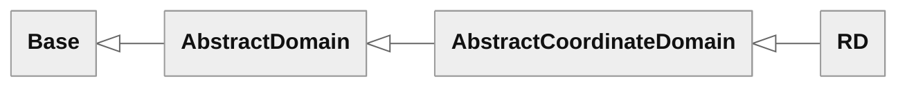

### Expressions and static type

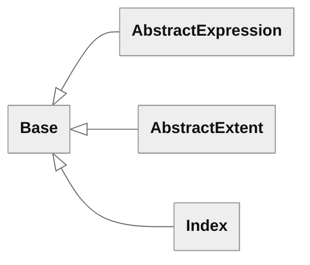

### Algebra

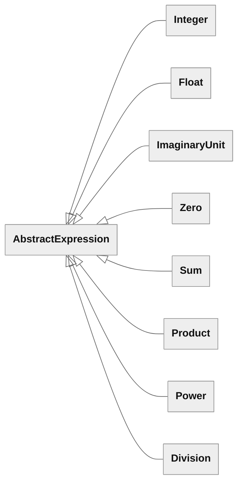

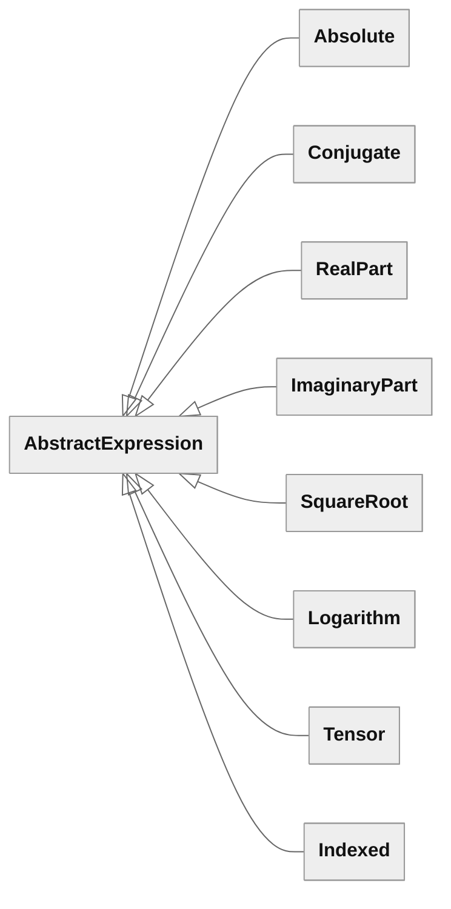

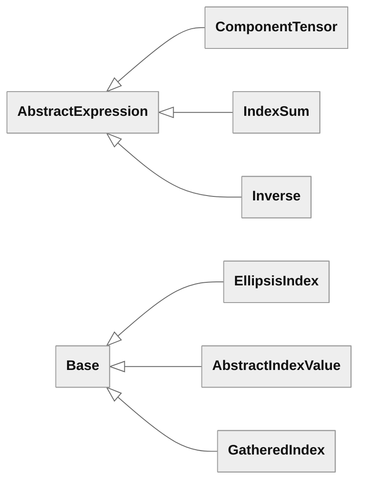

### Calculus on a domain

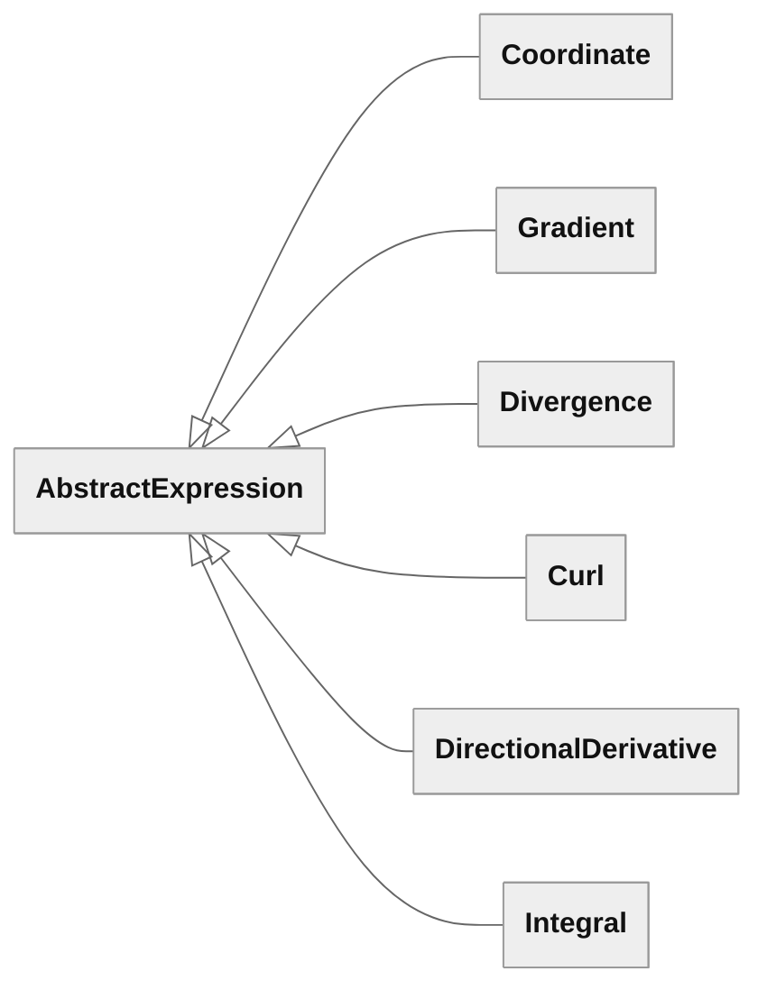

### Maps between domains

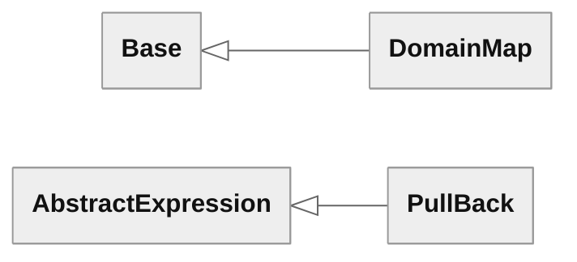

### Topology

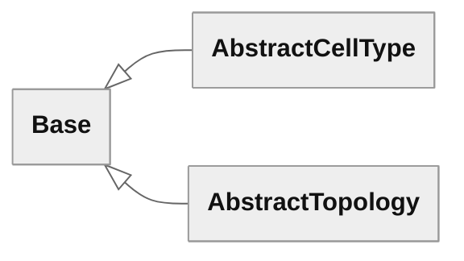

### Reference cells

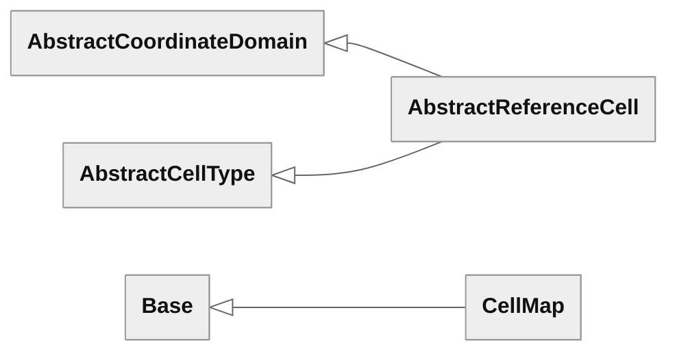

### Decomposed domains

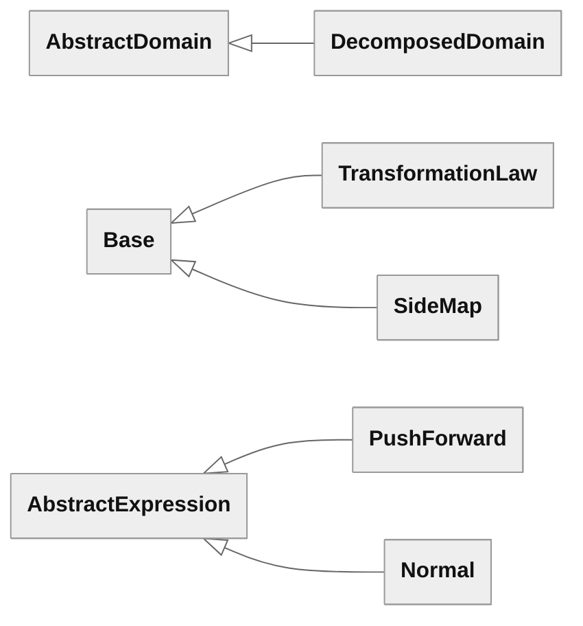

### Function spaces

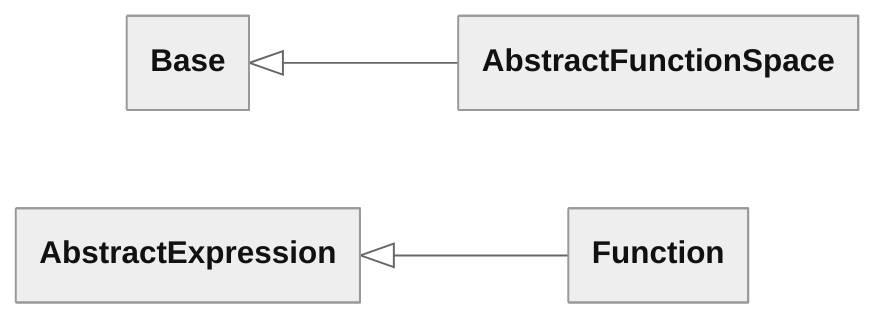

### Variational forms

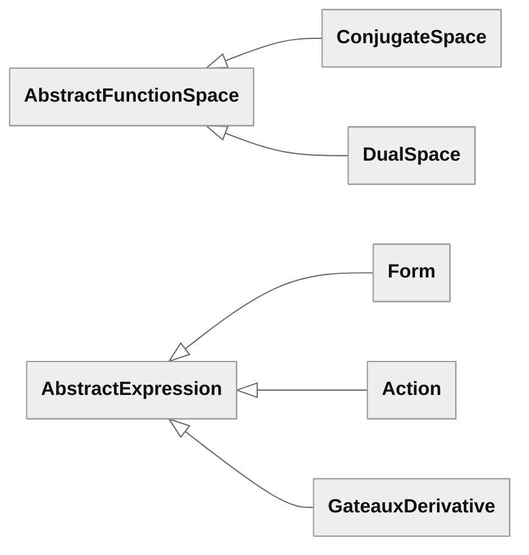
<!-- end generated: class-hierarchy -->

## Appendix: Free functions

<!-- generated: free-functions, run design/appendices.py to update -->
| Group                       | Free function                                                            | `AbstractExpression` overload | Takes                                                                                                                  | Returns                                                                                                                                                                         |
| --------------------------- | ------------------------------------------------------------------------ | ----------------------------- | ---------------------------------------------------------------------------------------------------------------------- | ------------------------------------------------------------------------------------------------------------------------------------------------------------------------------- |
| Expressions and static type | [`index(label)`](#index)                                                 |                               | `label: str \| tuple`                                                                                                  | `Index`                                                                                                                                                                         |
| Algebra                     | [`power(first, second)`](#power)                                         | `**`                          | `first, second: AbstractExpression`                                                                                    | `Power`                                                                                                                                                                         |
|                             | [`negate(f)`](#negation-and-subtraction)                                 | `-f`                          | `f: AbstractExpression`                                                                                                | `multiply(Integer(-1), f)`                                                                                                                                                      |
|                             | [`subtract(f, g)`](#negation-and-subtraction)                            | `f - g`                       | `f, g: AbstractExpression`                                                                                             | `add(f, negate(g))`                                                                                                                                                             |
|                             | [`absolute(f)`](#absolute)                                               | `abs(f)`                      | `f: AbstractExpression`                                                                                                | `Absolute`                                                                                                                                                                      |
|                             | [`conjugate(f)`](#conjugate)                                             |                               | `f: AbstractExpression`                                                                                                | `Conjugate`                                                                                                                                                                     |
|                             | [`square_root(f)`](#elementary-functions-very-incomplete)                |                               | `f: AbstractExpression`                                                                                                | `SquareRoot`                                                                                                                                                                    |
|                             | [`logarithm(f)`](#elementary-functions-very-incomplete)                  |                               | `f: AbstractExpression`                                                                                                | `Logarithm`                                                                                                                                                                     |
|                             | [`tensor(entries)`](#tensor)                                             |                               | `entries: tuple[AbstractExpression, ...]`                                                                              | `Tensor`                                                                                                                                                                        |
|                             | [`indexed(expression, indices)`](#indexed)                               |                               | `expression: AbstractExpression`, `indices: tuple`                                                                     | `Indexed`                                                                                                                                                                       |
|                             | [`component(f, entries)`](#partial-indexing)                             | `[]`                          | `f: AbstractExpression`, `entries: tuple`                                                                              | `component_tensor(indexed(f, entries + K), K)` if the entries are fewer than the rank of $f$ and contain no `EllipsisIndex`, otherwise `indexed(f, entries)`                    |
|                             | [`component_tensor(expression, indices)`](#componenttensor-and-indexsum) |                               | `expression: AbstractExpression`, `indices: tuple[Index, ...]`                                                         | `ComponentTensor`                                                                                                                                                               |
|                             | [`index_sum(expression, indices)`](#componenttensor-and-indexsum)        |                               | `expression: AbstractExpression`, `indices: tuple[Index, ...]`                                                         | `IndexSum`                                                                                                                                                                      |
|                             | [`ellipsis_index(label)`](#ellipsisindex)                                |                               | `label: str \| tuple`                                                                                                  | `EllipsisIndex`                                                                                                                                                                 |
|                             | [`gathered_index(table, indices)`](#gatheredindex)                       |                               | `table: AbstractIndexValue`, `indices: tuple`                                                                          | `GatheredIndex`                                                                                                                                                                 |
|                             | [`add(first, second)`](#tensor-arithmetic)                               | `+`                           | `first, second: AbstractExpression`                                                                                    | `component_tensor(first[K] + second[K], K)` if both operands have rank 1 or more, otherwise `Sum(first, second)`                                                                |
|                             | [`multiply(first, second)`](#tensor-arithmetic)                          | `*`                           | `first, second: AbstractExpression`                                                                                    | `component_tensor(first * second[K], K)` if only `first` is a scalar, `component_tensor(first[K] * second, K)` if only `second` is a scalar, otherwise `Product(first, second)` |
|                             | [`divide(first, second)`](#tensor-arithmetic)                            | `/`                           | `first, second: AbstractExpression`                                                                                    | `component_tensor(first[K] / second, K)` if `first` has rank 1 or more and `second` is a scalar, otherwise `Division(first, second)`                                            |
|                             | [`real_part(f)`](#tensor-arithmetic)                                     |                               | `f: AbstractExpression`                                                                                                | `component_tensor(RealPart(f[K]), K)` if $f$ has rank 1 or more, otherwise `RealPart(f)`                                                                                        |
|                             | [`imaginary_part(f)`](#tensor-arithmetic)                                |                               | `f: AbstractExpression`                                                                                                | `component_tensor(ImaginaryPart(f[K]), K)` if $f$ has rank 1 or more, otherwise `ImaginaryPart(f)`                                                                              |
|                             | [`matrix_product(first, second)`](#tensor-arithmetic)                    | `@`                           | `first, second: AbstractExpression`                                                                                    | The contraction of the last axis of `first` with the first axis of `second`, below                                                                                              |
|                             | [`transpose(A)`](#tensor-arithmetic)                                     |                               | `A: AbstractExpression`                                                                                                | `component_tensor(A[k, l], (l, k))`, with `(k, l)` = `K`, for $A$ of rank 2                                                                                                     |
|                             | [`inverse(A)`](#inverse)                                                 |                               | `A: AbstractExpression`                                                                                                | `Inverse`                                                                                                                                                                       |
|                             | [`determinant(A)`](#determinant)                                         |                               | `A: AbstractExpression`                                                                                                | The Leibniz formula for $\det A$                                                                                                                                                |
| Calculus on a domain        | [`coordinate(P)`](#coordinate)                                           |                               | `P: AbstractDomain`                                                                                                    | `Coordinate`                                                                                                                                                                    |
|                             | [`gradient(f, P)`](#gradient)                                            |                               | `f: AbstractExpression`, `P: AbstractDomain`                                                                           | `Gradient`                                                                                                                                                                      |
|                             | [`divergence(u, P)`](#divergence-and-curl)                               |                               | `u: AbstractExpression`, `P: AbstractDomain`                                                                           | `Divergence`                                                                                                                                                                    |
|                             | [`curl(u, P)`](#divergence-and-curl)                                     |                               | `u: AbstractExpression`, `P: AbstractDomain`                                                                           | `Curl`                                                                                                                                                                          |
|                             | [`directional_derivative(f, x, a, h)`](#directionalderivative)           |                               | `f: AbstractExpression`, `x: Function \| tuple`, `a, h: AbstractExpression \| tuple`                                   | `DirectionalDerivative(f, x, a, h)`                                                                                                                                             |
|                             | [`integral(f, P)`](#integral)                                            |                               | `f: AbstractExpression`, `P: AbstractDomain`                                                                           | `Integral`                                                                                                                                                                      |
| Maps between domains        | [`domain_map(P, psi, Q)`](#domainmap)                                    |                               | `P: AbstractCoordinateDomain \| AbstractTopology`, `psi: AbstractExpression`, `Q: AbstractDomain`                      | `DomainMap`                                                                                                                                                                     |
|                             | [`pull_back(f, D)`](#pullback)                                           |                               | `f: AbstractExpression`, `D: DomainMap \| SideMap \| CellMap`                                                          | `PullBack`                                                                                                                                                                      |
|                             | [`jacobian(D)`](#jacobian-and-density)                                   |                               | `D: DomainMap`                                                                                                         | `gradient(D.parameterisation, D.parameter_domain)`                                                                                                                              |
|                             | [`inverse_jacobian(D)`](#jacobian-and-density)                           |                               | `D: DomainMap`                                                                                                         | `inverse(jacobian(D))`                                                                                                                                                          |
|                             | [`density(D)`](#jacobian-and-density)                                    |                               | `D: DomainMap`                                                                                                         | The density $\rho$ below                                                                                                                                                        |
| Topology                    | [`cell_index(T, j)`](#abstracttopology)                                  |                               | `T: AbstractTopology`, `j: int`                                                                                        | `Index`                                                                                                                                                                         |
| Reference cells             | [`cell_map(T, j, e)`](#cellmap)                                          |                               | `T: AbstractTopology`, `j: int`, `e: Index \| GatheredIndex`                                                           | `CellMap(T, j, e)`                                                                                                                                                              |
|                             | [`cell_map(T, j)`](#cellmap)                                             |                               | `T: AbstractTopology`, `j: int`                                                                                        | `CellMap(T, j, cell_index(T, j))`                                                                                                                                               |
| Decomposed domains          | [`decomposed_domain(pieces)`](#decomposeddomain)                         |                               | `pieces: tuple[DomainMap, ...]`                                                                                        | `DecomposedDomain`                                                                                                                                                              |
|                             | [`image(x, Q)`](#meshes)                                                 |                               | `x: AbstractExpression`, `Q: AbstractDomain`                                                                           | `DecomposedDomain` with the pieces `domain_map(K_j, pull_back(x, cell_map(T, j)), Q)`                                                                                           |
|                             | [`cell_domain(D, j)`](#cell-domains)                                     |                               | `D: DecomposedDomain`, `j: int`                                                                                        | `DomainMap` of the cells of type `j`                                                                                                                                            |
|                             | [`cell_domain(D, j, e)`](#cell-domains)                                  |                               | `D: DecomposedDomain`, `j: int`, `e: Index \| GatheredIndex`                                                           | `DomainMap` of the cells of type `j` selected by `e`                                                                                                                            |
|                             | [`transformation_law(variances, weight)`](#transformationlaw)            |                               | `variances: tuple[str, ...]`, `weight: int`                                                                            | `TransformationLaw`                                                                                                                                                             |
|                             | [`push_forward(f, D, m)`](#pushforward)                                  |                               | `f: AbstractExpression`, `D: DecomposedDomain`, `m: TransformationLaw`                                                 | `PushForward(f, D, m)`                                                                                                                                                          |
|                             | [`push_forward(u, D)`](#pushforward)                                     |                               | `u: Function`, `D: DecomposedDomain`                                                                                   | `PushForward(u, D, u.space.transformation_law)`                                                                                                                                 |
|                             | [`side_map(X, P, s)`](#sidemap)                                          |                               | `X, P: AbstractTopology \| DecomposedDomain`, `s: str`                                                                 | `SideMap(X, P, s)`                                                                                                                                                              |
|                             | [`side_map(X, P)`](#sidemap)                                             |                               | `X, P: AbstractTopology \| DecomposedDomain`                                                                           | `SideMap(X, P, None)`, the first side of each group on $T$                                                                                                                      |
|                             | [`side_domain(D, S)`](#side-domains)                                     |                               | `D: DecomposedDomain`, `S: AbstractTopology`                                                                           | `image(pull_back(x, side_map(T, S)), Q)`                                                                                                                                        |
|                             | [`normal(sm)`](#normal)                                                  |                               | `sm: SideMap`                                                                                                          | `Normal`                                                                                                                                                                        |
| Function spaces             | [`function(V, label)`](#function)                                        |                               | `V: AbstractFunctionSpace`, `label: str \| tuple`                                                                      | `Function`                                                                                                                                                                      |
| Variational forms           | [`conjugate_space(V)`](#conjugatespace)                                  |                               | `V: AbstractFunctionSpace`                                                                                             | `V` for a real `V`, `V.space` for a `ConjugateSpace`, and `ConjugateSpace(V)` otherwise                                                                                         |
|                             | [`dual_space(S)`](#dualspace)                                            |                               | `S: AbstractFunctionSpace \| tuple[AbstractFunctionSpace, ...]`                                                        | `DualSpace`                                                                                                                                                                     |
|                             | [`form(expression, arguments)`](#form)                                   |                               | `expression: AbstractExpression`, `arguments: tuple[Function \| Conjugate \| tuple[Function \| Conjugate, ...], ...]`  | `Form`                                                                                                                                                                          |
|                             | [`action(f, position, g)`](#action)                                      |                               | `f: AbstractExpression`, `position: int`, `g: AbstractExpression \| tuple[AbstractExpression, ...]`                    | `Action`                                                                                                                                                                        |
|                             | [`gateaux_derivative(F, x, a, w)`](#gateaux-derivative)                  |                               | `F: AbstractExpression`, `x: Function \| tuple`, `a: AbstractExpression \| tuple`, `w: Function \| Conjugate \| tuple` | `GateauxDerivative(F, x, a, w)`                                                                                                                                                 |
<!-- end generated: free-functions -->

## Appendix: Static type table

This normative table gives the argument spaces of each node class. An operand
not named in the argument spaces column must have the argument spaces `()`,
except binders and functional values accepted by `Form`, `Action` and the
derivatives. Their signatures are checked by the respective class contracts
and are not added to the enclosing expression's argument spaces.

| Class                                    | Argument spaces of the node                                    |
| ---------------------------------------- | -------------------------------------------------------------- |
| `Integer`, `Float`, `ImaginaryUnit`      | `()`                                                           |
| `Zero`                                   | The stored argument spaces                                     |
| `Sum`                                    | Those of the operands, which must be equal                     |
| `Product`                                | Those of the operands, concatenated                            |
| `Power`, `Absolute`                      | `()`                                                           |
| `RealPart`, `ImaginaryPart`              | `()`                                                           |
| `Division`                               | Those of the first operand                                     |
| `Conjugate`                              | Those of the operand, each conjugated                          |
| `SquareRoot`, `Logarithm`, `Inverse`     | `()`                                                           |
| `Tensor`                                 | Those of the entries, which must be equal                      |
| `Indexed`, `ComponentTensor`, `IndexSum` | Those of the expression                                        |
| `Coordinate`                             | `()`                                                           |
| `Normal`                                 | `()`                                                           |
| `Function`                               | Those of the space                                             |
| `Form`                                   | Those of the expression, followed by the space of each entry, conjugated for a `conjugate(v)` entry |
| `Action`                                 | Those of the form without the entry at `position`              |
| `Gradient`, `Divergence`, `Curl`         | Those of the operand                                           |
| `PushForward`                            | Those of the expression                                        |
| `DirectionalDerivative`                  | Those of the expression                                        |
| `GateauxDerivative`                      | Those of the expression, followed by the space of the entry $w$ |
| `Integral`                               | Those of the integrand                                         |
| `PullBack`                               | Those of the expression                                        |

The value shape and the free indices of each node class are in the section
of the class. The support and the scalar type of the node classes that differ
from the default rules of [Support](#support) and [Scalar type](#scalar-type):

| Class                    | Support of the node                | Scalar type of the node           |
| ------------------------ | ---------------------------------- | --------------------------------- |
| `ImaginaryUnit`          | None                               | Complex                           |
| `Zero`                   | None                               | Real                              |
| `Absolute`               | The default                        | Real                              |
| `RealPart`, `ImaginaryPart` | The default                     | Real                              |
| `Coordinate`, `Gradient`, `Divergence`, `Curl` | The domain $P$               | The default                       |
| `DirectionalDerivative`  | The default                        | The scalar type of $f$            |
| `GateauxDerivative`      | The default                        | The scalar type of $F$ for a real $x$, and complex otherwise |
| `Integral`               | None                               | The default                       |
| `PullBack`               | The parameter domain of the domain | The default                       |
| `Normal`                 | $E$                                | Real                              |
| `Function`               | The domain of the space, or none   | The scalar type of the space      |
| `PushForward`            | The mesh $D$                       | The default                       |
| `Form`                   | The support of the expression      | The scalar type of the expression |
| `Action`                 | The support of the form            | The scalar type of the form       |

## Appendix: Summary

Counts of the core, from the sections.

<!-- generated: summary, run design/appendices.py to update -->
| Quantity                        | Count |
| ------------------------------- | ----- |
| Classes                         | 53    |
| Abstract classes                | 10    |
| Concrete classes                | 43    |
| Expression node classes         | 32    |
| Free functions                  | 55    |
| Free functions with an overload | 9     |
<!-- end generated: summary -->
