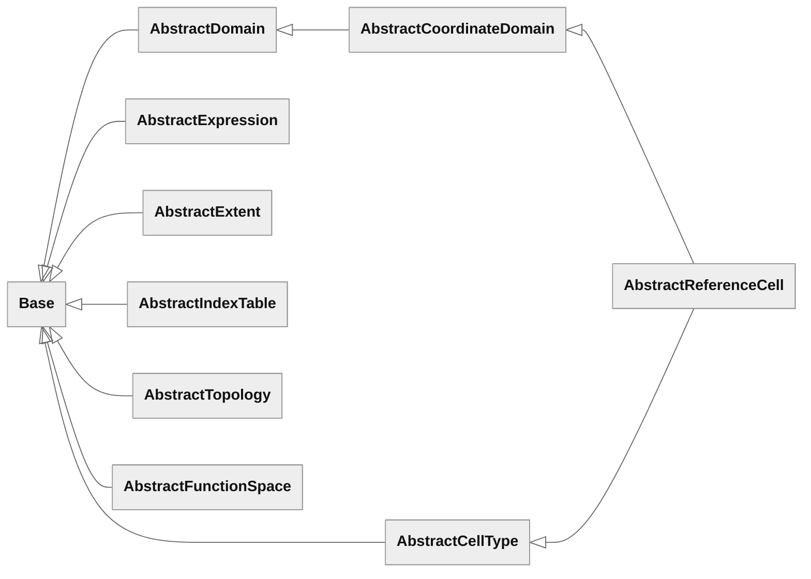

# Core UFLx language definition

This note defines UFLx objects and the rules for constructing and evaluating
them. It includes the core's rewrite passes, but leaves numerical algorithms
and backend implementation to the compiler.

The library classes of the examples and further worked examples are in
[examples/index.md](examples/index.md). The note assumes knowledge of differential
geometry and functional analysis, and explains some advanced concepts of
differential geometry in more detail.

This document is written for users and developers who know domain-specific
languages for variational forms, such as UFL and ngsolve.

## Conventions

### Normative wording

| Wording | Meaning |
| ------- | ------- |
| **Must** | An implementation or library has to satisfy the rule. |
| **Should** | An implementation or library satisfies the rule unless the note states a reason not to. |
| **May** | A choice left open to the implementation or library. |
| **Present tense**, such as “the value shape is a `tuple`” | A rule of the language. |
| **Not yet covered** | A decided gap that the authors intend to specify later. |
| **Open** | A question the authors have not decided. |
| **Legacy UFL** dropdown | A comparison with legacy UFL, not a rule. |

### Mathematical admissibility

Construction checks structural validity. Values and rewrites assume the required
mathematical hypotheses; the core neither verifies them nor extends formulas
through singularities.

### Glossary

| Term | Meaning |
| ---- | ------- |
| [Leaf](#leaves-and-subclassing) | A primitive object rather than an operation; it may have graph dependencies. |
| [Terminal](#leaves-and-subclassing) | A leaf that is an expression, such as a literal, `Coordinate`, `Function` or `Normal`. |
| [Construction free function](#node-class-or-free-function) | A pure free function that may validate inputs and builds fixed expression compositions or canonical space descriptions. |
| [Pass](#passes) | A pure free function that walks a graph after construction to compute a result or rewrite the graph. |
| [Evaluation traversal](#evaluation-traversal) | A walk through expression operands, excluding dependencies stored in geometry, spaces and labels. |
| [Grammar pattern](#grammars) | A structural condition on a node and objects within a bounded number of edges, independent of pass results. |
| [Rule pattern](#rule-tables) | A condition selecting a rewrite rule; it may inspect a pass result on an operand. |
| [Array rank](#abstractexpression), or **rank** | The number of axes in an expression's value shape. |
| [Arity](#argument-spaces) | The number of argument spaces of a form, counting a product-space argument once. |
| [Structurally equal](#the-base-object-base) | Objects with the same class and equal construction arguments, as tested by `==`. |
| [Mathematically equal](#the-base-object-base) | Expressions denoting the same value, whether or not their graphs are structurally equal. |

## Scope

### What UFLx is and isn't

UFLx is a typed symbolic language for writing variational forms.

The UFLx core language, henceforth the core, is independent of any particular
discretisation, solver or finite-element library. This draft requires vector calculus on
domains in $R^n$ and on manifolds embedded in $R^n$, in the coordinates of
$R^n$. One gradient serves every dimension, so the statement of each concept
does not depend on the dimension.

UFLx is *not* a symbolic language for reasoning about problems in functional
analysis or differential geometry. The core should therefore contain only the
concepts and relations needed to write variational forms as code for later
algorithmic transformation.

A UFLx program is ordinary Python code that builds a graph of symbolic objects,
usually a bilinear form, linear form or functional.

UFLx does not handle concrete data or numerical algorithms, such as meshes,
boundary markers, values of coefficients or assembly procedures. Those belong
to the surrounding problem-solving environment, such as DOLFINx, Firedrake,
FIAT and Basix. UFLx specifies a set of leaf nodes, and the external library
provides the concrete data behind each leaf node.

### Basic principles

- Each core object definition should follow the mathematical definition of
  the object closely.
- The core must not add definitions, properties or terminology outside
  differential geometry and functional analysis.
- The core values strictness and expressivity over brevity. Higher-level APIs
  can add brevity later.
- Use dimension-independent definitions where the mathematics permits.
  Operations such as `Curl` state their dimension-specific cases explicitly.
- The core contains no algorithms solely for a form compiler's convenience.
  Each compiler states the forms it accepts. A pass outside the core must
  lower to those forms, using only core node classes and
  [language extensions](#language-extensions) accepted by that compiler.
  For example, a basic form compiler might only accept integrals over a
  reference cell, such as a unit simplex, as in each cell term of a legacy UFL
  `dx` integral.

```{dropdown} Legacy UFL
TSFC lowers a UFL form to GEM, which repeats much of the algebra of UFL, partly because UFL simplifies during construction. The UFLx core does not simplify during construction, so a form compiler may be able to use a lowered UFLx form directly, adding only leaves for tables and kernel inputs. This has not been confirmed with the TSFC or FFCx developers.
```

## Rules of the language

### The base object `Base`

Every object in the directed acyclic graph (DAG) must extend `Base`. A graph
edge means "is defined from"; geometric edges are explicitly called edges of
a triangle or cell. Everything defining the variational problem must be
recoverable from the graph.

| `Base`     |                                                                    |
| ---------- | ------------------------------------------------------------------ |
| Properties | `construction_arguments`, the construction arguments, as in rule 4 |

Objects must satisfy the following rules:

1. A construction argument must be one of a small curated set of types: a base
   object, or exactly an `int`, a finite `float`, a `str`, or a `tuple` whose
   items are of these types. A subclass of these Python types is not accepted,
   so a `bool` is not an `int` and a named tuple is not a `tuple`. Construction
   arguments are deeply immutable. Their hashes must be deterministic across
   processes on the same machine, and they are compared by type and value.
   `1`, `1.0` and `True` are distinct, `0.0` and `-0.0` are distinct, and every
   value is equal to itself. Construction raises `TypeError` for an argument of
   any other type, and `ValueError` for a `float` that is not finite.
2. Construction must depend only on the construction arguments, not on global
   state.
3. The state of an object is immutable after construction. Every result that
   the object produces after construction depends only on the class and the
   construction arguments.
4. An object must be reconstructible from its class and construction arguments,
   with the result equal to the original. The base object records these arguments
   and returns them in order as the `tuple` `construction_arguments`. A subclass
   constructor validates them and may store data derived from them.
5. The edges of an object must be exactly the base objects among its
   construction arguments, including the base objects nested in `tuple`s, in
   order.
6. Any order that the core or a pass relies on must be deterministic across
   processes. A pass, and any other walk of the graph such as hashing,
   serialisation or printing, follows the edges it visits in order (rule 5).
   A pass states which edges it visits. Where unrelated objects must be sorted,
   the sort uses a total order defined by the class and the construction
   arguments alone.
7. Equality (`==`) must be structural and return a `bool`. Whether `is` is
   structural is implementation dependent. An implementation in which `is` is
   structural must intern objects, so that equal objects are the same object.
   Structural equality does not decide mathematical equality: $a + b$ and
   $b + a$ are not structurally equal. Mathematical equalities are applied
   in later graph algorithms.
8. Constructors validate their nodes. Construction free functions may validate
   their documented inputs, but never convert them. Structural requirements
   must be checked by the free function or the constructors it calls. Unless
   stated otherwise, an unacceptable type or class raises `TypeError`, and an
   unacceptable value of an accepted type or class raises `ValueError`.
   Class tables list only additional details or exceptions to these defaults.
9. A constructor has no default values, so every construction argument is
   written at construction.
10. A concrete class states an `identifier`, a `str` with the public name of
    the class qualified by the package name, such as `"uflx.Sum"` for the core
    or `"library.UnitSimplex"` for a library. The hash of rule 1, the total
    order of rule 6 and serialisation use the identifier and the construction
    arguments, and never the location of the class in the code. Construction
    raises `TypeError` for a class with no identifier. The package name keeps
    the identifiers of different libraries apart, and a library keeps the
    identifiers of the classes of the library distinct.

Hence two objects are equal if and only if the two objects have the same class
and equal construction arguments.

Because objects are immutable, an object need only be validated once, at
construction. Every object that exists is therefore structurally valid.

### Leaves and subclassing

Only leaves are subclassed. A leaf is a primitive object rather than an
operation, such as the coordinate domain `RD(n)` or a function whose values an
external library supplies. Leaves may have graph dependencies: a `Function`
depends on its space, and a `Coordinate` on its domain. A terminal is a leaf
that is an expression, such as a literal, `Coordinate`, `Function` or `Normal`
of the core, or a terminal of a downstream library.

An operation is represented by a single core class or a construction free
function returning core objects, never a subclass. For example, a construction
free function builds the map of an affinely mapped triangle as a
`DomainMap`, rather than a subclass of `DomainMap`. A language extension is the
one exception (see [Language extensions](#language-extensions)).

Concrete core classes are final; libraries subclass only abstract classes.
A parent class never constructs a subclass, though its properties may return
existing subclass instances. A subclass may narrow a property's return type.

### Construction policy

| Kind | Role and permitted inspection | Validation and exceptions |
| ---- | ----------------------------- | ------------------------- |
| Property | Returns stored or derived data; creates no objects | Derived objects may be built and stored during construction |
| Constructor | Creates a node and computes derived data; does not simplify expressions | Validates construction arguments |
| Construction free function | Builds a fixed composition from expression static types and documented interfaces of explicit non-expression arguments; does not inspect expression structure to choose a composition | Validates inputs itself or through constructors; may inspect structure for validation only. Space factories apply canonical forms; `indexed`, `component`, `component_tensor` and `index_sum` apply their empty-index identities |
| Pass | After construction, inspects graph structure and returns information or a rewritten graph | Enforces its own preconditions; constructors validate nodes it builds. Space substitution preserves canonical forms |

Free functions and passes are pure. A class method immediately calls a free
function. Constructor arguments are positional only; named arguments raise
`TypeError`. Free functions may take named arguments, such as
`domain_map(P=T, psi=psi, Q=RD(2))`.

A stored property returns a construction argument; a derived property depends
on the class and those arguments. Concrete classes inherit the derived
properties of their abstract classes.

### No simplification during construction

The construction policy preserves the user's written operations. For example,
in `(a + b) + c`, the user may need `(a + b)` evaluated before `c` is added
in floating-point arithmetic. Building a fixed composition defines an
operation; it does not simplify its operands. Later passes, chosen by the
user, may rewrite it.

### Passes

A pass is a pure free function that walks a graph after construction and
returns a value, such as a unit, or a new graph. To build a new graph, it
constructs replacement nodes and reconstructs dependent objects up to
the root along the edges it visits (see [The base object](#the-base-object-base)).
The dependency graph includes every construction argument; the
[evaluation traversal](#evaluation-traversal) follows only expression operands.
A substitution follows dependencies, so replacing an object also
reconstructs an [`Index`](#index) whose label contains the object, other than
a renamed name (see [Derived indices](#derived-indices)). Substitution
commutes with a fixed expression composition when its static-type choice is
unchanged: replacing `A` by `B` in `transpose(A)` gives `transpose(B)`, with
the derived indices of `B`. A pass
may cache results for each object, because objects are immutable.

Substitution is simultaneous and respects lexical scope, renaming bound names to
avoid capture (see [Substitution and binding](#substitution-and-binding)). The
core pass `replace(e, mapping)` performs this substitution.

A pass does one thing, such as differentiating or lowering. Passes compose,
and the user of the core chooses which passes run and in what order.

A pass fails with `TypeError` for a node class it has no rule for, or with an
error of the pass, such as inconsistent units.

### Operator overloads

Only `AbstractExpression` defines arithmetic and indexing overloads, listed in
the [table of free functions](#appendix-free-functions).

An overload passes operands unchanged to its free function, except for the
indexing syntax below. There are no reflected overloads, such as `__radd__`.

An overload applies one free function to the operands, so the graph follows
the grouping and the precedence of Python, and construction never regroups
(see [No simplification during
construction](#no-simplification-during-construction)). For example,
`a + b + c` is `Sum(Sum(a, b), c)` and `a + (b + c)` is `Sum(a, Sum(b, c))`,
and the two are not equal. `a ** b ** c` is `power(a, power(b, c))`, and
`-a ** b` is `negate(power(a, b))`.

Python passes `f[i]` to `__getitem__` as `i`, but `f[i, j]` as `(i, j)`.
`__getitem__` wraps a single entry in a `tuple` and calls `component` (see
[Partial indexing](#partial-indexing)).

`AbstractExpression` defines `__iter__` to raise `TypeError`, because
expressions are not iterable and Python otherwise iterates through
`__getitem__`.

### Numbers in expressions

Every number in an expression is written with literals, such as `Integer(2)`,
`Float(0.5)`, `Integer(1) / Integer(3)` or `Complex(Integer(0), Integer(1))`. A Python `int`, `float`,
`complex`, `Fraction` or NumPy scalar is never converted and is rejected with
`TypeError`.

With `X = coordinate(RD(2))`, `X[0]**Integer(2)` is accepted, but `X[0]**2`
raises `TypeError`. The same rule applies inside containers:
`tensor((Integer(1), Integer(2)))` is accepted, but `tensor((1, 2))` is not.

## Domains

Function spaces and operators use a domain's dimension, boundary and cell
decomposition. The only metric is the ambient Euclidean metric, which defines
the tangential [gradient](#gradient), integration [density](#jacobian-and-density)
and unit [normal](#normal).

### `AbstractDomain`

`AbstractDomain` represents a domain, the set on which an expression is defined.
A domain is a coordinate domain supplied by a library (see
[`AbstractCoordinateDomain`](#abstractcoordinatedomain)), or a mesh with a
topology and coordinate expression (see [`Mesh`](#mesh)). Every node class
taking a domain accepts either kind; its section defines its value on a mesh
through its cells.

| `AbstractDomain` |                                                                             |
| ---------------- | --------------------------------------------------------------------------- |
| Extends          | `Base` |
| Provides         | `dimension`, an `int` $k \ge 0$, and `ambient_domain`, an `AbstractDomain` |
| Defined by       | `AbstractCoordinateDomain` and `Mesh`                           |

The ambient domain of $D$ supplies the coordinates naming its points. The
first coordinate domain reached by following `ambient_domain` repeatedly is
the *ambient coordinate domain*, of dimension $n \ge k$. A coordinate domain
is its own ambient domain.

### `AbstractCoordinateDomain`

A coordinate domain is a subset of $R^n$ with non-empty interior in $R^n$ whose
points are named by the coordinates of the points themselves. The core cannot
build the set from smaller objects. A library defines a new coordinate domain,
such as a reference cell, by extending this abstract class. On a coordinate
domain the coordinates are canonical: the coordinate function is the identity
(see [`Coordinate`](#coordinate)), and the integral is the Lebesgue integral in
the coordinates (see [`Integral`](#integral)). Every other domain gets these by
pull-back.

| `AbstractCoordinateDomain` |                                              |
| -------------------------- | -------------------------------------------- |
| Extends                    | `AbstractDomain` |
| Provides                   | `dimension`, an `int` $n \ge 0$              |
| Derived                    | `ambient_domain`, the coordinate domain itself |
| Defined by                 | A subclass, such as `RD` or a reference cell |

Examples:

- The unit simplex in $R^n$ is a coordinate domain. A codimension-1 face is
  not: it has empty interior in $R^n$ and is instead the image of a domain map
  from the unit simplex in $R^{n-1}$.
- A mesh of triangles is *not* a coordinate domain, because the core builds the
  mesh from a topology and a coordinate expression; its cells are parameterised
  by reference triangles.

### `RD`

`RD(n)` is the whole of $R^n$.

| `RD(n)`    |                                                                 |
| ---------- | --------------------------------------------------------------- |
| Extends    | `AbstractCoordinateDomain` |
| Properties | `dimension`, an `int` $n \ge 0$                                 |
| Raises     | `TypeError` if $n$ is not an `int`, and `ValueError` if $n < 0$ |

Worked examples for this chapter: [the unit simplex](examples/library.md#the-unit-simplex).

## Expressions and static type

### `AbstractExpression`

| `AbstractExpression` |                                                                                      |
| -------------------- | ------------------------------------------------------------------------------------ |
| Extends              | `Base`                                                                               |
| Provides             | `value_shape`, `free_indices`, `scalar_type`, `domain`, `argument_spaces` |

These five derived properties form the static type (see
[Argument spaces](#argument-spaces)). The value shape is a `tuple` of
[extents](#extents), one per axis; `()` denotes a scalar. The array rank,
written simply as rank, is the number of axes.

### Extents

An extent is the length of an axis of a value shape, or the extent of a free
index. An extent is an `int` $n \ge 0$ or an `AbstractExtent`.

`AbstractExtent` represents an extent whose value is not known during
construction. Its supplied value must be a nonnegative integer.
An `AbstractExtent` is not an expression. A concrete
`AbstractExtent` is a subclass outside the core, such as `RuntimeExtent` in the
[cut cell example](examples/integration.md#integrating-over-a-cut-cell).

| `AbstractExtent` |                                      |
| ---------------- | ------------------------------------ |
| Extends          | `Base`                               |
| Defined by       | A subclass outside the core          |

An `AbstractExtent` has no arithmetic and no ordering, so the rules of the
core, which compare extents by equality, accept an `AbstractExtent` unchanged.
A concrete `AbstractExtent` stores the arguments that identify the extent, such
as a label.

Example:

- With an `AbstractExtent` `q`, an expression `points` of value shape `(q, 2)`
  and an expression `weights` of value shape `(q,)` share the extent `q`, so
  `weights[i] * points[i, 0]` is accepted. With a second `AbstractExtent` `r`,
  an expression `weights` of value shape `(r,)` raises `ValueError` in
  `weights[i] * points[i, 0]`, because the index `i` has two extents.

```{dropdown} Open: ragged indexing
An axis whose length depends on another index, such as the quadrature points
of each cut cell, cannot be written. A dependent extent, an `AbstractExtent`
whose label contains the other index, would cover the case. An index value
read from a table is a [`GatheredIndex`](#gatheredindex).
```

### `Index`

`Index` is a free index, not an expression. An `Index` names an axis of a
tensor, as `i` and `j` in `A[i, j]` (see [Index notation](#index-notation)).

| `Index(label)` |                                                                                                 |
| -------------- | ----------------------------------------------------------------------------------------------- |
| Extends        | `Base` |
| Free function  | `index(label)`                                                                                  |
| Takes          | `label: str \| tuple` |
| Properties     | `label`, a `str` for a user index, or a `tuple` that contains graph objects for a derived index |
| Raises         | `TypeError` if the label is neither a `str` nor a `tuple`                                       |

An `Index` takes its extent from the indexed axis; it has no extent of its own.

A user index has a `str` label, which the user chooses. Two free occurrences
of one `Index` in one scope are the same index, so an index that the user
means to be new needs a new name. The scope of an index is given in
[`ComponentTensor` and `IndexSum`](#componenttensor-and-indexsum).

A derived index has a `tuple` label, which a free function or a pass builds
from the operands, so that the index is fresh without a global counter (see
[Derived indices](#derived-indices)).

### Free indices

Every `AbstractExpression` derives the free indices, a `tuple` of pairs. Each
pair is an `Index` and an extent. The order is the order of first occurrence, never the
order of a `set`.

Unless a node class states otherwise, the free indices of a node are derived
from the edges of the node that are expressions:

- The free indices of the edges are taken in edge order, with each `Index`
  taken once, at the first occurrence.
- An `Index` that occurs in two edges must have the same extent in both edges,
  or construction raises `ValueError`.

Summation is never implicit. `a[i] * b[i]` has the free index `i` and denotes
the component-wise product. The sum over `i` is `index_sum(a[i] * b[i], (i,))`.
The operands of a node may have different free indices, so `a[i] + b[j]` has
the free indices `i` and `j` and denotes the outer sum.

### Scalar type

The scalar type is real or complex. Unless the [static type
table](#appendix-static-type-table) states otherwise, an expression is complex
if and only if at least one edge is a complex expression.

The scalar type is the arithmetic in which the expression is evaluated, not a
statement about the value. A real `SquareRoot`, `Logarithm` or `Power` whose
value is not a real number, such as `square_root(Integer(-1))`, is undefined.

### Domain

An expression's `domain` is where it is defined: an
[`AbstractDomain`](#abstractdomain), or an [`AbstractTopology`](#abstracttopology)
whose cell types are reference cells. It is `None` for an expression independent
of a domain, such as a literal.

Unless the [static type table](#appendix-static-type-table) states otherwise,
a node inherits the domain of its expression operands with a domain. All such
operands must have the same domain, or construction raises `ValueError`. A node
with no such operand has domain `None`.

The property always describes the resulting expression. An `Integral` stores
its region as `integration_domain` but has domain `None`; a `PullBack` stores
its `map` and has that map's `parameter_domain`. A `PushForward` stores its
`mesh`, which is also its domain. For `Coordinate`, `Gradient`, `Divergence`
and `Curl`, the stored domain is also the result's domain.

### Expressions as functions

An expression denotes an array-valued function on the domain of the
expression. An expression on a topology denotes a function on the reference
cell of each cell of the topology (see [`CellMap`](#cellmap)). An expression
with no domain denotes a single array. An expression with argument spaces other than `()` denotes a multilinear map from
the argument spaces to such functions (see [Variational
forms](#variational-forms)).

### Node class or free function

An operation uses a construction free function when it has a fixed
composition under the [construction policy](#construction-policy). A node
class is needed when choosing the result requires expression structure, when
the compiler must choose a numerical algorithm, or when a pass must retain
the operation as written. In the last case, the node's section states its
composition; `Integral` over a mesh is an example.

For example, the transpose is always `component_tensor(A[k, l], (l, k))`,
so it is a free function. `Inverse` and `Determinant` keep the algorithm
choice for the compiler.

A construction free function is part of the core only if a definition or a
rule of the core uses it, such as `density` in [`Integral` over a
mesh](#integral-over-a-mesh) and `cell_map` in
[Restriction](#restriction), or if a Python operator calls the free function
as an overload, such as `matrix_product` for `@` (see [Operator
overloads](#operator-overloads)). `transpose` is in the core because the rule
for `Inverse` of [Applying derivatives](#applying-derivatives) uses it. Every
other construction free function belongs to a library, such as the operations
of [Tensor algebra](examples/tensors.md#tensor-algebra).

A node class is part of the core only if a definition or a rule of the core
needs the node class, or if the node class is an operation of the scalar
field, such as conjugation. A rule for the node class itself does not count.
Otherwise the node class belongs to a
[language extension](#language-extensions). For example, the core writes a
rational number as the `Division` of two `Integer`s, so `Division` is part of
the core.

The [node-class rationale](#appendix-node-class-rationale) explains the
individual choices.

## Numbers and scalar operations

### Literals

A literal is a number written in an expression, such as `Integer(2) * u`.
`Integer` and `Float` are real terminals with value shape `()`, no free
indices, no domain and argument spaces `()`.

| `Integer(v)` |                       |
| ------------ | --------------------- |
| Extends      | `AbstractExpression` |
| Properties   | `value` $v$, an `int` |

| `Float(v)` |                               |
| ---------- | ----------------------------- |
| Extends    | `AbstractExpression`         |
| Properties | `value` $v$, a finite `float` |

`Integer` and `Float` accept only exact Python types, as in rule 1 of
[the base object](#the-base-object-base). So `Integer(True)` raises
`TypeError`, and `Float(-0.0) != Float(0.0)`.

A rational number is the `Division` of two `Integer`s, such as
`Integer(1) / Integer(3)`. The compiler chooses its numerical evaluation;
the core has no rational literal.

### `Complex`

`Complex` is a scalar complex constant built from two real literals. It is a
terminal, and its value is
`real` $+\,i\,$ `imag`.

| `Complex(real, imag)` | |
| --------------------- | - |
| Extends               | `AbstractExpression` |
| Takes                 | `real, imag: Integer \| Float` |
| Properties            | `real` and `imag`, the real and imaginary parts |
| Static type           | Value shape `()`, complex, no free indices, no domain and argument spaces `()` |
| Raises                | `TypeError` for a part of another class |

```python
Complex(Integer(0), Integer(1))  # The imaginary unit.
Complex(Integer(-1), Integer(0))  # Minus one with complex scalar type.
```

`Complex` retains its parts and stays complex even when the imaginary part
is zero. As a terminal, it has no evaluation operands (see
[Evaluation traversal](#evaluation-traversal)).

General real expressions `a` and `b` form a complex expression through
`a + Complex(Integer(0), Integer(1)) * b`. A real expression `r` is embedded
in complex arithmetic by `Complex(Integer(1), Integer(0)) * r`, preserving
its value shape, free indices, domain and argument spaces.

### `Zero`

`Zero` represents zero with a specified value shape, free indices, argument
spaces and scalar type (real or complex).

| `Zero(value_shape, free_indices, argument_spaces, scalar_type)` |                                                                                                                                |
| -------------------------------------------------- | ------------------------------------------------------------------------------------------------------------------------------ |
| Extends                                            | `AbstractExpression` |
| Properties                                         | `value_shape`, `free_indices`, `argument_spaces` and `scalar_type`, as in [Extents](#extents), [Free indices](#free-indices) [Argument spaces](#argument-spaces) and [Scalar type](#scalar-type) |
| Static type                                        | The stored properties, with no domain                                                                                         |
| Raises                                             | `TypeError` for an argument of another type, and `ValueError` for a negative extent or an index that occurs twice |

For example, `Zero((3,), (), (), real)` is a real zero vector and
`Zero((), (), (V,), complex)` is a complex zero form on `V`. Here `real` and
`complex` denote the scalar types, not Python numeric constructors.

### Arithmetic

`Sum`, `Product`, `Division` and `Power` denote the sum, product, quotient and
power of two scalar expressions. Both operands must have value shape `()`, or
construction raises `ValueError`; the result has value shape `()`. Free indices
follow the [default rule](#free-indices).

The free functions below construct these nodes for scalar operands. `add`,
`multiply` and `divide` also support [tensor arithmetic](#tensor-arithmetic).

| Class      | Free function | Overload |
| ---------- | ------------- | -------- |
| `Sum`      | `add`         | `+`      |
| `Product`  | `multiply`    | `*`      |
| `Division` | `divide`      | `/`      |
| `Power`    | `power`       | `**`     |

### `Sum`

| `Sum(first, second)` |                                             |
| -------------------- | ------------------------------------------- |
| Extends              | `AbstractExpression` |
| Free function        | [`add`](#tensor-arithmetic), with the overload `+` |
| Takes                | `first, second: AbstractExpression` |
| Properties           | `first` and `second` |
| Requires             | The operands of [Arithmetic](#arithmetic)   |

### `Product`

| `Product(first, second)` |                                                  |
| ------------------------ | ------------------------------------------------ |
| Extends                  | `AbstractExpression` |
| Free function            | [`multiply`](#tensor-arithmetic), with the overload `*` |
| Takes                    | `first, second: AbstractExpression` |
| Properties               | `first` and `second` |
| Requires                 | The operands of [Arithmetic](#arithmetic)        |

### `Power`

| `Power(first, second)` |                                                                             |
| ---------------------- | --------------------------------------------------------------------------- |
| Extends                | `AbstractExpression` |
| Free function          | `power(first, second)`, with the overload `**`                              |
| Takes                  | `first, second: AbstractExpression` |
| Properties             | `first` and `second` |
| Requires               | The operands of [Arithmetic](#arithmetic)                                   |

Complex powers use the principal value, consistent with `Logarithm`.
The exponent may have domain. The [derivative rules](#derivatives-of-the-node-classes)
distinguish constant and variable exponents.

### Negation and subtraction

Negation and subtraction are free functions, not node classes:

| Free function | Overload | Takes | Returns |
| ------------- | -------- | ----- | ------- |
| `negate(f)` | `-f` | `f: AbstractExpression` | `multiply(Integer(-1), f)` |
| `subtract(f, g)` | `f - g` | `f, g: AbstractExpression` | `add(f, negate(g))` |

These compositions inherit the tensor
behaviour of `multiply` and `add` (see [Tensor arithmetic](#tensor-arithmetic)).

### `Division`

| `Division(first, second)` |                                                                                        |
| ------------------------- | -------------------------------------------------------------------------------------- |
| Extends                   | `AbstractExpression` |
| Free function             | [`divide`](#tensor-arithmetic), with the overload `/` |
| Takes                     | `first, second: AbstractExpression` |
| Properties                | `first` and `second` |
| Requires                  | The operands of [Arithmetic](#arithmetic)                                              |

### `Absolute`

`Absolute` is the absolute value, or the modulus of a complex scalar.

| `Absolute(f)` |                                           |
| ------------- | ----------------------------------------- |
| Extends       | `AbstractExpression` |
| Free function | `absolute(f)`, with the overload `abs(f)` |
| Takes         | `f: AbstractExpression` |
| Properties    | `operand` $f$ |
| Requires      | A scalar $f$                              |
| Static type   | Value shape `()`, real                    |

### `Conjugate`

`Conjugate` is the complex conjugate of an expression of any value shape, entry
by entry.

| `Conjugate(f)` |                                                                                             |
| -------------- | ------------------------------------------------------------------------------------------- |
| Extends        | `AbstractExpression` |
| Free function  | `conjugate(f)`                                                                              |
| Takes          | `f: AbstractExpression` |
| Properties     | `operand` $f$ |
| Static type    | The value shape and the free indices of $f$, and the argument spaces of $f$ with each space conjugated (see [`ConjugateSpace`](#conjugatespace)) |

`Conjugate` is the only scalar-field node that accepts any value shape, because
[`Form`](#form) binds `conjugate(v)` even for a vector argument. Its entrywise
meaning is `conjugate(f)[e]` = `conjugate(f[e])` in value.

### `RealPart` and `ImaginaryPart`

`RealPart` and `ImaginaryPart` give the real and imaginary parts of a scalar.

| `RealPart(f)`, `ImaginaryPart(f)` |                                       |
| --------------------------------- | ------------------------------------- |
| Extends                           | `AbstractExpression` |
| Free function                     | [`real_part`](#tensor-arithmetic), [`imaginary_part`](#tensor-arithmetic) |
| Takes                             | `f: AbstractExpression` |
| Properties                        | `operand` $f$ |
| Requires                          | A scalar $f$                          |
| Static type                       | Value shape `()`, real                |

These nodes and `Absolute` are the only nodes that take a complex operand to
a real expression. The composition `(f + conjugate(f)) / Integer(2)` has the
value of the real part but remains complex by the [scalar-type rule](#scalar-type).

Their free functions apply entrywise to tensors (see
[Tensor arithmetic](#tensor-arithmetic)).

The operand may be real. Construction does not simplify, so `real_part(f)`
of a real $f$ is not $f$, and `imaginary_part(f)` of a real $f$ is not
`Zero`.

For `z = Complex(Integer(1), Integer(2))`, `real_part(z)` and
`imaginary_part(z)` are real expressions with the values 1 and 2, respectively.

### Elementary functions

`SquareRoot` and `Logarithm` give the square root and natural logarithm of a
scalar. The core provides these two; other layers are expected to provide
a wider range of elementary functions.

| `SquareRoot(f)`, `Logarithm(f)` |                                     |
| ------------------------------- | ----------------------------------- |
| Extends         | `AbstractExpression` |
| Free function   | `square_root(f)` and `logarithm(f)` |
| Takes           | `f: AbstractExpression` |
| Properties      | `operand` $f$ |
| Requires        | A scalar $f$                        |
| Static type     | Value shape `()`                    |

For a complex operand, `Logarithm` is the principal branch, with the imaginary
part in $(-\pi, \pi]$, and `SquareRoot` is the principal square root.

~~~{dropdown} Why `SquareRoot` is a node class
`SquareRoot` is not the composition `power(f, Integer(1) / Integer(2))`,
because IEEE 754 requires a correctly rounded square root and not a correctly
rounded power, so the result of `power` depends on the math library.
~~~

## Tensors and indexing

### `Tensor`

`Tensor` stacks expressions along a new first axis.

| `Tensor(entries)` |                                                                                                           |
| ----------------- | --------------------------------------------------------------------------------------------------------- |
| Extends           | `AbstractExpression` |
| Free function     | `tensor(entries)`                                                                                         |
| Takes             | `entries: tuple[AbstractExpression, ...]` |
| Properties        | `entries`, a non-empty `tuple` of `AbstractExpression`s with the same value shape `s`                     |
| Static type       | Value shape `(n,) + s`, with $n$ the number of entries                                                    |

A matrix is a `Tensor` of `Tensor`s.

Value shapes may contain extent 0, as in `coordinate(RD(0))`. An empty
`Tensor` cannot provide the entry shape `s`; use `Zero` for an array with an
extent 0, which has no entries.

Examples, with `one, two = Integer(1), Integer(2)`:

- `tensor((one, two))` is a vector of value shape `(2,)`.
- `tensor((one, tensor((one, two))))` raises `ValueError`, because the entries
  have different value shapes.

### Index notation

Index notation writes tensor algebra with four node classes. `Tensor` builds a
tensor from scalars, `Indexed` selects one component, and `ComponentTensor`
and `IndexSum` bind the free indices of a scalar, as axes or as a sum. Tensor
rearrangements and contractions are compositions of these, so `transpose`,
`dot` and `inner` are free functions, not node classes (see [Node class or
free function](#node-class-or-free-function)).

With `i, j = index("i"), index("j")` and a matrix `A` of value shape `(2, 3)`:

- `A[i, j]` is a scalar with the free indices `i`, of extent 2, and `j`, of
  extent 3. The scalar denotes one value for each value of `i` and `j`.
- `component_tensor(A[i, j], (j, i))` binds `j` and `i` as axes, in that
  order, and is the transpose of `A`, of value shape `(3, 2)`.
- `index_sum(A[i, j] * A[i, j], (i, j))` sums over `i` and `j`, and is the sum
  of the squares of the entries of `A`, with no free index.

The sections below give the rules. Tuples of ordinary indices, including
empty tuples for scalars, serve tensors of every rank. A
[`GatheredIndex`](#gatheredindex) reads an index value from a table that the
solver gives, such as the cell of each facet. A free function or a pass that
needs a fresh index derives the index from the operands (see [Derived
indices](#derived-indices)).

### `Indexed`

`Indexed` selects one component of a tensor. The overload `[]` calls
[`component`](#partial-indexing), which also supports partial indexing.

| `Indexed(expression, indices)` |                                                                                   |
| ------------------------------ | --------------------------------------------------------------------------------- |
| Extends                        | `AbstractExpression` |
| Free function                  | `indexed(expression, indices)`                                                    |
| Takes                          | `expression: AbstractExpression`, `indices: tuple` |
| Properties                     | `expression`, and `indices`, a non-empty `tuple` of entries of the kinds below    |
| Static type                    | Value shape `()`, and the free indices below                                      |
| Raises                         | `TypeError`, `ValueError` and `IndexError`, below                                 |

The factory `indexed(f, ())` returns `f` if `f` is scalar, and raises
`IndexError` otherwise: full indexing must cover every axis. `Indexed(f, ())`
still raises `ValueError`; the factory creates no node for the scalar case.

Indexing is full indexing. Each entry covers one axis of the
expression, and the entries together cover every axis exactly once. With
`(n_0, ..., n_{r-1})` the value shape of the expression, an entry is one of
the following kinds:

| Entry                                | Covers                                | Rule                                                                                               | Raises       |
| ------------------------------------ | ------------------------------------- | -------------------------------------------------------------------------------------------------- | ------------ |
| An `int` $k$                         | One axis, of extent $n_j$             | $n_j$ is an `int`, and $0 \le k < n_j$                                                             | `IndexError` |
| An [`Index`](#index)                 | One axis, of extent $n_j$             | The `Index` takes the extent $n_j$                                                                 |              |
| A [`GatheredIndex`](#gatheredindex)  | One axis, of extent $n_j$             | The extent of the `GatheredIndex` equals $n_j$                                                     | `IndexError` |

The free indices of the `Indexed` are the free indices of the expression,
followed by each `Index` entry with the extent that the
entry takes, followed by the free indices of each `GatheredIndex` entry, with
each index taken once.

An `Index` may occur in two or more entries, or may already be free in the
expression. All the occurrences are the same index and must have the same
extent, so the indexed axes take the same value. `A[i, i]` is the diagonal
entry of a matrix `A`.

Construction also raises `TypeError` for an entry of another kind,
`ValueError` for no entries or for an index with two extents, in two entries
or in an entry and the expression, and `IndexError` if the entries do not
cover exactly the rank. An expression with value shape `()` has rank 0.

For a matrix `A` of value shape `(2, 2)`, `A[1, 0]` has value shape `()`,
whereas `indexed(A, (1,))` raises `IndexError` because one axis is unindexed.

#### Partial indexing

The overload `[]` calls the free function `component`, which also takes fewer
entries than the rank and indexes the leading axes:

| Free function | Overload | Takes | Returns |
| ------------- | -------- | ----- | ------- |
| `component(f, entries)` | `[]` | `f: AbstractExpression`, `entries: tuple` | `f` if `entries == ()`; otherwise `component_tensor(indexed(f, entries + K), K)` if the entries are fewer than the rank of $f$, otherwise `indexed(f, entries)` |

`K` is the `tuple` of the derived indices
`Index(("uflx.component", f, entries, m))`, one for each axis that the entries
do not cover (see [Derived indices](#derived-indices)). `component` reads
the rank of $f$ and the number of entries.
In particular, `component(f, ())`, also written `f[()]`, returns `f` at any rank.
`Indexed` validates the entries, so too many entries raise `IndexError`.

A free function of the core calls `indexed`, never `component`, so a
composition in this document that writes `f[K]` is `indexed(f, K)`, and an
operand of the wrong rank raises from `Indexed`.

For the same matrix `A`, `A[1]` is row 1, of value shape `(2,)`. With `k`
the derived index, its construction is:

```python
entry = indexed(A, (1, k))
row = component_tensor(entry, (k,))
```

### `ComponentTensor` and `IndexSum`

`ComponentTensor` binds free indices as tensor axes; `IndexSum` sums over them.

If any summed index has extent zero, `IndexSum` has value zero with the
result's static type, without evaluating its summand. This also applies when
a symbolic extent is supplied as zero; it is an evaluation rule, not a
construction simplification.

| `ComponentTensor(expression, indices)`, `IndexSum(expression, indices)` |                                                                                                                                                                                                                   |
| ----------------------------------------------------------------------- | ----------------------------------------------------------------------------------------------------------------------------------------------------------------------------------------------------------------- |
| Extends                                                                 | `AbstractExpression` |
| Free function                                                           | `component_tensor(expression, indices)`, `index_sum(expression, indices)`                                                                                                                                         |
| Takes                                                                   | `expression: AbstractExpression`, `indices: tuple[Index, ...]` |
| Properties                                                              | `expression`, a scalar, and `indices`, a non-empty `tuple` of distinct `Index` entries free in the expression                                                                                 |
| Static type                                                             | The free indices of the expression without the indices. `ComponentTensor` has the value shape of the extents of the indices in order, and `IndexSum` the value shape `()` |

The factories `component_tensor(f, ())` and `index_sum(f, ())` return the
scalar expression `f` directly, preserving its entire static type. They raise
`ValueError` for a tensor-valued `f`. The node constructors still require
nonempty index tuples. Summing over no indices is the identity; summing over
an index of extent zero gives zero.

Scope is lexical. An index occurrence refers to the innermost enclosing
`ComponentTensor` or `IndexSum` that binds it; otherwise it is free. A bound
index is not free in the binding node. Nested binders may bind the same index.
For example, with a vector `a`:

```python
i = index("i")
p = component_tensor(a[i], (i,))
entry = p[i]
```

`p` has no free index. In `entry`, the outer `i` is free and does not refer
to the bound `i` inside `p`.

A pass that substitutes into the expression of a binder renames the bound
indices that would capture a free index of the substituted expression (see
[Substitution and binding](#substitution-and-binding)).

For a square matrix `A`, `index_sum(A[i, i], (i,))` is its trace, and
`component_tensor(A[i, i], (i,))` is its diagonal. Both work when the extent is
an `AbstractExtent`, without knowing its value during construction.

### `AbstractIndexTable`

`AbstractIndexTable` represents a table of index values supplied by the solver,
such as the cell on one side of each facet, or the local facet number in a facet
integral. The values are fixed but not known during construction. An
`AbstractIndexTable` is not an expression and not a free index.

| `AbstractIndexTable` |                                                        |
| -------------------- | ------------------------------------------------------ |
| Extends              | `Base` |
| Provides             | `extent`, an extent, and `shape`, a `tuple` of extents |
| Defined by           | A subclass outside the core                            |

The table has the shape `shape`, and each value is an `int` $v$ with
$0 \le v <$ `extent`. An `AbstractIndexTable` with the shape `()` is one
value. An expression reads the table only through a
[`GatheredIndex`](#gatheredindex), so one value is read as
`gathered_index(v, ())`.

### `GatheredIndex`

`GatheredIndex` reads an index value from a table. It is neither an expression
nor a free index; its table indices determine its free indices.

| `GatheredIndex(table, indices)` |                                                                                                                                    |
| ------------------------------- | ---------------------------------------------------------------------------------------------------------------------------------- |
| Extends                         | `Base` |
| Free function                   | `gathered_index(table, indices)`                                                                                                   |
| Takes                           | `table: AbstractIndexTable`, `indices: tuple` |
| Properties                      | `table`, an `AbstractIndexTable`, and `indices`, an `int`, an `Index` or a `GatheredIndex` for each axis of the shape of the table |
| Derived                         | `extent` and `free_indices`, below |
| Raises                          | `TypeError` for an invalid table or entry type, `IndexError` for an incorrect number of entries or invalid bounds or gather extent, and `ValueError` for inconsistent extents of a repeated index |

`indices` contains one `int`, `Index` or `GatheredIndex` per table axis, with
the same bounds and extent checks as [`Indexed`](#indexed). A scalar table
therefore takes `()`. Both constructor and factory follow this rule.
Gathers may nest. The result has the table's
extent, and its free indices are the `Index` entries with their axis extents,
followed by the free indices of the `GatheredIndex` entries, taking each index
once.

#### Examples

The examples use the following objects:

- A table `cells` of the shape `(4,)`, the extent 2 and the values
  `(0, 1, 1, 0)`, such as the cell of each of the four boundary edges of the
  square divided into two triangles.
- An array `a` of value shape `(2,)`, with one value for each triangle.

```python
e = index("e")
g = gathered_index(cells, (e,))

# The value of a on the triangle of each edge, with the free index e of extent 4.
a_e = a[g]

# The array (a[0], a[1], a[1], a[0]) of value shape (4,).
b = component_tensor(a_e, (e,))
```

- Let `cell_vertices` be a table of the vertices of each triangle, of the shape
  `(2, 3)` and the extent 4. `gathered_index(cell_vertices, (g, w))` is the
  vertex `w` of the triangle of edge `e`, with the free indices `e` and `w`.
- For an array `c` of value shape `(3,)`, `c[g]` raises `IndexError`, because
  the extent 2 of `g` differs from the extent 3 of the axis.

### Derived indices

A free function that needs fresh indices derives the indices from the
operands. The label of a derived index is a `tuple` of the identifier of the
free function, the arguments of the free function and a number. The
identifier is the public name of the free function, qualified by the package
name, such as `"uflx.transpose"` for the core or `"library.outer"` for a
library. For example, `transpose(A)` (see [Tensor
arithmetic](#tensor-arithmetic)) uses `Index(("uflx.transpose", A, 0))` and
`Index(("uflx.transpose", A, 1))`.
A derived index is fresh with respect to the operands, so the free function
does not inspect the operands to find a fresh index. A global counter is not
allowed, because a counter makes construction depend on global state.

A pass that needs fresh indices derives the indices in the same way, with the
identifier of the pass, the arguments of the rewritten node and a number. The
renamed index of [Substitution and binding](#substitution-and-binding) has the
label `("uflx.rename", i, body, (s_1, ..., s_n))`.

A label refers only to objects that the index is fresh for, and never to an
object that contains the index. A replacement rebuilds a derived index whose
label contains a replaced object, so that the replacement commutes with the
free functions. A renamed name keeps its label. The substitution that renames
a name continues into the operands that contain the new name, and rebuilding
the label there would substitute into $s_1, \dots, s_n$ again, which may
contain the binding node, so the substitution would not terminate.

The edges of an index to the objects in the label of the index identify the
index and are not operands (see [Evaluation traversal](#evaluation-traversal)).

Label contents do not introduce free occurrences of functions or indices.
This also applies to function labels: a function whose label mentions `u`
is not thereby a function of `u`. Labels still determine identity and are
rebuilt according to the substitution rules above.

A free function or a pass derives one `Index` per axis.
`component_tensor(e, K)[J]` is $e$ with each index of `K` replaced by the
corresponding entry of `J`.

## Tensor operations

### Tensor arithmetic

Tensor arithmetic uses fixed compositions of scalar nodes and index notation.
The free functions read operand ranks to choose the compositions below.

| Free function | Overload | Takes | Returns |
| ------------- | -------- | ----- | ------- |
| `add(first, second)` | `+` | `first, second: AbstractExpression` | `component_tensor(Sum(first[K], second[K]), K)` |
| `multiply(first, second)` | `*` | `first, second: AbstractExpression` | `component_tensor(Product(first, second[K]), K)` if `first` is scalar, `component_tensor(Product(first[K], second), K)` if only `second` is scalar, otherwise `Product(first, second)` |
| `divide(first, second)` | `/` | `first, second: AbstractExpression` | `component_tensor(Division(first[K], second), K)` |
| `real_part(f)` | | `f: AbstractExpression` | `component_tensor(RealPart(f[K]), K)` |
| `imaginary_part(f)` | | `f: AbstractExpression` | `component_tensor(ImaginaryPart(f[K]), K)` |
| `matrix_product(first, second)` | `@` | `first, second: AbstractExpression` | The contraction of the last axis of `first` with the first axis of `second`, below |
| `transpose(A)` | | `A: AbstractExpression` | `component_tensor(A[k, l], (l, k))`, with `(k, l)` = `K`, for $A$ of rank 2 |

In each composition, `K` is the `tuple` of the derived indices
`Index((name, first, second, m))`, or `Index((name, f, m))`, for
$m = 0, \dots, n - 1$, with `name` the identifier of the free function, such
as `"uflx.add"` (see [Derived indices](#derived-indices)). For addition and
division, $n$ is the rank of `first`; for real and imaginary parts, the rank
of `f`; for multiplication, the rank of the operand indexed in the selected
composition. Thus `K == ()` for scalar operands, and the empty-index factory
identities give the scalar operation directly. Explicit scalar constructors
inside the compositions avoid recursive calls to the tensor factories. The
indices of `K` are fresh with respect to the operands, so the free indices
of the operands remain free in the result.

The free functions read only the ranks; constructors reject incompatible
operands (see [The base object `Base`](#the-base-object-base)). There is no
broadcasting, and no product of two tensors other than `@`:

- `A + B` for ranks that differ raises `IndexError` from `Indexed`, and for
  extents that differ raises `ValueError` from `Sum`, because an index of `K`
  has two extents.
- `a + T` for a scalar `a` and a tensor `T` also raises `IndexError`: there is no scalar broadcasting.
- `A * B` for two tensors raises `ValueError` from `Product`, and `a / T`
  raises `ValueError` from `Division`.

A scalar operation's free function accepts tensors only when the operation has
no competing tensor meaning. Thus `conjugate`, `real_part` and `imaginary_part`
apply entrywise. The following remain scalar and raise `ValueError` for tensors:

| Free function | Second meaning on a tensor |
| ------------- | -------------------------- |
| `power`, `**` | The matrix power |
| `absolute`, `abs` | The norm of a vector |
| `square_root` | The matrix square root |
| `logarithm` | The matrix logarithm |

An elementary function added later, such as the exponential, stays scalar for
the same reason, because the matrix exponential is a second meaning. The
entry-by-entry application of a scalar operation `op` is written as
`component_tensor(op(T[K]), K)`, with one index in `K` for each axis of `T`. This
also applies to scalar `T`, with `K == ()`. A full contraction similarly uses
`index_sum(indexed(A, K) * indexed(B, K), K)` for equal-shaped operands;
for scalars it is their product.

The graph of `A + B` is the composition, with no node for the sum of tensors.
A language extension adds such a node if a pass must meet `A + B` as written
(see [Language extensions](#language-extensions)).

`matrix_product(A, B)` takes operands `A` and `B` each of rank 1 or 2. With
the derived indices $i$, $k$ and $j$ =
`Index(("uflx.matrix_product", A, B, m))` for $m = 0, 1, 2$, the free
function reads the ranks and builds:

| Value shapes of `A` and `B` | `matrix_product(A, B)` |
| --------------------------- | ---------------------- |
| `(n,)` and `(n,)` | `index_sum(A[k] * B[k], (k,))` |
| `(m, n)` and `(n,)` | `component_tensor(index_sum(A[i, k] * B[k], (k,)), (i,))` |
| `(n,)` and `(n, p)` | `component_tensor(index_sum(A[k] * B[k, j], (k,)), (j,))` |
| `(m, n)` and `(n, p)` | `component_tensor(index_sum(A[i, k] * B[k, j], (k,)), (i, j))` |

`matrix_product` indexes an operand of rank 2 with two indices and every other
operand with one index, so `Indexed` raises `IndexError` for an operand of
rank 0 or of rank 3 or more. Unequal inner extents raise `ValueError` from
`Product`, because $k$ has two extents. Neither operand is conjugated, so
`x @ y` of two complex vectors is not the inner product.

For ranks 1 and 2, `matrix_product` agrees with `@` of NumPy. NumPy treats an
operand of rank 3 or more as a stack of matrices, so the core rejects such an
operand and does not give `@` a second meaning. A contraction of higher rank
is written in index notation, or with a free function of a library, such as
`dot` (see [Tensor algebra](examples/tensors.md#tensor-algebra)).

Examples, with a scalar `a`, vectors `x` and `y` of value shape `(3,)`,
a matrix `A` of value shape `(2, 3)` and `i = index("i")`:

- `a * x` scales the vector and has value shape `(3,)`.
- `x[i] * y` also has value shape `(3,)`, but retains the free index `i`.
- `A @ x` contracts the last axis of `A`, giving value shape `(2,)`.

### `Inverse`

`Inverse` is the inverse of a square matrix, or the pseudo-inverse of a matrix
with more rows than columns.

| `Inverse(A)`  |                                                                                         |
| ------------- | --------------------------------------------------------------------------------------- |
| Extends       | `AbstractExpression` |
| Free function | `inverse(A)`                                                                            |
| Takes         | `A: AbstractExpression` |
| Properties    | `operand` $A$ |
| Requires      | $A$ with value shape `(n, k)`; either `n == k`, or both extents are integers with `k < n` and $A$ is real |
| Static type   | Value shape `(k, n)`                                                                    |

Equal extents establish the square case even when they are symbolic.
Unequal extents must both be integers; symbolic extents cannot be ordered.

`Inverse(A)` is the pseudo-inverse $A^+ = (A^T A)^{-1} A^T$ of a matrix $A$
of matrix rank $k$, the left inverse of $A$ with $A^+ A$ the identity. For
$k = n$, $A^+$ is the inverse matrix $A^{-1}$.

A pass chooses how to evaluate `Inverse`, in closed form for a small matrix or
by a factorisation. The definition fixes the value and not the algorithm: the
normal equations square the condition number of $A$, and a factorisation such
as QR does not.

Examples:

```python
one, two, three = Integer(1), Integer(2), Integer(3)
A = tensor((tensor((two, one)), tensor((one, three))))
J = tensor((tensor((one,)), tensor((one,))))
```

- `inverse(A)`
  has value shape `(2, 2)` and value
  $\frac{1}{5} \begin{pmatrix} 3 & -1 \\ -1 & 2 \end{pmatrix}$.
- `J` has value shape `(2, 1)`. `inverse(J)` has value shape `(1, 2)` and value
  $\begin{pmatrix} 1/2 & 1/2 \end{pmatrix}$. This is a left inverse.
- `inverse(transpose(J))` raises `ValueError`: the operand has more columns
  than rows.

### `Determinant`

`Determinant(A)` is the determinant of a square matrix $A$.

| `Determinant(A)` | |
| ---------------- | - |
| Extends | `AbstractExpression` |
| Free function | `determinant(A)` |
| Takes | `A: AbstractExpression` |
| Properties | `operand` $A$ |
| Requires | Value shape `(n, n)` and argument spaces `()` |
| Static type | Value shape `()` |
| Raises | `TypeError` for an $A$ that is not an expression, and `ValueError` if a requirement fails |

The extent $n$ may be an `int` or an `AbstractExtent`; the two axes must
have equal extents. The empty determinant, of shape `(0, 0)`, has value 1.
Domain, free indices and scalar type follow the operand.

The node remains in the core normal form. The compiler chooses its evaluation,
such as an explicit formula for a small matrix or a factorisation. The
[derivative rule](#derivatives-of-the-node-classes) uses `Inverse`.

Worked examples for this chapter: [transpose](examples/tensors.md#transpose), [tensor algebra](examples/tensors.md#tensor-algebra).

## Calculus on a domain

### `Coordinate`

`Coordinate` maps each point of a domain to its coordinates in the ambient
coordinate domain. It is a terminal.

| `Coordinate(P)` |                                                    |
| --------------- | -------------------------------------------------- |
| Extends         | `AbstractExpression` |
| Free function   | `coordinate(P)`                                    |
| Takes           | `P: AbstractDomain` |
| Properties      | `domain`, an `AbstractDomain` $P$                  |
| Static type     | Value shape `(n,)`, real, the domain $P$          |
| Raises          | `TypeError` if $P$ is not an `AbstractDomain`      |

$n$ is the dimension of the ambient coordinate domain of $P$. For a
coordinate domain $P$, the coordinate function is the identity,
$X : P \to R^n$, $X(p) = p$, and the gradient of $X$ is the identity matrix
(see [`Gradient`](#gradient)).

For a mesh $D$, `coordinate(D)` is the physical coordinate field on $D$.
Its pull-back by a cell map is that cell's parameterisation (see
[`Mesh`](#mesh)). This differs from `D.coordinate_function`, which is
the stored coordinate expression on the topology.
For a mesh `image(x, Q)`, the pull-back by `cell_map(D, j, e)` is
`pull_back(x, cell_map(T, j, e))`.

For example, `coordinate(RD(3))` has value shape `(3,)` and domain `RD(3)`.

### Valid pair

An expression and a domain $(f, P)$ are a valid pair if $P$ is an
[`AbstractDomain`](#abstractdomain) and $f$ has the domain $P$ or no domain.
Otherwise construction raises `TypeError` for $P$ or `ValueError` for $f$. An
$f$ with no domain is a constant on $P$.

### `Gradient`

`Gradient` is the gradient of an expression on a domain $P$. The gradient adds a
last axis in the coordinate frame of the ambient coordinate domain of $P$, of
dimension $n$.

| `Gradient(f, P)` |                                                                                                   |
| ---------------- | ------------------------------------------------------------------------------------------------- |
| Extends          | `AbstractExpression` |
| Free function    | `gradient(f, P)`                                                                                  |
| Takes            | `f: AbstractExpression`, `P: AbstractDomain` |
| Properties       | `expression` $f$ and `domain` $P$, with $n$ the dimension of the ambient coordinate domain of $P$ |
| Requires         | A [valid pair](#valid-pair) $(f, P)$                                                              |
| Static type      | Value shape `f.value_shape + (n,)`                                                                |
| Raises           | `TypeError` for $P$ and `ValueError` for $f$ if a requirement fails                               |

The gradient acts on each component of an array-valued $f$. Entry `j` of the
last axis of `Gradient(f, P)` is the partial derivative $\partial_j f$ in the
coordinate $X_j$ of the frame.

On a mesh, `Gradient`, `Divergence` and `Curl` act cellwise.
They do not include distributional interface terms for discontinuous fields;
traces and interface integrals are written explicitly.

#### The frame

For a domain $P$ of dimension $k$, the frame is the coordinate frame of the
ambient coordinate domain of $P$, of dimension $n$. A coordinate domain has
$k = n$.

- For $k = n$, $\partial_j$ is the partial derivative in the coordinate
  $X_j$ of $P$.
- For $k < n$, such as a mesh that is a surface in $R^3$, the
  coordinate directions of the ambient coordinate domain are not tangent to
  $P$. `Gradient(f, P)` is then the tangential gradient, the gradient of an
  extension of $f$ off $P$, projected orthogonally onto the tangent space of
  $P$ with the Euclidean metric of the ambient coordinate domain. The
  tangential gradient does not depend on the extension.

The divergence and the curl are [`Divergence` and `Curl`](#divergence-and-curl),
defined by `Gradient`. Other operators of vector calculus are fixed
compositions of `Gradient`, which a library provides as free functions (see
[New operations](#new-operations)).

#### Pull-backs of `Gradient`

The gradient depends on the coordinates of $P$, so a pull-back does not
commute with `Gradient`. `PullBack(Gradient(f, Q), D)` is the gradient of $f$
on $Q$, evaluated at $\psi(p)$.

#### Examples

Start with a scalar expression on `RD(3)`:

```python
P = RD(3)
X = coordinate(P)
x, y, z = X[0], X[1], X[2]
f = x * y * z
```

| Expression                              | Value shape | Meaning                                       |
| --------------------------------------- | ----------- | --------------------------------------------- |
| `gradient(f, P)`                        | `(3,)`      | The gradient $(yz, xz, xy)$, after evaluation |
| `gradient(gradient(f, P), P)`           | `(3, 3)`    | The Hessian of $f$                            |
| `gradient(X, P)`                        | `(3, 3)`    | The identity matrix, after evaluation         |

- Let `M` be a mesh of dimension 2 in `RD(3)`, and `w` a field
  on `M`. `gradient(w, M)` is the surface gradient of `w`, with value shape
  `(3,)`. `gradient(coordinate(M), M)` is the orthogonal projection onto the
  tangent plane of `M`, with value shape `(3, 3)`.
- `gradient(X, RD(2))` raises `ValueError`, because `X` has the domain
  `RD(3)`.

### `Divergence` and `Curl`

`Divergence` and `Curl` are the divergence and curl of an expression $u$ on a
domain $P$, with $n$ the dimension of its ambient coordinate domain.

| `Divergence(u, P)` |                                                                     |
| ------------------ | ------------------------------------------------------------------- |
| Extends            | `AbstractExpression` |
| Free function      | `divergence(u, P)`                                                  |
| Takes              | `u: AbstractExpression`, `P: AbstractDomain` |
| Properties         | `expression` $u$ and `domain` $P$                                   |
| Requires           | A [valid pair](#valid-pair) $(u, P)$, and $u$ of rank at least 1 with the last extent $n$ |
| Static type        | Value shape `u.value_shape[:-1]`                                    |
| Raises             | `TypeError` for $P$ and `ValueError` for $u$ if a requirement fails |

| `Curl(u, P)`  |                                                                     |
| ------------- | ------------------------------------------------------------------- |
| Extends       | `AbstractExpression` |
| Free function | `curl(u, P)`                                                        |
| Takes         | `u: AbstractExpression`, `P: AbstractDomain` |
| Properties    | `expression` $u$ and `domain` $P$                                   |
| Requires      | A [valid pair](#valid-pair) $(u, P)$, $n$ 2 or 3, and $u$ of value shape `(n,)` |
| Static type   | Value shape `(3,)` for $n = 3$ and `()` for $n = 2$                 |
| Raises        | `TypeError` for $P$ and `ValueError` for $u$ if a requirement fails |

The value of `Divergence(u, P)` is the trace of `gradient(u, P)` over the last
axis of $u$ and the axis of the gradient. With `G = gradient(u, P)`, so
$G_{ij}=\partial_j u_i$, `Curl(u, P)` is the antisymmetric contraction:

| Ambient dimension | Value |
| ----------------- | ----- |
| 2 | `G[1, 0] - G[0, 1]` |
| 3 | `tensor((G[2, 1] - G[1, 2], G[0, 2] - G[2, 0], G[1, 0] - G[0, 1]))` |

`Gradient` stays the one derivative that defines the others. The two node
classes are in the core so that the identity of Piola
holds structurally (see [`PushForward`](#pushforward)).

### `DirectionalDerivative`

`DirectionalDerivative` differentiates an expression $f$ with respect to a
variable $x$ at a point $a$ in a direction $h$,

$$
\mathrm{D}(f, x, a, h) = \frac{d}{d\varepsilon} f[x := a + \varepsilon h] \Big|_{\varepsilon = 0},
$$

with $\varepsilon$ real and $f[x := s]$ the substitution of $s$ for $x$ in $f$
that does not enter domains, domain maps or the spaces of functions. The
variable $x$ is a function or a `tuple` of functions. For a `tuple`, $a$ and $h$
are `tuple`s with one member for each member of $x$, and the substitution
replaces every member $x_k$ by $a_k + \varepsilon h_k$ at once. The functions of
$x$ are bound in $f$ (see [Substitution and
binding](#substitution-and-binding)).

| `DirectionalDerivative(f, x, a, h)` |                                                                                                       |
| -------------------------------- | ----------------------------------------------------------------------------------------------------- |
| Extends                          | `AbstractExpression` |
| Takes                            | `f: AbstractExpression`, `x: Function \| tuple[Function, ...]`, `a, h: AbstractExpression \| tuple[AbstractExpression, ...]` |
| Properties                       | `expression` $f$, `variable` $x$, `point` $a$ and `direction` $h$ |
| Requires                         | $x$ a [bindable function](#bindable-functions), or a `tuple` of at least two distinct bindable functions; member by member, $a$ and $h$ admissible values for the space of $x$ as in [`Action`](#action) |
| Static type                      | The value shape of $f$, the free indices of $f$ followed by those of the members of $a$ and $h$, each `Index` taken once, and the argument spaces and the scalar type of $f$ |
| Raises                           | `TypeError` for an $x$ that is not a `Function` or a `tuple` of functions, and `ValueError` if another requirement fails |

| Free function | Overload | Takes | Returns |
| ------------- | -------- | ----- | ------- |
| `directional_derivative(f, x, a, h)` | | `f: AbstractExpression`, `x: Function \| tuple`, `a, h: AbstractExpression \| tuple` | `DirectionalDerivative(f, x, a, h)` |

This is a partial derivative: substitution replaces only occurrences of $x$.
The point $a$ need not be a function. A `tuple` variable differentiates jointly
in its members, as for the unknowns of a mixed problem. Real points and
directions for a complex variable use the complex embedding of
[type compatibility](#type-compatibility-of-rewrites) before substitution.

A dual function may be a variable. Its point and direction may be symbolic
forms with the same functional signature; differentiation preserves the
argument spaces of the expression being differentiated.

The substitution does not enter domains, so the derivative holds the geometry
fixed. A shape derivative, with respect to the coordinates of a mesh, is a
language extension (see [Shape derivatives](#shape-derivatives)).

A real-linear differential is assumed. The gradient of a direction with no
domain is zero, so the derivative with respect to a function `u` in a constant
direction holds `gradient(u, P)` fixed. A direction that is a function in the
space of `u` gives the Gateaux derivative (see [Gateaux
derivative](#gateaux-derivative)).

For `u`, `a` and `h` in a real scalar space of constants,
`directional_derivative(u * u, u, a, h)` has the value $2 a h$. The variable
is `u`, the evaluation point is `a`, and the direction is `h`.

An indexed direction gives a family of derivatives. For scalar constants
`h0` and `h1` in the same space:

```python
i = index("i")
directions = tensor((h0, h1))
d = directional_derivative(u * u, u, a, directions[i])
```

`d` has free index `i` and value `Integer(2) * a * directions[i]`. Tensor derivatives
use families of unit directions; the directions specify any symmetry. See
[Hyperelasticity and the stress](examples/forms.md#hyperelasticity-and-the-stress).

### `Integral`

`Integral` integrates an expression $f$ over a domain $P$. A basic integral
needs no topological notion of the domain.

| `Integral(f, P)` |                                                                                             |
| ---------------- | ------------------------------------------------------------------------------------------- |
| Extends          | `AbstractExpression` |
| Free function    | `integral(f, P)`                                                                            |
| Takes            | `f: AbstractExpression`, `P: AbstractDomain` |
| Properties       | `expression` $f$ and `integration_domain` $P$                                                           |
| Requires         | A [valid pair](#valid-pair) $(f, P)$, or $P$ a mesh and $f$ with the domain `P.ambient_domain` |
| Static type      | The value shape and free indices of $f$, with no domain |
| Raises           | `TypeError` for $P$ and `ValueError` for $f$ if a requirement fails                         |

For a coordinate domain $P$ of dimension $n$, `Integral(f, P)` is the
Lebesgue integral in the coordinates $X$ of $P$,

$$
\int_P f \,\mathrm{d}X.
$$

For $n = 0$, the integral is the value of $f$ at the single point of $R^0$.

On a mesh, the integral sums the integrals over its pieces with
their induced densities (see [the expansion](#integral-over-a-mesh)).

An array-valued $f$ integrates component by component. A later pass might
approximate an `Integral` over a coordinate domain by
[quadrature](#quadrature), or evaluate it exactly when the rule is exact.

#### Examples

With `T = UnitSimplex(2)` and `X = coordinate(T)`:

- `integral(X[0], T)` is $\int_T X_0 \,\mathrm{d}X$. A later pass evaluates
  the integral to $1/6$.
- `integral(Integer(1), T)` is the area $1/2$ of `T`.
- `integral(X[0], T) * integral(X[1], T)` is a product of two integrals, with
  value shape `()` and no domain.

## Maps between domains

### `DomainMap`

`DomainMap` is a map $\psi$ from a parameter domain $P$ into an ambient coordinate domain
$Q$, with geometric image $\psi(P)$. The sections below write $D$ for the map
or its parameterised image, retaining multiplicity. A `DomainMap` is not an
`AbstractDomain` and is not the domain of an expression.

| `DomainMap(P, psi, Q)` |                                                                                                                                                                                                             |
| -------------------------------- | ----------------------------------------------------------------------------------------------------------------------------------------------------------------------------------------------------------- |
| Extends                          | `Base` |
| Free function                    | `domain_map(P, psi, Q)`                                                                                                                                                                           |
| Takes                            | `P: AbstractCoordinateDomain \| AbstractTopology`, `psi: AbstractExpression`, `Q: AbstractCoordinateDomain` |
| Properties                       | `parameter_domain` $P$, an [`AbstractCoordinateDomain`](#abstractcoordinatedomain) or an [`AbstractTopology`](#abstracttopology) of dimension $k$, `parameterisation` $\psi$, and `ambient_domain` $Q$, an `AbstractCoordinateDomain`                                                   |
| Requires                         | $\psi$ with the domain $P$ or no domain, $\psi$ real with value shape `(n,)` for the dimension $n$ of the ambient coordinate domain of $Q$ and the argument spaces `()`, and $k \le n$ |
| Derived                          | `free_indices`, the free indices of $\psi$ |
| Raises                           | `TypeError` for $P$ or $Q$, and `ValueError` if another requirement fails                                                                                                                                   |

The coordinates of $Q$ locate the image of
$D$. The 'topological dimension' of $D$ is $k$,
`D.parameter_domain.dimension`, and the 'geometric dimension' is $n$, the
dimension of the ambient coordinate domain of $Q$.

Maps need not be injective.

$P$ is a coordinate domain, such as a reference cell, or a topology. The
target $Q$ is a coordinate domain, never a topology or a mesh. Coordinates
alone do not select a cell or a reference preimage in a mesh; evaluation of
mesh fields uses explicit cell or side maps (see [A family of points in a
mesh](#a-family-of-points-in-a-mesh)).

A $\psi$ with free indices makes $D$ a family of domains, with one domain for
each value of the free indices. For example, with an array `x` of value shape
`(m, n)` and an index `i`, `domain_map(RD(0), x[i], RD(n))` is a family of $m$
points in `RD(n)`, retaining distinct members even at identical coordinates.

$Q$ is usually `RD(n)`. $Q$ may be smaller, such as the unit triangle for an
edge of the unit triangle.

Examples:

- The hypotenuse of the unit triangle is the image of a domain map with $k = 1$
  and $n = 2$. $P$ is the unit interval in $R^1$, and
  $\psi(X) = (1 - X_0, X_0)$. $Q$ is `RD(2)` for the hypotenuse in the plane,
  and `UnitSimplex(2)` for the hypotenuse in the unit triangle.

A curved example is the paraboloid, with $k = 2$ and $n = 3$:

```python
P = RD(2)
X = coordinate(P)
h = X[0] ** Integer(2) + X[1] ** Integer(2)
psi = tensor((X[0], X[1], h))
paraboloid = domain_map(P, psi, RD(3))
```

### `PullBack`

`PullBack` is the pull-back $\psi^* f$ of an expression $f$ on $Q$ by a map $D$
with parameter domain $P$ and ambient domain $Q$. A `DomainMap` additionally
specifies its coordinate parameterisation $\psi$.

| `PullBack(f, D)` |                                                                                                            |
| ---------------- | ---------------------------------------------------------------------------------------------------------- |
| Extends          | `AbstractExpression` |
| Free function    | `pull_back(f, D)`                                                                                          |
| Takes            | `f: AbstractExpression`, `D: DomainMap \| SideMap \| CellMap` |
| Properties       | `expression` $f$, and `map` $D$, a `DomainMap`, a [`SideMap`](#sidemap) or a [`CellMap`](#cellmap) |
| Requires         | $f$ with the domain $Q$ or no domain, and an equal extent for an `Index` free in both $f$ and $D$          |
| Static type      | The value shape of $f$, and the free indices of $f$ followed by those of $D$, with each `Index` taken once |
| Raises           | `TypeError` for $D$, and `ValueError` if another requirement fails                                         |

The second operand is a map that identifies its source $P$ and target $Q$.

For a `DomainMap`, the pull-back is the composition $f \circ \psi$, the
expression on $P$ with the value $f(\psi(p))$ at each point $p$ of $P$.
For a `CellMap` or `SideMap`, the map selects cells and reference positions;
its physical coordinates alone do not define the evaluation. The axes of the
value shape are not transformed. An axis of an expression on $Q$ is an array in the
coordinate frame of $Q$, so the pull-back keeps the frame of $Q$.

[`PushForward`](#pushforward) gives the corresponding forward value
transformation from $T$ to the mesh $D$. With the identity law it reverses
the pull-back cellwise; other laws also transform the values. It does not
denote a dual or adjoint operator.

Pull-backs of terminals remain for their supplying libraries to evaluate
(see [Functions in a space](#functions-in-a-space)).

For coordinate maps $D$ and $E$, with $E$ mapping into the parameter domain
of $D$, their composition is the domain map with the parameterisation
`pull_back(D.parameterisation, E)` on the parameter domain of $E$, in the
ambient domain of $D$, such as `E` in the example below. Composition through
a cell map instead keeps nested pull-backs, preserving the cell selection.

This example maps an edge of the unit triangle `T` into a triangle `K` in
`RD(2)`:

```python
T = UnitSimplex(2)
X = coordinate(T)
one, two = Integer(1), Integer(2)
psi = tensor((one + two * X[0] + X[1], one + two * X[1]))

# The unit interval, the parameter domain of the edge, with coordinate t.
S = UnitSimplex(1)
t = coordinate(S)[0]

# The edge of T from (1, 0) to (0, 1), as a domain in T.
e = domain_map(S, tensor((one - t, t)), T)

# PullBack(f, e), with the domain UnitSimplex(1) and value shape ().
f = X[0] * X[1]
fe = pull_back(f, e)

# The edge of K from (3, 1) to (2, 3), as a domain in RD(2).
E = domain_map(S, pull_back(psi, e), RD(2))
```

- A later pass evaluates `fe` to $(1 - t) t$, and the parameterisation of `E`
  to $(3 - t, 1 + 2 t)$.

Changing the ambient domain makes this pull-back invalid: `f` has domain
`T`, not `RD(2)`.

```python
edge_in_plane = domain_map(S, tensor((one - t, t)), RD(2))
pull_back(f, edge_in_plane)  # Raises ValueError.
```

### Jacobian and density

The free functions `jacobian(D)`, `inverse_jacobian(D)` and `density(D)` are
the Jacobian matrix, the left inverse of the Jacobian matrix and the density
of a `DomainMap` or a `CellMap` of a mesh, with coordinate parameter domain
$P$ of dimension $k$ and parameterisation $\psi$. $n$ is the physical
coordinate dimension of the target. A `CellMap` of a topology has no
parameterisation and is rejected with `TypeError`.

Each helper checks these input requirements before building its composition.

| Free function | Overload | Takes | Returns |
| ------------- | -------- | ----- | ------- |
| `jacobian(D)` | | `D: DomainMap \| CellMap` | `gradient(D.parameterisation, D.parameter_domain)` |
| `inverse_jacobian(D)` | | `D: DomainMap \| CellMap` | `inverse(jacobian(D))` |
| `density(D)` | | `D: DomainMap \| CellMap` | The density $\rho$ below |

The Jacobian matrix $J$ has value shape `(n, k)`, and $K$ =
`inverse_jacobian(D)`, of value shape `(k, n)`, is the inverse of $J$ for
$k = n$ and the pseudo-inverse $(J^T J)^{-1} J^T$ for $k < n$. The density
$\rho$ is the factor by which $\psi$ scales the length, the area or the volume
of a small region of $P$:

| Case | `density(D)` |
| ---- | ------------ |
| $k = 0$ | `Integer(1)` |
| $0 < k = n$ | `absolute(determinant(J))` |
| $0 < k < n$ | `square_root(determinant(G))`, with $G = J^T J$ |

The row $k = 0$ gives the value of the other rows, and keeps the Jacobian, of
value shape `(n, 0)`, out of an integral over points.

$J^T J$ is `component_tensor(index_sum(J[l, a] * J[l, b], (l,)), (a, b))`, with
derived indices.

An inverse Jacobian requires $\operatorname{rank} J = k$ wherever evaluated.
The density alone does not require full rank and may vanish.

The core, passes and libraries use `jacobian(D)`, `determinant(jacobian(D))`
and `inverse_jacobian(D)` for $J$, $\det J$ and $K$. These expressions let a
pass identify and evaluate each geometric quantity once per $D$.

### Concept: integral over a domain

Integration of an expression $f$ on $Q$ over $D$ = `DomainMap(P, psi, Q)`
is defined by the parameterisation:

$$
\int_D f = \int_P (f \circ \psi) \, \rho \, \mathrm{d}X,
$$

which is `integral(pull_back(f, D) * density(D), P)` for a scalar $f$. The
integral does not depend on the direction in which $\psi$ traverses $D$.

Coverage is counted with multiplicity. The result equals the ordinary integral
over the geometric image when the parameterisation is injective almost everywhere.

The core has no orientation of a domain. An integral that depends on a
direction, such as a circulation or a flux, is written with the Jacobian
matrix, which carries the direction of $\psi$. For example, the circulation
of a vector field $F$ along an edge $e$ = `DomainMap(S, psi, Q)` with $k = 1$
is

$$
\int_e F \cdot \mathrm{d}r = \int_S (F \circ \psi) \cdot \psi' \, \mathrm{d}t,
$$

which is `integral(index_sum(pull_back(F, e)[i] * jacobian(e)[i, 0], (i,)), S)`,
and the circulation changes sign when $\psi$ runs the other way. Where the
cells of a mesh must be oriented consistently, such as for the
flux through a surface in $R^3$, a separately supplied scalar field gives
a sign $+1$ or $-1$ for each cell (see
[The flux through a surface](examples/surfaces.md#the-flux-through-a-surface)).

### Mapped integration families

An indexed `DomainMap` describes a family of maps and retains its indices.
For a scalar field $f$ on $Q$ and `M = domain_map(P, psi[i, k], Q)`, with a
coordinate parameter domain $P$:

```python
per_member = integral(pull_back(f, M) * density(M), P)
per_configuration = index_sum(per_member, (i,))
```

The first expression retains `i` and `k`. The second sums only over `i` and
retains `k`. For several unrelated maps, add their reference-domain integrals
explicitly. No field domain is created by this construction. Integration counts
each map member separately, including coincident members.

For example, three segment maps of lengths 2, 3 and 5 give an indexed integral
of `Integer(1)` with values 2, 3 and 5. An explicit sum over their member index
gives 10. A topology-backed mesh of those segments also has total length 10,
but additionally identifies a domain on which fields and spaces can be defined.

### Points and point evaluation

A point is the image of a domain map. A point in a domain $Q$ is
`domain_map(RD(0), x, Q)`, with $x$ a constant expression of value shape
`(n,)` for the dimension $n$ of the ambient coordinate domain of $Q$. The core
needs no node class and no free function for a point.

#### Point evaluation

The value of an expression `f` at a point or indexed family of points `p` is:

```python
integral(pull_back(f, p), RD(0))
```

`p` has parameter domain `RD(0)`, and `f` is defined at its points. The
result has no domain, preserves the value shape, scalar type and argument
spaces of `f`, and carries the free indices of `f` followed by those of `p`,
each taken once. Point indices are retained, not summed.

Evaluation preserves symbolic dependence on the expression and the points.
Derivatives and value transformations are applied to the expression before
sampling; sampling `gradient(f, Q)` gives the gradient on `Q` at the points.
Basis tabulation and point observations use the same evaluation. The sampled
values alone define no field between the points.

For points in a mesh, see [A family of points in a
mesh](#a-family-of-points-in-a-mesh).

#### Quadrature

A quadrature rule on a coordinate domain is a weighted sum of point
evaluations. For a family `p` with index `i` and weights `w`:

```python
index_sum(w[i] * integral(pull_back(f, p), RD(0)), (i,))
```

`integral(f, Q)` denotes the integral; this sum approximates it and is
mathematically equal when the rule is exact for `f`. A quadrature pass
applies a supplied rule. On a mapped domain, the integrand includes the density
from [integral expansion](#integral-over-a-mesh).

#### Examples

The examples use the unit triangle `T = UnitSimplex(2)`, `X = coordinate(T)`,
and `f = X[0] * X[1]`:

```python
third = Integer(1) / Integer(3)

# DomainMap: the centroid of T, as a point in T.
c = domain_map(RD(0), tensor((third, third)), T)

# The value at the centroid: 1/9, with no domain and value shape ().
fc = integral(pull_back(f, c), RD(0))
```

Worked examples for this chapter: [an affinely mapped triangle](examples/integration.md#an-affinely-mapped-triangle), [circulation along an edge](examples/integration.md#circulation-along-an-edge), [integrating over an edge](examples/integration.md#integrating-over-an-edge), [integrating over the boundary of a triangle](examples/integration.md#integrating-over-the-boundary-of-a-triangle), [quadrature](examples/integration.md#quadrature), [integrating over a cut cell](examples/integration.md#integrating-over-a-cut-cell), [the centroid of a triangle](examples/integration.md#the-centroid-of-a-triangle).

## Topology

### `AbstractCellType`

`AbstractCellType` describes a cell type with numbered vertices.

| `AbstractCellType` |                                                                         |
| ------------------ | ----------------------------------------------------------------------- |
| Extends            | `Base` |
| Provides           | `dimension`, an `int` $n \ge 0$, and `num_vertices`, an `int` $m \ge 1$ |
| Defined by         | A subclass outside the core, such as `Simplex`                          |

The core does not number the facets or the other sub-entities of a cell type.
A sub-entity of a cell is named by the vertex numbers of the cell that the
sub-entity contains, such as the vertex numbers of a facet, and the mesh or a
library such as Basix decides which sets of vertices are sub-entities (see
[Sides of a topology](#sides-of-a-topology)).

A topology of polygons, as for the virtual element method, has a cell type for
each number of vertices. A number of vertices known only at run time is not yet
covered.

### `AbstractTopology`

`AbstractTopology` describes a set of cells of given cell types, without
coordinates.

| `AbstractTopology` |                                                                                             |
| ------------------ | ------------------------------------------------------------------------------------------- |
| Extends            | `Base` |
| Provides           | `cell_types`, `num_cells`, `sides`, and `side_tables(i, side)` for a topology with sides |
| Derived            | `dimension`, the dimension of the cell types                                                |
| Defined by         | A subclass outside the core, such as the topology of the mesh of a solver                   |

- `cell_types` is a nonempty `tuple` of `AbstractCellType`s $C_0, C_1, \dots$ of the
  same dimension, one for each group of cells. A cell of group $j$ has type
  $C_j$ and its vertices are numbered as in $C_j$.
  The cell types are distinct, except that two groups with different sides may
  have the same cell type (see [Sides of a topology](#sides-of-a-topology)).
- `num_cells` is a `tuple` of the same length as `cell_types`, with the number
  of cells in each group: a nonnegative `int`, such as for a macro element,
  or an `AbstractExtent`, such as for the mesh of a solver.
- `sides` is `()`, or the sides of [Sides of a topology](#sides-of-a-topology).

Zero-cell groups are valid, including when every group is empty. An empty
topology retains its cell types, which determine its dimension. An empty
boundary selection likewise retains its facet types and side declarations;
its side tables have zero entries along the cell axis. The supplying library
must satisfy these contracts, including for counts supplied at evaluation.

A cell-group number `j` for a topology `T` is an `int` satisfying
`0 <= j < len(T.cell_types)`. This applies to cell maps, side triples and
`side_tables`; negative numbers do not select groups from the end.

A topology whose cell types are reference cells may be the domain of an
expression and the domain of a space, as the cell complex of its cells (see
[`CellMap`](#cellmap)). A topology is not an `AbstractDomain`, so
`Coordinate`, `Gradient` and `Integral` reject a topology.

Topology identity is structural: a concrete `AbstractTopology` stores its
identifying arguments, such as a label.

The free function `cell_index(T, j)` returns the derived index
`Index(("uflx.cell_index", T, j, 0))` for the cells of group $j$, numbered from
0. The index differs between groups and between topologies, even if the numbers of cells are equal.

`cell_index` checks that $T$ is a topology and $j$ is an `int` with
`0 <= j < len(T.cell_types)`.

| Free function | Overload | Takes | Returns |
| ------------- | -------- | ----- | ------- |
| `cell_index(T, j)` | | `T: AbstractTopology`, `j: int` | `Index` |

An expression with the free index `cell_index(T, j)` has one value per cell of
group $j$.

Examples:

- The Alfeld split of a triangle, a macro element, has the numbers of cells
  `(3,)`.
- A mesh of a solver with triangles and quadrilaterals has two cell types, and
  two `AbstractExtent`s as the numbers of cells.

```{dropdown} Legacy UFL
In legacy UFL, a `Mesh` holds both the topology and the coordinate element, and the measure `dx` hides the sum over the cells. In UFLx, the topology, the parameterisations of the pieces of a mesh and the `IndexSum` over `cell_index(T, j)` are separate.
```

### Sides of a topology

A topology $S$ whose cells are sub-entities of cells of other topologies has
sides. A cell of $S$ is seen from one cell of another topology on each side,
and [Restriction](#restriction) picks the value of an expression on a cell of
$S$ by the side name.

#### `sides`

`S.sides` describes the sides of $S$:

- `S.sides` has one entry for each cell group of $S$.
- Entry $i$ is a `tuple` of one or more sides with distinct names.
- Each side is a triple `(name, T, j)` of a side name, a `str`, a topology
  $T$ and a cell-group number $j$ of $T$.
- Entries for groups with the same cell type must differ. A group of cells of $S$ is
  therefore fixed by the cell type and the sides together.
- A topology whose cells are not seen from other cells has the sides `()`.

Notation, for the group $i$ of $S$ with a side `(name, T, j)`:

- $K_j$ is the reference cell of group $j$ of $T$, and $k_j$ is the
  dimension of $K_j$.
- $m$ is the number of vertices of the cell type of group $i$ of $S$.

#### The image of a cell on a side

On each side, a cell of group $i$ of $S$ is the image of the cell type $F_i$
of group $i$ under the inclusion of the side tables, a map into $K_j$ (see
[Restriction](#restriction)). The image is one of the following:

- A sub-entity of the cell on the side. The sub-entity is the cell itself, with
  the vertices in the order of the cell, a facet, or a sub-entity of lower
  dimension, such as an edge of a tetrahedron or a vertex.
- A piece of the cell on the side that is not a sub-entity, such as half of a
  facet at a hanging node or a segment of a line through the cell.

The concrete mesh gives the inclusion of each cell of $S$ into the cell on
each side. A mesh library may build the inclusion as the affine map through
the positions of the vertices of the cell in $K_j$ (see [A static
topology](examples/library.md#a-static-topology)):

- For a matching facet, the position is that of the same vertex.
- For a periodic boundary, the position is that of the vertex one period away.
- For a piece, the position is that of a point of the cell.

#### Side tables

A concrete topology with sides also provides `side_tables(i, side)`, the
triple `(cells, inclusion, reference_normal)` for the side named `side` of
group $i$, with the side `(side, T, j)`, the cell type $F_i$ of group $i$ and
`e = cell_index(S, i)`:

- `cells` is an [`AbstractIndexTable`](#abstractindextable) of the shape
  `(S.num_cells[i],)` and the extent `T.num_cells[j]`. Entry $e$ selects a cell of
  group $j$ of $T$ on the side of the cell $e$ of $S$.
- `inclusion` is a [`DomainMap`](#domainmap) from $F_i$ into $K_j$ with the
  free index `e`. Member $e$ is the inclusion of the cell $e$ into the cell on
  the side.
- `reference_normal` is an expression with the domain $F_i$ or no domain,
  the value shape `(k_j,)` and the free index `e`, for a group of cells of
  dimension $k_j - 1$, and `None` for any other group. A normal that varies
  along the cell, such as on a curved piece, has the domain $F_i$. Member $e$ is a normal in $K_j$ of
  the image of the cell $e$. The normal points out of $K_j$ for an image on the
  boundary of $K_j$. For an image inside $K_j$, the supplying library chooses
  its orientation.

Side inclusions pair points across sides. Physical coincidence is a
library-supplied assumption for ordinary interfaces, not a core requirement;
periodic and mortar couplings may pair distinct physical points.
[Restriction](#restriction) and [`Normal`](#normal) read the tables.

#### What the concrete mesh decides

The concrete mesh decides the following:

- Which sub-entities or pieces are the cells of $S$. For example, the cells of
  $S$ may be the facets of a marked boundary or the cells of a marked
  subdomain.
- From which cells on each side each cell of $S$ is seen. For example, a facet
  of two cells may be seen from one cell only.
- For a sub-entity of lower dimension than a facet, such as a vertex of a
  triangle mesh, which one of the several cells that contain the sub-entity is
  on a side. A function that is continuous across the cells has the same
  restriction from each of the cells. The restriction of any other function
  depends on the choice.
- The names of the sides, and which cell is on which side. For example, the
  facets of an interface between fluid and solid triangles of the one cell
  type 0 of `T` have the sides `(("fluid", T, 0), ("solid", T, 0))`. The cell
  on the side `"fluid"` is the fluid triangle.

The sides may have different topologies, such as a mesh and a submesh, or two
meshes that meet. The topology of a side may itself have sides, so the cells
of $S$ may be facets of facets.

#### Cells that are pieces

A cell of $S$ that is a piece of the cell on a side covers the cases where one
entity meets several cells:

- At a hanging node, the facet of the small cell is half of a facet of the
  large cell. The large cell sees the half facet through a vertex and an edge
  midpoint of $K_j$.
- At a mortar interface between two meshes, the cells of $S$ are the pieces of
  the intersections of the facets. Each piece is seen from one cell of each
  mesh.
- For a line through the cells of a 3D mesh, the cells of $S$ are the segments
  of the line inside one cell each. Each segment is seen from the cell of the
  line and from the cell of the mesh (see [A 1D network in a 3D
  mesh](examples/coupling.md#a-1d-network-in-a-3d-mesh)).

The concrete mesh computes which parts of an entity meet which cells, outside
the language, as the concrete mesh locates the cell that contains a point (see
[A family of points in a mesh](#a-family-of-points-in-a-mesh)). The inclusion of
a piece of a curved cell may be an approximation, as a quadrature rule is.

#### Examples

The examples use a triangle topology `T` with cell types `(K,)`,
`I = Simplex(1)` and `P = Simplex(0)`. For restriction, use reference cells
instead, such as `ReferenceSimplex(1)` for `I`.

- A boundary topology `B` has cell types `(I,)` and one side,
  `((("inside", T, 0),),)`. Its facet index is `cell_index(B, 0)`.
- Interior facets have two sides: `((("+", T, 0), ("-", T, 0)),)`.
- Corners of the boundary have cell types `(P,)` and sides
  `((("+", B, 0), ("-", B, 0)),)`: a side topology can itself have sides.
- For a boundary submesh `M` with cell types `(I,)`, the sides
  `((("mesh", T, 0), ("submesh", M, 0)),)` refer to different topologies.
- A periodic left boundary has sides `((("left", T, 0), ("right", T, 0)),)`.
  From `"right"`, each vertex is located one period to the right.
- For a topology `M` of triangles and quadrilaterals, interior facets have
  cell types `(I, I, I)` and sides
  `((("+", M, 0), ("-", M, 0)), (("+", M, 0), ("-", M, 1)), (("+", M, 1), ("-", M, 1)))`.
  The same facet type occurs in three groups, distinguished by the adjacent
  cell types. An integral has one term per group.
- For a prism topology `U3` with cell types `(W,)`, the boundary has two
  different facet types `(K, Q)`, triangular and quadrilateral, with sides
  `((("inside", U3, 0),), (("inside", U3, 0),))`.

```{dropdown} Legacy UFL
The legacy UFL measures `ds` and `dS` integrate over a topology of facets with one and two sides, and legacy UFL names the two sides `'+'` and `'-'`. The legacy UFL measure `dx(1)` integrates over a topology of the cells of a subdomain, and the legacy UFL measure `dP` integrates over a topology of vertices.
```

Worked examples for this chapter: [the simplex as a cell type](examples/library.md#the-simplex-as-a-cell-type), [a static topology](examples/library.md#a-static-topology).

## Reference cells

### Reference cell

An abstract subclass of `AbstractCoordinateDomain` and of `AbstractCellType`
for a reference cell `AbstractReferenceCell`, a cell type that is also a
coordinate domain. The core reads no vertices of a reference cell. A library
that builds inclusions, such as from vertex positions, keeps the vertices of
its reference cells (see [The unit simplex as a reference
cell](examples/library.md#the-unit-simplex-as-a-reference-cell)).

| `AbstractReferenceCell` |                                                                                                                                                            |
| ----------------------- | ---------------------------------------------------------------------------------------------------------------------------------------------------------- |
| Extends                 | `AbstractCoordinateDomain`, `AbstractCellType` |
| Defined by              | A subclass outside the core, such as [`ReferenceSimplex`](examples/library.md#the-unit-simplex-as-a-reference-cell)                                                   |

### `CellMap`

`CellMap(X, j, e)` selects cells of group $j$ of a topology or mesh $X$.
Let $T$ be $X$ when $X$ is a topology, and `X.topology` when $X$ is a mesh.
The selected cells retain their identities even when their physical
coordinates coincide.

| `CellMap(X, j, e)` | |
| ------------------ | - |
| Extends | `Base` |
| Takes | `X: AbstractTopology \| Mesh`, `j: int`, `e: int \| Index \| GatheredIndex` |
| Properties | `ambient_domain` $X$, `cell_group` $j$, and `entry` $e$ |
| Requires | $j$ a valid cell-group number of $T$, `T.cell_types[j]` a reference cell $K_j$; an integer $e$ satisfies `0 <= e < T.num_cells[j]`, and a `GatheredIndex` has extent `T.num_cells[j]` |
| Derived | `topology` $T$, `parameter_domain` $K_j$, `free_indices` and, for a mesh, `parameterisation`, as below |
| Raises | `TypeError` for an invalid argument type, and `ValueError` if another requirement fails |

For an ordinary `Index` $e$, `free_indices` contains $e$ with extent
`T.num_cells[j]`; the index itself stores no extent. For a `GatheredIndex`,
it is the free indices of $e$. For an integer entry it is `()`.

A cell map of a topology has no parameterisation. For a mesh $D$ with
coordinate expression $x$, `CellMap(D, j, e).parameterisation` is
`pull_back(x, cell_map(T, j, e))`. This expression is derived, not a
construction argument. Substitution reconstructs the map from $D$, $j$ and
$e$, preserving the selected cell independently of its coordinates.

| Free function | Overload | Takes | Returns |
| ------------- | -------- | ----- | ------- |
| `cell_map(X, j, e)` | | `X: AbstractTopology \| Mesh`, `j: int`, `e: int \| Index \| GatheredIndex` | `CellMap(X, j, e)` |
| `cell_map(X, j)` | | `X: AbstractTopology \| Mesh`, `j: int` | `CellMap(X, j, cell_index(T, j))`, with $T$ the topology of $X$ |

`pull_back(f, cell_map(X, j, e))` is the value of an expression $f$ on $X$
on the reference cell $K_j$ of each selected cell. For a function on a
topology, the library of its space gives the value (see [Functions in a
space](#functions-in-a-space)). For a mesh field, lowering uses the selected
cell and its parameterisation (see [Expanding pull-backs](#expanding-pull-backs)).

Worked examples for this chapter: [the unit simplex as a reference cell](examples/library.md#the-unit-simplex-as-a-reference-cell).

## Meshes

### `Mesh`

`Mesh(x, Q)` is one physical field domain, with coordinate expression $x$ on
an `AbstractTopology` $T$ and ambient domain $Q$. Cells keep their identities
when their physical coordinates coincide. The mesh stores no connectivity or
coordinate values; those remain with the topology and coordinate-function library.

| `Mesh(x, Q)` | |
| ------------ | - |
| Extends | `AbstractDomain` |
| Free function | `image(x, Q)` |
| Takes | `x: AbstractExpression`, `Q: AbstractCoordinateDomain` |
| Properties | `coordinate_function` $x$, and `ambient_domain` $Q$ |
| Requires | $x$ with domain $T$, a topology whose cell types are reference cells; $x$ real, with value shape `(n,)` for the ambient coordinate dimension of $Q$, free indices `()` and argument spaces `()`; `T.dimension <= n` |
| Derived | `topology` $T$ = `x.domain`, `dimension` = `T.dimension`, and `pieces`, below |
| Raises | `TypeError` for an invalid coordinate domain or ambient-domain type, and `ValueError` if another requirement fails |

`image(x, Q)` returns `Mesh(x, Q)`. The topology is determined by $x$ and is
not a separate construction argument. Mesh identity depends on $x$ and $Q$;
replacing the coordinates reconstructs the mesh from the new coordinates.

A mesh describes one geometry, not an indexed family of geometries. Coordinates
may depend on symbolic coefficients, deformation fields or scalar parameters,
but have no free indices. Construction and reconstruction enforce this rule.
A solver may evaluate a form for different coordinate values or manage several
meshes outside the language. Shape differentiation does not require an indexed
mesh (see [Shape derivatives](#shape-derivatives)).

Deformed surfaces, isogeometric patches and analytic maps are meshes of
coordinate functions. Continuity across cells is a property of the space of
$x$. Independent patches or points that support fields use a topology with
independent cells; no sides are required. An indexed family used only for
integration or sampling needs a `DomainMap`, not a mesh (see
[Mapped integration families](#mapped-integration-families)).

#### Cell maps and pieces

For group $j$ of $T$, let $K_j$ be its reference cell. `pieces` is the derived
`tuple` of maps
`domain_map(K_j, pull_back(x, cell_map(T, j)), Q)`.
These maps are views of the mesh, not construction arguments. They carry the
cell index `cell_index(T, j)` and do not introduce extra geometry parameters.

The ambient domain $Q$ is a coordinate domain. A mesh embedded in another
mesh has its own physical coordinates; cell or side maps specify its
relation to the other mesh's cells.

#### Mesh cell maps

`cell_map(D, j, e)` returns `CellMap(D, j, e)`, whose target is the mesh $D$.
Its parameterisation is `pull_back(x, cell_map(T, j, e))`. Piece $j$ instead
has target $Q$ and records only physical coordinates. These maps have the
same parameterisation but different meanings: only the cell map selects a
cell of $D$ for evaluating a mesh field.

For a field $f$ on $D$, `pull_back(f, cell_map(D, j))` is its local
expression on $K_j$, indexed by the cells of group $j$. Pulling back
`coordinate(D)` gives `pull_back(x, cell_map(T, j))`.

#### Examples

Use the two-triangle topology of the [static topology
example](examples/library.md#a-static-topology), on reference cells:

```python
K = ReferenceSimplex(2)
square = StaticTopology((K,), (((0, 1, 2), (1, 3, 2)),), ())
```

Let `x` be a vector Lagrange function of degree 1 on `square`, of value shape
`(2,)`, with vertex values $(0, 0)$, $(1, 0)$, $(0, 1)$ and $(1, 1)$.
Its image is the square:

```python
D = image(x, RD(2))
```

- `D.topology` is `square`. `cell_map(D, 0)` is the family of the two
  triangles, with the free index `cell_index(square, 0)`.
- `pull_back(coordinate(D), cell_map(D, 0))` is
  `pull_back(x, cell_map(square, 0))`, which the library of the space of `x`
  evaluates on triangle 1 to $(1 - X_1, X_0 + X_1)$.

For a topology `M` of triangles and quadrilaterals, with the cell types
`(Kt, Kq)`, `image(x, RD(2))` has one piece for each cell group. A function `u`
on `M` is one expression, pulled back through each cell group:

```python
# On Kt with the free index cell_index(M, 0), and on Kq with cell_index(M, 1).
u_tri = pull_back(u, cell_map(M, 0))
u_quad = pull_back(u, cell_map(M, 1))
```

```{dropdown} Legacy UFL
In legacy UFL, a `Mesh` is `image(x, Q)` for the coordinate element of `x`, and `SpatialCoordinate(mesh)` is `coordinate(D)`.
```

### `TransformationLaw`

`TransformationLaw` specifies how function values on a reference cell transform
to a cell of a mesh.

| `TransformationLaw(variances, weight)` |                                                                       |
| -------------------------------------- | --------------------------------------------------------------------- |
| Extends                                | `Base` |
| Free function                          | `transformation_law(variances, weight)`                               |
| Takes                                  | `variances: tuple[str, ...]`, `weight: int` |
| Properties                             | `variances`, a `tuple` of `"covariant"` and `"contravariant"`, and `weight` $w$ |
| Raises                                 | `TypeError` for an argument of another type, and `ValueError` for another string |

There is one variance for each of the last axes of the value shape, and the
leading axes are unchanged. A library may type the variances as a `Literal`.

For a cell $\psi$ of a mesh, with $J$, $K$ and $\rho$ of [Jacobian and
density](#jacobian-and-density), $k$ the dimension of the topology and $n$ the
dimension of the ambient coordinate domain, the law $m$ maps a value $\hat f$
on the reference cell to $m_\psi(\hat f)$. $m_\psi$ multiplies each covariant
axis by $K^T$ and each contravariant axis by $J$, and divides by
$(\det J)^w$ for $k = n$ and by $\rho^w$ for $k < n$. Each transformed axis
has the extent $k$ in $\hat f$ and $n$ in $m_\psi(\hat f)$.

The pull-back of a gradient by a cell and the normal of a side use the
covariant law of weight 0 (see [Expanding pull-backs](#expanding-pull-backs)).
The density of an integral is not an instance, because a measure uses
$\lvert \det J \rvert$ and the law uses $\det J$.

The maps of Basix are instances. The core names no instances:

| Space                             | Law                                       | Legacy UFL map         |
| --------------------------------- | ----------------------------------------- | ---------------------- |
| Lagrange, vector Lagrange         | `((), 0)`                                 | identity               |
| Nédélec, $H(\mathrm{curl})$       | `(("covariant",), 0)`                     | covariant Piola        |
| Raviart–Thomas, $H(\mathrm{div})$ | `(("contravariant",), 1)`                 | contravariant Piola    |
| Discontinuous densities           | `((), 1)`                                 | $L^2$ Piola            |
| Regge                             | `(("covariant", "covariant"), 0)`         | double covariant       |
| Hellan–Herrmann–Johnson           | `(("contravariant", "contravariant"), 2)` | double contravariant   |

The law has no orientation. A space of odd weight on a topology of lower
dimension than the ambient coordinate domain gives its own signs for each pair
of cell and facet, as the space gives the transformations of its degrees of
freedom.

### `PushForward`

`PushForward` gives the field on a mesh $D$ of an expression $f$ on its topology
$T$.

| `PushForward(f, D, m)` |                                                                     |
| ---------------------- | ------------------------------------------------------------------- |
| Extends                | `AbstractExpression` |
| Takes                  | `f: AbstractExpression`, `D: Mesh`, `m: TransformationLaw` |
| Properties             | `expression` $f$, `mesh` $D$ and `law` $m$                        |
| Requires               | $D$ a mesh with the topology $T$, $f$ with the domain $T$ or no domain, and the last axes of $f$, one for each variance of $m$, of the extent $k$ |
| Static type            | The value shape of $f$ with the extent $n$ for each transformed axis, the domain $D$ |
| Raises                 | `TypeError` for $D$ or $m$, and `ValueError` if another requirement fails |

| Free function | Overload | Takes | Returns |
| ------------- | -------- | ----- | ------- |
| `push_forward(f, D, m)` | | `f: AbstractExpression`, `D: Mesh`, `m: TransformationLaw` | `PushForward(f, D, m)` |

The pull-back of `PushForward(f, D, m)` by `cell_map(D, j, e)` is
$m_\psi(\hat f)$, with $\psi$ the cell and $\hat f$ =
`pull_back(f, cell_map(T, j, e))`. The push-forward of the coordinate function
$x$ of $D$ by `transformation_law((), 0)` is `coordinate(D)`.

The transformation law is always explicit, for example
`push_forward(u, D, transformation_law(V))` for `u` in `V`, where the
one-argument `transformation_law` is supplied by the library of `V`.
The arguments of a form, the variable and the direction of a derivative,
and the keys of the data are the
functions on $T$. A library may wrap `push_forward`, as the
[classic FEniCS layer](examples/forms.md#a-classic-fenics-layer-for-the-poisson-problem) does.

The identity of Piola holds on each cell of $D$, with no derivative of $J$:

- The divergence of a push-forward by `(("contravariant",), 1)` is the
  divergence on $K_j$ of $\hat f$, carried by `((), 1)`.
- For $k = n$, the curl of a push-forward by `(("covariant",), 0)` is the curl
  on $K_j$ of $\hat f$, carried by `(("contravariant",), 1)` for $n = 3$ and
  by `((), 1)` for $n = 2$.

[`expand_pull_backs`](#expanding-pull-backs) applies the identity, and every
other `Divergence` and `Curl` lowers to its composition of `Gradient`.

### Restriction

The restriction of an expression $f$ on a topology $T$ or a mesh $D$ to the
cells of a topology $S$ with sides, from the side $s$, is the pull-back of $f$
along the inclusion of each cell of $S$ into the cell on the side $s$. The
side tables of $S$ give the cell on the side, through a
[`GatheredIndex`](#gatheredindex) entry, and the inclusion of each cell of $S$
into that cell. The restriction is `pull_back(f, side_map(T, S, s))` for $f$
on $T$, and `pull_back(f, side_map(D, E, s))` for $f$ on $D$ and a side
domain $E$ (see [`SideMap`](#sidemap)).

Notation, for the group $i$ of $S$ with the side `(s, T, j)`:

- `(cells, inclusion, reference_normal)` are the side tables of the side $s$
  of group $i$.
- $F_i$ is the cell type of group $i$, and $K_j$ the reference cell of
  group $j$ of $T$.
- `e = cell_index(S, i)` and `g = gathered_index(cells, (e,))`.

#### The inclusion

Two families of maps with the free index `e` make the inclusion of the cells
of group $i$:

- $B_i$, the cell on the side, is `cell_map(T, j, g)` on $T$, and
  `cell_map(D, j, g)` on a mesh $D$ with the topology $T$.
- $A_i$, the inclusion into the cell on the side, is `inclusion` of the side
  tables, a domain map from $F_i$ into $K_j$. $F_i$ must be a reference cell.

The restriction of $f$ to group $i$ from the side $s$ is
`pull_back(pull_back(f, B_i), A_i)`, an expression on $F_i$ with the free index
`e`.

For an explicit cell selection `q` (an `int`, `Index` or `GatheredIndex`),
use the same side data with their cell index replaced:

```python
B_selected = replace(B_i, {e: q})
A_selected = replace(A_i, {e: q})
```

The selected restriction is `pull_back(pull_back(f, B_selected), A_selected)`.
Substitute only into the side data, not into `f`; its free indices remain
independent. The default selection `q = e` leaves the maps unchanged.

Restrictions are compared at paired points; their difference is an ordinary
interface jump when those points physically coincide (see [Side tables](#side-tables)).
A cell with more than two sides has no jump; a form uses each side's
restriction separately.

#### `SideMap`

`SideMap` is the lazy map of the cells of $S$ into $T$, or of the cells of a
side domain $E$ into a mesh $D$, through the side $s$.

| `SideMap(X, P, s)` |                                                                                                         |
| ------------------ | ------------------------------------------------------------------------------------------------------- |
| Extends            | `Base` |
| Takes              | `X, P: AbstractTopology \| Mesh`, `s: str` |
| Properties         | `ambient_domain` $X$, `parameter_domain` $P$, and `side` $s$ |
| Derived            | `free_indices`, always `()` |
| Requires           | Conditions 1 to 3 below                                                                                 |

| Free function | Overload | Takes | Returns |
| ------------- | -------- | ----- | ------- |
| `side_map(X, P, s)` | | `X, P: AbstractTopology \| Mesh`, `s: str` | `SideMap(X, P, s)` |

1. $X$ is a topology $T$ and $P$ a topology $S$, or $X$ is a mesh with the
   topology $T$ and $P$ a side domain with the topology $S$.
2. Every cell type of $S$ is an `AbstractReferenceCell`.
3. Every group of $S$ has a side named $s$ with the topology $T$.

A side map of a mesh takes a side domain, so that a coupling of two meshes
shares one side domain. `pull_back(f, side_map(X, P, s))` is an expression
with the domain $P$, the restriction of $f$ to all the groups at once. The
pull-back of that expression by `cell_map(P, i, q)` uses
`pull_back(pull_back(f, B_selected), A_selected)`, with the selected maps
defined above. This covers both topology and mesh targets.

#### Side domains

| Free function | Overload | Takes | Returns |
| ------------- | -------- | ----- | ------- |
| `side_domain(D, S, s)` | | `D: Mesh`, `S: AbstractTopology`, `s: str` | `image(pull_back(x, side_map(T, S, s)), Q)` |

For a mesh $D$ = `image(x, Q)` with the topology $T$, the side domain of $S$
is the image of the trace of $x$ from side $s$, so the side domain moves with
$x$. The result has topology $S$ and geometry supplied by that side.

The chosen side supplies the integration measure. Any measure conversion
belongs in the integrand.

#### Traces and normals

The restriction of an expression is the value of the expression on the cell
of $S$, from the side:

- The restriction of `gradient(f, D)` is the whole gradient of `f` on the cell
  on the side, as for a normal derivative. The last axis is in the frame of
  the ambient coordinate domain from every side.
- `gradient(pull_back(f, side_map(D, E, s)), E)` is the tangential gradient of
  the restriction along the cells of $E$.

The unit side conormal is [`normal(side_map(D, E, s))`](#normal), outward on
boundary pieces.

#### Example

The example uses `D` and `square` of the
[`Mesh`](#mesh) example, `I = ReferenceSimplex(1)`, a
function `u` on `square`, and the diagonal of `square`:

```python
diagonal = StaticTopology((I,), (((1, 2),),), ((("+", square, 0), ("-", square, 0)),))
plus = side_map(square, diagonal, "+")
minus = side_map(square, diagonal, "-")
jump = pull_back(u, plus) - pull_back(u, minus)
E = side_domain(D, diagonal, "+")
```

From `"+"`, the side tables are the cells `(0,)` and the inclusion
$A_+(t) = (1 - t, t)$, through the local vertices 1 and 2 of `K`. From
`"-"`, the side tables are the cells `(1,)` and the inclusion
$A_-(t) = (0, t)$, through the local vertices 0 and 2. The coordinates of
`E` are $(1 - t, t)$.

Suppose the reference-cell value `pull_back(u, cell_map(square, 0))` is:

```python
a[c, 0] + a[c, 1] * X[0] + a[c, 2] * X[1]
```

Here `c = cell_index(square, 0)` and `X = coordinate(K)`. Substituting the cell
number and inclusion from each side gives:

$$
\begin{aligned}
u_+(t) &= a_{0,0} + a_{0,1}(1 - t) + a_{0,2}t, \\
u_-(t) &= a_{1,0} + a_{1,2}t.
\end{aligned}
$$

The two are mathematically equal for all $t$ if `u` is continuous at vertices 1 and 2.

Listing the diagonal as `(2, 1)` changes the inclusion from `"+"` to
$A_+(t) = (t, 1 - t)$. Both restrictions then run the other way along the
diagonal, leaving the jump at each point unchanged.

```{dropdown} Legacy UFL
The legacy UFL restriction `f('+')` is `pull_back(f, side_map(T, S, "+"))` on the topology $S$ of the interior facets, whose sides are named `'+'` and `'-'`.
```

### A family of points in a mesh

The following constructions use cells and reference positions supplied by
the solver (see [Functions in a space](#functions-in-a-space)).

For a mesh $D$ with topology $T$, suppose a family indexed by $i$ has selected
cells in group $j$, with reference cell $K_j$. The solver supplies a table
`cells` with extent `T.num_cells[j]` and an expression `positions[i]` for the
reference positions. Evaluation is the nested pull-back:

```python
g = gathered_index(cells, (i,))
R = domain_map(RD(0), positions[i], K_j)
values = pull_back(pull_back(f, cell_map(D, j, g)), R)
```

Families spanning several cell groups are split by group. The inner
pull-back selects the cell; the outer pull-back evaluates within it. The
cell selection is retained when maps are substituted or expressions lowered.

#### Adjacent and coincident cells

Let group 0 contain two interval cells with reference cell $K = [0, 1]$.
On a mesh $D$ with cells $[0, 1]$ and $[1, 2]$, let $f$ equal 2 on cell 0
and 7 on cell 1. These snippets describe symbolic values, not numerical
execution by the core:

```python
f0 = pull_back(f, cell_map(D, 0, 0))
f1 = pull_back(f, cell_map(D, 0, 1))
midpoint = domain_map(RD(0), tensor((Float(0.5),)), K)
left_endpoint = domain_map(RD(0), tensor((Integer(0),)), K)
right_endpoint = domain_map(RD(0), tensor((Integer(1),)), K)

pull_back(f0, midpoint)  # Physical coordinate 0.5; value 2.
pull_back(f0, right_endpoint)  # Physical coordinate 1; value 2.
pull_back(f1, left_endpoint)  # Physical coordinate 1; value 7.
```

The last two expressions are the two traces at the interface. Physical
coordinate 1 alone does not choose between them.

For a mesh `D_overlap` whose two cells both occupy $[0, 1]$, let $g$ again
have values 2 and 7 on the respective cells:

```python
g0 = pull_back(g, cell_map(D_overlap, 0, 0))
g1 = pull_back(g, cell_map(D_overlap, 0, 1))
pull_back(g0, midpoint)  # Physical coordinate 0.5; value 2.
pull_back(g1, midpoint)  # Physical coordinate 0.5; value 7.
```

The physical and reference coordinates coincide, but the selected cells differ.

#### Points forming a domain

A reusable domain of points may instead have a topology $S$ with one
zero-dimensional cell per point and a side `("inside", T, j)`. Its side
tables store the selected cells and reference positions supplied by the
solver. Set `P = side_domain(D, S, "inside")`:

```python
inside = side_map(D, P, "inside")
values = pull_back(pull_back(f, inside), cell_map(P, 0))
total = integral(pull_back(f, inside), P)
```

This representation supports fields, restrictions and integration on the
points. A single evaluation or indexed family needs only the nested
pull-backs above, without constructing a point topology.

### `Integral` over a mesh

`Integral(f, D)` sums over all cells of mesh $D$, counting coincident cells
separately. The integrand has domain $D$, domain `D.ambient_domain`, or no
domain. Every free index of $f$ remains free in the result. The cell indices
used by integration are internal to the expansion; a matching name in $f$
does not make that index a cell selector.

If all cell counts are zero, the mesh is empty and the integral has value
zero with its declared static type. Each zero-cell group contributes an empty
index sum, without evaluating the integrand or geometry for any cell. This
also applies when symbolic cell counts are supplied as zero.

#### Expansion over cells

For group $j$ of `D.topology`, let $K_j$ be its reference cell and $e_j$ an
internal cell index fresh for $f$. The deterministic choice of $e_j$ is stated
in [Expanding integrals](#expanding-integrals). Set
`D_j = cell_map(D, j, e_j)`. For a scalar field on $D$, the contribution is:

```python
index_sum(integral(pull_back(f, D_j) * density(D_j), K_j), (e_j,))
```

For a field on `D.ambient_domain`, use the map with the same parameterisation
and that ambient domain in the pull-back. A domain-free integrand is also
pulled back, so the internal cell index is present even for zero-dimensional
cells, whose density is `Integer(1)`. Array-valued integrands are integrated
component by component.

The density does not depend on orientation. For ambient fields, the result
agrees with integration over the geometric union when each cell map is injective
almost everywhere and distinct images overlap only on sets of zero measure.

#### Cell data and indexed loads

Cell-dependent data are fields on the topology or mesh. A field equal to 2
on one unit cell and 7 on another has integral 9. In contrast, a domain-free
indexed load with values `[2, 7]` is integrated over the whole two-cell mesh
for each index value, giving `[4, 14]`. Its index remains free, even when it
has the name `cell_index(D.topology, j)`.

To pair a raw indexed datum with explicit cell maps, pull back to reference
cells and use `IndexSum` explicitly. Mesh integration does not infer that
pairing from the names. Substitution into a mesh integral therefore cannot
capture an integrand index; the expansion enforces the same rule.

#### Examples

The examples use the following objects:

- `D` and `square` of the [`Mesh`](#mesh) example.
- A field `f` on `D`, such as `push_forward(u, D, m)` for a function `u` on
  `square` (see [`PushForward`](#pushforward)).
- The mesh `B` of the boundary facets of `D`, with the side
  `"inside"`.

- `integral(Integer(1), D)` is the area 1 of the square, the sum of two
  integrals over `K`.
- `integral(pull_back(f, side_map(D, B, "inside")), B)` restricts `f` to the
  boundary before integrating it.

```{dropdown} Legacy UFL
`f * dx`, `f * ds` and `f * dS` are `integral(f, D)` over the mesh of the cells, of the boundary facets and of the interior facets, with the fields restricted to the facets in `f`. The three are one integral over three domains.
```

### `Normal`

`Normal` is the unit side conormal: tangent to the parent cell and orthogonal
to the side cell, with the orientation supplied by `reference_normal`.
It points outward on boundary pieces.

| `Normal(sm)` |                                                                                                       |
| ------------ | ----------------------------------------------------------------------------------------------------- |
| Extends      | `AbstractExpression` |
| Free function | `normal(sm)`                                                                                         |
| Takes        | `sm: SideMap` |
| Properties   | `side_map`, a [`SideMap`](#sidemap) `SideMap(D, E, s)`                                               |
| Requires     | $D$ a mesh, and $E$ of the dimension $k - 1$ for the dimension $k$ of $D$                             |
| Static type  | Value shape `(n,)` for the dimension $n$ of the ambient coordinate domain, the domain $E$, real      |
| Raises       | `TypeError` for an `sm` that is not a `SideMap`, and `ValueError` if the requirement fails           |

The normal of `sm` belongs to the same side as the restriction
`pull_back(f, sm)`, so a form writes both from one side map.

Notation, for `sm` = `SideMap(D, E, s)` and the piece $i$ of $E$:

- $B_i$ and $A_i$ are the maps of [Restriction](#restriction) for the side $s$.
- $K_j$ is the reference cell of the cell on the side.
- $k$ is the dimension of $D$, and $n$ is the dimension of the ambient
  coordinate domain.

#### The pull-back of `Normal`

The pull-back of `Normal(SideMap(D, E, s))` by `cell_map(E, i, q)` is
$\nu = w / \lvert w \rvert$, with $w = m_{B_{\mathrm{selected}}}(\hat m)$,
using the selected maps of [Restriction](#restriction), where:

- $m$ is `transformation_law(("covariant",), 0)`, applied with the Jacobian
  of `B_selected` on the side at the points of `A_selected` (see
  [`TransformationLaw`](#transformationlaw)).
- $\hat m$ is `replace(reference_normal, {cell_index(E.topology, i): q})`,
  using the normal from the side tables of side $s$ of group $i$ (see
  [Side tables](#side-tables)).

The composition is `w / square_root(w @ w)`. It requires full column rank
of the cell Jacobian and $w \ne 0$ wherever evaluated.

The core needs no numbering of the facets and no vertices of $K_j$, because
the library of the topology gives $\hat m$.

#### The direction of the normal

- For a cell of $E$ on the boundary of $K_j$, such as a facet or a piece of a
  facet, $\hat m$ points out of $K_j$ (see [Side tables](#side-tables)).
- For a cell of $E$ inside $K_j$, such as a cut through the cell, $\hat m$
  has the orientation chosen by the supplying library.
- For $k = n$, outward normals are opposite when the two regions adjoin on
  opposite sides of the interface. Coincident geometry or side names alone
  do not imply this relation.
- For $k < n$, the same conclusion also requires matching tangent spaces.
  On a surface, a jump therefore uses each side's conormal, as in
  `u_p * n_p + u_m * n_m`.

`Normal` is the normal of a cell on a side, not the unit normal field of a
domain of dimension $n - 1$, such as of a surface in $R^3$. The unit normal
field uses a separately supplied orientation field (see
[The flux through a surface](examples/surfaces.md#the-flux-through-a-surface)).

#### Examples

The examples use the following objects:

- `B` of the [`Integral` over a mesh](#integral-over-a-mesh) examples.
- The mesh `E` of the interior facets of `D`, with the sides
  `"+"` and `"-"`.
- `grad_f = gradient(f, D)` and `i = index("i")`.

```python
inside, plus, minus = side_map(D, B, "inside"), side_map(D, E, "+"), side_map(D, E, "-")
n_B = normal(inside)

# The flux of grad f out of the square, the legacy UFL dot(grad(f), n) * ds.
flux = integral(index_sum(pull_back(grad_f, inside)[i] * n_B[i], (i,)), B)

# The jump of the normal derivative across the diagonal, from the side "+".
n_E = normal(plus)
jump = pull_back(grad_f, plus)[i] - pull_back(grad_f, minus)[i]
penalty = integral(index_sum(jump * n_E[i], (i,)) ** Integer(2), E)
```

Worked examples for this chapter: [an interior facet integral](examples/coupling.md#an-interior-facet-integral), [a Bank-Weiser error estimator](examples/estimation.md#a-bank-weiser-error-estimator), [a fluid and a solid](examples/coupling.md#a-fluid-and-a-solid), [a 1D network in a 3D mesh](examples/coupling.md#a-1d-network-in-a-3d-mesh), [a deformed domain](examples/surfaces.md#a-deformed-domain).

## Function spaces

A function is a member of a function space, such as a coefficient or an
argument of a variational form.

### `AbstractFunctionSpace`

`AbstractFunctionSpace` describes a space of fields or multilinear maps,
with or without a domain or topology.

| `AbstractFunctionSpace` |                                                                                                                                                       |
| ----------------------- | ----------------------------------------------------------------------------------------------------------------------------------------------------- |
| Extends                 | `Base` |
| Provides                | `domain`, an [`AbstractDomain`](#abstractdomain), an [`AbstractTopology`](#abstracttopology) or `None`, `value_shape`, `scalar_type`, and `argument_spaces`, `()` for a space of fields |
| Defined by              | A subclass outside the core, such as a subclass for the finite element spaces of Basix, and [`DualSpace`](#dualspace) in the core                           |

A space with the domain `None` has functions that do not depend on a domain.

A library may supply `transformation_law(V)` for spaces with a
[`TransformationLaw`](#transformationlaw). This is not a required space property
or a core overload; the core constructor remains `transformation_law(variances, weight)`.

#### Functions in a space

`Function(V, label)` uses the domain of $V$ and the value
shape, scalar type and argument spaces of $V$. These describe its expression
representation; a form may represent the same space element differently
(see [The double dual](#the-double-dual)). For a field,
the concrete subclass defines the function on the cells:

- A space whose values on the reference cell do not depend on the geometry is
  on a topology $T$. The concrete subclass defines
  `pull_back(u, cell_map(T, j, e))` for every cell group $j$ and every entry
  $e$, such as with one finite element for each cell type. The field on a
  mesh is a [`PushForward`](#pushforward).
- A space whose values on the reference cell depend on the geometry is on a
  mesh $D$, such as Hermite, Argyris, Morley and the other elements that are
  not Piola equivalent. The concrete subclass defines
  `pull_back(u, cell_map(D, j, e))`, and reads $x$ from the cell map.
- For a coordinate domain, such as a reference cell, a function is a terminal
  that the concrete subclass evaluates.

The library evaluates these cell reads and their reference derivatives,
including at supplied reference positions. It also evaluates actions on
functional terminals and spatial transformations of their outputs. Core
lowering leaves these reads for the library; it does not compute basis or
coefficient values.

The solver locates physical points and supplies the selected cells and
reference positions before an evaluation is constructed. At interfaces or
overlaps, the cell selection is part of defining the value. A coordinate-only
`DomainMap` into a mesh is invalid (see [A family of points in a
mesh](#a-family-of-points-in-a-mesh)).

The concrete subclass owns the polynomials, degrees of freedom and basis of
$V$, and stores the arguments identifying the space, such as the finite
element. Space identity is structural.

A library may provide [cell-local interpolation](#cell-local-interpolation)
using the sampling rule and basis of the target space. These are library
data, not additional properties required by `AbstractFunctionSpace`.

#### Spaces of constants

A space with the domain `None` and the argument spaces `()` is a space of
constants. A function in the space is an expression with no domain, a
single array with the value shape and the scalar type of $V$.

The integrals of a form decide the cells on which a constant acts.

A constant unknown, such as a Lagrange multiplier, needs a space because form
arguments come from spaces. Constant data needs none: a literal or kernel-input
array with no domain is already a constant.

#### Mixed problems

A mixed problem needs no mixed space, because an argument of a [form](#form)
may be a `tuple` of functions in several spaces.

#### Examples

The examples use a topology `T` of `ReferenceSimplex(2)` cells and the mesh
`D = image(x, RD(2))`, so $k = n = 2$.

- The Lagrange space of polynomial degree 1 on `T` has the value shape `()`.
- The Nédélec and the Raviart–Thomas spaces on `T` both have the value shape
  `(2,)`, and differ in the transformation law.
- The Hermite space is on `D`.

```{dropdown} Legacy UFL
The legacy UFL `Real` space is a space of constants, and the legacy UFL `Constant` is constant data.

In legacy UFL, a `FunctionSpace` holds a mesh and an element, and the element states the value shape, the map to the reference cell and the Sobolev space. In UFLx, a space may be defined on a topology, with an explicit law for its push-forward to a mesh, or on the mesh itself.
```

### `Function`

`Function` is an externally supplied member of a function space. It is a
field when its argument spaces are `()`, and otherwise a multilinear map
with those argument spaces.

| `Function(V, label)` |                                                                                                                              |
| -------------------- | ---------------------------------------------------------------------------------------------------------------------------- |
| Extends              | `AbstractExpression` |
| Free function        | `function(V, label)`                                                                                                         |
| Takes                | `V: AbstractFunctionSpace`, `label: str \| tuple` |
| Properties           | `space` $V$, an `AbstractFunctionSpace`, and `label`, a `str` or a `tuple` with the rules of the label of an [`Index`](#index) |
| Static type          | The value shape, scalar type and argument spaces of $V$, the domain of $V$, and no free indices |
| Raises               | `TypeError` if a requirement fails                                                                                           |

The label identifies the function, so two functions are the same only if the
spaces and the labels are equal. `Function(DualSpace(S), label)` is an
antilinear form, such as a known load (see [DualSpace](#dualspace)).

Multilinearity applies to the argument slots, not to spatial dependence.
Evaluation follows [Functions in a space](#functions-in-a-space).

The [form](#form), rather than the function, decides whether a function is an
argument or fixed data.

For a scalar space `V` on a topology `T`, `u = function(V, "u")` has domain
`T` and value shape `()`.

For a matrix, a library may provide `matrix_space(V, U)` with argument
spaces `(conjugate_space(V), U)`, no domain, scalar value shape, and the
common scalar type of `V` and `U`. For fields `u` in `U` and `v` in `V`:

```python
A = function(matrix_space(V, U), "A")
load = action(A, 1, u)
value = action(load, 0, conjugate(v))
```

`load` has argument spaces `(conjugate_space(V),)`; `value` has none and
represents $v^H A u$ in coefficient notation. No matrix entries are stored
in the expression.

```{dropdown} Legacy UFL
The legacy UFL `Coefficient`, `TestFunction` and `TrialFunction` are all functions. A test function and a trial function are the functions that a form states as the arguments at the positions 0 and 1.
```

## Variational forms

A variational form abstracts an expression over functions to make a multilinear
map. It binds functions as [`ComponentTensor`](#componenttensor-and-indexsum)
binds indices; an action supplies an argument as [`Indexed`](#indexed) supplies
an index to an axis.

### Argument spaces

Every expression derives a `tuple` of argument spaces in position order, or
`()` for a non-form. Each entry is an `AbstractFunctionSpace` for one function,
or a `tuple` of at least two spaces for a product-space argument.

Arity counts argument spaces, not functions within each argument: a functional
has arity 0, a linear form 1 and a bilinear form 2.

A node passes on the argument spaces of an operand in which the node is linear
or antilinear, and every other operand must have the argument spaces `()`, or
construction raises `ValueError`, unless its contract accepts a functional
value with a specified signature. The [static type
table](#appendix-static-type-table) gives the rule of each node class. A terminal
class states the argument spaces as part of the contract of the class, as the
value shape.

Binding an argument declares linearity in $V$ or antilinearity in
`conjugate_space(V)` (see [`Form`](#form)).

Static argument spaces let construction reject incompatible arities and sums
of linear and antilinear forms.

#### Bindable functions

A `Function` is bindable if its argument spaces are `()` or its space is a
`DualSpace`. `Form` and `DirectionalDerivative` bind these functions. A dual of a product is one functional argument; a `tuple`
of binders is one jointly linear product-space argument.

The argument spaces of a functional describe the values it accepts. Binding
that functional adds its space as one argument of the enclosing form, without
adding its own argument spaces again. Arbitrary multilinear operator-valued
arguments remain an open question.

### `ConjugateSpace`

`ConjugateSpace` is the complex conjugate space $\bar V$ of a complex space $V$.

| `ConjugateSpace(V)` |                                                                                                   |
| ------------------- | ------------------------------------------------------------------------------------------------- |
| Extends             | `AbstractFunctionSpace` |
| Free function       | `conjugate_space(V)` |
| Takes               | `V: AbstractFunctionSpace` |
| Returns             | `V` for a real `V`, `V.space` for a `ConjugateSpace`, and `ConjugateSpace(V)` otherwise |
| Properties          | `space` $V$, an `AbstractFunctionSpace` with the complex scalar type, not a `ConjugateSpace`       |
| Derived             | `domain`, `value_shape` and `scalar_type`, those of $V$; `argument_spaces`, those of $V$ with each space conjugated, member by member for a `tuple` |
| Raises              | `TypeError` for a $V$ that is not a space, and `ValueError` for a real $V$ or a `ConjugateSpace`  |

$\bar V$ has the functions of $V$ with the conjugate scalar multiplication, so
a function in $\bar V$ is the conjugate of a function in $V$, and a linear
form on $\bar V$ is an antilinear form on $V$. The core uses $\bar V$ only as
an argument space, to record that a form is antilinear in an argument. The conjugate
of an argument space is `conjugate_space(V)` for a space $V$ and $V$ for
`ConjugateSpace(V)`, so conjugating twice gives the space back (see
[`Conjugate`](#conjugate)).

For `l` with space `DualSpace(V)`, `l` has argument spaces
`(conjugate_space(V),)` and `conjugate(l)` has `(V,)`.
`conjugate_space(dual_space(V))` and `dual_space(conjugate_space(V))` are
not identified structurally.

Space substitution rebuilds conjugate spaces through `conjugate_space`,
preserving these canonical forms.

### `DualSpace`

`DualSpace` is the space of bounded antilinear functionals on a space or a
product of spaces. All spaces in the language are reflexive: the core
identifies the double dual with the original space, but keeps a space
and its dual distinct. A Riesz map between them requires a chosen inner
product and belongs to the supplying library.

| `DualSpace(S)` | |
| -------------- | - |
| Extends | `AbstractFunctionSpace` |
| Takes | `S: AbstractFunctionSpace \| tuple[AbstractFunctionSpace, ...]` |
| Properties | `space` $S$, a space other than a `DualSpace`, or a `tuple` of at least two spaces with the same scalar type |
| Derived | `domain`, `value_shape`, `scalar_type` and `argument_spaces`, below |
| Raises | `TypeError` for an $S$ of another type, and `ValueError` for a `DualSpace` or an invalid tuple |

| Free function | Overload | Takes | Returns |
| ------------- | -------- | ----- | ------- |
| `dual_space(S)` | | `S: AbstractFunctionSpace \| tuple[AbstractFunctionSpace, ...]` | `S.space` for a `DualSpace`, otherwise `DualSpace(S)` |

`DualSpace(S)` provides:

- No domain, and value shape `()`.
- The argument spaces `(S',)`, with $S'$ = `conjugate_space(S)` for a
  space, or the tuple of the conjugate spaces for a `tuple` $S$.
- The scalar type of $S$, common to the members of a `tuple`.

Space substitution rebuilds a dual through `dual_space`, preserving its
canonical form. For a `tuple` $S$, taking the dual twice returns that tuple;
product values remain tuples of members, not a single `Function`.

#### Antilinear forms

A function whose space is `DualSpace(S)` is antilinear on $S$ and linear on
its conjugate space. A residual bound as `(conjugate(v),)` and an assembled
load therefore have the same argument spaces and can be subtracted.

A linear form on a complex $S$ has argument spaces `(S,)` and represents an
element of `dual_space(conjugate_space(S))`. The core therefore fixes no
convention on the argument in which a form is antilinear.

For `l` with space `DualSpace(S)` and `w` in $S$, the pairing is
`action(l, 0, conjugate(w))`: the argument space of `l` is conjugated, and
[actions](#action) are linear in their arguments.
The library supplying `l` evaluates the pairing.

#### The double dual

`dual_space(dual_space(V))` returns `V`. The canonical identification is

$$
\iota_V(u)(\ell) = \overline{\ell(u)},
$$

with the conjugation absent over real scalars. Thus
`form(conjugate(action(l, 0, conjugate(u))), (conjugate(l),))`
represents $u$ in the double dual.

Space membership and expression representation are separate. A
`Function` in the double dual is a `Function` in `V`. A scalar form with
one argument in `conjugate_space(dual_space(V))` represents an element of
`V` but retains that argument and its scalar output. Assembly may produce
the corresponding field; space normalisation does not change a form's
argument spaces or make it a pointwise field expression.

#### Examples

Let `v` and `q` be fields in spaces `V` and `Q` with the same scalar type.
A function in a dual space pairs with a conjugated argument:

```python
l = function(dual_space(V), "l")
pairing = action(l, 0, conjugate(v))
```

`l` has argument spaces `(conjugate_space(V),)`, and `pairing` is
$\langle l, v \rangle$.

For a product of spaces, the argument is a tuple:

```python
m = function(dual_space((V, Q)), "m")
pairing_mixed = action(m, 0, (conjugate(v), conjugate(q)))
```

`m` has argument spaces `((conjugate_space(V), conjugate_space(Q)),)`.
A form may bind both participants of the pairing:

```python
P = form(pairing, (l, conjugate(v)))
```

`P` has argument spaces `(dual_space(V), conjugate_space(V))`: the pairing
is linear in `l` and antilinear in `v`.

```{dropdown} Legacy UFL
The legacy UFL `Cofunction` and `Coargument` are a fixed and a bound function in `dual_space(V)`. Both languages identify the double dual with the primal space.
```

### `Form`

`Form` binds some functions of an expression as arguments of a variational form.

| `Form(expression, arguments)` |                                                                                                                                                                                                    |
| ----------------------------- | -------------------------------------------------------------------------------------------------------------------------------------------------------------------------------------------------- |
| Extends                       | `AbstractExpression` |
| Free function                 | `form(expression, arguments)`                                                                                                                                                                      |
| Takes                         | `expression: AbstractExpression`, `arguments: tuple[Function \| Conjugate \| tuple[Function \| Conjugate, ...], ...]` |
| Properties                    | `expression`, an expression, and `arguments`, a `tuple` of entries, each a [function](#function) `v`, the [conjugate](#conjugate) `conjugate(v)` of a function, or a `tuple` of at least two of these |
| Requires                      | Every function in `arguments` distinct and [bindable](#bindable-functions) |
| Static type                   | That of the expression, with the argument spaces of the expression followed by the space $V$ of each entry `v`, `conjugate_space(V)` of each entry `conjugate(v)`, or the `tuple` of the spaces of the members of a `tuple` entry, in order |
| Raises                        | `TypeError` for an entry that is not a `Function`, a `Conjugate` of a `Function` or a `tuple` of these, and `ValueError` for a repeated or non-bindable function or a `tuple` of fewer than two members |

An entry's binder index is its index in `arguments`; its argument position
is the arity of `expression` plus that index. An entry `v` declares
linearity in `v`; `conjugate(v)` declares linearity in $\bar v$, hence
antilinearity in `v`. They give the same argument space for a real space.
A `tuple` entry declares joint linearity in its members, so a term may depend
on only one member. The user is responsible for these declarations. Construction checks the
structural requirements above; an optional [linearity check](#checking-linearity)
may help diagnose mistakes.

Binding is lexical: an occurrence refers to the innermost enclosing `Form`
that binds the function, and is fixed otherwise. Thus a function may be an
argument in one form and fixed in another. Substitution renames bound functions
to avoid capture (see [Substitution and binding](#substitution-and-binding)).

The expression may itself be a form; new arguments follow its existing
arguments, as in a [Gateaux derivative](#gateaux-derivative). No core pass
flattens `Form(Form(e, a), b)` into `Form(e, a + b)`, because products of forms
would require argument reordering. Assembly reads argument order from the
static type.

A dual argument accepts a terminal load or a symbolic form with the same
functional signature. Substituting a symbolic form into a pairing creates
an action on that form (see [Applying actions](#applying-actions)).

```{dropdown} Open: operator composition for preconditioning
A linear preconditioner maps residuals in $V^\star$ to corrections in $V$.
An auxiliary-space construction is $P B_W P^\star$, with $P: W \to V$ and
$B_W: W^\star \to W$. Dual arguments and typed operator composition could
express this construction. It is open whether arbitrary operator-valued
arguments are also useful, or composition belongs in the solver layer.

A concrete finite element implementation should establish how the symbolic
operations connect to assembly, matrix-free application and auxiliary solves
before extending `Form` further. Preconditioner construction need not be
linear in its operator inputs, even when its residual-to-correction action is
linear.
```

Tuple arguments express mixed problems without mixed spaces. Their members may
have different value shapes and domains, such as a Raviart–Thomas field and a
discontinuous field, or a boundary Lagrange multiplier. A library may assemble
one system or separate blocks. A block retains one member of each argument
and replaces the other members by `Zero`.

The expression may have any value shape and domain. A form of a field is a
linear operator; a form of integrals has no domain, even if its arguments do.

Let `u` and `v` be scalar functions in a space `V` on `D`:

```python
a = integral(u * v, D)
L = form(a, (v,))
B = form(a, (v, u))
```

`L` binds `v` and keeps `u` fixed. `B` binds both, giving argument spaces
`(V, V)`. The sum `B + L` raises `ValueError` because their arities differ.

A conjugated entry gives a sesquilinear form:

```python
m = integral(u * conjugate(v), D)
M = form(m, (conjugate(v), u))
```

`M` has argument spaces `(conjugate_space(V), V)`.

A form and an assembled load can have the same argument spaces. For a fixed
scalar field `f` on `D`:

```python
r = integral(f * conjugate(v), D)
R = form(r, (conjugate(v),))
l = function(dual_space(V), "l")
residual = R - l
```

`residual` has argument spaces `(conjugate_space(V),)`. For complex `V`,
binding `v` linearly instead gives incompatible argument spaces:

```python
linear_load = form(integral(f * v, D), (v,))
linear_load - l  # Raises ValueError.
```

For a mixed problem, let `u`, `v` belong to a velocity space `V`, and `p`, `q`
to a pressure space `Q`. Let `e` be the Stokes expression with terms
$\nabla u : \nabla v$, $-p \, \mathrm{div}\, v$ and $-q \, \mathrm{div}\, u$:

```python
stokes = form(e, ((v, q), (u, p)))
wrong_arity = form(e, (v, q, u, p))
```

`stokes` has argument spaces `((V, Q), (V, Q))`. The declaration in
`wrong_arity` is invalid: no term is linear in all four functions. An optional
linearity check may diagnose this mistake.

#### Checking linearity

Linearity is a mathematical requirement of a form declaration, not a property
that construction must prove. For an entry `v`, the expression must be linear
in `v`; for `conjugate(v)`, it must be antilinear in `v`. Zero satisfies either
convention. A tuple entry declares joint dependence in its members.

A library may provide a structural check of these declarations (see [New
questions](#new-questions)). The core does not require a checking pass or a
classification API. An inconclusive check does not establish that a declaration
is invalid. Checks may assume the stated contracts of opaque operations;
libraries need not expose their implementations to prove linearity.

An implementation may also recognise linearity to simplify an expression. For
example, a complex-linear differential has a zero antilinear part. If the
analysis is inconclusive, evaluation uses the general rules. This changes
performance, not the meaning or admissibility of the expression. Users may
construct known derivative forms directly with `Form`.

```{dropdown} Legacy UFL
In legacy UFL, the arguments of a form are the test functions and the trial functions in the integrand, with the argument numbers of the functions, and a form is not an expression. In UFLx, a function has no argument number, the form states the arguments, and a functional is any expression with the argument spaces `()`. The legacy UFL `MixedElement` and `split` are an argument that is a `tuple` of functions.
```

### `Action`

`Action` gives an expression to one argument of a form.

| `Action(f, position, g)` |                                                                                                                                                        |
| ------------------------ | ------------------------------------------------------------------------------------------------------------------------------------------------------ |
| Extends                  | `AbstractExpression` |
| Free function            | `action(f, position, g)`                                                                                                                               |
| Takes                    | `f: AbstractExpression`, `position: int`, `g: AbstractExpression \| tuple[AbstractExpression, ...]` |
| Properties               | `form` $f$, `position`, an `int`, and `argument`, the expression $g$, or a `tuple` of expressions |
| Requires                 | `0 <= position < len(f.argument_spaces)` and the conditions below |
| Static type              | That of $f$, with the free indices of $f$ followed by those of $g$, each `Index` taken once, and the argument spaces of $f$ without the entry at `position` |

Let the argument space at `position` be $V$ or `ConjugateSpace(V)`.

- For a space $V$, $g$ has the value shape and the argument spaces of a
  function in $V$, the scalar type of that function or the real scalar type,
  and the domain of that function or no domain.
- For `ConjugateSpace(V)`, $g$ has the type of the conjugate of an admissible
  value for $V$, including conjugating its argument spaces. It supplies the
  value of an entry `conjugate(v)`.
- For a `tuple` of spaces, $g$ is a `tuple` with one such member per space.
- An `Index` free in both $f$ and $g$ has the same extent in both.

Free indices in $g$ give a family of actions, one per index value. For a
`tuple` $g$, its free indices are those of its members.

An admissible real value for a complex argument is interpreted in that
argument's complex scalar type. Evaluation makes this embedding explicit
before substitution (see [Type compatibility of rewrites](#type-compatibility-of-rewrites)).

Let $p$ be `position` and $n$ the arity of $e$. The value of
`Action(Form(e, arguments), p, g)` is determined by the argument's position:

- For $p < n$, it is `Form(Action(e, p, g), arguments)`.
- Otherwise, remove entry $p - n$ of `arguments` and substitute $g$ for that
  argument in $e$. Bind the remaining entries in a `Form`, or return the
  substituted $e$ if none remain.

Substitution renames a remaining bound function if it is free in $g$ (see
[Substitution and binding](#substitution-and-binding)). For `conjugate(v)`,
substitute `conjugate(g)` for `v`: $g$ is the value of the entry, making the
action linear in $g$ at every position. For a tuple entry, substitute the
members of $g$ simultaneously for the matching members.

Actions on other forms follow by linearity. An action on a terminal is
defined by its library, for each value of the free indices of $g$. It may
leave argument slots open; further actions remain nested, with positions
counted among the remaining slots. The library evaluates these partial or
complete applications. A dual pairing is the one-slot case.

Spatial differentiation and pull-back transform the output of a form, keeping
the supplied argument fixed:

| Expression | Value |
| ---------- | ----- |
| `gradient(action(A, p, g), P)` | `action(gradient(A, P), p, g)` |
| `pull_back(action(A, p, g), psi)` | `action(pull_back(A, psi), p, g)` |

The transformed form retains its argument spaces. For $A(g) = a g$,
$(\nabla A)(g) = \nabla(a g)$, including the derivative of $g$.

A dual argument may receive a symbolic form. With `P` from the
[`DualSpace`](#dualspace) example and scalar fields `f`, `w` in `V` on `D`:

```python
L = form(integral(f * conjugate(w), D), (conjugate(w),))
transferred = action(P, 0, L)
```

Its value is `form(integral(f * conjugate(v), D), (conjugate(v),))`.
For a conjugated dual binder, the same substitution rule applies: supplying
`conjugate(L)` for `conjugate(l)` substitutes `L` for `l`, in value.

#### Examples

Let `u`, `v` and `w` be scalar functions in a space `V` on `D`.
An action supplies a value for one argument:

```python
a = integral(u * v, D)
F = form(a, (v, u))
result = action(F, 1, w)
```

The result has the value:

```python
form(integral(w * v, D), (v,))
```

Supplying `v` instead requires renaming the bound argument to avoid capture:

```python
result = action(F, 1, v)
```

With `v_fresh` the renamed bound function, the result has the value:

```python
form(integral(v * v_fresh, D), (v_fresh,))
```

For a conjugated argument:

```python
m = integral(u * conjugate(v), D)
M = form(m, (conjugate(v), u))
result = action(M, 0, conjugate(w))
```

The result has the value:

```python
form(integral(u * conjugate(w), D), (u,))
```

Supplying `conjugate(w)` to the conjugated entry replaces `v` by `w`.

Actions distribute over sums: `action(F + G, 1, w)` has value
`action(F, 1, w) + action(G, 1, w)` for compatible forms.

An indexed argument gives a family: `action(F, 1, directions[k])` retains
`k` as a free index.

For `stokes = form(e, ((v, q), (u, p)))`, the action
`action(stokes, 1, (w, r))` supplies both members of the second argument
and leaves a linear form in `(v, q)`.

```{dropdown} Legacy UFL
Legacy UFL operations are actions and rebindings. The action on the last argument of a bilinear form is `action(f, 1, w)`. The adjoint of `form(e, (conjugate(v), u))` is `form(conjugate(e), (conjugate(u), v))`, because `conjugate(e)` is linear in `v` and antilinear in `u`. The Gateaux derivative with respect to a function adds an argument (see [Gateaux derivative](#gateaux-derivative)).
```

Worked examples for this chapter: [the Laplace-Beltrami operator](examples/surfaces.md#the-laplace-beltrami-operator), [the flux through a surface](examples/surfaces.md#the-flux-through-a-surface), [Helmholtz with a perfectly matched layer](examples/forms.md#helmholtz-with-a-perfectly-matched-layer), [mixed Poisson with Raviart-Thomas elements](examples/forms.md#mixed-poisson-with-raviart-thomas-elements), [dual-weighted residual error estimation](examples/estimation.md#dual-weighted-residual-error-estimation), [a classic FEniCS layer for the Poisson problem](examples/forms.md#a-classic-fenics-layer-for-the-poisson-problem).

### Gateaux derivative

`gateaux_derivative(F, x, a, w)` constructs a derivative form, adding an
argument $w$ after the arguments of $F$. It composes `Form` and
`DirectionalDerivative` with scalar arithmetic; it introduces no node class.

| Free function | Overload | Takes | Returns |
| ------------- | -------- | ----- | ------- |
| `gateaux_derivative(F, x, a, w)` | | `F: AbstractExpression`, `x: Function \| tuple`, `a: AbstractExpression \| tuple`, `w: Function \| Conjugate \| tuple` | The `Form` constructed below |

The variable $x$ is a [bindable function](#bindable-functions), or a tuple of
at least two distinct bindable functions. The point $a$ and entry $w$ match
its tuple structure and length. Member by member, $a$ is an admissible value
for the space of $x$ as in [`Action`](#action), and the function underlying
$w$ belongs to that space. The functions of $w$ are distinct, none is free
in $F$ or $a$, and tuple members of $w$ are either all plain functions or all
conjugates. Shared free indices of $F$ and the points have matching extents.

Construction raises `TypeError` if $F$ is not an expression or $x$ is not a
function or tuple of functions, and `ValueError` if another requirement fails.
It checks these structural requirements, not existence of the differential
or holomorphicity. The resulting form has the value shape of $F$, the free
indices of $F$ and $a$, and the argument spaces of $F$ followed by the space
of entry $w$. Its scalar type is that of $F$ for real $x$, and complex for
complex $x$.

The members of a `tuple` $x$ have one scalar type, the scalar type of $x$.
The linear and the antilinear parts below are defined only on a complex
space, and the product of a real and a complex space is a real space, so a
`tuple` that mixes the two is rejected.

```{dropdown} Open: mixed real and complex tuples
A complex state with a real unknown, such as a Lagrange multiplier, needs a
mixed `tuple`. A convention could put the part in the real members into
$J_+$. Until then, take the derivatives separately.
```

The real differential in a direction $v$ is
$\delta F[v]$ = `directional_derivative(F, x, a, v)`, with the members of a
`tuple` variable substituted at once (see
[`DirectionalDerivative`](#directionalderivative)). $\delta F$ is
real-linear in $v$. Write $h$ for the function underlying $w$, member by
member for a tuple; for a plain entry, $h=w$. Construction uses
`i_unit = Complex(Integer(0), Integer(1))` and binds the entry as follows:

| Space and entry | Construction |
| --------------- | ------------ |
| A real space, either entry convention | `Form(δF[h], (w,))` |
| A complex space, plain entry `w` | `Form(Integer(1) / Integer(2) * (δF[h] - i_unit * δF[i_unit * h]), (w,))` |
| A complex space, conjugate entry `w` | `Form(Integer(1) / Integer(2) * (δF[h] + i_unit * δF[i_unit * h]), (w,))` |

For a tuple direction, multiplication by `i_unit` is member by member. The
complex bodies are respectively the linear part $J_+[h]$ and the antilinear
part $J_-[h]$ of the real differential. Binding follows the ordinary scopes
of `Form` and `DirectionalDerivative`; no separate derivative-form binding
rule or evaluation pass is needed.

$\delta F = J_+ + J_-$, and the two parts are unique. For a real functional
$\Pi$ on a complex space, $J_-$ with the entry `conjugate(h)` is the
Wirtinger derivative $\partial \Pi / \partial \bar u$, a function in
`dual_space(V)` (see [Antilinear forms](#antilinear-forms)), so $J_-$ minus a
load is a residual. If the differential is complex-linear in its direction,
$J_+$ is $\delta F$ and $J_-$ is zero. If it is complex-antilinear,
$J_+$ is zero and $J_-$ is $\delta F$. Implementations may recognise these
cases during lowering, but no detector is required. A user who knows the
appropriate dependence may construct the corresponding forms directly.

The Jacobian of a complex-linear residual, such as that of the Helmholtz
equation, has only $J_+$. In general the Jacobian is the pair of forms $J_+$ and $J_-$, which do not add
because the argument spaces differ, and Newton's method solves
$J_+ \, \delta u + J_- \, \overline{\delta u} = -R$ with an algorithm that the
solver chooses.

The value is a form that binds $w$ after the arguments of $F$, so the
derivative of a residual form is the tangent form, and an action on the new
argument gives the selected part in a fixed direction. For complex variables,
the full real differential is recovered by acting on $J_+$ with $h$ and on
$J_-$ with $\overline h$, then adding the results. The real Hessian is symmetric
when the functional is twice continuously differentiable.
On a complex space, repeated Gateaux derivatives select its Wirtinger blocks.
The graph does not record symmetry.

## Evaluation

A lazy node class states its value in its section. A pass may rewrite it as
an expression of other node classes with that value. The lazy classes are
`Action`, `DirectionalDerivative`, `Integral` over a mesh, `PullBack`,
`Gradient`, `Divergence`, `Curl` and `PushForward`.

A rewrite preserves value under the [mathematical admissibility](#mathematical-admissibility)
convention and preserves [type compatibility](#type-compatibility-of-rewrites),
using the renaming of [Substitution and binding](#substitution-and-binding).
Value preservation is mathematical; it does not guarantee identical
floating-point results after rewriting.

The evaluation rules do not require algebraic simplification; zero terms may
remain in the graph. Implementations may apply value- and type-preserving
optimizations under the mathematical admissibility convention. No rule makes
zero times an undefined value defined.

`Action` and `DirectionalDerivative` commute with the following node classes
in the listed operands, when the other operands do not depend on what the
evaluated node changes:

| Node class | Operands |
| ---------- | -------- |
| `Sum`, `Tensor` | Every operand |
| `Indexed`, `ComponentTensor`, `IndexSum`, `Form`, `DirectionalDerivative` | The expression |
| `Division` | The numerator |
| `Gradient`, `Divergence`, `Curl`, `PushForward`, `PullBack`, `Integral` | The expression |

`DirectionalDerivative` also commutes with `Conjugate`, `RealPart` and
`ImaginaryPart`, because its parameter is real. `Action` has a separate rule
for `Conjugate` (see [Applying actions](#applying-actions)); `RealPart` and
`ImaginaryPart` have no argument spaces.

The value of a commuting node is linear in the listed operands, and the
evaluated node acts on the value of an operand alone: an action substitutes into
a bound field or functional, and a directional derivative
differentiates in a real parameter with the domains fixed. Moving an evaluated
node into a binding node first makes the binding node fresh for the other
operands of the evaluated node (see [Substitution and
binding](#substitution-and-binding)). The partial derivative of
[`apply_gradients`](#applying-gradients) commutes with the same node classes
except `Gradient`, `Divergence`, `Curl`, `PushForward`, `PullBack` and
`Integral`, which the rows of that pass match first; it also commutes with
`Conjugate`, `RealPart` and `ImaginaryPart`.

For `Action`, the `Gradient` and `PullBack` identities are evaluated toward
actions on transformed forms, as in [`Action`](#action).

### Transformations, recipes and contracts

A transformation changes an expression using the rules below. A recipe
coordinates transformations. A contract describes an accepted representation
and can be checked without transforming it. These are separate responsibilities;
a contract does not choose a recipe.

Consumers may compose transformations and stop at a suitable boundary:

| Contract | Required representation |
| -------- | ----------------------- |
| Derivatives expanded | No `DirectionalDerivative` in the expression traversal; actions, mesh integrals and spatial operators may remain |
| Reference integration | Derivatives expanded, with no `Integral` over a `Mesh`; other coordinate-domain integrals and spatial operators may remain |
| Core normal form | The node classes and patterns of [The core normal form](#the-core-normal-form) |

A check reports offending nodes and reasons, or no violations. It assumes valid
nodes and checks only the [evaluation traversal](#evaluation-traversal), not
mathematical declarations or later compiler capabilities. Quadrature, tabulation
and geometry processing impose their own requirements at their own boundaries.
No target class or checking API is prescribed.

An output contract does not establish that a transformation preserved particular
input structure. A symbolic consumer that needs the original domains and spatial
operators retained must also require that preservation from its chosen recipe.

### Standard lowering recipe

| Free function | Overload | Takes | Returns |
| ------------- | -------- | ----- | ------- |
| `lower(f)` | | `f: AbstractExpression` | An equivalent expression in core normal form |

`lower(f)` runs the standard recipe and checks its output. It raises `TypeError`
for a non-expression input or an unsupported rewrite, and `ValueError` if the
result violates core normal form, identifying the offending nodes. It assumes
the geometry precondition of [Evaluation traversal](#evaluation-traversal).
Extension nodes require an extension recipe before entering this core operation.

The standard recipe takes a core expression to core normal form. The table gives
one schedule and names its intermediate grammars for the rule tables below.
Consumers need not follow this schedule when targeting another contract, but must
satisfy the preconditions of the transformations they use.

| Pass | Evaluates | Output grammar |
| ---- | --------- | -------------- |
| [`apply_actions`](#applying-actions) | `Action`, except actions on a `Function`, downstream terminal, `Gradient`, `PullBack` or another remaining `Action` | $N_1$ |
| [`apply_derivatives`](#applying-derivatives) | `DirectionalDerivative`, then any actions it creates | $N_2$ |
| [`expand_integrals`](#expanding-integrals) | `Integral` over a mesh | $N_3$ |
| The lowering stage | `Gradient`, `Divergence`, `Curl`, `PushForward` and `PullBack` | $N_4$, [the core normal form](#the-core-normal-form) |

In this recipe, the first three passes keep this order. `apply_actions` evaluates actions
created by substitution, and `apply_derivatives` uses it to evaluate actions
created by differentiation or substitution at the derivative's point.
The lowering stage repeats [`apply_gradients`](#applying-gradients)
and then [`expand_pull_backs`](#expanding-pull-backs) until neither rewrites.
Both passes evaluate actions they create or expose with `apply_actions` and
revisit affected expressions with their own rules.
`apply_gradients` runs first, so a gradient is evaluated on the domain on
which the form states the gradient, such as `gradient(coordinate(D), D)`, the
identity matrix for $D$ of the dimension of its ambient coordinate domain, and
not as the product of $J$ and $K$ on the reference cell.

The recipe checks its output against core normal form. Constructs allowed there
remain for later processing; a construct outside that contract is reported,
not silently accepted as a completed lowering. Other recipes may have weaker
output contracts. A transformation's own postcondition is the one in its rule
table, not necessarily the contract of the complete recipe.

The passes use the [evaluation traversal](#evaluation-traversal). A substitution
of indices also enters domains, domain maps and spaces. Extensions coordinate
their transformations with core transformations through their own recipes. For
example, [shape differentiation](#shape-derivatives) needs geometry exposed by
spatial lowering before differentiating, and spatial lowering again afterwards.

A rewrite of index notation that keeps the value, such as the reduction of an
`Indexed` of a `ComponentTensor`, is a pass of the compiler, not of the core.

## Rewriting and substitution

### Type compatibility of rewrites

A replacement $r$ is type-compatible with the expression $e$ it replaces if:

- Their value shapes, scalar types and ordered argument spaces are equal.
- Their free indices have the same names and extents, up to order and the
  consistent renaming of bound names.
- Their domains are equal, or $r$ has no domain. In the latter case,
  $r$ represents a constant field on the domain of $e$, for each assignment
  of the free indices and form arguments.

The replacement must preserve the value on the original domain. A pull-back
of `Integer(2)` may become `Integer(2)`, and the gradient of coordinates on a
full-dimensional domain may become a literal identity matrix. These results
lose domain; a consumer needing the original domain must retain it.

Before returning a table's result `r` or rebuilding its parent, complete its
type against the replaced expression `e`. Let

```python
z = Zero(e.value_shape, e.free_indices, e.argument_spaces, e.scalar_type)
```

Apply these steps in order, using tensor arithmetic:

- If `e` is complex and `r` is real, promote `r` to
  `Complex(Integer(1), Integer(0)) * r`.
- If `r` lacks any free index of `e`, replace `r` by `r + z`.

The raw result must already have the required shape and argument spaces,
matching extents for retained indices and no extra free indices. A real `e`
requires a real result. A row giving zero uses `z`; this is what the tables
mean by zero with the type of an expression.

Evaluation of `Action` and `DirectionalDerivative` also promotes real values
before substituting them for complex functions, member by member for tuples.
General structural substitution with `replace` does not insert this promotion.
For example, substituting a real negative point into `square_root(u)` for
complex `u` must preserve complex arithmetic. Promotion after rebuilding the
square root would be too late. Likewise, missing family indices must be
restored before rebuilding an enclosing `ComponentTensor` or `IndexSum`.

### Evaluation traversal

Evaluation visits the root expression and recursively visits its value
operands in construction order, as defined in [Substitution and
binding](#substitution-and-binding). Traversal stops at non-expression `Base`
objects and does not visit binding declarations.

Thus evaluation visits both expression arguments of an `Action`, including
a tuple argument, but does not enter domains, maps, spaces, indices or their
labels. Rules may inspect these dependencies and expose expressions from
them: a pull-back of coordinates returns a map's parameterisation, for
example. Exposed expressions are visited; stored geometry is unchanged.

Each expression exposed from geometry must belong to $N_3$ as a separate
root. The supplier runs the first three passes before building the geometry
if necessary. This is a pass precondition, not a constructor restriction;
it also applies to parameterisations of maps that rewrites build. The lowering
stage evaluates exposed gradients and pull-backs.

The enclosing expression's normal form makes no claim about expressions
retained in geometry, spaces or metadata. Consumers evaluate these separately
when needed. Labels have no lowering-grammar requirement. Substitution still
follows its dependency and binding rules, including rebuilding derived labels
without evaluating their contents.

### Substitution and binding

The following rules define value operands, binding declarations and scopes
for evaluation, substitution and differentiation:

- Terminals have no value operands.
- Except for the nodes below, value operands are the `AbstractExpression`
  construction arguments, including those nested in `tuple`s; no names are bound.
- Labels are identity metadata, not value operands. Substitution follows the
  reconstruction rules of [Derived indices](#derived-indices).

| Binding node | Value operands | Bound names | Bound in |
| ------------ | -------------- | ----------- | -------- |
| [`ComponentTensor(e, indices)`, `IndexSum(e, indices)`](#componenttensor-and-indexsum) | `e` | The indices of `indices` | `e` and `indices` |
| [`Form(e, arguments)`](#form) | `e` | The functions of `arguments` | `e` and `arguments` |
| [`DirectionalDerivative(f, x, a, h)`](#directionalderivative) | `f`, `a`, `h` | $x$ | $f$ and $x$ |

Tuple-valued operands are visited member by member. Substitution follows
construction dependencies subject to these scopes and the label rules;
individual passes specify which value operands they transform.

A binding node is made fresh for expressions $s_1, \dots, s_n$ by renaming,
in the operands in which the names are bound, each bound name that is free in
some $s_k$, so that the binding node does not capture the name.

A substitution replaces expressions $r_1, \dots, r_n$ by $s_1, \dots, s_n$
simultaneously, so a substituted $s_k$ is not searched for the other $r_l$.
Inside a binding node, the substitution goes into the other operands as
anywhere else. For the operands in which the names are bound, the substitution
drops each pair whose $r_k$ has a bound name free in it, because every
occurrence of that $r_k$ there refers to the bound name, makes the binding node
fresh for the remaining $s_k$, and substitutes the remaining pairs.

When a binding node is made fresh for $s_1, \dots, s_n$, the new name of a
bound index `i` is the derived index
`Index(("uflx.rename", i, body, (s_1, ..., s_n)))`, and the new
name of a bound function `v` in a space $V$ is
`Function(V, ("uflx.rename", v, body, (s_1, ..., s_n)))`, with `body` the
`tuple` of the operands in which the names are bound. The label refers to
`body` and to each $s_k$, so the new name occurs in neither (see [Derived
indices](#derived-indices)). The bound names of a binding node are distinct,
so the new names are distinct.

The core pass `replace(e, mapping)` performs this simultaneous substitution,
replacing each key of the `dict` `mapping` with its value.

Match whole original nodes first, subject to binding scope. A match stops
descent; inserted values and rebuilt nodes are not searched. Otherwise,
recurse according to the binding and label rules. Overlapping keys are
allowed: the outermost eligible match wins.

Order replacement pairs by the structural key order of
[`Base`](#the-base-object-base), preserving that order through scope filtering
and in fresh-name labels. Dictionary insertion order has no effect.

```python
replace(a + b, {a + b: c, a: d})  # c
replace(a + b, {a: d, d + b: c})  # d + b; no match after rebuilding
replace(a, {a: b, b: c})  # b; inserted values are not searched
```

For example, substituting an expression with a free index requires renaming:

```python
e = index_sum(a[i] * c, (i,))
result = replace(e, {c: b[i]})
```

With `j` the renamed index, the result is:

```python
index_sum(a[j] * b[i], (j,))
```

The index `i` remains free. Without renaming, it would be captured by the sum.

A bound function is not replaced:

```python
F = form(a, (v,))
replace(F, {v: w})  # Leaves the bound v unchanged.
```

The point of a derivative is not bound, even when it is the same function as
the variable:

```python
d = DirectionalDerivative(f, u, u, h)
result = replace(d, {u: u0})
```

The result is the derivative at `u0`:

```python
DirectionalDerivative(f, u, u0, h)
```

### Grammars

A grammar is a set of expressions and specifies a structural contract. A check
asks whether an expression belongs to that set (see [New questions](#new-questions)).
The numbered grammars below describe the standard recipe; they are not a sequence
that every consumer must traverse.

- For the lowering grammars, an expression node of an expression $e$ is a
  node visited by the [evaluation traversal](#evaluation-traversal), including
  $e$. The grammar $N_0$ is the set of the
  expressions $e$ in which every expression node is an instance of a concrete
  class of the core or a terminal of a downstream library (see [Leaves and
  subclassing](#leaves-and-subclassing)). Every object is structurally valid,
  so $N_0$ needs no other structural condition. A node class of a language
  extension is not in $N_0$, and an extension that adds node classes states
  the grammars that contain them.
- A pass maps a source grammar into a target grammar if, for every
  expression of the source grammar satisfying the pass's preconditions, the
  result belongs to the target grammar. The core pass contracts also require
  the geometry precondition of [Evaluation traversal](#evaluation-traversal).
- A grammar pattern is a condition on one expression node that reads only
  the node and the objects within a bounded number of edges. It never reads
  the result of a pass. It may inspect a domain or map to classify that node;
  this does not add the expressions in that dependency to the traversal.
- For a grammar $N$ and a set of grammar patterns $P$, the delta $N \setminus P$ is
  the set of the expressions of $N$ with no expression node that matches a
  pattern of $P$. An intermediate grammar is written as a delta of an earlier
  grammar.
- The core normal form is the output contract of the standard recipe, written
  as a list of the node classes and the grammar patterns that it allows. A
  form compiler receives the integrand layer of an expression in the core
  normal form and continues with passes of its own, and the code that
  assembles receives the form layer.

A grammar may restrict two layers of an expression separately. The form layer
consists of every `Action` and every node with argument spaces other than
`()`. The integrand layer consists of the other nodes.

Each pass states its input and output grammars. These are conditional guarantees:
for example, `expand_integrals` removes mesh integrals, but reaches the reference
integration contract only when no directional derivatives remain. A consumer
checks the contract it needs rather than inferring success from a pass's name.

For example, a `Function` is in $N_4$ even if its domain's parameterisation
contains a reducible `Gradient`: traversal stops at the function. The
parameterisation is checked separately when exposed or evaluated.

## Actions and derivatives

### Applying actions

| `apply_actions(f)` |  |
| ------------------ | - |
| Evaluates          | `Action` |
| Input grammar      | $N_0$ |
| Output grammar     | $N_1 = N_0 \setminus \{$an `Action` whose form is not a `Function`, downstream terminal, `Gradient`, `PullBack` or `Action`$\}$ |

The pass rewrites every `Action(f, p, g)`, inner actions first, with the first
row that matches the form $f$, and keeps the value of [`Action`](#action).
It applies the rules again to actions created by a rewrite, including those
created by substituting a symbolic form for a dual function.

A downstream terminal may declare argument spaces, for example to represent
an assembled vector or matrix held by its supplying library. Actions on it
remain for that library to evaluate. The terminal must satisfy the ordinary
argument-space and action contracts.

| Form $f$ | Rewrite of `Action(f, p, g)` |
| -------- | ---------------------------- |
| `Form(e, arguments)`, $p$ at least the arity $n$ of $e$ | The value of `Action`: `Form(e, others)` with $g$ substituted for the argument at $p - n$, or $e$ with $g$ substituted if no entries remain |
| `Conjugate(e)` | `conjugate(action(e, p, conjugate(g)))`, with conjugation member by member for a `tuple` $g$ |
| `Product(a, b)`, with $n$ the arity of $a$ | `Product(Action(a, p, g), b)` for $p < n$, otherwise `Product(a, Action(b, p - n, g))` |
| `Gradient`, `PullBack` | Remains; the operation transforms the form's output |
| A commuting node class (see [Evaluation](#evaluation)) | The node with the action moved into the listed operands |
| `Zero` | Zero with the type of the action |
| `Function` or a downstream terminal | Remains, for the supplying library |
| `Action` | Remains, as a further application of a remaining action |
| Any other class of the core | Cannot occur, because the argument spaces are `()` |

- `DirectionalDerivative` binds its variable, so moving the action into it
  renames the variable if the variable is free in $g$, and the $x$ in $g$ is
  not differentiated.
- A substituted form is a value with its own binders. Substitution preserves
  their scope and the scope of the enclosing form. The pass finishes when
  every remaining action applies a `Function`, a downstream terminal, a
  `Gradient`, a `PullBack` or another remaining action. Actions on `Gradient` and `PullBack` stay
  outside these operations, so spatial lowering does not rewrite in a cycle.

### Derivatives of the node classes

The passes that differentiate share one table, the derivative of each node
class in terms of the derivatives of its operands. In the table, $\delta b$ is
the derivative of the operand $b$ in the pass, and an operand is constant for
the pass if the first row of the pass matches the operand. Each pass matches
its own rows first, for the terminals of the expression, and then the rows below.

| Expression | Derivative |
| ---------- | ---------- |
| `Product(b, c)` | $\delta b \, c + b \, \delta c$ |
| `Division(b, c)` | $\delta b / c - (b \, \delta c) / (c c)$ |
| `Power(b, c)`, $c$ constant | $c \, b^{c - 1} \, \delta b$ |
| `Power(b, c)` | $b^c (\log(b) \, \delta c + c \, \delta b / b)$ |
| `Absolute(b)` | $\operatorname{Re}(\bar b \, \delta b) / \lvert b \rvert$, with `real_part`, so the derivative is real |
| `SquareRoot(b)` | $\delta b / (2 \sqrt b)$ |
| `Logarithm(b)` | $\delta b / b$ |
| `Determinant(A)` | $\det(A)\sum_{i,j}(A^{-1})_{ij}\,\delta A_{ji}$, with `inverse`, `index_sum` and derived indices $i,j$ |
| `Inverse(A)`, square shape | `-inverse(A) @ delta_A @ inverse(A)`, with `delta_A` = $\delta A$ |
| `Inverse(A)`, rectangular shape | $-A^+ \, \delta A \, A^+ + A^+ (A^+)^T (\delta A^T - \delta A^T A A^+)$, with `@`, `transpose` and `-` |
| `Conjugate(b)`, `RealPart(b)`, `ImaginaryPart(b)` | The same node applied to $\delta b$ |
| A commuting node class (see [Evaluation](#evaluation)) | The node with the derivative moved into the listed operands |

- The `Determinant` row applies where $A$ is invertible.
- The square `Inverse` row applies when the two value-shape extents are equal,
  including equal symbolic extents; otherwise use the rectangular row.
- The constant-exponent row for `Power` avoids the logarithm of the general
  row, allowing negative real bases where the power is differentiable.
- A commuting row applies only to an operand that no row of the pass
  matches first, so each pass decides through its own rows which node classes
  the derivative moves into, as [`apply_gradients`](#applying-gradients) does
  for `Gradient`, `PushForward` and `PullBack`.
- A language extension that adds a node class adds the derivative of the
  class to this table, and every pass that differentiates then uses the row.
- The derivative of each row is a composition of node classes of the core,
  with actions evaluated as in [Applying actions](#applying-actions).

### Applying derivatives

| `apply_derivatives(f)` |  |
| ---------------------- | - |
| Evaluates              | `DirectionalDerivative` and actions created by its evaluation |
| Input grammar          | $N_1$ |
| Output grammar         | $N_2 = N_1 \setminus \{$a `DirectionalDerivative`$\}$ |

The pass rewrites every `DirectionalDerivative(f, x, a, h)`, inner derivatives
first, with the first row that matches $f$. $\mathrm{D} b$ is short for
`DirectionalDerivative(b, x, a, h)`. The rules give the derivative directly
at $a$: undifferentiated operands in the derivative formulas use the
substitution $[x := a]$ of [`DirectionalDerivative`](#directionalderivative),
while $h$ is inserted unchanged. Rules match the original operands, before
substitution. The pass applies `apply_actions` to the result, so the output
remains in $N_1$ and contains no `DirectionalDerivative`.

| Expression $f$ | Rewrite of the derivative at $a$ |
| -------------- | -------------------------------- |
| No function of $x$ free in $f$ | Zero with the type of the derivative |
| $f$ equal to the member $x_k$ of $x$ | $h_k$, or $h$ for a function $x$ |
| `Action(b, p, g)` | `Action(Db, p, g) + Action(b, p, Dg)`, with undifferentiated operands evaluated at $a$ |
| Any other expression | The row of [Derivatives of the node classes](#derivatives-of-the-node-classes), with $\delta b = \mathrm{D} b$ |
| `DirectionalDerivative` | Cannot occur, because the inner derivative is rewritten first |

- The first row comes first, so no derivative is built for an operand that
  does not depend on $x$, and a terminal other than a function of $x$ needs no
  row. An operand is constant for the pass if no function of $x$ is free in
  the operand.
- This test follows value operands and respects binding scopes. A `Function`
  contributes itself, not occurrences in its label or space. Domains and maps
  are held fixed, as in the definition of `DirectionalDerivative`.
- A `Form` that binds $x$ has no free $x$, so the first row gives zero.
- A dual variable can occur in the functional operand of a pairing. Its
  direction and substitution point may be symbolic forms; their actions
  are evaluated by `apply_actions`.
- The `Action` row varies both expression operands, member by member for a
  `tuple` argument. A conjugated argument varies through `Conjugate`.

For real scalar functions `u` and `a` in a space of constants,
`directional_derivative(u * u, u, a, u)` rewrites to `u * a + a * u`.

For a real scalar function `u` in a space of constants and a constant array
`a` of shape `(m,)`, `directional_derivative(u, u, a[i], Integer(1))` lowers
to `Integer(1) + Zero((), ((i, m),), (), real)`: its value is one for every `i`.
Type completion retains indices even from unused members of tuple points
and directions.

## Spatial lowering

### Expanding integrals

| `expand_integrals(f)` |  |
| --------------------- | - |
| Evaluates             | `Integral` over a mesh |
| Input grammar         | $N_2$ |
| Output grammar        | $N_3 = N_2 \setminus \{$an `Integral` whose domain is a `Mesh`$\}$ |

The pass rewrites mesh integrals, inner integrals first. For group $j$ of
`D.topology`, let $K_j$ be the reference cell and $c_j$ =
`cell_index(D.topology, j)`.

Choose the internal index without capturing $f$: form the template
`index_sum(pull_back(Integer(1), cell_map(D, j)), (c_j,))`, make its binder
fresh for $f$ using [Substitution and binding](#substitution-and-binding), and
let $e_j$ be its resulting bound index. This retains $c_j$ when no renaming is
needed, preserving shared geometry for ordinary integrands. Set
`D_j = cell_map(D, j, e_j)` and
`piece_j = domain_map(K_j, D_j.parameterisation, D.ambient_domain)`.

Let `K` contain one derived `Index` for each value axis of $f$, with `()`
for a scalar, and set `f_K = indexed(f, K)`.

| Integral | Rewrite |
| -------- | ------- |
| `Integral(f, D)` | `component_tensor(sum_j, K)`, where `sum_j` is the sum over groups $j$ of `index_sum(integral(g_j * density(D_j), K_j), (e_j,))` |

$g_j$ is `pull_back(f_K, piece_j)` when $f$ has domain `D.ambient_domain`,
and `pull_back(f_K, D_j)` otherwise, including domain-free $f$.
The pull-back introduces the internal cell index; `IndexSum` consumes it and
retains every free index of $f$ and the component indices `K`. The outer
`component_tensor` restores the value shape, and is the identity for scalar
$f$. The remaining integrals have coordinate domains.

Repeated expansion of the same input constructs the same graph. Paths involving
capture-avoiding renaming may choose different bound names; the rule does not
assert structural equality between every ordering of substitution and expansion.
They must preserve the same value and free indices.

### Applying gradients

| `apply_gradients(f)` |  |
| -------------------- | - |
| Evaluates            | `Gradient`, `Divergence` and `Curl` |
| Input grammar        | $N_3$, in the lowering stage |
| Output grammar       | $N_3 \setminus G$, with $G$ the grammar patterns of the rows below that rewrite |

A cell is a `CellMap` of a topology or mesh. The identity of Piola
matches `Divergence(PushForward(f, D, m), D)` with $m$ =
`transformation_law(("contravariant",), 1)`, and `Curl(PushForward(f, D, m), D)`
with $m$ = `transformation_law(("covariant",), 0)` and $k = n$ (see
[`PushForward`](#pushforward)).

The pass rewrites `Gradient(Action(A, p, g), P)` as
`Action(Gradient(A, P), p, g)`. It rewrites every `Divergence` and `Curl` that
the identity of Piola does not match as its composition of `gradient(u, P)`,
and every other `Gradient(f, P)` that a row below rewrites, inner gradients first, as
`component_tensor(∂_j f[a_1, …, a_r], (a_1, …, a_r, j))`, with $r$ the rank
of $f$ and derived indices $a_1, \ldots, a_r$ and $j$. $\partial_j b$, entry
$j$ of the last axis of the gradient of $b$ on $P$, has the value shape of
$b$ and the free index $j$ of the extent $n$, the dimension of the ambient
coordinate domain of $P$. Empty component-axis lists use the factory
identities: scalar `f[K]` is `f`, and a retained scalar gradient component is
`gradient(b, P)[j]`. $\partial_j$ applies the first row that matches:

| Expression $b$ | $\partial_j b$ |
| -------------- | -------------- |
| $b$ with no domain | `Zero`, with the value shape and the argument spaces of $b$, and the free indices of $b$ followed by $j$ |
| `Coordinate(P)`, $P$ of the dimension of its ambient coordinate domain | `component_tensor(I[i, j], (i,))`, with $I$ the identity matrix of value shape `(n, n)` and a derived index $i$ |
| A terminal, a `Gradient`, a `PushForward`, a node that the identity of Piola matches, or a `PullBack` by a cell or a `SideMap` | `component_tensor(gradient(b, P)[a_1, …, a_s, j], (a_1, …, a_s))`, with $s$ the rank of $b$, so the gradient remains |
| `PullBack(g, φ)`, φ a `DomainMap` | `component_tensor(index_sum(H[A + (l,)] * J[l, j], (l,)), A)`, with `H = pull_back(gradient(g, Q), φ)`, `J = jacobian(φ)`, and $Q$ the ambient domain of φ |
| `Action(A, p, g)` | `Action(∂_j A, p, g)`, with $g$ unchanged |
| Any other expression | The row of [Derivatives of the node classes](#derivatives-of-the-node-classes), with $\delta b = \partial_j b$ |

- In the chain-rule row, `A` contains one derived index per value axis of
  `g`, and `l` is a distinct derived contraction index. The result retains
  the value shape of `g`, with `j` free. For scalar `g`, `A == ()`.
- An operand is constant for the pass if the operand has no domain.
- The gradient of a terminal remains for the library of the terminal, so the
  Hessian of a function is a gradient of a gradient.
- On a mesh $P$ of lower dimension than its ambient coordinate
  domain, `Gradient` is the tangential gradient (see [`Gradient`](#gradient)),
  which obeys the same rows. The `Coordinate` row does not match, so
  `gradient(coordinate(P), P)`, the projection $\Pi$, remains, and a
  pull-back by a cell evaluates it.
- A gradient that remains is rewritten on the reference cell by
  [`expand_pull_backs`](#expanding-pull-backs), and the gradients that
  `expand_pull_backs` creates, such as the Jacobian of a cell, are rewritten
  in the next round of the lowering stage.

### Expanding pull-backs

| `expand_pull_backs(f)` |  |
| ---------------------- | - |
| Evaluates              | `PullBack` |
| Input grammar          | $N_3$, in the lowering stage |
| Output grammar         | $N_3 \setminus R$, with $R$ the grammar patterns of the rows below that rewrite |

The pass rewrites every `PullBack(f, ψ)`, inner pull-backs first, with the
first row that matches, and applies the rows again to each `PullBack` that a
rewrite creates. $P$ and $Q$ are the parameter domain and the ambient domain
of $\psi$. For $\psi$ a cell $D_j$ = `cell_map(D, j, e)` of a mesh $D$ with
the topology $T$, $\hat f$ is `pull_back(f, cell_map(T, j, e))` and $m_\psi$
is the law $m$ on $\psi$ (see [`TransformationLaw`](#transformationlaw)). For
$\psi$ = `cell_map(Y, i, q)` for a topology or mesh $Y$ and a side $s$,
`B_selected` and
`A_selected` are the maps of [Restriction](#restriction), selected by `q`.

| `PullBack(f, ψ)` | Rewrite |
| ---------------- | ------- |
| `Action(A, p, g)` | `Action(PullBack(A, ψ), p, g)`, with $g$ unchanged |
| `Form(e, arguments)` | Make the form fresh for $\psi$, obtaining `Form(e_new, arguments_new)`; return `Form(PullBack(e_new, ψ), arguments_new)` |
| $\psi$ a `SideMap`, $f$ with a domain | Remains until a pull-back by a cell of $P$ |
| $f$ with no domain | $f$, with [type completion](#type-compatibility-of-rewrites) to retain the free indices of $\psi$ |
| `Coordinate(Q)` | The parameterisation of $\psi$ |
| `PullBack(g, SideMap(X, Y, s))`, $\psi$ = `cell_map(Y, i, q)` | `PullBack(PullBack(g, B_selected), A_selected)` |
| `PullBack(g, φ)`, φ a `SideMap` or a cell | Remains, so a pull-back nests only inside a read on a cell |
| `PullBack(g, φ)`, φ a `DomainMap` | `PullBack(g, domain_map(P, pull_back(φ.parameterisation, ψ), φ.ambient_domain))`, the pull-back by the image of $\psi$ under φ (see [`PullBack`](#pullback)) |
| `PushForward(f, D, m)`, $\psi$ a cell of $D$ | $m_\psi(\hat f)$ |
| `Divergence(PushForward(f, D, m), D)` of the identity of Piola, $\psi$ a cell of $D$ | $m'_\psi$ of `divergence(f̂, K_j)`, with $m'$ = `transformation_law((), 1)` |
| `Curl(PushForward(f, D, m), D)` of the identity of Piola, $\psi$ a cell of $D$ | $m'_\psi$ of `curl(f̂, K_j)`, with $m'$ = `transformation_law(("contravariant",), 1)` for $n = 3$ and `transformation_law((), 1)` for $n = 2$ |
| `PushForward`, `Divergence` or `Curl` | Remains, read at the points of $P$ |
| `Gradient(g, Q)`, $\psi$ a cell of $Q$ | $m_\psi(\nabla_P(\psi^* g))$, with $m$ = `transformation_law(("covariant",), 0)` |
| `Gradient(g, Q)` | Remains, the gradient on $Q$ read at the points of $P$ |
| `Normal(SideMap(D, E, s))`, $\psi$ = `cell_map(E, i, q)` | $w / \lvert w \rvert$ of [`Normal`](#normal) |
| A terminal | Remains, for the library of the terminal |
| Any other node class | The node of the pull-backs of the operands that are expressions |

- The `Form` row pulls back only the body, retaining the declarations after
  capture avoidance (see [Substitution and binding](#substitution-and-binding)).
  Its argument spaces are unchanged. Substitution still visits the body and
  declarations according to their binding scopes.
- The `Action` row transforms only the form's output. The last row moves the
  pull-back into the expression operands of the other unmatched node classes,
  with a binding node made fresh for $\psi$ first.
- A restriction is a pull-back by a `SideMap` (see
  [Restriction](#restriction)), so this pass also lowers restrictions. A
  pull-back by a `SideMap` that no pull-back by a cell encloses, such as on an
  expression on $P$ that is not integrated, remains.
- The composition of maps lowers the parameterisation of the map that the
  composition builds as a separate expression root (see
  [Evaluation traversal](#evaluation-traversal)). Composition through a
  `CellMap` remains nested, preserving its explicit cell selection.
- The rows of the identity of Piola read no derivative of $J$. A
  `PushForward` and a node of the identity of Piola under a map that is not a
  cell remain, as a function on a mesh does.
- Only a pull-back by a cell moves a gradient on a mesh to the
  reference cell, so the pass inverts the Jacobian of a cell only. The
  gradient of a pull-back by another map is the chain rule of
  [`apply_gradients`](#applying-gradients).
- Remaining cell reads are evaluated under the library contract in
  [Functions in a space](#functions-in-a-space).

## The core normal form

The core normal form is $N_4 = N_3 \setminus (G \cup R)$, the output contract of
the standard lowering recipe. Its expression nodes, as visited by the evaluation
traversal, are instances of concrete core classes or downstream terminals.
The following table lists all allowed node classes and their conditions:

| Chapter | Node class | Allowed in the core normal form |
| ------- | ---------- | ------------------------------- |
| [Numbers and scalar operations](#numbers-and-scalar-operations) | `Integer`, `Float`, `Complex`, `Zero` | Always |
| [Numbers and scalar operations](#numbers-and-scalar-operations) | `Sum`, `Product`, `Division`, `Power`, `Absolute`, `Conjugate`, `RealPart`, `ImaginaryPart`, `SquareRoot`, `Logarithm` | Always |
| [Tensors and indexing](#tensors-and-indexing) | `Tensor`, `Indexed`, `ComponentTensor`, `IndexSum` | Always, including index notation that a rewrite could reduce, such as an `Indexed` of a `ComponentTensor`, which the compiler rewrites (see [Evaluation](#evaluation)) |
| [Tensor operations](#tensor-operations) | `Inverse`, `Determinant` | Always, for the compiler to evaluate |
| [Calculus on a domain](#calculus-on-a-domain) | `Coordinate` | Always |
| [Calculus on a domain](#calculus-on-a-domain) | `Gradient` | Of a terminal, a `Gradient`, a `PushForward`, a node of the identity of Piola, or a `PullBack` by a cell or a `SideMap`, other than `Coordinate(P)` on its own domain $P$ of the dimension of its ambient coordinate domain |
| [Calculus on a domain](#calculus-on-a-domain) | `Divergence`, `Curl` | Of the identity of Piola, under no pull-back by a cell |
| [Calculus on a domain](#calculus-on-a-domain) | `Integral` | Over a domain that is not a `Mesh`, such as a reference cell or `RD(0)` |
| [Maps between domains](#maps-between-domains) | `PullBack` | By a `SideMap` of an expression other than an `Action` or `Form`, or of a terminal, of a `PullBack` by a `SideMap` or a cell, or of a `Gradient`, a `PushForward` or a node of the identity of Piola by a map that is not a cell |
| [Meshes](#meshes) | `Normal` | Always |
| [Meshes](#meshes) | `PushForward` | Under no pull-back by a cell |
| [Function spaces](#function-spaces) | `Function` | Always |
| [Variational forms](#variational-forms) | `Form` | Always, including a form whose expression is a form (see [`Form`](#form)) |
| [Variational forms](#variational-forms) | `Action` | Its form is a `Function`, a downstream terminal, a `Gradient`, a `PullBack` or another such `Action`, with each operand in the core normal form |
| | A terminal of a downstream library | Always |

Dependencies outside the [evaluation traversal](#evaluation-traversal), such
as geometry and labels, are outside this normal-form claim.

The code that assembles receives the form layer (see [Grammars](#grammars)):
sums and products of forms, real and complex zeros, forms whose expression
may be a form, with the order of the arguments from the static type (see [`Form`](#form)),
and actions on supplied or spatially transformed forms.

A form compiler receives the integrand layer: integrals over reference cells
and points, with arithmetic and index notation over constants, reference
coordinates and the library reads of [Functions in a space](#functions-in-a-space).

Every expression that a pass builds from domain maps, such as the Jacobian,
the inverse Jacobian, the density and the normal of a side, depends only on
those domain maps and remains a subexpression of the result. A form compiler
can therefore evaluate such an expression once for the values that the domain
maps read, such as the coordinates of a mesh, and use the value in every
integral that contains the expression.

In particular, the core normal form may still contain:

- A pull-back by a `SideMap` that no pull-back by a cell encloses, such as a
  restriction that is not integrated.
- A `Gradient` of the coordinates of a mesh of lower dimension
  than its ambient coordinate domain, the projection $\Pi$, and a
  `Gradient`, a `PushForward` or a node of the identity of Piola on a mesh
  not yet read through a cell map, including under an unexpanded side restriction.

## Extending the core

The core has a small, fixed set of node classes and an open set of passes. A
downstream library extends UFLx mainly by adding passes, not by adding
properties to the node classes of the core. A new pass needs one rule for each
node class of the core and does not change the core. Only a language extension
adds node classes.

The core supports five kinds of extension:

- [New questions](#new-questions), such as physical units, polynomial degree
  or linearity checks.
- [New subclasses](#new-subclasses), such as the elements and functions of
  Basix, or new coordinate domains.
- [New operations](#new-operations), such as the trace or the cross product.
- [New transformations](#new-transformations), such as compiler lowering of
  index notation.
- [Language extensions](#language-extensions), such as external operators.

A property that the rules of the core depend on is part of the core, not an
extension. For example, the scalar type is part of the core, because
`Absolute` is real for a complex operand. Adding such a property changes the
core.

```{dropdown} Legacy UFL
In legacy UFL, properties are stored on the node classes, and the set of properties is fixed. Every new property touches every node class, so features such as complex numbers and dual spaces were patched in across the node classes.
```

### Language extensions

A language extension is a package outside the core that adds non-leaf node
classes. Each extends `AbstractExpression`, never a concrete core class
(see [Leaves and subclassing](#leaves-and-subclassing)), and provides:

- the value of the node, as the section of a lazy node class of the core
  states the value (see [Evaluation](#evaluation)), and
- its expression operands for the [evaluation traversal](#evaluation-traversal),
  distinguishing them from metadata, and
- a lowering to a mathematically equal expression of core node classes, if
  such an expression exists.

An extension node may state argument spaces, making it an operator with
arguments. The extension's action-evaluation table defines the action on
each argument; dual arguments alone do not require an extension node.

#### Rule tables

A pass is built from an ordered `tuple` of rule tables, each a list of rules
pairing a rule pattern with a rewrite. A rule pattern may match the node
class, operand classes, a condition on the static type, or the pass result
on an operand. The first matching rule wins, in table order and then rule
order. Each rule receives the whole pass, including every table, to apply to
operands.

- A table of a language extension may match only some nodes. The table of
  the core comes last, and has a rule for every node class of the core.
- A pass applied to a node that no rule matches raises `TypeError`.
- The lowering table of a node class with a lowering matches the nodes of the
  class, lowers the node and applies the pass to the lowering.
- The caller chooses the tables and their order, including extension tables;
  there is no global registry. The result depends on this order, not on the
  order in which extensions are loaded.

An extension supplies its own rules or its lowering table for each supported
pass, whether from the core or another library, such as `units`. Earlier
extension tables may override core rules. Rewrite rules preserve value.
Every rule must agree, up to mathematical equality, with lowering followed
by the pass.
An identity of a composition, such as the identity of Piola, needs node
classes for that composition, as with `Divergence` and `Curl` in the core
(see [`PushForward`](#pushforward)).

#### Examples

- A language extension for local external operators adds a node class for an
  operation known only by name, such as `exp`, a material law or a neural
  network. The node class has no lowering. The table of the extension for a
  derivative gives the derivative of the operation, and the table for a
  pull-back gives the node of the pulled-back operands, because the operation
  is pointwise. A pass with no table of the extension raises `TypeError` for
  the node.
- An interpolation node may retain the target space or delay expansion into
  sampling and basis reconstruction. Its lowering is the library operation
  of [Cell-local interpolation](#cell-local-interpolation). Forward
  interpolation itself needs no new node class.
- A named composition that must survive a pass, or print as written, is a node
  class of a language extension whose lowering is the composition. A
  `Transpose` node class lowers to `component_tensor(A[k, l], (l, k))`. The
  table of the extension for a pull-back gives the `Transpose` of the
  pull-back, because the transpose is pointwise, so `Transpose` survives the
  pull-back. A pass such as a derivative takes the lowering table of
  `Transpose`.
- For a pass that reduces an `Indexed` of a `ComponentTensor`, the table of
  the `Transpose` extension matches an `Indexed` of a `Transpose`, and
  rewrites `Transpose(A)[i, j]` as `A[j, i]`. The table comes before the table
  of the core, which has a rule for every `Indexed`.

[Shape derivatives](#shape-derivatives) give an example of an extension whose
pass runs between two lowering stages.

### New questions

A downstream library asks a new question of an expression with a pass. The pass
has a rule table for the node classes of the core and the terminal classes of the
library. A pass that meets a node class of a language extension also has a
table for that class before the table of the core, such as the lowering table
(see [Rule tables](#rule-tables)).

For example, a library that checks physical units, such as the work of Habera
et al.:

1. Assigns a unit to terminals in a table of the library. For example, with
   `X = coordinate(RD(2))`, the table `{X: "m"}` states that the coordinates
   are in metres. A terminal that is not in the table, such as a literal, is
   dimensionless.
2. Writes passes, such as `units(expression, table)`, which returns the unit of
   any expression. `units` derives the unit of an expression from the units of
   the terminals, in the same way as the core derives the value shape.
   `X[0] * X[1]` is in square metres. The gradient
   `gradient(X[0], RD(2))` is in metres divided
   by metres, so the gradient is dimensionless.
   `X[0] + X[0] * X[1]` is an error of the units library.
3. Calls `units` on an expression whenever the library needs the check.

### New operations

A downstream library builds a new operation from existing node classes, as a
construction free function. As in the core, it may read the static type of
the operands, such as a value shape, to choose the composition (see
[Node class or free function](#node-class-or-free-function)). For example,
`cross(a, b)` checks that both operands have value shape `(3,)` and returns:

```python
tensor(
    (
        a[1] * b[2] - a[2] * b[1],
        a[2] * b[0] - a[0] * b[2],
        a[0] * b[1] - a[1] * b[0],
    )
)
```

`trace(A)` reads no extent,
because `index_sum(A[k, k], (k,))`, with a derived index `k`, is the trace for
every extent. Operations such as `outer(u, v)` read operand ranks to build
index tuples, without inspecting axis extents (see
[Tensor algebra](examples/tensors.md#tensor-algebra)).

#### Cell-local interpolation

`interpolate(f, V)` is a library construction free function. Its value is the
field in `V` whose degrees of freedom are given by applying the target's
sampling rule to `f`.

| `interpolate(f, V)` | |
| ------------------- | --- |
| Takes | `f: AbstractExpression`, `V: AbstractFunctionSpace` |
| Requires | `V` a finite element space on a reference cell, `f` with that domain or no domain and the value shape and scalar type of `V`, both with argument spaces `()`, and `f` defined at every sampling point |
| Static type | The domain, value shape and scalar type of `V`, the free indices of `f`, and argument spaces `()` |

The library of `V` defines each degree of freedom as a weighted combination
of [point evaluations](#point-evaluation), including any quadrature for
moments. The supplied rule defines interpolation even when the moments are
not exact. Interpolation is linear for a fixed rule and geometry.

For a target obtained from a reference element by a
[transformation law](#transformationlaw), interpolation on a physical cell
applies the target's inverse law to the pulled-back input, then maps the
reference interpolant to the physical cell by the target's law.
Geometry-dependent basis construction and interpolation belong to the library
and are outside this description.
A `PullBack` alone does not transform value components.

For a source field `u` in `U` and `l` in `dual_space(V)`, the dual pairing is:

```python
B = form(action(l, 0, conjugate(interpolate(u, V))), (l, conjugate(u)))
```

`B` has argument spaces `(dual_space(V), conjugate_space(U))`. Supplying a
target load at position 0 gives its dual transfer to `U`. Supplying
`conjugate(u0)` at position 1 leaves a linear functional of the target load.
Its conjugate represents `interpolate(u0, V)` through the double-dual
identification; pointwise evaluation uses the interpolant itself.

Only value sampling and affine, invertible cell maps between equal dimensions
are covered. Derivative sampling is not yet covered.

```{dropdown} Open: an interpolation node
Whether a language extension node should retain membership of `V` or delay
expansion is open.
```

### New subclasses

An abstract class states the contract that downstream subclasses fulfil
without changing the core. Passes handle them through that contract, which
belongs to the class, never a global registry. For example, a downstream
`AbstractCoordinateDomain`, such as
[`UnitSimplex`](examples/library.md#the-unit-simplex), provides the dimension; passes
handle its coordinate function through `Coordinate`.

Information that a downstream library attaches to the graph goes in one of two
places:

- Information that defines the variational problem goes in the construction
  arguments of a leaf. For example, the space that a function belongs to
  changes the meaning of an expression, so the space is part of the leaf.
- Information that only checks or analyses the variational problem may stay in
  a table of the library, keyed by leaves. For example, units check an
  expression but do not change the meaning of the expression.

### New transformations

A new transformation is a pass with one rule for each node class of the core
and one rule for each terminal class that the transformation rewrites. For
example, a compiler may reduce an `Indexed` of a `ComponentTensor`, following
the [substitution and binding](#substitution-and-binding) rules.

### Shape derivatives

> A language extension, not a rule of the core.

`ShapeDerivative(f, x, h)` is the derivative of $f$ when the coordinate function
$x$ of a mesh `image(x, Q)` moves in the direction $h$ (see [A shape
derivative](examples/surfaces.md#a-shape-derivative)). The pass of the extension runs
between two spatial-lowering stages, where $x$ occurs explicitly in the
parameterisations of the cells, and lowers the node to `DirectionalDerivative(f,
x, x, h)`, which holds the domains fixed. The extension recipe first exposes
geometry while retaining its own nodes, applies shape differentiation, then
re-enters `lower` to finish derivatives, resulting actions and spatial operations
and check core normal form. The first stage is not a completed call to core
`lower`, since extension nodes remain. A function on the topology keeps its
values on the reference cell, so the function moves with the mesh.

The direction is any direction that the core derivatives allow, an expression
on the topology of value shape `(n,)` or a constant. With an argument as the
direction, the Gateaux derivative gives the shape gradient. An ALE mesh is
`image(x0 + d, Q)`.

## Appendix: Node-class rationale

This catalogue explains the design choices; the rules are in the class sections.

The node classes of the core, and why each is a node class and not a
composition:

| Node class                                       | Why a node class                                                                                              |
| ------------------------------------------------ | ------------------------------------------------------------------------------------------------------------- |
| `Integer`, `Float`                                | A number written down is a terminal |
| `Complex`                                        | A scalar complex constant retains its two real literals without arithmetic construction |
| `Zero`                                           | A zero carries its shape, free indices, argument spaces and scalar type without edges to other expressions                              |
| `Sum`, `Product`, `Power`, `Absolute`             | Operations of the scalar field, which nothing else composes                                                 |
| `Conjugate`                                      | An operation of the scalar field, and `Form` meets `conjugate(v)` of a function of any value shape as written |
| `RealPart`                                       | `(f + conjugate(f)) / Integer(2)` has the value of the real part but is complex, and the real part is real    |
| `ImaginaryPart`                                  | `real_part(Complex(Integer(0), Integer(1)) * conjugate(f))` multiplies the real part by zero, which is NaN for an infinite real part |
| `Division`                                       | Preserves the written quotient rather than replacing it with multiplication by a reciprocal |
| `SquareRoot`                                     | IEEE 754 rounds the square root correctly and the power not, so `power(f, Integer(1) / Integer(2))` differs   |
| `Logarithm`                                      | An elementary function, which nothing else composes                                                           |
| `Inverse`, `Determinant`                         | The compiler chooses the numerical algorithm; construction retains the operation |
| `Tensor`, `Indexed`, `ComponentTensor`, `IndexSum` | The primitives of index notation                                                                            |
| `Coordinate`, `Function`, `Normal`               | Terminals: the coordinate function of a domain, a member of a space, the unit side conormal |
| `Gradient`                                       | Nothing composes to differentiate                                                                             |
| `DirectionalDerivative`                          | Nothing composes to differentiate with respect to an expression                                               |
| `Integral`                                       | Nothing composes to integrate over a coordinate domain, and over a mesh a pass must meet the integral as written |
| `PullBack`                                       | Nothing composes to move an expression between domains                                                        |
| `Form`, `Action`                                 | Binding arguments and giving an expression to an argument are not compositions                                |

## Appendix: Class hierarchy

Every object extends `Base`. The diagram shows the abstract bases; the lists
below give concrete classes and their parents. Arrows point to parents.

<!-- generated: class-hierarchy, run design/appendices.py to update -->


### Domains

Extend `AbstractCoordinateDomain`:

[`RD`](#rd).

### Expressions and static type

Extend `Base`:

[`Index`](#index).

### Numbers and scalar operations

Extend `AbstractExpression`:

[`Integer`](#literals), [`Float`](#literals), [`Complex`](#complex), [`Zero`](#zero), [`Sum`](#sum), [`Product`](#product), [`Power`](#power), [`Division`](#division), [`Absolute`](#absolute), [`Conjugate`](#conjugate), [`RealPart`](#realpart-and-imaginarypart), [`ImaginaryPart`](#realpart-and-imaginarypart), [`SquareRoot`](#elementary-functions), [`Logarithm`](#elementary-functions).

### Tensors and indexing

Extend `AbstractExpression`:

[`Tensor`](#tensor), [`Indexed`](#indexed), [`ComponentTensor`](#componenttensor-and-indexsum), [`IndexSum`](#componenttensor-and-indexsum).

Extend `Base`:

[`GatheredIndex`](#gatheredindex).

### Tensor operations

Extend `AbstractExpression`:

[`Inverse`](#inverse), [`Determinant`](#determinant).

### Calculus on a domain

Extend `AbstractExpression`:

[`Coordinate`](#coordinate), [`Gradient`](#gradient), [`Divergence`](#divergence-and-curl), [`Curl`](#divergence-and-curl), [`DirectionalDerivative`](#directionalderivative), [`Integral`](#integral).

### Maps between domains

Extend `Base`:

[`DomainMap`](#domainmap).

Extend `AbstractExpression`:

[`PullBack`](#pullback).

### Reference cells

Extend `Base`:

[`CellMap`](#cellmap).

### Meshes

Extend `AbstractDomain`:

[`Mesh`](#mesh).

Extend `Base`:

[`TransformationLaw`](#transformationlaw), [`SideMap`](#sidemap).

Extend `AbstractExpression`:

[`PushForward`](#pushforward), [`Normal`](#normal).

### Function spaces

Extend `AbstractExpression`:

[`Function`](#function).

### Variational forms

Extend `AbstractFunctionSpace`:

[`ConjugateSpace`](#conjugatespace), [`DualSpace`](#dualspace).

Extend `AbstractExpression`:

[`Form`](#form), [`Action`](#action).
<!-- end generated: class-hierarchy -->

## Appendix: Free functions

<!-- generated: free-functions, run design/appendices.py to update -->
### Expressions and static type

| Function                 | Overload | Takes                 | Returns |
| ------------------------ | -------- | --------------------- | ------- |
| [`index(label)`](#index) |          | `label: str \| tuple` | `Index` |

### Numbers and scalar operations

| Function                                      | Overload | Takes                               | Returns                    |
| --------------------------------------------- | -------- | ----------------------------------- | -------------------------- |
| [`power(first, second)`](#power)              | `**`     | `first, second: AbstractExpression` | `Power`                    |
| [`negate(f)`](#negation-and-subtraction)      | `-f`     | `f: AbstractExpression`             | `multiply(Integer(-1), f)` |
| [`subtract(f, g)`](#negation-and-subtraction) | `f - g`  | `f, g: AbstractExpression`          | `add(f, negate(g))`        |
| [`absolute(f)`](#absolute)                    | `abs(f)` | `f: AbstractExpression`             | `Absolute`                 |
| [`conjugate(f)`](#conjugate)                  |          | `f: AbstractExpression`             | `Conjugate`                |
| [`square_root(f)`](#elementary-functions)     |          | `f: AbstractExpression`             | `SquareRoot`               |
| [`logarithm(f)`](#elementary-functions)       |          | `f: AbstractExpression`             | `Logarithm`                |

### Tensors and indexing

| Function                                                                 | Overload | Takes                                                          | Returns                                                                                                                                                         |
| ------------------------------------------------------------------------ | -------- | -------------------------------------------------------------- | --------------------------------------------------------------------------------------------------------------------------------------------------------------- |
| [`tensor(entries)`](#tensor)                                             |          | `entries: tuple[AbstractExpression, ...]`                      | `Tensor`                                                                                                                                                        |
| [`indexed(expression, indices)`](#indexed)                               |          | `expression: AbstractExpression`, `indices: tuple`             | `Indexed`                                                                                                                                                       |
| [`component(f, entries)`](#partial-indexing)                             | `[]`     | `f: AbstractExpression`, `entries: tuple`                      | `f` if `entries == ()`; otherwise `component_tensor(indexed(f, entries + K), K)` if the entries are fewer than the rank of $f$, otherwise `indexed(f, entries)` |
| [`component_tensor(expression, indices)`](#componenttensor-and-indexsum) |          | `expression: AbstractExpression`, `indices: tuple[Index, ...]` | `ComponentTensor`                                                                                                                                               |
| [`index_sum(expression, indices)`](#componenttensor-and-indexsum)        |          | `expression: AbstractExpression`, `indices: tuple[Index, ...]` | `IndexSum`                                                                                                                                                      |
| [`gathered_index(table, indices)`](#gatheredindex)                       |          | `table: AbstractIndexTable`, `indices: tuple`                  | `GatheredIndex`                                                                                                                                                 |

### Tensor operations

| Function                                              | Overload | Takes                               | Returns                                                                                                                                                                                |
| ----------------------------------------------------- | -------- | ----------------------------------- | -------------------------------------------------------------------------------------------------------------------------------------------------------------------------------------- |
| [`add(first, second)`](#tensor-arithmetic)            | `+`      | `first, second: AbstractExpression` | `component_tensor(Sum(first[K], second[K]), K)`                                                                                                                                        |
| [`multiply(first, second)`](#tensor-arithmetic)       | `*`      | `first, second: AbstractExpression` | `component_tensor(Product(first, second[K]), K)` if `first` is scalar, `component_tensor(Product(first[K], second), K)` if only `second` is scalar, otherwise `Product(first, second)` |
| [`divide(first, second)`](#tensor-arithmetic)         | `/`      | `first, second: AbstractExpression` | `component_tensor(Division(first[K], second), K)`                                                                                                                                      |
| [`real_part(f)`](#tensor-arithmetic)                  |          | `f: AbstractExpression`             | `component_tensor(RealPart(f[K]), K)`                                                                                                                                                  |
| [`imaginary_part(f)`](#tensor-arithmetic)             |          | `f: AbstractExpression`             | `component_tensor(ImaginaryPart(f[K]), K)`                                                                                                                                             |
| [`matrix_product(first, second)`](#tensor-arithmetic) | `@`      | `first, second: AbstractExpression` | The contraction of the last axis of `first` with the first axis of `second`, below                                                                                                     |
| [`transpose(A)`](#tensor-arithmetic)                  |          | `A: AbstractExpression`             | `component_tensor(A[k, l], (l, k))`, with `(k, l)` = `K`, for $A$ of rank 2                                                                                                            |
| [`inverse(A)`](#inverse)                              |          | `A: AbstractExpression`             | `Inverse`                                                                                                                                                                              |
| [`determinant(A)`](#determinant)                      |          | `A: AbstractExpression`             | `Determinant`                                                                                                                                                                          |

### Calculus on a domain

| Function                                                       | Overload | Takes                                                                                | Returns                             |
| -------------------------------------------------------------- | -------- | ------------------------------------------------------------------------------------ | ----------------------------------- |
| [`coordinate(P)`](#coordinate)                                 |          | `P: AbstractDomain`                                                                  | `Coordinate`                        |
| [`gradient(f, P)`](#gradient)                                  |          | `f: AbstractExpression`, `P: AbstractDomain`                                         | `Gradient`                          |
| [`divergence(u, P)`](#divergence-and-curl)                     |          | `u: AbstractExpression`, `P: AbstractDomain`                                         | `Divergence`                        |
| [`curl(u, P)`](#divergence-and-curl)                           |          | `u: AbstractExpression`, `P: AbstractDomain`                                         | `Curl`                              |
| [`directional_derivative(f, x, a, h)`](#directionalderivative) |          | `f: AbstractExpression`, `x: Function \| tuple`, `a, h: AbstractExpression \| tuple` | `DirectionalDerivative(f, x, a, h)` |
| [`integral(f, P)`](#integral)                                  |          | `f: AbstractExpression`, `P: AbstractDomain`                                         | `Integral`                          |

### Maps between domains

| Function                                       | Overload | Takes                                                                                                       | Returns                                            |
| ---------------------------------------------- | -------- | ----------------------------------------------------------------------------------------------------------- | -------------------------------------------------- |
| [`domain_map(P, psi, Q)`](#domainmap)          |          | `P: AbstractCoordinateDomain \| AbstractTopology`, `psi: AbstractExpression`, `Q: AbstractCoordinateDomain` | `DomainMap`                                        |
| [`pull_back(f, D)`](#pullback)                 |          | `f: AbstractExpression`, `D: DomainMap \| SideMap \| CellMap`                                               | `PullBack`                                         |
| [`jacobian(D)`](#jacobian-and-density)         |          | `D: DomainMap \| CellMap`                                                                                   | `gradient(D.parameterisation, D.parameter_domain)` |
| [`inverse_jacobian(D)`](#jacobian-and-density) |          | `D: DomainMap \| CellMap`                                                                                   | `inverse(jacobian(D))`                             |
| [`density(D)`](#jacobian-and-density)          |          | `D: DomainMap \| CellMap`                                                                                   | The density $\rho$ below                           |

### Topology

| Function                                | Overload | Takes                           | Returns |
| --------------------------------------- | -------- | ------------------------------- | ------- |
| [`cell_index(T, j)`](#abstracttopology) |          | `T: AbstractTopology`, `j: int` | `Index` |

### Reference cells

| Function                        | Overload | Takes                                                                       | Returns                                                         |
| ------------------------------- | -------- | --------------------------------------------------------------------------- | --------------------------------------------------------------- |
| [`cell_map(X, j, e)`](#cellmap) |          | `X: AbstractTopology \| Mesh`, `j: int`, `e: int \| Index \| GatheredIndex` | `CellMap(X, j, e)`                                              |
| [`cell_map(X, j)`](#cellmap)    |          | `X: AbstractTopology \| Mesh`, `j: int`                                     | `CellMap(X, j, cell_index(T, j))`, with $T$ the topology of $X$ |

### Meshes

| Function                                                      | Overload | Takes                                                      | Returns                                     |
| ------------------------------------------------------------- | -------- | ---------------------------------------------------------- | ------------------------------------------- |
| [`image(x, Q)`](#mesh)                                        |          | `x: AbstractExpression`, `Q: AbstractCoordinateDomain`     | `Mesh`                                      |
| [`transformation_law(variances, weight)`](#transformationlaw) |          | `variances: tuple[str, ...]`, `weight: int`                | `TransformationLaw`                         |
| [`push_forward(f, D, m)`](#pushforward)                       |          | `f: AbstractExpression`, `D: Mesh`, `m: TransformationLaw` | `PushForward(f, D, m)`                      |
| [`side_map(X, P, s)`](#sidemap)                               |          | `X, P: AbstractTopology \| Mesh`, `s: str`                 | `SideMap(X, P, s)`                          |
| [`side_domain(D, S, s)`](#side-domains)                       |          | `D: Mesh`, `S: AbstractTopology`, `s: str`                 | `image(pull_back(x, side_map(T, S, s)), Q)` |
| [`normal(sm)`](#normal)                                       |          | `sm: SideMap`                                              | `Normal`                                    |

### Function spaces

| Function                          | Overload | Takes                                             | Returns    |
| --------------------------------- | -------- | ------------------------------------------------- | ---------- |
| [`function(V, label)`](#function) |          | `V: AbstractFunctionSpace`, `label: str \| tuple` | `Function` |

### Variational forms

| Function                                                | Overload | Takes                                                                                                                  | Returns                                                                                 |
| ------------------------------------------------------- | -------- | ---------------------------------------------------------------------------------------------------------------------- | --------------------------------------------------------------------------------------- |
| [`conjugate_space(V)`](#conjugatespace)                 |          | `V: AbstractFunctionSpace`                                                                                             | `V` for a real `V`, `V.space` for a `ConjugateSpace`, and `ConjugateSpace(V)` otherwise |
| [`dual_space(S)`](#dualspace)                           |          | `S: AbstractFunctionSpace \| tuple[AbstractFunctionSpace, ...]`                                                        | `S.space` for a `DualSpace`, otherwise `DualSpace(S)`                                   |
| [`form(expression, arguments)`](#form)                  |          | `expression: AbstractExpression`, `arguments: tuple[Function \| Conjugate \| tuple[Function \| Conjugate, ...], ...]`  | `Form`                                                                                  |
| [`action(f, position, g)`](#action)                     |          | `f: AbstractExpression`, `position: int`, `g: AbstractExpression \| tuple[AbstractExpression, ...]`                    | `Action`                                                                                |
| [`gateaux_derivative(F, x, a, w)`](#gateaux-derivative) |          | `F: AbstractExpression`, `x: Function \| tuple`, `a: AbstractExpression \| tuple`, `w: Function \| Conjugate \| tuple` | The `Form` constructed below                                                            |

### Evaluation

| Function                                | Overload | Takes                   | Returns                                      |
| --------------------------------------- | -------- | ----------------------- | -------------------------------------------- |
| [`lower(f)`](#standard-lowering-recipe) |          | `f: AbstractExpression` | An equivalent expression in core normal form |
<!-- end generated: free-functions -->

## Appendix: Static type table

This normative table gives the argument spaces of each node class. An operand
not named in the argument spaces column must have the argument spaces `()`,
except binders and functional values accepted by `Form`, `Action` and the
derivatives. Their signatures are checked by the respective class contracts
and are not added to the enclosing expression's argument spaces.

| Class                                    | Argument spaces of the node                                    |
| ---------------------------------------- | -------------------------------------------------------------- |
| `Integer`, `Float`                        | `()` |
| `Complex`                                | Those of the parts, which must be equal |
| `Zero`                                   | The stored argument spaces                                     |
| `Sum`                                    | Those of the operands, which must be equal                     |
| `Product`                                | Those of the operands, concatenated                            |
| `Power`, `Absolute`                      | `()`                                                           |
| `RealPart`, `ImaginaryPart`              | `()`                                                           |
| `Division`                               | Those of the first operand                                     |
| `Conjugate`                              | Those of the operand, each conjugated                          |
| `SquareRoot`, `Logarithm`, `Inverse`, `Determinant` | `()`                                                           |
| `Tensor`                                 | Those of the entries, which must be equal                      |
| `Indexed`, `ComponentTensor`, `IndexSum` | Those of the expression                                        |
| `Coordinate`                             | `()`                                                           |
| `Normal`                                 | `()`                                                           |
| `Function`                               | Those of the space                                             |
| `Form`                                   | Those of the expression, followed by the space of each entry, conjugated for a `conjugate(v)` entry |
| `Action`                                 | Those of the form without the entry at `position`              |
| `Gradient`, `Divergence`, `Curl`         | Those of the operand                                           |
| `PushForward`                            | Those of the expression                                        |
| `DirectionalDerivative`                  | Those of the expression                                        |
| `Integral`                               | Those of the integrand                                         |
| `PullBack`                               | Those of the expression                                        |

The value shape and the free indices of each node class are in the section
of the class. The domain and the scalar type of the node classes that differ
from the default rules of [Domain](#domain) and [Scalar type](#scalar-type):

| Class                    | Domain of the node                | Scalar type of the node           |
| ------------------------ | ---------------------------------- | --------------------------------- |
| `Complex`          | None                               | Complex                           |
| `Zero`                   | None                               | Real                              |
| `Absolute`               | The domain of the operand         | Real                              |
| `RealPart`, `ImaginaryPart` | The domain of the operand      | Real                              |
| `Coordinate`             | The domain $P$                     | Real                              |
| `Gradient`, `Divergence`, `Curl` | The domain $P$               | The scalar type of the expression |
| `DirectionalDerivative`  | The domain of $f$                 | The scalar type of $f$            |
| `Integral`               | None                               | The scalar type of the integrand  |
| `PullBack`               | The parameter domain of the map | The scalar type of the expression |
| `Normal`                 | $E$                                | Real                              |
| `Function`               | The domain of the space, or none   | The scalar type of the space      |
| `PushForward`            | The mesh $D$                       | The scalar type of the expression |
| `Form`                   | The domain of the expression      | The scalar type of the expression |
| `Action`                 | The domain of the form            | The scalar type of the form       |

## Appendix: Summary

Counts of the core, from the sections.

<!-- generated: summary, run design/appendices.py to update -->
| Quantity                        | Count |
| ------------------------------- | ----- |
| Classes                         | 52    |
| Abstract classes                | 10    |
| Concrete classes                | 42    |
| Expression node classes         | 32    |
| Free functions                  | 50    |
| Free functions with an overload | 9     |
<!-- end generated: summary -->
