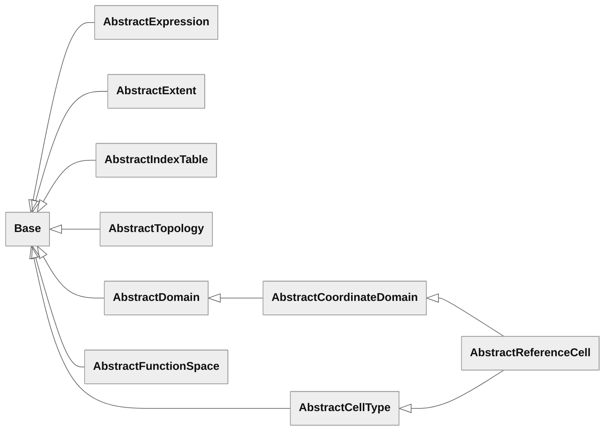

# Reference

## Appendix: Node-class rationale

This table explains why each concrete expression node is needed. The rules
are in the class sections.

| Node class                                       | Why a node class                                                                                              |
| ------------------------------------------------ | ------------------------------------------------------------------------------------------------------------- |
| `Integer`, `Float`                                | A number written down is a terminal |
| `Complex`                                        | A scalar complex constant retains its two real literals without arithmetic construction |
| `Zero`                                           | A zero carries its shape, free indices, argument spaces and scalar type without edges to other expressions                              |
| `Sum`, `Product` | Retain addition and scalar multiplication at their original value shape |
| `Power`, `Absolute` | Primitive scalar operations |
| `Conjugate`                                      | An operation of the scalar field, and `Form` meets `conjugate(v)` of a function of any value shape as written |
| `RealPart`                                       | `(f + conjugate(f)) / Integer(2)` has the value of the real part but is complex, and the real part is real    |
| `ImaginaryPart`                                  | `real_part(Complex(Integer(0), Integer(1)) * conjugate(f))` multiplies the real part by zero, which is NaN for an infinite real part |
| `Division`                                       | Preserves the written quotient rather than replacing it with multiplication by a reciprocal |
| `SquareRoot`                                     | IEEE 754 rounds the square root correctly and the power not, so `power(f, Integer(1) / Integer(2))` differs   |
| `Logarithm`                                      | An elementary function, which nothing else composes                                                           |
| `Inverse`, `Determinant`                         | The compiler chooses the numerical algorithm; construction retains the operation |
| `BroadcastTo` | Repeats values over explicit axes, including symbolic and empty shapes, without artificial arithmetic |
| `Tensor`, `Indexed`, `ComponentTensor`, `IndexSum` | The primitives of index notation                                                                            |
| `Coordinate`, `Function`, `Normal`               | Terminals: the coordinate function of a domain, a member of a space, the unit side conormal |
| `Gradient`                                       | Nothing composes to differentiate                                                                             |
| `Divergence`, `Curl` | Retain the operators so lowering can apply Piola identities before expanding them into gradients |
| `DirectionalDerivative`                          | Nothing composes to differentiate with respect to an expression                                               |
| `Integral`                                       | Nothing composes to integrate over a coordinate domain, and over a mesh a pass must meet the integral as written |
| `PullBack`                                       | Nothing composes to move an expression between domains                                                        |
| `PushForward` | Represents a topology field on a mesh and retains its transformation law for cellwise lowering and Piola identities |
| `Form`, `Apply`                                 | Binding arguments and fully applying a map are not compositions                                |

## Appendix: Class hierarchy

Every object extends `Base`. The diagram shows the abstract bases; the lists
below give concrete classes and their parents. Arrows point to parents.

<!-- generated: class-hierarchy, run design/appendices.py to update -->

### Expressions and static type

Extend `Base`:

[`Index`](expressions.md#index).

### Numbers and scalar operations

Extend `AbstractExpression`:

[`Integer`](expressions.md#literals), [`Float`](expressions.md#literals), [`Complex`](expressions.md#complex), [`Zero`](expressions.md#zero), [`Sum`](expressions.md#sum), [`Product`](expressions.md#product), [`Power`](expressions.md#power), [`Division`](expressions.md#division), [`Absolute`](expressions.md#absolute), [`Conjugate`](expressions.md#conjugate), [`RealPart`](expressions.md#realpart-and-imaginarypart), [`ImaginaryPart`](expressions.md#realpart-and-imaginarypart), [`SquareRoot`](expressions.md#elementary-functions), [`Logarithm`](expressions.md#elementary-functions).

### Tensors and indexing

Extend `AbstractExpression`:

[`Tensor`](expressions.md#tensor), [`BroadcastTo`](expressions.md#broadcastto), [`Indexed`](expressions.md#indexed), [`ComponentTensor`](expressions.md#componenttensor-and-indexsum), [`IndexSum`](expressions.md#componenttensor-and-indexsum).

Extend `Base`:

[`GatheredIndex`](expressions.md#gatheredindex).

### Tensor operations

Extend `AbstractExpression`:

[`Inverse`](expressions.md#inverse), [`Determinant`](expressions.md#determinant).

### Domains

Extend `AbstractCoordinateDomain`:

[`EuclideanSpace`](topology.md#euclideanspace).

### Reference cells

Extend `Base`:

[`CellMap`](topology.md#cellmap).

### Restriction

Extend `Base`:

[`SideMap`](topology.md#sidemap).

### Meshes

Extend `AbstractDomain`:

[`Mesh`](geometry.md#mesh).

### Calculus on a domain

Extend `AbstractExpression`:

[`Coordinate`](geometry.md#coordinate), [`Gradient`](geometry.md#gradient), [`Divergence`](geometry.md#divergence-and-curl), [`Curl`](geometry.md#divergence-and-curl), [`DirectionalDerivative`](geometry.md#directionalderivative), [`Integral`](geometry.md#integral).

### Maps between domains

Extend `Base`:

[`DomainMap`](geometry.md#domainmap).

Extend `AbstractExpression`:

[`PullBack`](geometry.md#pullback).

### Fields on a mesh

Extend `Base`:

[`TransformationLaw`](geometry.md#transformationlaw).

Extend `AbstractExpression`:

[`PushForward`](geometry.md#pushforward), [`Normal`](geometry.md#normal).

### Function spaces

Extend `AbstractExpression`:

[`Function`](forms.md#function).

### Variational forms

Extend `AbstractFunctionSpace`:

[`ConjugateSpace`](forms.md#conjugatespace), [`DualSpace`](forms.md#dualspace).

Extend `AbstractExpression`:

[`Form`](forms.md#form), [`Apply`](forms.md#apply).
<!-- end generated: class-hierarchy -->

## Appendix: Free functions

<!-- generated: free-functions, run design/appendices.py to update -->
### Expressions and static type

| Function                               | Overload | Takes                 | Returns |
| -------------------------------------- | -------- | --------------------- | ------- |
| [`index(label)`](expressions.md#index) |          | `label: str \| tuple` | `Index` |

### Numbers and scalar operations

| Function                                                             | Overload         | Takes                                | Returns                          |
| -------------------------------------------------------------------- | ---------------- | ------------------------------------ | -------------------------------- |
| [`power(base, exponent)`](expressions.md#power)                      | `**`             | `base, exponent: AbstractExpression` | `Power`                          |
| [`negate(operand)`](expressions.md#negation-and-subtraction)         | `-operand`       | `operand: AbstractExpression`        | `multiply(Integer(-1), operand)` |
| [`subtract(first, second)`](expressions.md#negation-and-subtraction) | `first - second` | `first, second: AbstractExpression`  | `add(first, negate(second))`     |
| [`absolute(operand)`](expressions.md#absolute)                       | `abs(operand)`   | `operand: AbstractExpression`        | `Absolute`                       |
| [`conjugate(operand)`](expressions.md#conjugate)                     |                  | `operand: AbstractExpression`        | `Conjugate`                      |
| [`square_root(operand)`](expressions.md#elementary-functions)        |                  | `operand: AbstractExpression`        | `SquareRoot`                     |
| [`logarithm(operand)`](expressions.md#elementary-functions)          |                  | `operand: AbstractExpression`        | `Logarithm`                      |

### Tensors and indexing

| Function                                                                               | Overload | Takes                                                                         | Returns                                                                                                                                                                                             |
| -------------------------------------------------------------------------------------- | -------- | ----------------------------------------------------------------------------- | --------------------------------------------------------------------------------------------------------------------------------------------------------------------------------------------------- |
| [`tensor(entries)`](expressions.md#tensor)                                             |          | `entries: tuple[AbstractExpression, ...]`                                     | `Tensor`                                                                                                                                                                                            |
| [`broadcast_to(value, value_shape)`](expressions.md#broadcastto)                       |          | `value: AbstractExpression`, `value_shape: tuple[int \| AbstractExtent, ...]` | `BroadcastTo`                                                                                                                                                                                       |
| [`indexed(expression, indices)`](expressions.md#indexed)                               |          | `expression: AbstractExpression`, `indices: tuple`                            | `Indexed`                                                                                                                                                                                           |
| [`component(expression, entries)`](expressions.md#partial-indexing)                    | `[]`     | `expression: AbstractExpression`, `entries: tuple`                            | `expression` if `entries == ()`; otherwise `component_tensor(indexed(expression, entries + K), K)` if the entries are fewer than the rank of `expression`, otherwise `indexed(expression, entries)` |
| [`component_tensor(expression, indices)`](expressions.md#componenttensor-and-indexsum) |          | `expression: AbstractExpression`, `indices: tuple[Index, ...]`                | `ComponentTensor`                                                                                                                                                                                   |
| [`index_sum(expression, indices)`](expressions.md#componenttensor-and-indexsum)        |          | `expression: AbstractExpression`, `indices: tuple[Index, ...]`                | `IndexSum`                                                                                                                                                                                          |
| [`gathered_index(table, indices)`](expressions.md#gatheredindex)                       |          | `table: AbstractIndexTable`, `indices: tuple`                                 | `GatheredIndex`                                                                                                                                                                                     |

### Tensor operations

| Function                                                             | Overload | Takes                                        | Returns                                                                               |
| -------------------------------------------------------------------- | -------- | -------------------------------------------- | ------------------------------------------------------------------------------------- |
| [`add(first, second)`](expressions.md#tensor-arithmetic)             | `+`      | `first, second: AbstractExpression`          | `Sum(first, second)`                                                                  |
| [`multiply(first, second)`](expressions.md#tensor-arithmetic)        | `*`      | `first, second: AbstractExpression`          | `Product(first, second)`                                                              |
| [`divide(numerator, denominator)`](expressions.md#tensor-arithmetic) | `/`      | `numerator, denominator: AbstractExpression` | `Division(numerator, denominator)`                                                    |
| [`real_part(operand)`](expressions.md#tensor-arithmetic)             |          | `operand: AbstractExpression`                | `component_tensor(RealPart(operand[K]), K)`                                           |
| [`imaginary_part(operand)`](expressions.md#tensor-arithmetic)        |          | `operand: AbstractExpression`                | `component_tensor(ImaginaryPart(operand[K]), K)`                                      |
| [`matrix_product(first, second)`](expressions.md#tensor-arithmetic)  | `@`      | `first, second: AbstractExpression`          | The contraction of the last axis of `first` with the first axis of `second`, below    |
| [`transpose(matrix)`](expressions.md#tensor-arithmetic)              |          | `matrix: AbstractExpression`                 | `component_tensor(matrix[k, l], (l, k))`, with `(k, l)` = `K`, for `matrix` of rank 2 |
| [`inverse(matrix)`](expressions.md#inverse)                          |          | `matrix: AbstractExpression`                 | `Inverse`                                                                             |
| [`determinant(matrix)`](expressions.md#determinant)                  |          | `matrix: AbstractExpression`                 | `Determinant`                                                                         |

### Reference cells

| Function                                             | Overload | Takes                                                | Returns                      |
| ---------------------------------------------------- | -------- | ---------------------------------------------------- | ---------------------------- |
| [`cell_map(parent, cell_slot)`](topology.md#cellmap) |          | `parent: AbstractTopology \| Mesh`, `cell_slot: int` | `CellMap(parent, cell_slot)` |

### Restriction

| Function                                                            | Overload | Takes                                                               | Returns                                     |
| ------------------------------------------------------------------- | -------- | ------------------------------------------------------------------- | ------------------------------------------- |
| [`side_map(parent, restriction_domain, side)`](topology.md#sidemap) |          | `parent, restriction_domain: AbstractTopology \| Mesh`, `side: str` | `SideMap(parent, restriction_domain, side)` |

### Meshes

| Function                                                        | Overload | Takes                                                                                 | Returns |
| --------------------------------------------------------------- | -------- | ------------------------------------------------------------------------------------- | ------- |
| [`mesh(coordinate_function, ambient_domain)`](geometry.md#mesh) |          | `coordinate_function: AbstractExpression`, `ambient_domain: AbstractCoordinateDomain` | `Mesh`  |

### Calculus on a domain

| Function                                                                                              | Overload | Takes                                                                                                            | Returns                                                         |
| ----------------------------------------------------------------------------------------------------- | -------- | ---------------------------------------------------------------------------------------------------------------- | --------------------------------------------------------------- |
| [`coordinate(domain)`](geometry.md#coordinate)                                                        |          | `domain: AbstractDomain`                                                                                         | `Coordinate`                                                    |
| [`gradient(expression, domain)`](geometry.md#gradient)                                                |          | `expression: AbstractExpression`, `domain: AbstractDomain`                                                       | `Gradient`                                                      |
| [`divergence(expression, domain)`](geometry.md#divergence-and-curl)                                   |          | `expression: AbstractExpression`, `domain: AbstractDomain`                                                       | `Divergence`                                                    |
| [`curl(expression, domain)`](geometry.md#divergence-and-curl)                                         |          | `expression: AbstractExpression`, `domain: AbstractDomain`                                                       | `Curl`                                                          |
| [`directional_derivative(expression, variable, point, direction)`](geometry.md#directionalderivative) |          | `expression: AbstractExpression`, `variable: Function \| tuple`, `point, direction: AbstractExpression \| tuple` | `DirectionalDerivative(expression, variable, point, direction)` |
| [`integral(expression, integration_domain)`](geometry.md#integral)                                    |          | `expression: AbstractExpression`, `integration_domain: AbstractDomain`                                           | `Integral`                                                      |

### Maps between domains

| Function                                                                                  | Overload | Takes                                                                                                                                                | Returns                                                                                                                            |
| ----------------------------------------------------------------------------------------- | -------- | ---------------------------------------------------------------------------------------------------------------------------------------------------- | ---------------------------------------------------------------------------------------------------------------------------------- |
| [`domain_map(parameter_domain, parameterisation, ambient_domain)`](geometry.md#domainmap) |          | `parameter_domain: AbstractCoordinateDomain \| AbstractTopology`, `parameterisation: AbstractExpression`, `ambient_domain: AbstractCoordinateDomain` | `DomainMap`                                                                                                                        |
| [`pull_back(expression, map)`](geometry.md#pullback)                                      |          | `expression: AbstractExpression`, `map: DomainMap \| SideMap \| CellMap`                                                                             | `PullBack`                                                                                                                         |
| [`jacobian(map)`](geometry.md#jacobian-and-density)                                       |          | `map: DomainMap \| CellMap`                                                                                                                          | `gradient(map.parameterisation, P)`, where `P` is `map.parameter_domain` for a `DomainMap` or `map.reference_cell` for a `CellMap` |
| [`inverse_jacobian(map)`](geometry.md#jacobian-and-density)                               |          | `map: DomainMap \| CellMap`                                                                                                                          | `inverse(jacobian(map))`                                                                                                           |
| [`density(map)`](geometry.md#jacobian-and-density)                                        |          | `map: DomainMap \| CellMap`                                                                                                                          | The density $\rho$ below                                                                                                           |

### Fields on a mesh

| Function                                                                      | Overload | Takes                                                                         | Returns                                                                                                                     |
| ----------------------------------------------------------------------------- | -------- | ----------------------------------------------------------------------------- | --------------------------------------------------------------------------------------------------------------------------- |
| [`transformation_law(variances, weight)`](geometry.md#transformationlaw)      |          | `variances: tuple[Literal["covariant", "contravariant"], ...]`, `weight: int` | `TransformationLaw`                                                                                                         |
| [`push_forward(expression, mesh, law)`](geometry.md#pushforward)              |          | `expression: AbstractExpression`, `mesh: Mesh`, `law: TransformationLaw`      | `PushForward(expression, mesh, law)`                                                                                        |
| [`side_domain(parent, restriction_topology, side)`](geometry.md#side-domains) |          | `parent: Mesh`, `restriction_topology: AbstractTopology`, `side: str`         | `mesh(pull_back(parent.coordinate_function, side_map(parent.topology, restriction_topology, side)), parent.ambient_domain)` |
| [`normal(side_map)`](geometry.md#normal)                                      |          | `side_map: SideMap`                                                           | `Normal`                                                                                                                    |

### Function spaces

| Function                                      | Overload | Takes                                                 | Returns    |
| --------------------------------------------- | -------- | ----------------------------------------------------- | ---------- |
| [`function(space, label)`](forms.md#function) |          | `space: AbstractFunctionSpace`, `label: str \| tuple` | `Function` |

### Variational forms

| Function                                                 | Overload | Takes                                                                                                                 | Returns                                                                                                 |
| -------------------------------------------------------- | -------- | --------------------------------------------------------------------------------------------------------------------- | ------------------------------------------------------------------------------------------------------- |
| [`conjugate_space(space)`](forms.md#conjugatespace)      |          | `space: AbstractFunctionSpace`                                                                                        | `space` for a real `space`, `space.space` for a `ConjugateSpace`, and `ConjugateSpace(space)` otherwise |
| [`dual_space(space)`](forms.md#dualspace)                |          | `space: AbstractFunctionSpace \| tuple[AbstractFunctionSpace, ...]`                                                   | `space.space` for a `DualSpace`, otherwise `DualSpace(space)`                                           |
| [`form(expression, arguments)`](forms.md#form)           |          | `expression: AbstractExpression`, `arguments: tuple[Function \| Conjugate \| tuple[Function \| Conjugate, ...], ...]` | `Form`                                                                                                  |
| [`apply(form, arguments)`](forms.md#apply)               |          | `form: AbstractExpression`, `arguments: tuple[AbstractExpression \| tuple[AbstractExpression, ...], ...]`             | `form` for `apply(form, ())` when `form.argument_spaces == ()`, otherwise `Apply(form, arguments)`      |
| [`partial(form, mapping)`](forms.md#partial-application) |          | `form: Form`, `mapping: dict`                                                                                         | The form with selected outer entries supplied, or its body when none remain                             |
| [`rebind(binder, mapping)`](forms.md#rebinding)          |          | `binder: Form \| ComponentTensor \| IndexSum`, `mapping: dict`                                                        | The binder with selected declarations renamed                                                           |

### Pass recipes

| Function                                                            | Overload | Takes                   | Returns                                                  |
| ------------------------------------------------------------------- | -------- | ----------------------- | -------------------------------------------------------- |
| [`expand_arithmetic(f)`](evaluation.md#expanding-tensor-arithmetic) |          | `f: AbstractExpression` | An equivalent expression with tensor arithmetic expanded |

### Standard lowering recipe

| Function                                             | Overload | Takes                   | Returns                                      |
| ---------------------------------------------------- | -------- | ----------------------- | -------------------------------------------- |
| [`lower(f)`](evaluation.md#standard-lowering-recipe) |          | `f: AbstractExpression` | An equivalent expression in core normal form |
<!-- end generated: free-functions -->

## Appendix: Static type table

This normative table gives the argument spaces of each node class. An operand
not named in the argument spaces column must have the argument spaces `()`,
except binders and functional values accepted by `Form`, `Apply` and the
derivatives. Their signatures are checked by the respective class contracts
and are not added to the enclosing expression's argument spaces.

| Class                                    | Argument spaces of the node                                    |
| ---------------------------------------- | -------------------------------------------------------------- |
| `Integer`, `Float`                        | `()` |
| `Complex`                                | Those of the parts, which must be equal |
| `Zero`                                   | The stored argument spaces                                     |
| `Sum`                                    | Those of the operands, which must be equal                     |
| `Product`                                | Those of the operands, concatenated                            |
| `Power`, `Absolute`                      | `()`                                                           |
| `RealPart`, `ImaginaryPart`              | `()`                                                           |
| `Division`                               | Those of the first operand                                     |
| `Conjugate`                              | Those of the operand, each conjugated                          |
| `SquareRoot`, `Logarithm`, `Inverse`, `Determinant` | `()`                                                           |
| `Tensor`                                 | Those of the entries, which must be equal                      |
| `BroadcastTo` | Those of the value |
| `Indexed`, `ComponentTensor`, `IndexSum` | Those of the expression                                        |
| `Coordinate`                             | `()`                                                           |
| `Normal`                                 | `()`                                                           |
| `Function`                               | Those of the space                                             |
| `Form`                                   | Those of the expression, followed by the space of each entry, conjugated for a `conjugate(v)` entry |
| `Apply`                                 | `()`              |
| `Gradient`, `Divergence`, `Curl`         | Those of the operand                                           |
| `PushForward`                            | Those of the expression                                        |
| `DirectionalDerivative`                  | Those of the expression                                        |
| `Integral`                               | Those of the integrand                                         |
| `PullBack`                               | Those of the expression                                        |

The value shape and the free indices of each node class are in the section
of the class. The domain and the scalar type of the node classes that differ
from the default rules of [Domain](expressions.md#domain) and [Scalar type](expressions.md#scalar-type):

| Class                    | Domain of the node                | Scalar type of the node           |
| ------------------------ | ---------------------------------- | --------------------------------- |
| `Complex`          | None                               | Complex                           |
| `Zero`                   | None                               | The stored scalar type            |
| `Absolute`               | The domain of the operand         | Real                              |
| `RealPart`, `ImaginaryPart` | The domain of the operand      | Real                              |
| `Coordinate`             | The domain $P$                     | Real                              |
| `Gradient`, `Divergence`, `Curl` | The domain $P$               | The scalar type of the expression |
| `DirectionalDerivative`  | The domain of $f$                 | The scalar type of $f$            |
| `Integral`               | None                               | The scalar type of the integrand  |
| `PullBack`               | The parameter domain of the map | The scalar type of the expression |
| `Normal`                 | $E$                                | Real                              |
| `Function`               | The domain of the space, or none   | The scalar type of the space      |
| `PushForward`            | The mesh $D$                       | The scalar type of the expression |
| `Form`                   | The domain of the expression      | The scalar type of the expression |
| `Apply`                 | The domain of the form            | The scalar type of the form       |

## Appendix: Summary

Counts of the core, from the sections.

<!-- generated: summary, run design/appendices.py to update -->
| Quantity                        | Count |
| ------------------------------- | ----- |
| Classes                         | 53    |
| Abstract classes                | 10    |
| Concrete classes                | 43    |
| Expression node classes         | 33    |
| Free functions                  | 51    |
| Free functions with an overload | 9     |
<!-- end generated: summary -->
